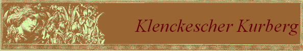
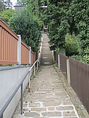
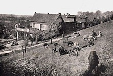

* * *

* * *

* * *

* * *

* * *

* * *

_Barfußweg_

Der “Klenckesche Kurberg”, auch als Kurberg Wachwitz bezeichnet, entstand
1896 als erste Kuranstalt des Ortes. In diesem Jahr beantragte der Arzt und Besitzer einer Klinik für reformierte Medizin in Dresden, Julius Hermann Klencke,
die Erweiterung seines “hygienischen Pensionates” auf  dem früheren Wachwitzer Plantagengut. Zur Kuranstalt gehörte neben dem Hauptgebäude ein ca. 100.000 m²
großes Grundstück, auf dem mehrere “Lufthütten” für die geplanten Licht- und Luftbäder entstanden. Im  Angebot der Anstalt waren Diät- und Erholungskuren,
die an die Ideen des von Kneipp inspirierten Gründers anknüpften und Teil der damals modernen “ganzheitlichen Behandlung” waren. Zu den ersten Gästen
gehörte der junge Bildhauer Ernst Barlach, der die Wände im Obergeschoss mit Malereien verschönerte.

1904 verstarb Hermann Klencke. Dessen Erben gaben die Kuranstalt kurze Zeit später auf. Die neuen Besitzer richteten
hier eine Ziegenwirtschaft ein, für die der frühere Speisesaal zum Stall umgebaut wurde. Ziegenmilch und -käse waren die
hauptsächlichen Produkte der Wirtschaft, die jedoch bereits vor dem Ersten Weltkrieg geschlossen wurde. Die Gebäude wurden kurz darauf abgebrochen und im früheren Kurberg ein neues Wohnhaus errichtet ( [Wachwitzer Bergstraße 5](../../../../nordost/wachwitz/strassen_wachwitz/)). An
Stelle des einstigen Speisesaals steht heute das zugehörige Tor- bzw. Chauffeurhaus (Nr. 7). An Klenckes Kurberg erinnert bis heute noch der Barfußweg, der von den Kurgästen als Laufstrecke genutzt wurde. .

* * *

 \[ [Home](../../../../index.html)\] \[ [Nord](../../../../nord/)\] \[ [Nordwest](../../../../nordwest/)\] \[ [Neustadt](../../../../neustadt/)\] \[ [Nordost](../../../../nordost/)\] \[ [West](../../../../west/)\] \[ [Zentrum](../../../../zentrum/)\] \[ [Südwest](../../../../sudwest/)\] \[ [Süd](../../../../sud/)\] \[ [Südost](../../../../sudost/)\] \[ [Ost](../../../../ost/)\] \[ [Register](../../../../Register/register.html)\] \[ [Kontakt](../../../../Kontakt/kontakt.html)\] \[ [Impressum](../../../../impressum/)\]
