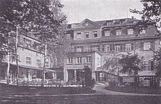
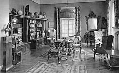
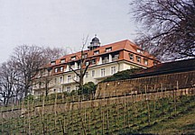

* * *

Das Sanatorium Weidner in Wachwitz wurde 1916 vom Loschwitzer Arzt Dr.
Eugen Weidner (1861-1926) gegründet. Weidner hatte zuvor als Arzt am [Lahmann-Sanatorium](../../../../nordost/page10246/strassen_weisser_hirsch/lahmann-sanatorium/) gearbeitet und war durch seine Heirat zu einem
beträchtlichen Vermögen gekommen. Auf dem Gelände des früheren Landhauses Reischel in Oberwachwitz entstanden inmitten eines kleinen Kiefernwäldchens zwischen 1914 und 1916 drei Sanatoriumsgebäude, die mit
Wandelgängen verbunden wurden. Architekten des schlossartigen Gebäudekomplexes waren Carlo Sattler und W. Schnitzler. Im Haupthaus _(Foto)_ befanden sich die Gesellschaftsräume mit Bibliothek _(Foto)_,
Musiksaal, Billard- und Radiozimmer. Das Kurmittelhaus beherbergte hingegen die Behandlungsräume mit den Badekabinen, mehrere Gymnastiksäle sowie eine Sonnenterrasse auf dem Dach. Hinzu kamen Herren- und
Damen-Luftbäder, überdachte Räume für Freiübungen sowie Kegelbahn und ein hauseigener Tennisplatz.

Die Kurklinik gehörte mit anfänglich 63 komfortablen Gästezimmern zu den
größten und modernsten in Dresden und bot  “klinisch geleitete, diätisch-physikalische Heilkuren” an. Gäste des mit modernster Behandlungstechnik ausgestatteten exklusiven Sanatoriums waren neben
hochrangigen Adligen und Militärs u. a. die Schauspieler Magda Schneider, Grete Weiser, Willi Fritsch und Heinrich George, der Komponist Paul Lincke und der Dichter Stephan Hermlin. Gern weilte auch der Schriftsteller
Gerhard Hauptmann in Wachwitz. 1945 musste er hier den Luftangriff auf Dresden miterleben, was ihn zu seinem anklagenden [Artikel](../../../../nordost/wachwitz/strassen_wachwitz/weidners_sanatorium/dresden_1945/) “Wer das
Weinen verlernt hat, erlernt es wieder beim Untergang Dresdens...” veranlasste. Das Sanatorium wurde zu diesem Zeitpunkt bereits von Weidners Nachfolgern geleitet, da der Gründer 1926 verstorben war.

1945 wurde das Weidnersche Sanatorium geschlossen und in ein sowjetisches
Armeelazarett umgewandelt. 1951 übernahm die “Kasernierte Volkspolizei” die Gebäude als Tuberkulose-Heilstätte. 1956 trat die NVA deren Nachfolge an, die
das frühere Sanatorium bis 1990 als Militärkrankenhaus nutzte. Bis 1991 wurde dieses Lazarett noch durch die Bundeswehr bewirtschaftet. Im gleichen Jahr übernahm die private HUMAINE-Gesellschaft für Klinikmanagement aus
München das Areal und richtete hier die einzige onkologische Fachklinik im Dresdner Raum ein. In den Folgejahren erfolgten umfassende Sanierungs- und Modernisierungsarbeiten. Seit 2006 gehörte diese als Helios-Klinik
Dresden-Wachwitz zum Fresenius-Konzern. 2010 wurde sie durch das Städtische [Krankenhaus Friedrichstadt](../../../../zentrum/friedrichstadt/strassen_friedrichstadt/friedrichstrasse/marcolinipalais/krankenhaus_friedrichstadt/)
übernommen und in die Friedrichstadt verlegt. Künftig ist der Umbau der unter Denkmalschutz stehenden Gebäude zu Eigentumswohnungen geplant. Außerdem werden auf dem Areal zwei moderne Mehrfamilienhäuser errichtet.

* * *

 \[ [Home](../../../../index.html)\] \[ [Nord](../../../../nord/)\] \[ [Nordwest](../../../../nordwest/)\] \[ [Neustadt](../../../../neustadt/)\] \[ [Nordost](../../../../nordost/)\] \[ [West](../../../../west/)\] \[ [Zentrum](../../../../zentrum/)\] \[ [Südwest](../../../../sudwest/)\] \[ [Süd](../../../../sud/)\] \[ [Südost](../../../../sudost/)\] \[ [Ost](../../../../ost/)\] \[ [Register](../../../../Register/register.html)\] \[ [Kontakt](../../../../Kontakt/kontakt.html)\] \[ [Impressum](../../../../impressum/)\]
