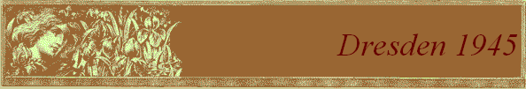

* * *

* * *

* * *

* * *

* * *

* * *

**Gerhart Hauptmann**(1862-1946)

Gerhard Hauptmann besuchte Anfang Februar 1945 letztmalig Dresden und kam hier am 5. Februar an. Gemeinsam mit seiner Frau Margarete bewohnten sie ein Gartenhaus auf dem Gelände des [Sanatoriums Weidner](../../../../../nordost/wachwitz/strassen_wachwitz/weidners_sanatorium/) im Stadtteil Wachwitz. Von der Terrasse des Sanatoriums erlebte er am 13./14. Februar 1945 den Luftangriff und die Zerstörung der Stadt. Wenige Tage später reiste er, innerlich schwer getroffen, in seinen Wohnort Agnetendorf im Riesengebirge zurück.

Hier besuchten ihn zwei Mitarbeiter der NSDAP-Gauleitung und baten ihn um eine Stellungnahme zur Zerstörung Dresdens. Unter Verwendung einiger bereits zuvor gemachter Notizen schrieb Gerhard Hauptmann
den weltberühmt gewordenen Artikel “Wer das Weinen verlernt hat...”, welcher im Anschluss unter dem Titel “Die Untat von Dresden” im Rundfunk gesendet und in zahlreichen Zeitungen abgedruckt wurde:

_Wer das Weinen verlernt hat, der lernt es wieder beim Untergang Dresdens. Dieser heitere Morgenstern_

_der Jugend hat bisher der Welt geleuchtet. Ich weiß, daß in England und Amerika gute Geister_
_genug vorhanden sind, denen das göttliche Licht der Sixtinischen Madonna nicht fremd war und die von dem Erlöschen dieses Sternes allertiefst getroffen weinen. Und ich habe den Untergang Dresdens unter den_

_Sodom- und Gomorrha-Höllen der englischen und amerikanischen Flugzeuge persönlich erlebt._

_Wenn ich das Wort “erlebt” einfüge, so ist mir das noch wie ein Wunder. Ich nehme mich nicht wichtig genug, um zu glauben,_
_das Fatum habe mir dieses Entsetzen gerade an dieser Stelle in dem fast liebsten Teil_

_meiner Welt ausdrücklich vorbehalten._

_Ich stehe an Ausgangstor meines Lebens und beneide alle meine toten Geisteskameraden,_

_denen dieses Erlebnis erspart geblieben ist._

_Ich weine. Man stoße sich nicht an das Wort “Weinen”: die größten Helden des Altertums, darunter_

_Perikles und andere haben sich seiner nicht geschämt. Von Dresden aus, von seiner köstlich-gleichmäßigen Kunstpflege_
_sind herrliche Ströme durch die Welt geflossen, und auch England und Amerika haben_

_durstig davon getrunken. Haben Sie das vergessen?_

_Ich bin nahezu dreiundachzig Jahre alt und stehe mit meinem_
_Vermächtnis vor Gott, das leider machtlos ist und nur aus dem Herzen kommt: es ist die Bitte, Gott möge die Menschen mehr lieben, läutern und_

_klären zu ihrem Heil als bisher.”_

* * *

 \[ [Home](../../../../../index.html)\] \[ [Nord](../../../../../nord/)\] \[ [Nordwest](../../../../../nordwest/)\] \[ [Neustadt](../../../../../neustadt/)\]
 \[ [Nordost](../../../../../nordost/)\] \[ [West](../../../../../west/)\] \[ [Zentrum](../../../../../zentrum/)\] \[ [Südwest](../../../../../sudwest/)\]
 \[ [Süd](../../../../../sud/)\] \[ [Südost](../../../../../sudost/)\] \[ [Ost](../../../../../ost/)\] \[ [Register](../../../../../Register/register.html)\] \[ [Kontakt](../../../../../Kontakt/kontakt.html)\] \[ [Impressum](../../../../../impressum/)\]
