* * *

_“Es verkauft der Königlich-sächsische Hof- und Justiz-Rath Herr Ludwig Friedrich Ferdinand von Zedtwitz sein in Wachwitzer Flur gelegenes Weinberg-_
_grundstück und zwar I. den zwischen dem Gebhardtschen und Brücknerschen Grund- stücken gelegenen Wein- berg mit sämtlichen Gebäuden, Busch und Wiesen...;_

_II. den zwischen I. und der_
_Gerichtsherrschaft zu Wachwitz gelegenen Weinberg, beide Grund- stücke mit allen Ein- und Zubehörungen und was darinnen und dabei Erd-, Wand- Band- Mauer- Klammer- Nagel- und Wurzelfest ist,_
_ferner mit der dazugehörigen Wein- presse und allen und jeden Weinbergs- gerätschaften”._

_**Aus dem “Kauf-Contrackt”  vom 26. August 1824**_

* * *

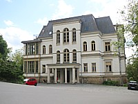Die Geschichte des Königlichen Weinbergs in Wachwitz begann 1824, als Prinz
Friedrich August (später König Friedrich August II.) für 11.000 Taler drei Weinberge im Ort kaufte. 1825 folgte ein weiteres Grundstück, bevor 1827 das komplette
Rittergut Niederpoyritz mit Wachwitz vom russischen Major Alexejew von Olsusieff erworben werden konnte. Friedrich August kaufte in den Folgejahren noch weitere
Grundstücke hinzu, so dass ein fast 40 Hektar großes zusammen hängendes Areal entstand. Auf dem Grundstück standen zu diesem Zeitpunkt nur einige wenige
Gebäude, darunter die alte Wachwitzer Weinpresse und ein Winzerhaus, welches der Wettiner zu einem kleinen Palais umbauen ließ. Oberhalb wurde auf einem Felsen inmitten der Weinberge eine kleine Kapelle errichtet _(Foto)_. Um seinen Besitz besser erreichen zu können, ließ der Prinz 1840 zwischen Niederpoyritz und dem königlichen Weinberg einen Weg anlegen, der später Königsweg genannt, nach 1877 jedoch kaum noch genutzt wurde.

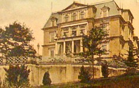
Friedrich August hielt sich nur gelegentlich in Wachwitz auf. Die Verwaltung des Grundstücks wurde deshalb einem Gärtner übertragen, der ausdrücklich auch
Fremden den Besuch des Königlichen Weinbergs erlauben sollte, sofern der König nicht anwesend war. Den Gärtnern und dem übrigen Personal oblag auch
die Pflege des Anwesens, welches mit verschiedenen alpinen Pflanzen gestaltet wurde. Außerdem errichtete man Gewächshäuser, Pferdeställe und einige
Nebengebäude. Im nördlichen Teil ließ Friedrich August einen kleinen Tiergarten mit Rot- und Damwild und Volieren für Raubvögel anlegen. Dieser Tierpark
wurde nach dem Tod des Königs 1854 aufgelöst. Neben einer Jagdhütte bestand auch ein kleines Fachwerkhäuschen, welches als “Vogelherd” der Vogelstellerei diente und erst in den Jahren nach dem
Zweiten Weltkrieg abgerissen wurde.

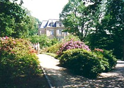
Wachwitz hatte sich seit dem Regierungsantritt Friedrich August II. 1836 zur Sommerresidenz der Wettiner entwickelt, die hier regelmäßig ihre Gäste empfingen.
Verbürgt sind Besuche König Otto I. von Griechenland und des russischen Zaren Nikolaus I. Nach dem der König 1854 bei einem Bergunfall in Tirol ums Leben gekommen war, wurde der Wachwitzer Weinberg in einen Fideikommiss
umgewandelt und blieb somit dauerhaft im Besitz der Wettiner. 1859 erlebte Wachwitz nochmals ein prächtiges Fest anlässlich des Besuches von Bayernkönig
Ludwig I. Da sich sowohl König Anton wie auch seine Nachfolger mehr für die Besitzungen in Pillnitz und Strehlen interessierten, geriet das Wachwitzer Palais ins
Abseits und wurde nur noch selten besucht. 1877 verstarb Königin Maria, Witwe Friedrich August II., in ihrem Wachwitzer Haus, welches sie als Witwensitz gewählt hatte.

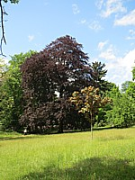Um 1890 wurde das alte Weinbergspalais abgerissen und durch eine größere Villa ersetzt. Diese
bezog 1894 der spätere letzte König Friedrich August III. und bewohnte sie bis zu seinem Regierungsantritt 1904 mit seiner Familie. Tochter Maria Alix kam in diesem Wachwitzer
Schlösschen zur Welt. Im November 1918 weilte Friedrich August III. letztmalig auf seinem Wachwitzer Besitz. Das Areal blieb jedoch auch später Eigentum der Familie. Aus Mitteln der
Fürstenabfindung ließ sich Markgraf Friedrich Christian 1935/36 ein zum Teil von ihm selbst entworfenes Schloss im Weinberg erbauen. Bis zur Enteigung 1945 traf er sich hier mit
verschiedenen Persönlichkeiten, unter ihnen befreundete Künstler und die Generäle Hans Oster und Friedrich Olbricht. Wegen der Verstrickung der Familie in das Hitlerattentat 1944 wurde
Prinz Maria Emanuel 1944 von der Gestapo in Wachwitz verhaftet, kam jedoch mangels Beweisen bald wieder frei.

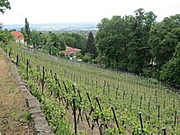1945 übernahm die sowjetische Militäradministration das Neue Schloss und nutzte es als Verwaltungsgebäude. Ab 1949 diente es als Bildungseinrichtung des Zentralrates der
FDJ. In die alte königliche Villa zog später ein Lehrerbildungsinstitut ein. 1984 gründete sich ein Freundeskreis, welcher gemeinsam mit der Weinbaugemeinschaft Wachwitz ab
1987 Teile der einstigen Weinberge wieder mit Weinreben bepflanzte. Nach 1990 entwickelte sich ein Rechtsstreit um den ehemaligen Wettinischen Besitz in Wachwitz,
welcher von der Familie zurückgefordert wurde. Nach Ablehnung aller Ansprüche erwarb 2007 eine Dresdner Immobilienfirma das Neue Schloss, um hier ihren Firmensitz
einzurichten, entschloss sich jedoch wenig später für einen Umbau zum Wohnhaus. Auch die frühere Königliche Villa dient heute Wohnzwecken.

Video: Prinzessin Maria Alix von Sachsen (geb. am 27 September 1901 in Wachwitz)

Einzelne Gebäude und Anlagen:

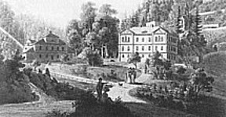Alte Königliche Villa: Das Gebäude, auch als “Palais” bezeichnet, war ältester Bau auf dem früheren königlichen Grundstück. 1824 hatte Prinz
Friedrich August zusammen mit dessen Weinberg das Landhaus des Adligen Ludwig Friedrich Ferdinand von Zedtlitz erworben und durch Anton Ludwig Blaßmann im italienischen Stil umbauen lassen. Im Inneren
befanden sich Speisesaal und Arbeitszimmer des Königs mit Bibliothek. Hinzu kamen der “Blaue Salon” im Erdgeschoss und Wohnräume für die  Bediensteten im Obergeschoss. Hier lag auch das Wohn- und
Schlafzimmer der Königin. 1890 wurde die Villa bis auf die Kellerräume abgerissen. Diese bilden heute das Fundament einer kleinen Aussichtsterrasse.

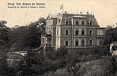Neue Königliche Villa: Die neue Villa wurde 1892/93 nach Plänen von Wilhelm
Teichgräber im Neorenaissancestil errichtet. 1894 konnte Kronprinz Friedrich August III. mit seiner Familie einziehen und nutzte das Gebäude bis zu seinem
Regierungsantritt 1904. Neben den Privaträumen wurde auch eine kleine Hauskapelle eingerichtet. Bis 1918 war diese Villa Sommerresidenz der Wettiner
und blieb auch danach bis 1945 in Familienbesitz. Zuletzt hatte hier die Sächsische Akademie für Weiterbildung der Lehrer und Erzieher ihr Domizil. 2009 erfolgte
eine umfassende Rekonstruktion und der Umbau zum Wohnhaus. Dabei konnten zahlreiche Details der früheren Innenraumgestaltung erhalten und restauriert werden. Heute befinden sich im Haus hochwertige Eigentumswohnungen.

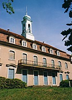Neues Schloss Wachwitz:
Aus Mitteln der Fürstenabfindung entstand das auch “Haus Wachwitz” genannte neue Schloss zwischen 1935 und 1936. Architekt war Max Hans Kühne
aus Dresden, der das Gebäude als Wohnsitz des Prinzen Friedrich Christian entwarf. Das Äußere orientierte sich an barocken Vorbildern, so dass das Haus auch einen kleinen
Dachreiter mit Uhr und Glocke nach dem Vorbild des Schlosses Hubertusburg erhielt. Auch im Inneren finden sich Anklänge an wichtige Bauten der sächsischen Geschichte wie das Palais Brühl und das Schloss Moritzburg.

Während im Erdgeschoss die Empfangs- und Gesellschaftsräume mit Speisesaal und Bibliothek lagen, stand das Obergeschoss den privaten Bedürfnissen zur Verfügung. Die Räume wurden
teilweise mit wertvollen historischen Möbeln und Gemälden ausgestattet. Auch dieses Schloss erhielt eine kleine Kapelle mit Familiengruft der Wettiner. Das Deckengemälde schuf Heinrich
Pickel, einige heute in der Hofkirche befindliche Bilder mit Kreuzwegdarstellungen der Italiener Stefano Torelli. Die Orgel
stammte von der Firma Jehmlich. In der unter der Kapelle gelegenen Gruft wurde im Januar 1945 als Einzige die im
Schloss Wachwitz verstorbene ehemalige kaiserliche Hofdame von Schwartzenfeldt beigesezt. Allerdings musste der Sarg
nach Kriegsende auf Weisung der sowjetischen Militärverwaltung auf den Loschwitzer Friedhof überführt werden.

Nach 1945 nutzte zunächst die Rote Armee, 1947 und 1949 ein “Intourist”-Hotel und danach der Zentralrat der FDJ das
Schloss als Schulungszentrum. Dabei erfolgten im Inneren einige Umbauten. Zwischen 1990 und 1993 diente es der
Medizinischen Akademie als Tagungsstätte und Gästehaus. Ab 1994 stand das Gebäude leer. Im Zusammenhang mit der
geplanten Einrichtung von Eigentumswohnungen erfolgte 2007 der Verkauf an eine private Unternehmensgruppe, welche das Schloss 2010/11 sanierte. Im Dezember 2012 wurde das Gebäude an die künftigen Bewohner übergeben.

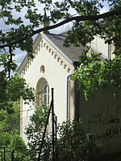Katholische Bergkapelle:
Die kleine Kapelle entstand bereits 1825 auf den Fundamenten eines früheren Weinberghäuschens oberhalb des Palais und ist über 106 Treppenstufen zu erreichen. Der neogotische Bau _(Foto)_
stammt von Karl Moritz Haenel, der die Kapelle 1839 nochmals erneuerte. Ein geplanter Neubau durch Gottfried Semper kam nie zustande. Leider gingen die
1844 und 1892 geschaffenen Glasfenster mit Szenen aus dem Neuen Testament 1945 verloren. Eines der Fenster soll sich ursprünglich im Palais des Grafen Brühl in Dresden befunden haben.

Geistlichenhaus: Das Gebäude entstand 1867 durch Umbau eines alten Winzerhauses und sollte als Unterkunft der Geistlichen aus dem Umfeld des Hofes dienen. Zuletzt bewohnte es der
Direktor des Mineralogisch-Geologischen Museums Karl Wanderer, bevor das Haus 1937 wegen Baufälligkeit abgerissen wurde.

Presshaus:
Das Presshaus des Weinbergs wurde schon um 1800 erbaut und nach Einstellung des Weinbaus um 1895 als
Stallgebäude genutzt. Über dem Eingang befindet sich ein Bildfries des Hofbildhauers Franz Pettrich, welches Kinder bei
Tätigkeiten rund um den Weinbau zeigt. 1936 und nach 1945 erfolgten Umbauten des Hauses zu Wohnzwecken. Im
Erdgeschoss gab es zeitweise auch einen Betsaal für katholische Gottesdienste. Heute dient das 2010 sanierte Gebäude als Wohnhaus.

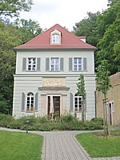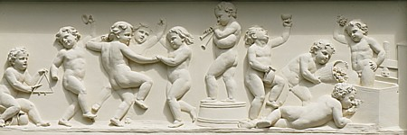

**_Fotos:_** _Das Presshaus des Wachwitzer Weinbergs mit dem Bilderfries von Franz Pettrich_

Küchenhaus:
Ursprünglich wurde dieses Haus als altes Gärtnerhaus bezeichnet, da hier der Hofgärtner wohnte. Beim Umbau 1825 erhielt auch dieses Gebäude an beiden Seitenflügeln Reliefs von Franz Pettrich mit Darstellungen aus dem
Landleben. Die linke Relieftafel zeigt einen Gärtner mit seinen typischen Arbeitsgeräten, die rechte eine Blumenbinderin. 1893 wurde das Haus im Zusammenhang mit dem Neubau der Königlichen Villa zum Küchenhaus umgebaut.

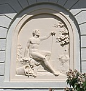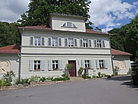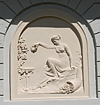

**_Fotos:_** _Das ehemalige alte Gärtner- oder Küchenhaus mit Relieftafeln Franz Pettrichs_

Wirtschaftsgebäude:
Dieses Haus wurde 1886 von Wilhelm Teichgräber an Stelle des alten Longoschen Wohnhauses erbaut. Der Vorgängerbau stammte von 1817 und wurde 1850 um ein Stallgebäude erweitert. Für den Neubau nutzte der
Architekt Keller und Fundamente des alten Wohnhauses. Bis 1918 hatte im Haus der Oberhofmeister seine Räume.

Reitstall:
Der unmittelbar an das Wirtschaftsgebäude anschließende Bau entstand um 1850 als Pferdestall, wurde später
jedoch als Stall für Kühe und Ziegen genutzt. Baumeister war Johann Gottlieb Ehlich aus Loschwitz. 1935 erhielt das Haus sein heutiges Aussehen.

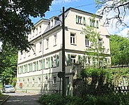Winzerhaus: An dieser Stelle stand bis 1889 das Näthersche Haus, ein um 1750
entstandenes zweigeschossiges Winzerhaus mit Weinpresse. Nach dessen Abriss wurde durch Eduard Beeger der noch heute bestehende Bau errichtet.

Marienhaus:
Dieses Gebäude wurde um 1810 erbaut. Nach Besitzerwechsel erfolgte in der Mitte des 19. Jahrhunderts ein Umbau zum Wohnhaus. Dabei entstand auch die
kleine Hauskapelle an der Rückseite. 1854 erwarb Friedrich August II. das Grundstück, welches 1887 baulich verändert wurde. Bis zur Fertigstellung der neuen Villa wohnte
Friedrich August III. mit seiner Frau Luise von Toscana in diesem Haus _(Foto)_.

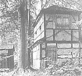Weitere Kleinbauten: Von den zahlreichen Kleinbauten des Königlichen Weinbergs sind heute
nur geringe Reste erhalten geblieben. Ursprünglich gab es mehrere Pavillons, Laubengänge mit Weinspalieren und Aussichtspunkte. Am Ende des sogenannten “Panoramaweges” befindet
sich bis heute ein kleines Rondell, in welches beim Abbruch 1907 geborgene Bauteile der alten Augustusbrücke eingefügt wurden. Weiter oben in den Bergen standen einst die
verschwundene “Efeulaube” und das “Berghäuschen”. Auch das frühere Vogelsteller- und Botanisierhäuschen _(Foto)_ wurde im Sommer 1945 bis auf die Fundamente beseitigt. Hier
hatte der naturkundlich interessierte König Friedrich August II. sein Studienzimmer. Später nutzte es Prinz Max als Vogelstellerhaus.

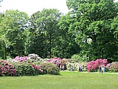Parkanlagen:
Bereits um 1830 ließ Friedrich August II. einen Teil seines Besitzes mit einer Mauer einfassen und als Tiergarten nutzen. Zugleich wurden hier wertvolle
Gehölze des als “Botaniker auf dem Königsthron” bekannten Wettiners angepflanzt. Maßgeblich beteiligt an der Gestaltung der Gartenanlagen war sein Hofgärtner
Terscheck. Nach dem Tod des Königs 1854 verfiel der Garten und wurde später mit Weinstöcken und Obstbäumen bepflanzt.

Nach dem Bau des Neuen Palais entstand erneut eine Parkanlage, in der zahlreiche
Plastiken ihren Platz fanden. So standen hier eine “Psyche” des Bildhauers Wolf von Hoyer, zwei Nymphenfiguren und weitere Figurengruppen mit Szenen aus der griechischen Mythologie. Leider ist nur die
Figur Hoyers erhalten geblieben (heute im Stadtmuseum), die anderen gingen nach 1945 verloren. Eine Plastik nach dem
Vorbild der antiken “Ildefonsogruppe” (heute im Prado bei Madrid) wurde bereits 1929 bei einem Unwetter zerstört.

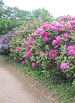Rhododendrongarten: 1970 legte der Gartenbauingenieur Karl Scholz in einem zuvor als
Gärtnerei genutzten Teil des Parks einen reizvollen Rhododendron-Lehr- und Schaugarten an. Unterstützt wurde er dabei von Werner Dänhardt vom [Institut für Gartenbau](../../../nordost/pillnitz/institut_fur_gartenbau/) in Pillnitz sowie
von Rudolf Schröder, dem späteren technischen Leiter des Botanischen Gartens. Die Pflanzten stammten von der Gärtnerei Seidel aus Grüngräbchen sowie aus dem tschechischen Pruhonice bei Prag.

Mit Unterstützung der Technischen Universität und des Kulturbundes der DDR konnte der kleine Park bereits 1972 eröffnet werden und ist heute zur Blütezeit beliebtes Ziel von
Besuchern. Mit über 1000 Sträuchern in über 200 verschiedenen Sorten gehört der Wachwitzer Rhododendrongarten zu den bedeutendsten seiner Art in Europa. Außerdem
finden sich einige seltene Gehölze, u.a. ein Amberbaum und ein Tulpenbaum sowie mehrere alte Platanen, Eichen und Buchen.

* * *

 \[ [Home](../../../index.html)\] \[ [Nord](../../../nord/)\] \[ [Nordwest](../../../nordwest/)\] \[ [Neustadt](../../../neustadt/)\] \[ [Nordost](../../../nordost/)\] \[ [West](../../../west/)\] \[ [Zentrum](../../../zentrum/)\] \[ [Südwest](../../../sudwest/)\] \[ [Süd](../../../sud/)\] \[ [Südost](../../../sudost/)\] \[ [Ost](../../../ost/)\] \[ [Register](../../../Register/register.html)\] \[ [Kontakt](../../../Kontakt/kontakt.html)\] \[ [Impressum](../../../impressum/)\]
