* * *

* * *

* * *

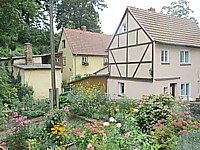Der Wachwitzgrund gehört zu den romantischen rechten Seitentälern der Elbe und wird
vom Gönnsdorfer Bach gebildet, der in der Nähe des Wachwitzer Dorfkerns in die Elbe mündet. Die Straße durch das Tal trug früher den Namen Rochwitzer Fußsteig bzw.
Grundstraße, bevor sie 1930 offiziell in Wachwitzgrund umbenannt wurde Der obere Teil wird nach der früheren sächsischen Kronprinzessin Luise von Toscana auch Luisen-Grund genannt.

Im unteren Teil des Grundes stehen noch zahlreiche kleine Fachwerkwohnhäuser, die an die Vergangenheit des Ortes erinnern. Hier lebten meist arme Häusler, Winzer und
Tagelöhner des Rittergutes. Schwere Schäden richtete am 12. Mai 1844 ein Wolkenbruch an, der den kleinen Bach
anschwellen ließ und zum reißenden Gewässer machte. Zahlreiche Gebäude wurden dabei zerstört bzw. schwer beschädigt. An die Katastrophe erinnert noch heute ein [Gedenkstein](../../../nordost/wachwitz/strassen_wachwitz/hochwasser-gedenkstein/) neben dem Brunnenhaus in Altwachwitz. Weitere Häuser fielen
später dem Abriss zum Opfer und wurden durch Mehrfamilienhäuser bzw. Villen ersetzt.

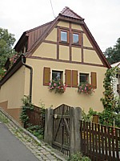Zu den älteren Bauten gehören die Fachwerkhäuschen Wachwitzgrund Nr. 2, 4, 6, 12, 14, 16 und 18.  Gegen Ende des 19. Jahrhunderts richtete man in vielen Häusern kleine Läden und
Gewerbebetriebe ein, da die Bewohner nach Einstellung des Weinbaus auf andere Erwerbsmöglichkeiten umsteigen mussten. Älteste Häuser von Wachwitz sind das Umgebindehaus
Wachwitzgrund 13 von 1623 und Wachwitzgrund 15. Einer heute nicht mehr lesbaren Inschrift zufolge soll dieses Gebäude bereits um 1605 entstanden sein.

Auch im oberen Teil des Grundes sind noch einige historische
Bauten erhalten geblieben. Zwar musste das kleinste Haus des Ortes, von den Bewohner auch “Villa bücke Dich” genannt, 1969
wegen Baufälligkeit abgerissen werden, dafür blieb das ehemalige Gemeindearmenhaus (Nr. 74) bis heute erhalten. Unweit der ehemaligen Gaststätte “Johannesbad” erinnert ein Ehrenhain an die
im Ersten Weltkrieg gefallenen Einwohner des Ortes. An der Flurgrenze nach Pappritz führt ein schmaler Pfad auf einen Felsen über dem Wachwitzgrund, auf dem 1883 die Gaststätte [“Wachberg”](../../../nordost/wachwitz/wachwitzgrund/wachberg/) eingerichtet wurde.

Einzelne Gebäude:

Nr. 1:
Das Eckhaus zur Straße Am Steinberg wurde zwischen 1888 und 1891 an Stelle eines älteren Fachwerkhauses
errichtet. Ursprünglich gehörte es, wie auch das Nachbargebäude Nr. 3 der Familie Bähr. Der Entwurf stammt von Friedrich
August Wanneck. Das mit Neorenaissance-Elementen verzierte Gebäude hat seine Schauseite zum Dorfplatz Altwachwitz.
Im Erdgeschoss entstand ein kleiner Laden, der bis 1948 als “Wachwitzer Markthalle”, danach bis 1990 unter Regie des
Konsum für den Lebensmittelverkauf genutzt wurde. Später mieteten verschiedene Gewerbetreibende die Räume u.a. als Videothek, Versicherungsagentur und Make-up-Studio.

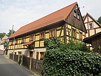Nr. 2, 4, 6, 12, 14 und 16: Die Fachwerkhäuser im unteren Wachwitzgrund bilden ein
interessantes Ensemble historischer Alt-Wachwitzer Wachwitzer aus dem 18./19. Jahrhundert. Sie entstanden als Wohnhäuser von Fischer- und Winzerfamilien und stehen unter Denkmalschutz _( **Foto:** Wachwitzgrund 4)_.

Nr. 7: Das auch “Haus Sonnenrose” genannte Gebäude entstand 1863. Zuvor war dieser Platz für den Bau der Wachwitzer Schule vorgesehen. 1872 erwarb der Maler Woldemar
Hottenroth (1855-1937) das Haus und nutzte es als Wohnung und Atelier. Hottenroth, der zuvor u.a. in Paris, Rom und Hamburg tätig gewesen war, siedelte sich Mitte des 19.
Jahrhunderts in Dresden an und war der erste Künstler, der Wachwitz zum zeitweiligen Wohn- und Arbeitsort wählte. Bereits
ab 1856 war in den Sommermonaten regelmäßig im Ort zu Gast und lebte dabei im Haus Am Steinberg 15.

Nr. 8:
Das Gebäude entstand um 1840 als Winzerhaus eines zugehörigen Weinberges an Stelle einer alten Wassermühle.
Zwischen 1908 und 1924 gehörte es dem Literaturhistoriker Dr. Friedrich Kummer (1865-1939), der hier regelmäßig die
Sommermonate verbrachte. Kummer gehörte ab 1897 der Redaktion des “Dresdner Anzeigers” an und verfasste 1908 eine
“Deutsche Literaturgeschichte des 19. und 20. Jahrhunderts. Außerdem ist er Verfasser eines Reiseführers und arbeitete als
Redakteur für verschiedene Zeitungen und Zeitschriften. Hinter dem Haus führt eine steile Treppe zum “Schweizerhäuschen” mit der “Flüstergrotte”, Reste der früheren romantischen Gestaltung des Grundstücks.

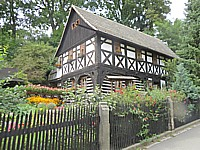Nr. 13:
Das Umgebindehaus gehört zu den ältesten Gebäuden im Ort _(Foto)_. Einer Datierung im Türsturz wurde es im Jahr 1623 errichtet. Im Obergeschoss und im Giebel
sind die für diese Gebäude typischen Andreaskreuze zu sehen. Vor dem Haus blieb ein kleiner abgedeckter Backofen erhalten. Ab 1707 gehörte das Grundstück zum Areal Am Steinberg 11.

Nr. 15:
Noch älter ist einer heute nicht mehr vorhandenen Inschrift zufolge das Fachwerkhaus Wachwitzgrund 15. Eine  hölzerne Schrifttafel trug die Inschrift _“O treue_
_Gott, Dein rechte Hand / bewahr dies Haus vor Feuer und Brand, / Vor Unfall und vor allem Trübsal; / Behüt´s o Gott überall. / Erbaut - Anno 1605”_ und verschwand um 1950. Besitzer war im 18.
Jahrhundert ein nicht mit dem berühmten Baumeister verwandter George Bähr.

Schreiters Mühle (Nr. 18): Das 1808 errichtete Fachwerkhaus steht auf dem Grundstück des früheren Wachwitzer
Mühlengutes. 1607 ist dieses erstmals genannt und befand sich im Besitz von Blasius Saupe. Später wurde sie, wohl nach
einem neuen Besitzer, Schäfersche Mühle genannt. Der Antrieb der Wassermühle erfolgte durch den Wachwitzbach, der
durch einen heute nicht mehr vorhandenen Mühlteich verstärkt werden konnte. 1858 erwarb Johanne Sophie Schreiter die
Mühle und führte sie unter dem Namen Schreiters Mühle weiter. 1890 kaufte der Bäckermeister August Dittrich das Grundstück für seine Bäckerei und stellte den Mahlbetrieb ein. Heute wird das Gebäude als Wohnhaus genutzt.

Nr. 20: Die Villa wurde 1906 als Wohnhaus errichtet und behrbergte von 1920 bis 1940 ein Erholungsheim des Sächsischen Gemeindebeamten-Bundes.

Nr. 22: Das auf dem Gelände von Schreiters Mühle befindliche Haus gehörte ab 1890, wie auch die ehemalige Wassermühle
selbst, dem Bäckermeister August Dittrich. Dieser erhielt 1896 eine Schankerlaubnis füe Kaffee, Wein, Likär und
alkoholfreie Getränke. Fünf Jahre später veräußerte er das Grundstück an Ernst Gössel. Unter wechselnden Betreibern gab es hier noch bis die 1930er Jahre eine Kaffee- und Weinstube.

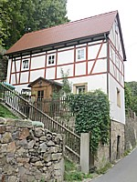Nr. 27:
Das kleine Fachwerkhaus entstand im 17. Jahrhundert und gehört zu den besterhaltendsten historischen Gebäuden von Wachwitz. Das Haus wurde in den letzten Jahren liebevoll saniert _(Foto)_.

Nr. 53: Das im oberen Teil des Wachwitzgrundes gelegene Landhaus “Waldfrieden” war von 1896 bis zu seinem Tod Sommer- bzw. Dauerwohnsitz des Komponisten und Organisten
Johannes Fährmann (1860-1940). Er war von 1890 bis 1926 Kantor der Dresdner [Johanniskirche](../../../Zentrum/Pirnaische_Vorstadt/Johanniskirche/johanniskirche.html) und besaß ab 1891 eine Professur für Orgel und Komposition am Konservatorium.
Fährmann gilt als einer der bedeutendsten Orgelkomponisten seiner Zeit und schuf zahlreiche Sonaten, Orgelkonzerte und Choralbearbeitungen.

Zwischen 1951 und 1955 lebte in diesem Haus der bekannte Dresdner Musikkritiker Hans Böhm (1909-1999). Böhm, der
bereits zwischen 1936 und 1939 in Wachwitz gelebt hatte (Königsweg 11), wirkte ab 1954 an der Hochschule für Musik als
Dozent für Musikgeschichte und war Vorstandsmitglied des Komponistenverbandes der DDR. Bekannt wurde er als
Musikkritiker der Tageszeitung “Die Union” und Mitbegründer der Dresdner Musikfestspiele. Unterhalb des Gebäudes lag
einst der Mühlteich der “hinteren Mühle”, aus der später die Gastwirtschaft “Johannesbad” hervorhing (Nr. 76).

Nr. 54:
Das Haus entstand im 19. Jahrhundert als Landhaus des Malers Woldemar Graf von Reichenbach (1846-1914).
Nach einer Italienreise ließ er an seinem 1894 erworbenen Wohnhaus ein antikes Portal einbauen, welches er dort erworben
hatte. Das einstige Ateliergebäude ist heute nicht mehr vorhanden. Im Wohnhaus befand sich ab 1954 die Frauenklinik von Dr. Fritz Jüngst. Sie existierte bis 1974, danach noch einige Jahre als Praxis.

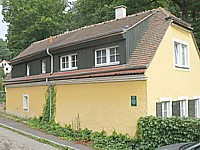Nr. 56 (“Talhaus”):
Nach Zerstörung der oberen Wachwitzer Mühle beim Unwetter 1844 errichtete zwei Jahre später Johann Gottlieb Ehrlich an gleicher Stelle ein neues Gebäude.
1854 wurde dieses von König Friedrich August II. erworben, der hier die Unterkunft seiner Schlosswache einrichtete. Zwischen 1921 und 1977 bewohnte der Maler Hans
Jüchser (1894-1977) das Gebäude. Hans Jüchser war nach seinem Studium an der Dresdner Kunstakademie als freischaffender Maler tätig und gehörte zu den von den
Nazis als “entartet” verfemten Künstlern. Nach seiner Rückkehr aus der Kriegsgefangenschaft bezog er 1947 wieder sein Wachwitzer Atelier. Jüchser, der zu den
bedeutendsten Dresdner Malern des 20. Jahrhunderts gehört, schuf neben zahlreichen Porträts auch einige Darstellungen des Wachwitzgrundes und seiner Umgebung. An ihn erinnert eine Infotafel an der Fassade
des nach 1990 sanierten Gebäudes.

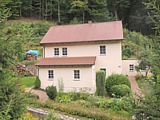Nr. 70:
Das ehemals kleinste Gebäudedes Ortes mit Giebel zur Straßenseite wurde wegen seier geringen Größe im Volksmund “Villa bücke Dich” genannt. Im Inneren gab
es nur drei übereinanderliegende Räume. 1969 wurde das Haus wegen Baufälligkeit abgerissen.

Nr. 74 (Gemeindearmenhaus): Das zweistöckige Wohngebäude wurde 1873 als neues
Armenhaus der Gemeinde errichtet. Zuvor diente ein für den Bau der Wollner-Villa Vorgängergebäude Am Steinberg diesem Zweck. Das Grundstück für das neue
Gemeindearmenhaus stiftete der wohlhabende Wachwitzer Bürger Otto Georg Ferrario. Heute befinden sich in dem nach 1990 sanierten gebäude Wohnungen _(Foto)_.

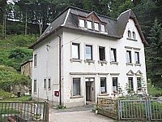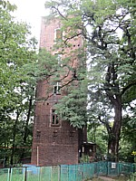Johannesbad (Nr. 76): Die Gaststätte wurde 1874 in den Gebäuden einer alten Mahl- und Schneidemühle eingerichtet
und hieß zunächst “Zur Güldenen Aue”. Nachdem der Besitzer Friedrich Moritz Mißbach 1876 die Erlaubnis zur Einrichtung einer Badeanstalt erhalten hatte, benannte man das gesamte
Anwesen in “Johannesbad” um. Dafür wurde der frühere Mühlteich zum Gondelteich umgestaltet. Außerdem entstanden ein Konzertsalon und auf dem Hügel über dem Haus ein Aussichtsturm. Der bis heute zu Wohnzwecken genutzte
Johannesturm _(Foto rechts)_ war zeitweise Wohnsitz der Kunstmaler Curt Rothe und Erhard Benscheck. Trotz mehrfachem Besitzerwechsel wurde das “Johannesbad” noch bis 1939
gastronomisch genutzt, schloss dann jedoch seine Pforten.

Nach dem Zweiten Weltkrieg befand sich auf dem Grundstück eine Nutriafarm, später eine Zucht für Schäferhunde. Da 1967
ein Unwetter den Mühlteich verschüttete und das Grundstück verwüstete, sind heute kaum noch Reste aus der Glanzzeit des
beliebten Ausflugslokals erhalten. Das Gasthaus dient heute ebenso wie der erhaltenen Johannesturm als Wohnhaus.

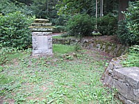Ehrenhain: Die am Ende des Wachwitzgrundes kurz vor der Flurgrenze zu Rochwitz
gelegene Anlage entstand in den 1920er Jahren auf Initiative des Schriftstellers Edmund Hottenroth; die Schrifttafeln schuf der Bildhauer Otto Wilhelm Hunger. In der Mitte
befindet sich ein Gedenkstein, der einst eine heute nicht mehr vorhandene Bronzetafel mit der Aufschrift _“Weltkrieg 1914 - 1918. Vergiss die treuen Toten nicht.”_ trug. Um den
Stein sind auf einer ca. 25 cm hohen Ringmauer Steintafeln mit den Namen und Todesdaten gefallener Wachwitzer Einwohner angebracht. Leider ist die Anlage heute stark verfallen.

Pappritzmühle: Die Mühle entstand im 16. Jahrhundert auf Rochwitzer Flur und wurde 1547 erstmals erwähnt. Erster namentlich bekannter Eigentümer war der Müller Jacob Wainer. Hauptsächlich diente sie als Getreidemühle. 1848/49 soll sich der Dichter Joseph Freiherr von Eichendorff mehrmals hier aufgehalten und sein Lied “In einem kühlen Grunde...” geschrieben haben, was historisch jedoch nicht verbürgt ist. Mehrfach wechselte die Mühle ihre Besitzer und gehörte zuletzt Carl Heinrich Petzsch, der am 31. Mai 1885 verstarb. Ein Jahr später verkaufte sie seine Witwe Auguste Wilhelmine Petzsch an die Gemeinde Wachwitz.

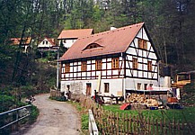1886 wurde der Mahlbetrieb eingestellt und die Pappritzmühle fortan nur noch als
Wohnhaus genutzt. Das Mühlrad verschwand nach der Jahrhundertwende. Wegen ihres schlechten Bauzustandes sollte die Mühle 1963 abgerissen werden. Nach einem Antrag des Dresdner Anglerverbandes, hier ein Vereinshaus einzurichten, revidierte man diese Pläne und überließ das Gebäude den Vereinsmitgliedern. Diese planten, den ehemaligen Mühlteich als Forellenzuchtanlage zu nutzen und begannen mit der Instandsetzung des Staudammes und der Entschlammung des Teiches. Nach schweren Schäden durch ein Unwetter im Sommer 1965 gab man die Pläne jedoch auf und überließ die historische Mühle der “URANIA”. Das unter Denkmalschutz stehende Gebäude wurde 1995/97 saniert und wird heute als Wohnhaus genutzt.

Da Sie den ehemaligen Besitzer angeben, konnte ich bei "ancestrylibrary.com" feststellen, dass KARL (nur so dort zu finden ) Heinrich Petzsch bereits am 31. Mai 1885 verstorben ist im Alter von 55 Jahren. Seinen Geburtsort kann ich nicht lesen, bzw. finde nichts auf das, was ich lese.
Er hatte noch 1883 ein Kind bekommen ( Standesamt Weißig ). Seine Ehefrau war Auguste Wilhelmine Petzsch, geb. Müller. ( erstes mir bekanntes Kind 1859 in Pappritz )
Das Haus müsste also wohl seine Witwe verkauft haben... Im Oktober 1886 heiratete sie wieder und hieß dann SACHSE ( ein Weber ). Die Mehrheit der Urkunden weist die Kataster-Nummer 32 auf. Das wollte ich Ihnen gerne mitteilen, falls Sie es noch brauchen können.

* * *

 \[ [Nord](../../../nord/)\] \[ [Nordwest](../../../nordwest/)\] \[ [Neustadt](../../../neustadt/)\] \[ [Nordost](../../../nordost/)\]
 \[ [West](../../../west/)\] \[ [Zentrum](../../../zentrum/)\] \[ [Südwest](../../../sudwest/)\] \[ [Süd](../../../sud/)\] \[ [Südost](../../../sudost/)\] \[ [Ost](../../../ost/)\] \[ [Register](../../../Register/register.html)\] \[ [Kontakt](../../../Kontakt/kontakt.html)\] \[ [Impressum](../../../impressum/)\]
