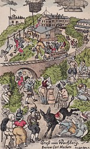
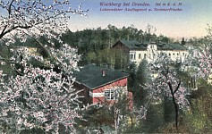
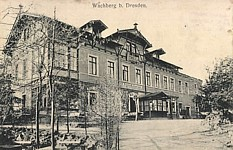
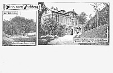

* * *

* * *

* * *

* * *

* * *

* * *

**Wachberg mit “Kamerunbahn”**

Die Ausflugsgaststätte “Wachberg” wurde 1883 auf einer Granodioritklippe
über dem Wachwitzgrund errichtet. An dieser Stelle soll sich früher eine Burg befunden haben (Wachstätte), die allerdings ins Reich der Legende gehört.
Auch der Ortsname Wachwitz hat nichts mit dem Wort “Wache” zu tun. Erster Besitzer war Ernst Wilhelm Palisch, der sein  Ausflugslokal dennoch in Form einer Ritterburg mit “Rittersaal” gestalten und mit zahlreichen
Vergnügungseinrichtungen ausstatten ließ. Neben einer Terrasse mit Aussichtsplattform gab es einen kleinen Pavillon mit einer Camera obscura, eine Kegelbahn, einen Musikpavillon und eine Jagdhütte. Für Kinder standen
Esel zum Reiten und für Kutschfahrten zur Verfügung. Außerdem wurden Gleise bis auf das Plateau des heutigen
Fernsehturms verlegt. Von dort rollte ein Wagen bis direkt vor die Gaststätte. Da dieser zeitweise von zwei Afrikanern
wieder an seine Startposition verbracht wurde, erhielt die Bahn den Namen “Kamerunbahn”. Zur Wasserversorgung diente ein eigens angelegter 15 Meter tiefer Brunnen.

Später wechselten mehrfach die Besitzer des “Wachbergs”, die das Gelände jeweils nach ihren Vorstellungen
veränderten. Bis 1942 existierte das Lokal noch als Ausflugsgaststätte und wurde dann an einen Tüllfabrikanten verkauft.
Nach 1945 nutzte eine Weberei die Gebäude als Betriebsferienheim. Später entstand ein Studentenwohnheim der Musikhochschule. Erst nach Privatisierung 1995 konnte der “Wachberg” saniert
und im November 1996 als Gaststätte wiedereröffnet werden. Neben dem wiederhergestellten “Rittersaal” erinnern auch die erhaltene Jagdhütte und ein
Wettinstein von 1889 an die Frühzeit der Gaststätte. Von der Aussichtsplattform bietet sich ein herrlicher Fernblick bis
zum südlichen Stadtrand. Außerdem entstanden einige Pensionszimmer. 2009 übernahm der ehemalige Dynamo- Fußballer Gerd Seifert die Bewirtschaftung.

_Das Lokal “Wachberg” auf historischen Ansichtskarten_

* * *

 \[ [Home](../../../../index.html)\] \[ [Nord](../../../../nord/)\] \[ [Nordwest](../../../../nordwest/)\] \[ [Neustadt](../../../../neustadt/)\] \[ [Nordost](../../../../nordost/)\] \[ [West](../../../../west/)\] \[ [Zentrum](../../../../zentrum/)\] \[ [Südwest](../../../../sudwest/)\] \[ [Süd](../../../../sud/)\] \[ [Südost](../../../../sudost/)\] \[ [Ost](../../../../ost/)\] \[ [Register](../../../../Register/register.html)\] \[ [Kontakt](../../../../Kontakt/kontakt.html)\] \[ [Impressum](../../../../impressum/)\]
