* * *

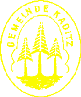

**Gemeindesiegel von Kaditz**

* * *

**Schulen in Kaditz:**

* * *

**Vereine in Kaditz:**

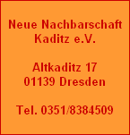

[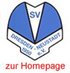](http://www.sv-dresden-neustadt.de)

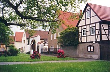Kaditz wurde 1269 erstmals urkundlich erwähnt und gehört zu den ältesten
Siedlungen in der Elbtalaue. Der Name Kayticz stammt aus dem altsorbischen und bedeutet Leute des Kojeta. Bereits 1273 ist von einer Kirche die Rede, die unter dem Namen [Emmauskirche](../../nordwest/kaditz/emmauskirche/) bis heute das Ortsbild prägt und einst kirchlicher Mittelpunkt von neun Dörfern war. Das Dorf unterstand dem Meißner
Bischof und kam somit nach der Reformation an das Prokuraturamt Meißen. Außerdem besaß das Amt Dresden Anteile an Kaditz, so dass bis ins 19. Jahrhundert zwei Amtsrichter über die Gemeindeangelegenheiten wachten.

Ursprünglich bestand die Kaditzer Flur nur aus 6 Gütern und den Hufenfeldern östlich des Dorfkerns, an die noch der Straßenname An den Hufen erinnert. Später wurden
die hochwassergefährdeten, aber sehr fruchtbaren Weideflächen am Elbufer einbezogen. Hinzu kam im 15. Jahrhundert das ehemalige bischöfliche Herrengut und Vorwerk Poppewitz. Nach
dessen Auflösung wurden die Fluren als “Puppsfelder” an die Kaditzer Bauern ausgegeben. Bereits Ende des 14. Jh. war das Dorf [Gleina](../../nordwest/kaditz/gleina/), zwischen Kaditz und Trachau gelegen, von seinen Bewohnern verlassen worden. Dessen Fluren wurden
danach ebenfalls von Kaditz aus bewirtschaftet.

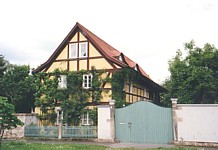Neben der dominierenden Landwirtschaft wurde in Kaditz auch Weinbau
betrieben. Mittelpunkt waren der sogenannte “Bischofsgarten” an der Kaditzer Elbfähre und die nordwestlich des Ortes gelegene Erhebung Goppitz. Bis heute erinnern alte Weinbergsmauern an verschiedenen Stellen an diesen
Wirtschaftszweig. Ebenfalls nur noch Reste sind vom [Kaditzer Tännicht](../../nordwest/) erhalten, einem früheren Kiefernwäldchen zwischen Radebeul und dem heutigen Riegelplatz.
Mit Trockenlegung des alten Elbarmes an den Seewiesen wurde zusätzliche Nutzfläche gewonnen und später meist gartenbaulich genutzt.

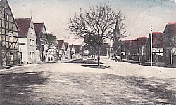Der alte Dorfkern von Kaditz _(_ _Fotos)_ mit seinen schmalen Giebelhäusern gehört zu den besterhaltenen in Dresden. Deutlich ist die frühere
Zersplitterung der ursprünglich größeren Güter durch Erbteilung zu erkennen, welche erst 1635 durch die Einführung des Minorats (Erbrecht des jüngsten Sohnes) eingeschränkt wurde. Der unter Denkmalschutz stehende Anger
erhielt sein heutiges Aussehen nach dem letzten Dorfbrand 1818. Infolge der intakten dörflichen Strukturen, die den Zuzug fremder Häusler und Gärtner
verhinderte, konnten sich in Kaditz noch bis zum Ende des 19. Jh. Bräuche und Sitten aus der sorbischen Vergangenheit erhalten. Dazu gehörte der alte
Versammlungsruf  “Botscheremoh” (“Kommt alle zusammen”), mit dem Gemeindeversammlungen einberufen wurden. Am 1. Januar 1903 kam Kaditz als Ortsteil zu Dresden.

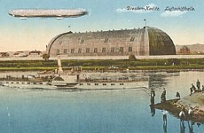Um 1895 wurde am Riegelplatz abseits vom Dorfkern ein kleines Zentrum der
Gemeinde mit einem neuen Schulhaus geschaffen. Zuvor war an der [Leipziger Straße](../../neustadt/leipziger_vorstadt/leipziger_strasse/) bereits der Ortsteil Neukaditz rund um den Gasthof [“Feldschlößchen”](../../neustadt/leipziger_vorstadt/leipziger_strasse/rudi_arndt/) entstanden. Zum Aufschwung dieses Gebietes trug auch die 1899 eingeweihte [Lößnitzbahn](../../nordwest/mickten/lossnitzbahn/) nach Radebeul bei. Bereits 1869 war in Kaditz eine Anlegestelle der Dampfschiffahrt eingerichtet worden. Trotz dieser Verbesserungen der
Anbindung zur nahen Residenzstadt wurde eine städtische Entwicklung wie in den Nachbargemeinden durch die ungünstige Lage des Ortes verhindert. Allerdings war Kaditz ab 1911 Standort des städtischen [Klärwerks](../../nordwest/kaditz/klarwerk/) und besaß zwischen 1913 und 1926 Dresdens ersten [Flugplatz](../../nordwest/kaditz/flugplatz_kaditz/) mit Luftschiffhalle
_(Foto)_. Außerdem existierten zeitweise einige Kiesgruben an der Spitzhausstraße.

Im Dorf selbst dominierte damals noch die Landwirtschaft. Lediglich im Norden der Gemeindeflur existierten einige
kleinere Gewerbebetriebe, darunter zwei Dachpappenfabriken und die “Elbthal-Brauerei” an der Rankestraße. Zur Förderung der gemeindlichen Entwicklung erhielten die meisten Häuser kurz nach 1900 Gas- und Wasseranschluss,
später auch Elektrizität. Der geplante Bau eines Rathauses scheiterte 1902 an der bevorstehenden Eingemeindung. So
blieb Kaditz auch nach dem Ersten Weltkrieg ein ländlicher Ort, dessen Bewohner sich zunehmend auf den Gartenbau
zur Versorgung der Dresdner Bevölkerung konzentrierten. Zur Ertragssteigerung wurde der im städtischen Klärwerk
anfallende Schlamm auf den Feldern verteilt, eine Praxis, die noch bis in die jüngste Vergangenheit üblich war.

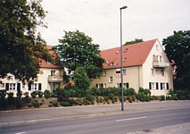Seit 1930 verbindet die heute meist [Flügelwegbrücke](../../nordwest/kaditz/strassen_kaditz/flugelwegbrucke/) genannte Kaditzer Elbbrücke
den Ort mit der anderen Elbseite, womit auch die alte Fährverbindung zwischen Kaditz und Kemnitz überflüssig wurde. Eine weitere Elbbrücke entstand 1935 für die [Autobahn](../../west/kemnitz/autobahn/). Zwischen 1936 und 1938 wurde auf dem Gelände des gerodeten
Kaditzer Tännichts eine ausgedehnte Kleinhaussiedlung an der [Kötzschenbroder Straße](../../nordwest/mickten/strassen_mickten/kotzschenbroder_strasse/) angelegt _(Foto)_
. 1940 begann im Ortsteil Kleinkaditz, welcher ursprünglich nur aus drei abseits des Dorfkernes gelegenen Wirtschaften bestand, der Bau einer
weiteren Siedlung. Eisenbahnanschluss, wenn auch nur für den Güterverkehr, erhielt Kaditz mit der 1952 eröffneten, inzwischen stillgelegten [Industriebahn](../../nordwest/kaditz/industriebahn_kaditz/) zwischen
Radebeul-Ost und Übigau.

Auch nach 1945 blieb Kaditz wichtiger Gartenbaustandort, dessen Tradition bis 1990 durch das Frühgemüsezentrum
fortgesetzt wurde. Die meisten bäuerlichen Wirtschaften schlossen sich 1960 zur GPG “Nachbarschaft Kaditz” zusammen, die verschiedene Gebäude im Dorfkern als Ställe bzw. Scheunen nutzten. Die Genossenschaft war größte
ihrer Art im Bezirk und widmete sich vorrangig dem Anbau von Gemüse, obwohl in geringerem Umfang auch Getreide
angepflanzt und Vieh gehalten wurde. In den 70er Jahren entstanden einige moderne Kühl- und Gewächshäuser an der Kötzschenbroder Straße. 1973 erfolgte die Zusammenlegung mit weiteren LPG´s der Dresdner Umgebung zur LPG
Frühgemüsezentrum  “Wilhelm Wolff”. 1990 wurde diese aufgelöst. Die verbliebenen landwirtschaftlichen Nutzflächen werden heute von der Frühgemüsezentrum Kaditz GmbH bebaut.

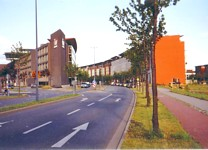Weitere Flächen wurden 1992 als Bauland an Investoren verkauft. Auf dem Areal zwischen Autobahn und Mickten war damals der Bau eines neuen Stadtviertels mit Wohn- und Gewerbeflächen geplant, welches jedoch zunächst nur in Ansätzen realisiert wurde. Hauptanziehungspunkt des heute meist als Kaditz-Mickten bezeichneten Viertels ist das größte Dresdner Einkaufszentrum “ElbePark” an der Scharfenberger Straße. Neben verschiedenen Einkaufsmärkten, Gaststätten und kleineren Geschäften befindet sich hier auch das moderne Großkino “UCI”. Außerdem entstand 1996/98 eine moderne Wohnzeile an der Flutrinne sowie das moderne Verwaltungsgebäude der Sparkassen- Versicherung Sachsen _(Foto)_. Großen Schaden richtete im August 2002 das Elbehochwasser an, welches neben dem Elbepark auch den Dorfkern und weite Teile der Kaditzer Flur unter Wasser setzte. Als Ersatz für die nach dem Hochwasser stillgelegte Straßenbahnlinie nach Übigau erhielt Kaditz 2003/04 Straßenbahnanschluss bis zum Riegelplatz. 2017 begann zwischen Brockwitzer Straße, Flößerstraße und An der Elbaue der Bau eines nach seinem Bauherren "Mika-Quartier" genannten Wohnviertels mit ca. 2200 Wohnungen und einer Kindertagesstätte.

Schulen in Kaditz:

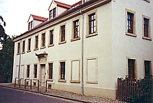Dorfschule: Die erste Kaditzer Dorfschule entstand kurz nach Einführung der Reformation und wurde auch von den Kindern der Nachbarorte besucht. Zunächst fand der Unterricht in verschiedenen Räumen in der Umgebung der Kirche statt, bevor 1854 auf dem Grundstück Altkaditz 32 ein richtiges Schulhaus errichtet werden konnte. Die Leitung des Baus oblag dem Baumeister Christian Gottlieb Ziller, die Ausführung dem Maurermeister Götze. Dem künftigen Zweck des Hauses entsprechend wurde die schlichte Fassade mit einem Fries und Schmuckelementen sowie dem damaligen Erziehungsideal entsprechenden Bibelsprüchen verziert. Bis 1894 war diese Schule in Betrieb. Später diente das Haus als Kantorat, als Kirchgemeindehaus und Wohnung. Der 1969 geplante Abriss des Gebäudes konnte durch die Kirchgemeinde verhindert werden. Seit 1999 dient das zuvor komplett sanierte Gebäude als Wohnhaus.

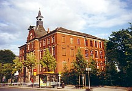Grundschule:  Nachdem die alte Schule am Dorfplatz zu klein geworden war, errichtete die Gemeinde 1894 außerhalb des Ortskerns am heutigen Riegelplatz ein neues Schulgebäude. Die Grundsteinlegung erfolgte am 20. März 1894. Das mit Backsteinen verkleidete Schulhaus _(Foto)_ entstand unter Leitung des Baumeisters Jähnig und erhielt über dem Eingang die Inschrift “Großes Werk gedeiht nur durch Einigkeit”, einem Zitat aus dem Lied “Turner, auf zum Streite” von A. H. Weismann. Die 1898 im Dachreiter eingebaute Turmuhr stammt aus der bekannten Leipziger Turmuhrenwerkstatt Zacharias. Interessant ist auch das 1946 über dem Hauptportal angebrachte Dresdner “Aufbauwappen”, eine Darstellung des Wappenlöwens mit Maurerkelle und Ziegeln.

Der Platz vor der Schule wurde 1898/99 als kleine Parkanlage gestaltet und sollte Auftakt für ein neues Kaditzer Ortszentrum sein. Bereits 1900 machte sich eine Erweiterung des Schulhauses um zwei Seitenflügel erforderlich. Außerdem wurde 1905 das Hintergebäude an der Grimmstraße 44 angemietet, welches heute vom Schulhort “Kinderland Gebrüder Grimm” genutzt wird. Das eigentliche Schulhaus war ab 1903 Sitz der 43. Bezirksschule Dresden, ab 1919 Volksschule und ab 1958 Polytechnische Oberschule. 1969 erhielt die damalige 43. POS den Namen des Bauernführers "Thomas Müntzer". Mit der Umgestaltung des sächsischen Schulsystems wurde sie 1992 zur 43. Grundschule “Thomas Müntzer”. Zwischen 2006 und 2011 erfolgte eine umfassende Sanierung und der Bau eines modernen Ergänzungsflügels.

Kaditzer Feuerwehr:

Der älteste Hinweis auf eine Feuerspritze in Kaditz stammt aus dem Jahr 1727, als die Dorfgemeinschaft eine tragbare
Stoßspritze erwarb. Diese kam nicht nur bei Bränden im Ort, sondern auch in den Nachbardörfern zum Einsatz, wobei diese
dann per Pferdewagen zum Unglücksort transportiert werden musste. Die Unterhaltung einer Dorffeuerwehr mit der erforderlichen Mannschaft gehörte in Sachsen seit dem 18. Jahrhundert zu den Aufgaben jeder Gemeinde. Ihren
Standort hatte die mehrfach durch modernere Geräte ersetzte Schlauchspritze im 1814 errichteten Spritzenhaus Übigauer Straße 5.

Mit der Eingemeindung des Dorfes wurde am 31. Dezember 1902 auch die Ortsfeuerwehr aufgelöst. Auf Wunsch der
Bevölkerung blieb diese jedoch als freiwillige Feuerwehr auch weiterhin bestehen und durfte die vorhandenen Geräte
behalten. Bis in die Nachkriegszeit war sie als Löschmannschaft in den Verein “Kaditzer Nachbarschaft” integriert. Nach vorübergehender Unterbrechung wurde
1962 offiziell eine neue Freiwillige Feuerwehr gegründet, die bis heute besteht.

Kaditzer Linde:

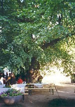Die Sommerlinde wurde vermutlich bereits zur Gründungszeit des Ortes gepflanzt und ist mit
ca. 1.000 Jahren ältester Baum in Dresden. Im Mittelalter diente sie wahrscheinlich als Pranger und Gerichtsort. Obwohl urkundliche Belege fehlen, deuten Reste eingeschlagener Eisen am
Stamm zumindest daraufhin. Glücklicherweise überstand die Linde sowohl kriegerische Ereignisse als auch alle größeren Dorfbrände, wurde jedoch beim letzten Brand von 1818
schwer beschädigt. Ihr Umfang beträgt heute 11,90 Meter und besteht aus mehreren Sekundärstämmlingen.

Erste Sicherungsarbeiten am Stamm erfolgten Mitte des 19. Jahrhunderts. Zunehmend fand
der Baum auch das Interesse von Heimatkundlern und Fachleuten sowie von bildenden Künstlern, die den Baum auf zahlreichen Zeichnungen und Gemälden darstellten und dadurch
zu seiner Popularität beitrugen. Seit 1975 steht die Kaditzer Linde als Naturdenkmal unter Schutz. In den letzten Jahren fanden regelmäßige Pflegearbeiten statt, um den Baum auch künftig für die Nachwelt zu
erhalten. Eine Informationstafel informiert seit 2003 über seine Geschichte.

Elbfähren:

Der an der Elbe gelegene Ort besaß einst auch mehrere Fährverbindungen, von denen jedoch keine mehr existiert.
Erstmals genannt wurde 1737 eine Kahnfähre nach Stetzsch, welche ihre Anlegestelle südlich des Dorfkerns hatte. Eine
weitere Fähre verkehrte ab 1784 nach Kemnitz. Die dritte Fährverbindung wurde 1825 nach Briesnitz eingerichtet,
bereits 1869 jedoch wieder eingestellt. Zwischen 1913 und 1922 gab es außerdem eine Verbindung zwischen Cotta und
dem Kaditzer Flughafen. Wirtschaftliche Gründe führten bereits Mitte der Dreißiger Jahre zur Aufgabe der Kemnitzer
Fähre, welche wegen des Baus der Flügelwegbrücke überflüssig geworden war. 1959 folgte schließlich auch die letzte Fähre nach Stetzsch.

[_Weiterführende Literatur und Quellen_](../../impressum/quellenverzeichnis/)

**Buchtipp: Siegfried Reinhardt: “Als Fliegen noch ein Wagnis war”, Engelsdorfer Verlag (ISBN**
**978-3-86268-969-9)**

In diesem Buch beschreibt der Autor Siegfried Reinhardt die Geschichte des
Kaditzer Flugplatzes und erinnert an einige tragische Unglücksfälle, welche sich dort ereignet haben. Das Buch kostet 16 Euro und ist im Buchhandel erhältlich.

 \[ [Home](../../index.html)\] \[ [Nord](../../nord/)\] \[ [Nordwest](../../nordwest/)\] \[ [Neustadt](../../neustadt/)\] \[ [Nordost](../../nordost/)\] \[ [West](../../west/)\] \[ [Zentrum](../../zentrum/)\] \[ [Südwest](../../sudwest/)\] \[ [Süd](../../sud/)\]
 \[ [Südost](../../sudost/)\] \[ [Ost](../../ost/)\] \[ [Register](../../Register/register.html)\] \[ [Kontakt](../../Kontakt/kontakt.html)\] \[ [Impressum](../../impressum/)\]
