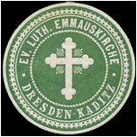
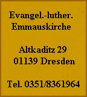
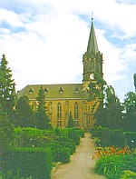
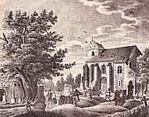
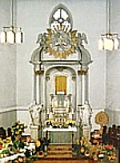
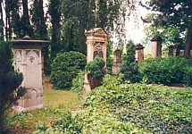
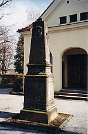

* * *

* * *

**_Das spukhafte Bild zu Kaditz_**

_In dem zum Dresdner Amtsbezirk gehörigen Dorfe Kaditz befindet sich eine alterthümliche Kirche, welche in ihrer Vorhalle, der ursprünglichen Kapelle, eine Statue ihres Schutzheiligen und_
_ein Oelgemälde des ehemaligen hiesigen Pfarrers M. Böhme in Lebensgröße besitzt. Von letzterem erzählt die Sage, er habe sich erhenkt und sei von den Seinigen in die Elbe getragen worden, damit man_
_glauben solle, er sei darin, wo man ihn nachher wirklich fand, ertrunken._

_Nun sagt man, daß jedesmal am Kirchweihfeste des Dorfes, an welchem Tage nämlich der angebliche Selbstmord des_
_Geistlichen gefallen ist, dieses Bild gewaltig schwitze, gleichsam als sey es eine lebende Person, der es in dem Gedränge so vieler Menschen zu warm werde._

_\\*\\*\\*_

* * *

Friedhofsverwaltung dresden-kaditz  altkaditz 29 01139 dresden  tel. 0351/8361964

 _* * *_

Emmauskirche:

Die Kaditzer Emmauskirche geht vermutlich auf eine bereits um 1200 vorhanden Laurentius-Kapelle zurück. Kaditz war damals Station des alten Bischofsweges von Meißen nach Stolpen, der bei Briesnitz die Elbe durchquerte. Die 1273 erstmals urkundlich genannte Kapelle wurde in den Hussitenkriegen 1429/30 zerstört und anschließend wieder aufgebaut. Am Pfingssonntag des Jahres 1539 fand hier der erste evangelische Gottesdienst im Dresdner Raum statt, noch sieben Wochen vor dem der Dresdner Kreuzkirche.

Nach der Reformation war die Kirche Mittelpunkt eines Kirchspiels, zu dem neben Kaditz auch Radebeul, Mickten, Übigau, Trachau, Pieschen und weitere Gemeinden gehörten. Gleichzeitig wurde in Kaditz eine [Kirchschule](../../../nordwest/kaditz/) für die zugehörigen Dörfer eingerichtet. Um 1600 wurde diese Kirche umgebaut, brannte jedoch 1637 erneut ab und wurde ab 1650 wieder hergestellt. Der Innenraum erhielt zwischen 1750 und 1756 eine Ausgestaltung im Barockstil und eine bemalte Kassettendecke. Reste der alten Kirche mit einem gotischen Kreuzgewölbe und einem Laurentiusrelief haben sich im Untergeschoss des Kirchturmes erhalten.

Beim großen Dorfbrand 1818 blieb die Kirche verschont und wurde erst 1869 im neugotischen Stil verändert. Dabei entstand auch der 44,50 Meter hohe Kirchturm in veränderter Form neu. Die Leitung des Umbaus oblag den Brüdern Robert und Gottlieb Ziller aus Oberlößnitz. Beide zeichneten auch für die Neugestaltung des Innenraumes 1887/88 verantwortlich. Bedingt durch das Bevölkerungswachstum bot die Kirche nun über 1000 Gläubigen Platz. Neben den alteingesessenen Kaditzer Familien besuchten auch die insgesamt über 16.000 Bewohner von Radebeul, Serkowitz, Oberlößnitz, Trachau, Trachenberge, Pieschen, Mickten und Übigau dieses Gotteshaus. Erst weitere Kirchenneubauten in den Dresdner Vororten ließen die Kaditzer Gemeinde später wieder schrumpfen.

Seit 1904 trägt die Kirche offiziell den Namen Emmauskirche. Der Name soll der Überlieferung nach darauf hinweisen, dass Kaditz ca. zwei Wegstunden von der Stadt entfernt liegt, ebenso wie das biblische Emmaus von Jerusalem. Ein erneuter Umbau des Innenraums erfolgte 1912 durch den Architekten Reuter, bei dem die früher vorhandene zweite Empore abgetragen wurde. Die Kaditzer Kirche diente seit dem Ersten Weltkrieg auch als Garnisonskirche für die in der Übigauer Kaserne stationierten Soldaten. Am 13. Oktober 1930 fiel die Turmhaube einem Brand zum Opfer, konte jedoch durch den Micktener Baumeister Franz Stolle schnell wieder hergestellt werden. Da die Emmauskirche 1945 keine Schäden erlitt, war sie in der Nachkriegszeit zeitweise Auftrittsort des Kreuzchores. 1946 wurde die Kantorei neu gegründet.

Zu den bemerkenswerten Ausstattungsstücken gehören ein hölzerner Kanzelaltar von Johann Gottfried Knöffler _(Foto)_ sowie die Glocken im Kirchturm, die 1676/77 in der Werkstatt von Andreas Herold gegossen wurden und bis 1942 in der Sophienkirche hingen. Diese waren wie auch das Kaditzer Geläut zum Einschmelzen vorgesehen, konnten jedoch nach Kriegsende vom Hamburger Glockenfriedhof gerettet und nach Dresden zurückgebracht werden. Von den drei Kaditzer Glocken blieb hingegen nur eine erhalten, die seit 1949 im Glockenstuhl des [Matthäusfriedhofes](../../../zentrum/friedrichstadt/strassen_friedrichstadt/friedrichstrasse/matthauskirche/matthausfriedhof/) läutet. Eine dritte Glocke, gegossen in Apolda und gestiftet von der Kaditzer Nachbarschaft, kam 1973 in den Kirchturm. Die vier Glasfenster im Altarraum sind ein Geschenk des früheren Pfarrers Henrici und wurden vom Glasmaler Urban gestaltet.

1973 erwarb die Gemeinde ein modernes Ölgemälde des Meißner Malers Gerhard Schiffner, welches u. a. den von den Nazis in Auschwitz ermordeten Pater Dr. Maximilian Kolbe, die schwerstbehinderte Diakonisse Helene Heitmann und einen 1918 in Estland erschossenen orthodoxen Bischof darstellt und so den ökumenischen Gedanken symbolisiert. 1991 wurde eine moderne Orgel der Firma Jehmlich in die Kirche eingebaut. Zuvor gab es bereits seit spätestens dem 17. Jahrhundert ein solches Instrument, welches 1753 durch Johann Ernst Hähnel bzw. 1888 durch die Firma Jehmlich jeweils durch Neubauten ersetzt werden musste.

1999 schlossen sich die Gemeinden der Kaditzer Emmauskirche und der Pieschener Markuskirche zu einer gemeinsamen Kirchgemeinde zusammen, die in Anlehnung an die Anfänge des kirchlichen Lebens im Dresdner Nordwesten heute wieder den Namen Laurentius-Gemeinde trägt. Neben der Emmauskirche und der [Markuskirche](../../../nordwest/pieschen/markuskirche/) gehören auch die [Kapelle Mickten](../../../nordwest/mickten/kapelle_mickten/), die Kapelle in Übigau, die [Apostelkirche](../../../nordwest/trachau/apostelkirche/) in Trachau und die [Weinbergskirche](../../../nordwest/trachenberge/weinbergskirche/) Trachenberge dazu. 2004 wurde der Turm der Kaditzer Kirche saniert.

Pfarrhaus:

Das Kaditzer Pfarrhaus stammt von 1686 und befindet sich in unmittelbarer Nähe der Kirche am Dorfplatz (heute Altkaditz Nr. 25). Neben den notwendigen Wohn- und Verwaltungsräumen gehörten auch landwirtschaftliche Nutzflächen zu diesem Anwesen, welches deshalb zum Dreiseithof ausgebaut wurde. Während die Scheune später abgetragen wurde, blieben die übrigen Gebäude des Pfarrhofs erhalten und werden zu Wohnzwecken genutzt. Heute befindet sich das Pfarramt im Gemeindezentrum in Mickten.

Ein weiteres kirchliches Gebäude entstand 1719 als Diakonat, nachdem ein zweiter Pfarrer für die gewachsene Gemeinde angestellt worden war. Dieses Haus (Altkaditz Nr. 29) wird heute vom Friedhofsmeister bewohnt. Das ehemalige Verwaltergebäude der Kirchgemeinde (Nr. 23) dient seit 1993 der freikirchlichen [Dreieinigkeitsgemeinde](../../../nordwest/kaditz/emmauskirche/dreieinigkeitsgemeinde/).

Kaditzer Friedhöfe:

 1\. Kaditzer Friedhof: Der älteste Kaditzer Friedhof wurde spätestens um 1500 als Kirchhof der Dorfkirche angelegt, existiert aber wahrscheinlich noch länger. Bis 1862 war er einziger Friedhof des Kirchspiels Kaditz. Hier befinden sich einige historisch interessante Grabdenkmale aus dem 18. Jahrhundert. Außerdem fanden einige frühere Pfarrer und der Architekt des letzten Kirchenumbaus Robert Gustav Ziller (1838-1895) auf diesem Friedhof ihre letzte Ruhe. Zu den bekannten Persönlichkeiten, die hier begraben wurden, gehören Gustav Paul Watzke (1882- 1937), ehemaliger Inhaber des [Ballhauses Watzke](../../../nordwest/mickten/ballhaus_watzke/) an der Kötzschenbroder Straße, der Zigarrenfabrikant Friedrich Otto Jedicke (1860-1911) und der Serkowitzer Bauunternehmer und Ziegeleibesitzer Friedrich Wilhelm Eisold. Bemerkenswert ist auch die ca. 1000-jährige [Kaditzer Linde](../../../nordwest/kaditz/) unmittelbar am Eingang.

Ein weiterer alter Baum steht im Hof des Grundstücks Altkaditz 27 unmittelbar an der Kirche. Die sogenannte "Schulmeister-Schulze-Linde" wurde am 8. April 1622 zum Beginn des neuen Schuljahres gepflanzt und nach dem damaligen Kaditzer Lehrer Paul Schulze benannt. Sie ist der älteste Baum im Dresdner Stadtgebiet, von dem Pflanztermin und -anlass genau bekannt sind. In den 1970er Jahren und 1999 mussten Teile der Baumkrone entfernt werden.

Vor der Kirche erinnert seit 1925 ein Denkmal an die in den beiden Weltkriegen gefallenen Kaditzer. Der vom Militärverein Dresden-Kaditz und der Kaditzer Nachbarschaft mit Spendenmitteln finanzierte Obelisk trägt neben den Jahreszahlen 1914-1918 verschiedene Reliefs, die militärische Symbole sowie die Gemeindesiegel der zum Kirchspiel gehörenden Orte zeigen. 1934 kam noch eine Bronzetafel mit den Namen aller gefallenen Einwohner hinzu, die an der Außenwand der Kirche angebracht wurde. Auf Initiative des Kaditzer Pfarrers wurden 1968 die Jahresangaben 1939 bis 1945 ergänzt.

2\. Kaditzer Friedhof:
Der Friedhof an der Serkowitzer Straße wurde 1862 eröffnet, nachdem der alte Kirchhof zu klein geworden war. Auch hier liegen Kaditzer Pfarrer und Fabrikbesitzer aus den umliegenden Gemeinden begraben.
Bemerkenswert ist eine Grabanlage für 116 französische Kriegsgefangene des Deutsch-französischen Krieges 1870/71.
Diese waren zu dieser Zeit in einem Barackenlager in Übigau untergebracht und dort verstorben. 114 von ihnen liegen in
einem Massengrab, zwei Soldaten wurden in einer Doppelgrabstelle beigesetzt. Die Gedenkstätte wurde 1872 von der
französischen Kriegsgräberfürsorge geschaffen und im Jahr 2000 saniert. Ein kostbares Jugendstilgrab erinnert an den
Micktener Fabrikbesitzer Robert Leo Hörmann (1870-1907), Inhaber der Waffelfabrik Hörmann an der Sternstraße.

3\. Kaditzer Friedhof: Dieser Friedhof entstand 1878 an der Spitzhausstraße und diente
ebenfalls der Entlastung des alten Kirchhofs. Auf dem Gottesacker befindet sich eine Feierhalle für Beisetzungen auf allen drei Friedhöfen. Das schlichte Gebäude wurde am 7.
Juli 1878 eingeweiht und 1926-29 vergrößert und modernisiert. Zur Ausstattung gehört ein Kruzifix aus dem Jahr 1690, die übrige Innenausstattung stammt aus den Jahren 1970-72
und wurde vom Kaditzer Pfarrer Scharf entworfen.

Vor der Kapelle mahnt ein Denkmal an die 1866 und 1870/71 gefallenen Kaditzer _(Foto)_.
Dieses Monument schuf 1879 der Pieschener Bildhauer Louis Hartenstein. Außerdem besteht eine 1992 neu gestaltete Grabanlage für Opfer des Zweiten Weltkrieges.  Ein
weiterer Obelisk erinnert an 13 Tote des Luftangriffs vom 13./14. Februar 1945, die hier in einem Sammelgrab beigesetzt wurden.

* * *

 \[ [Home](../../../index.html)\] \[ [Nord](../../../nord/)\] \[ [Nordwest](../../../nordwest/)\] \[ [Neustadt](../../../neustadt/)\] \[ [Nordost](../../../nordost/)\] \[ [West](../../../west/)\] \[ [Zentrum](../../../zentrum/)\] \[ [Südwest](../../../sudwest/)\] \[ [Süd](../../../sud/)\] \[ [Südost](../../../sudost/)\] \[ [Ost](../../../ost/)\] \[ [Register](../../../Register/register.html)\] \[ [Kontakt](../../../Kontakt/kontakt.html)\] \[ [Impressum](../../../impressum/)\]
