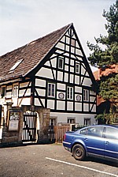

* * *

* * *

* * *

* * *

* * *

* * *

Die Geschichte der Dreieinigkeitsgemeinde Dresden-Kaditz der Evangelisch-Lutherischen
Freikirche geht bis in das 19. Jahrhundert zurück. 1837/38 gründeten drei Schuhmacher den ersten “Verein evangelisch-lutherischer Glaubensgenossen zur Unterstützung Armer und
Kranker”, dem vor allem Handwerker angehörten. 1868 entstand aus diesem Verein der Lutheraner-Verein, dessen Mitglieder die evangelische Kirche wieder stärker zu den
Lehren Luthers zurückführen wollten. Nach Verabschiedung neuer Gesetze, die den Kirchenaustritt wie auch die Bildung neuer religiöser Gemeinschaften ermöglichten, trat der
Vorsitzende des Dresdner Lutheraner-Vereins aus der lutherischen Landeskirche aus. Weitere Mitglieder in der Elbestadt sowie der zweiten “Hochburg” der neuen Kirche in
Zwickau und Planitz folgen ihm und gründeten 1876 die Evangelisch-Lutherische Freikirche in Sachsen. 1884 errichtete die Dresdner Gemeinde ein eigenes Gotteshaus, welches jedoch 1945 den Bomben zum Opfer fiel.

Nach 1945 versuchte die Gemeinde, an ihre frühere Tradition anzuknüpfen und einen Kirchenneubau zu realisieren.
Alle Bemühungen scheiterten jedoch an den gesellschaftlichen Verhältnissen in der DDR, so dass die Gottesdienste in
angemieteten Räumen stattfinden mussten. Erst 1993 konnte die Freikirche das Bauerngut Altkaditz 23 erwerben und zu einem kirchlichen Zentrum ausbauen. Am 27. Mai 1996 wurde der neue Kirchsaal eingeweiht.

* * *

 \[ [Home](../../../../index.html)\] \[ [Nord](../../../../nord/)\] \[ [Nordwest](../../../../nordwest/)\] \[ [Neustadt](../../../../neustadt/)\] \[ [Nordost](../../../../nordost/)\] \[ [West](../../../../west/)\] \[ [Zentrum](../../../../zentrum/)\] \[ [Südwest](../../../../sudwest/)\] \[ [Süd](../../../../sud/)\] \[ [Südost](../../../../sudost/)\] \[ [Ost](../../../../ost/)\] \[ [Register](../../../../Register/register.html)\] \[ [Kontakt](../../../../Kontakt/kontakt.html)\] \[ [Impressum](../../../../impressum/)\]
