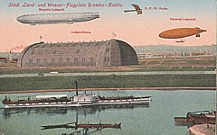
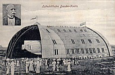

* * *

* * *

Die Geschichte des Flugplatzes Kaditz begann im Jahr 1912. Zuvor waren bereits Freiflächen in Reick und am Heller für Ballonaufstiege und Flugversuche genutzt worden, u. a. vom sächsischen Flugpionier Hermann Reichelt. Nachdem mehrfach Luftschiffe die Residenzstadt besucht hatten und sich das Fehlen eines befestigten Start- und Landeplatzes negativ bemerkbar machte, entschloss sich der Rat zu Dresden am 29. Oktober 1912 zum Bau eines städtischen Luftschiffhafens. Als geeignet wurde schließlich das Gelände zwischen Kaditz und Übigau gewählt, da sich hier weder größere Erhebungen noch störende Bebauung befanden. Gleichzeitig stationierte man dort eine Kompanie des Königlich-Preußischen Luftschiffer-Bataillons Nr. 3 unter Leitung des sächsischen Hauptmanns Gaissert.

Im April 1913 wurde mit dem Bau der Luftschiffhalle am Elbufer begonnen _(Foto)_. Auftragnehmer war die in Berlin ansässige Zeppelin-Hallenbau Gesellschaft m.b.H Bereits vor der endgültiger Fertigstellung landete am 19. September 1913 der erste Zeppelin mit Namen “Sachsen” in Kaditz und wurde von den Zuschauern begeistert begrüßt. Nach einer Rundfahrt über die Stadt und die Sächsische Schweiz kehrte das Luftschiff noch am gleichen Tag mit seinen 15 Passagieren nach Leipzig zurück. Wenige Wochen später konnte am 25. Oktober die Halle übergeben werden. Diese war 191 Meter lang und 58 Meter breit und bot Platz für zwei Luftschiffe, die hier auch betankt werden konnten. Hinzu kamen ein Aufenthaltsraum für die Passagiere und ein Büro. Vor der Luftschiffhalle lag der eigentliche Flugplatz, der mit einem Bretterzaun umgeben war. Außerdem entstanden dort Kassenhäuschen und Tribünen, die bei den geplanten Flugschauen Besuchern einen besseren Überblick über das Geschehen verschaffen sollten. Die offizielle Einweihung des Kaditzer Flugplatzes, offiziell als “Städtischer Land- und Wasser-Flugplatz Dresden” bezeichnet, erfolgte im Beisein des Königs und Tausender Dresdner am 26. Oktober 1913. Zugleich wurde eine Elbfähre nach dem gegenüberliegenden Stadtteil Cotta in Betrieb genommen, welche bis nach dem Ersten Weltkrieg existierte. Erster Direktor des Kaditzer Flugplatzes war der sächsische Leutnant Albert Willy Meyer (1885-1977), der sein Amt jedoch nach Ausbruch des Ersten Weltkriegs bereits am 2. August 1914 wieder aufgeben musste. Meyer hatte 1911 den Flugschein gemacht und galt als einer der besten Flieger seiner Zeit.

\+\+\+ fuer die mir namens des rats der stadtverordneten und buergerschaft zu dresden nach gluecklicher weihe des luftschiffhafens uebermittelte begruessung herzlichsten dank. mit dem ausdruck meiner frohen zuversicht, dass sich die gebrachten opfer und das meiner sache bewahrte vertrauen fuer dresden reichlich lohnen werden +++

**Telegramm Graf Zeppelins vom 26. Oktober 1913**

Nach der Einweihung fanden bis zum Beginn des Ersten Weltkrieges regelmäßige Schauvorführungen statt, an denen sowohl Luftschiffe als auch Flugzeuge teilnahmen. Höhepunkte waren der Besuch des französischen Kunstfliegers Adolphe Pégoud sowie die Testflüge Hermann Reichelts, der in seiner AERO Fliegerschule GmbH auch junge Flieger ausbildete. Hinzu kamen häufige Besuche verschiedener Zeppelin-Luftschiffe, die Dresden als Ziel oder Zwischenstation wählten. Auch der Kunstpilot Pierre Chanteloup und der Fallschirmspringer Thomik waren in Kaditz zu Gast. Zu den tragischen Zwischenfällen dieser Veranstaltungen gehörte der Tod Hermann Reichelts, der gemeinsam mit seiner Schwägerin am Karfreitag 1914 (10. April) in Kaditz abstürzte und dabei ums Leben kam.

Mit Beginn des Ersten Weltkrieges mussten alle zivilen Flüge eingestellt werden. Der Flugplatz wurde nun der Militärverwaltung unterstellt und für Kriegszwecke genutzt. Dafür entstanden 1914/15 angrenzend an den städtischen Bereich eine 184 Meter lange und 35 Meter breite Militärluftschiffhalle und eine Anlage zur Herstellung von Wasserstoffgas. Hinzu kamen Werkstätten und Unterkunftsräume für die hier stationierten Soldaten. Alle Versuche der Stadt Dresden, den Kaditzer Flugplatz zumindest zeitweise wieder für Veranstaltungen zu nutzen, scheiterten am Einspruch der Militärs, ebenso die geplante Einführung einer Luftpostverbindung zwischen Dresden und Leipzig. Erst im September 1918 wurde der Flugplatz an die städtischen Behörden zurückgegeben.

Am 23. März 1919 konnte ein Kurierdienst zwischen Dresden und Weimar eingerichtet werden. Außerdem gab es ab August auch wieder Schauflüge und Rundflüge mit Passagieren ab Dresden-Kaditz. Dieser Entwicklung setzten jedoch die im Versailler Vertrag festgelegten Bestimmungen 1920 ein jähes Ende. Auf Beschluss der ehemaligen Kriegsgegner mussten beide Luftschiffhallen sowie die meisten Nebengebäude abgetragen werden. Lediglich ein Flugzeugschuppen durfte erhalten bleiben und konnte ab 1921 wieder genutzt werden. Auf einem Großteil des ehemaligen Flugplatzgeländes entstanden nun Sportplätze und Gärten. Weitere Gebäude, darunter die Gasanstalt, wurden vom Kaditzer Unternehmen [Koch & Sterzel](../../../nordwest/ubigau/strassen_ubigau/koch___sterzel/) übernommen. Die große Zeppelinhalle erwarb eine Wilthener Firma und ließ sie auf ihr Betriebsgelände umsetzen, wo sie noch heute als Lagerraum der örtlichen Weinbrennerei dient.

Trotzdem gelang es in den folgenden Jahren, in bescheidenem Umfang wieder den Flugbetrieb aufzunehmen. So konnte am 1. Februar 1921 Dresden in das Luftpostnetz einbezogen werden. Regelmäßige Flugverbindungen gab es u. a. nach Berlin, Hamburg und Magdeburg. Auch Rundflüge konnten zu bestimmten Anlässen angeboten werden. Der vorgesehene Ausbau des Flugplatzes, der u. a. den Bau eines Empfangsgebäudes mit Gaststätte vorsah, scheiterte jedoch an den fehlenden finanziellen Mitteln. Die unzureichenden Bedingungen sowie die schlechte Verkehrsanbindung des Geländes führten schließlich 1923 zur vorläufigen Schließung des Platzes. Gelegentlich gab es bis 1926 noch Flüge, bevor am 12. April 1926 ein neuer Flugplatz am Heller in Betrieb genommen wurde. 1927 wurde der Kaditzer Platz endgültig stillgelegt und später teilweise bebaut.

Video: Die Junkers F13 und G24 auf dem Flugplatz Dresden-Kaditz um 1925

Aero Flugzeugbau- und Fliegerschule:

Das Unternehmen Aero Flugzeugbau- und Fliegerschule G.m.b.H. wurde 1912 von Hermann Reichelt _(Foto links)_ gegründet, welcher hier selbstkonstruierte Flugzeuge baute und eine Flugschule für angehende Piloten betrieb. Nach dem Tod Reichelts am 10. April 1914 übernahm dessen Freund Alfred Lipfert das Unternehmen. Lipfert, gelernter Zimmermann und Ingenieur,hatte bereits 1913 in Treben bei Altenburg die “Komet-Flugzeugwerke” gegründet und wechselte nun nach Dresden. Sein Büro befand sich zunächst auf der Moritzburger Straße 59, später in der Nähe der Produktionsstätten auf der Mengsstraße 9 in Übigau.

Die junge Firma baute bis zum Beginn des Ersten Weltkriegs Flugzeuge des von Reichelt entworfenen und von Lipfert weiterentwickelten Typs “Aero” _(Foto rechts)_, musste jedoch auf Weisung der Behörden am 5. Dezember 1914 schließen. Da die Produktion als nicht kriegswichtig eingestuft wurde, scheiterten alle Pläne zur Wiederaufnahme, ebenso wie der geplante Bau einer neuen Werkshalle am Rande des Kaditzer Flugplatzes. Lipfert musste wenig später seinen Kriegsdienst antreten und war bis 1918 als Fluglehrer und Ingenieur an der Königlich-Sächsischen Versuchsanstalt für Luftfahrt in Großenhain eingesetzt.

Nach seiner Entlassung plante der Unternehmer, seinen Betrieb fortzuführen. Der vorgesehene Bau eigener Flugzeuge scheiterte jedoch an Materialproblemen und der fehlenden Finanzierung. Lipfert erwarb daraufhin im Juni 1919 drei Kleinflugzeuge und setzte diese für Schau-, Schul- und Passagierflüge ein. Wegen der starken Beschränkungen des Flugzeugbaus durch den Versailler Vertrag und zahlreiche behördliche Restriktionen entschloss sich Lipfert Ende 1919, die Firma an Wilhelm Jesse zu verkaufen. Dieser änderte den Namen in “Sächsische Luftreederei G.m.b.H., kam jedoch bereits am 9. November 1920 bei einem Übungsflug auf dem Kaditzer Flugplatz ums Leben. Lipfert, der zwischenzeitlich ein neues Unternehmen auf der [Kötzschenbroder Straße](../../../nordwest/mickten/strassen_mickten/kotzschenbroder_strasse/) gegründet hatte, übernahm daraufhin seinen alten Betrieb zurück, musste jedoch im Januar 1921 Konkurs anmelden. Der Flugpionier zog sich daraufhin aus der Branche zurück. Die ehemalige Produktionshalle wurde im September 1921 gemeinsam mit der Luftschiffhalle abgerissen.

* * *

 \[ [Home](../../../index.html)\] \[ [Nord](../../../nord/)\] \[ [Nordwest](../../../nordwest/)\] \[ [Neustadt](../../../neustadt/)\] \[ [Nordost](../../../nordost/)\] \[ [West](../../../west/)\] \[ [Zentrum](../../../zentrum/)\] \[ [Südwest](../../../sudwest/)\] \[ [Süd](../../../sud/)\] \[ [Südost](../../../sudost/)\] \[ [Ost](../../../ost/)\] \[ [Register](../../../Register/register.html)\] \[ [Kontakt](../../../Kontakt/kontakt.html)\] \[ [Impressum](../../../impressum/)\]
