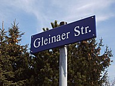

Das Dorf Gleina lag einst zwischen Trachau und Serkowitz in der Nähe der heutigen
Autobahnauffahrt Dresden-Neustadt. 1250 wurde der Ort erstmals urkundlich als “Glina” erwähnt. Der Name leitet sich vom slawischen Wort für Lehm her, was auf die
hiesige Bodenbeschaffenheit hindeutet. Das kleine Dorf bestand nur aus wenigen Gehöften und besaß insgesamt sieben Hufen Land. Unterstellt war die Siedlung dem
Meißner Domkapitel. Mehrfach taucht Gleina auch später noch in den Urkunden auf, so im Jahr 1302 und 1350.

Aus welchem Grund die Siedlung von ihren Bewohnern Ende des 14. Jahrhunderts
aufgegeben wurde, ist nicht bekannt. Vermutlich spielten wirtschaftliche Überlegungen eine Rolle. Die wüsten Felder wurden daraufhin von Kaditzer Bauern übernommen und lange Zeit noch
“die Gleinen” genannt. 1633 ist Gleina zum letzten Mal als “wüstes Dorf” in den Urkunden verzeichnet. Seit 1937 erinnert die Gleinaer Straße in der Kaditzer
Siedlung nördlich der Kötzschenbroder Straße an den verschwundenen Ort.

 \[ [Home](../../../index.html)\] \[ [Nord](../../../nord/)\] \[ [Nordwest](../../../nordwest/)\] \[ [Neustadt](../../../neustadt/)\] \[ [Nordost](../../../nordost/)\] \[ [West](../../../west/)\] \[ [Zentrum](../../../zentrum/)\] \[ [Südwest](../../../sudwest/)\] \[ [Süd](../../../sud/)\] \[ [Südost](../../../sudost/)\] \[ [Ost](../../../ost/)\] \[ [Register](../../../Register/register.html)\] \[ [Kontakt](../../../Kontakt/kontakt.html)\] \[ [Impressum](../../../impressum/)\]
