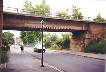
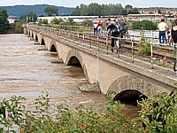

Die Geschichte der Kaditzer Industriebahn begann in den Dreißiger Jahren mit
ersten Plänen zum Bau eines Eisenbahnanschlusses für die Industriebetriebe zwischen Kaditz und Übigau. Vor allem die Firmen Dampfkesselbau Übigau und [Koch & Sterzel](../../../nordwest/ubigau/strassen_ubigau/koch___sterzel/) drängten auf einen solchen Anschluss, um ihre Erzeugnisse
kostengünstig zum Empfänger transportieren zu können. 1941 begannen sowjetische Kriegsgefangene mit den Erdarbeiten und dem Bau der erforderlichen
Straßenüberführungen. Kriegsbedingt wurde das Projekt jedoch bereits ein Jahr später vorerst aufgegeben.

Erst 1952 konnte der Eisenbahnbau zwischen Radebeul-Ost und Übigau fortgesetzt werden. Brückenbauten entstanden
u. a. zur Überquerung der Forst- und der Rankestraße (Foto) sowie als größtes Kunstbauwerk der 4,5 km langen
Strecke zur Überwindung der Flutrinne. Letztere wurde als Gewölbebogenbrücke errichtet, was ihr eine größere Stabilität
verlieh, gleichzeitig aber den Durchfluss des Wassers erschwerte. Am 25. November 1953 konnte die ausschließlich dem
Güterverkehr dienende Anschlussbahn eingeweiht werden. Den Betrieb übernahmen in den Anfangsjahren zwei
Dampflokomotiven, die später durch modernere dieselbetriebene Loks abgelöst wurden. Diese blieben bis zur Einstellung des Verkehrs 1993 im Einsatz und befinden sich heute im Eisenbahnmuseum in Schwarzenberg.

Nach der politischen Wende erfolgte auch eine grundlegende Umstrukturierung des Kaditz-Übigauer Industriegebietes. Mit Übernahme des ehemaligen Transformatoren-
und Röntgenwerkes durch Siemens endete dort die Herstellung von elektrotechnischen Großgeräten, so dass die Anschlussbahn überflüssig wurde. Ein Großteil der
Gleisanlagen wurde daraufhin abgebaut, die beim Hochwasser 2002 schwer beschädigte Brücke über die Flutrinne im November 2003 beseitigt.

_Die Brücke über die Flutrinne beim Elbehochwasser am 16. August 2002_

_(Foto: Volkmar Döring)_

* * *

 \[ [Home](../../../index.html)\] \[ [Nord](../../../nord/)\] \[ [Nordwest](../../../nordwest/)\] \[ [Neustadt](../../../neustadt/)\] \[ [Nordost](../../../nordost/)\] \[ [West](../../../west/)\] \[ [Zentrum](../../../zentrum/)\] \[ [Südwest](../../../sudwest/)\] \[ [Süd](../../../sud/)\] \[ [Südost](../../../sudost/)\] \[ [Ost](../../../ost/)\] \[ [Register](../../../Register/register.html)\] \[ [Kontakt](../../../Kontakt/kontakt.html)\] \[ [Impressum](../../../impressum/)\]
