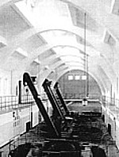
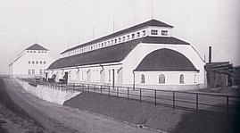

* * *

* * *

[**Zur Homepage**](http://www.stadtentwaesserung-dresden.de)

Erste Pläne zum Bau einer städtischen Kläranlage kamen kurz nach 1900 auf, nachdem ein
Gutachten des Reichsgesundheitsamtes eine Reinigung der Abwässer vor deren Einleitung in die Elbe gefordert hatte. Zuvor wurden diese in Fäkaliengruben unmittelbar auf den
Grundstücken gesammelt und von dort in regelmäßigen Abständen abtransportiert. Um hygienischen Problemen zu begegnen, übernahm 1871 die Düngerexport-Actiengesellschaft
die Beräumung dieser Gruben. Als eine der ersten Städte Deutschlands besaß Dresden außerdem seit dem 19. Jahrhundert eine Kanalisation, die nach Abtragung der
Stadtbefestigung entstanden und ständig erweitert worden war. Wesentlichen Anteil daran hatte der Leiter der Tiefbauabteilung des Stadtplanungsamtes Carl Manck, welcher bis
1874 drei neue zur Elbe führende Hauptschleusen anlegen ließ. 1890 begann unter Leitung seines Nachfolgers, des Stadtbaurates Hermann Klette, der planmäßige Ausbau des
vorhandenen Netzes, wobei das Gebiet Kaditz/ Mickten als optimaler Endpunkt des Kanalsystems ermittelt wurde.
Doch erst mit der Eingemeindung von Kaditz war die Voraussetzung für den Bau einer Kläranlage an dieser Stelle geschaffen.

Zunächst begannen die Arbeiten mit dem Bau einer Versuchsanlage unterhalb der Marienbrücke, womit die verschiedenen Reinigungsverfahren und -anlagen erprobt werden sollten. Nach Abschluss der Testphase entstand
1909/10 die Kaditzer Kläranlage und wurde am 15. Juli 1910 in Betrieb genommen. Die von Hans Erlwein und Hermann Klette projektierte Anlage dient der Reinigung der Abwässer aus dem gesamten Stadtgebiet und einiger
Nachbarorte, die in einem weitverzweigten Kanalnetz durch natürliches Gefälle nach Kaditz geleitet werden. Der
Standort am Elbufer wurde gewählt, da sich hier eine der tiefsten Stellen des Dresdner Stadtgebietes befindet.  Zur
Unterquerung der Elbe dienen zwei Dükerrohre in der Nähe der Flügelwegbrücke. Das Kaditzer Klärwerk bildete den Abschluss der seit 1874 ausgebauten Dresdner Schwemmkanalisation und war zum Zeitpunkt seiner Entstehung
modernstes in Europa. Neben den für die Abwasserreinigung erforderlichen Anlagen entstanden auch Betriebs- und Bürogebäude sowie Aufenthalts- und Sanitärräume für die Beschäftigten.

**_Foto:_** _Klärwerk Kaditz um 1910_

Nach Einleitung des Abwassers wird dieses durch Grobrechen, Siebscheiben und Sandfänge geleitet und dort
vorgereinigt. Anschließend erfolgt in mehreren Stufen die eigentliche Reinigung. Der anfallende Schlamm wurde noch
bis 1986 in zwei sogenannten Faultürmen unter Luftabschluss zersetzt und konnte so als Dünger in der Landwirtschaft
eingesetzt werden. In den 60er Jahren entstand zusätzlich ein Rohrleitungssystem, mit dessen Hilfe der Naßschlamm direkt auf den Feldern der Umgebung verregnet werden konnte.

Finanzielle Engpässe verhinderten jedoch den bereits unmittelbar nach dem Zweiten Weltkrieg geplanten Ausbau des Kaditzer Klärwerks. Erschwerend kam der Bau neuer Wohngebiete mit modernen WC-Anlagen hinzu, so dass die
Menge der zu klärenden Abwässer ständig stieg. Am 2. Januar 1987 wurde die Kaditzer Anlage nach einer Havarie
außer Betrieb genommen, so dass das Abwasser bis zur Wende ungereinigt in die Elbe floss und so zu deren starker Verschmutzung beitrug.

Da das 1991 wieder funktionstüchtig gemachte Klärwerk inzwischen nicht mehr den Umweltanforderungen genügte, wurden Mitte der 1990er Jahre umfangreiche Modernisierungsmaßnahmen durchgeführt. Seit 1993 erfolgt neben der
mechanischen auch eine biologische Klärung des Abwassers, die eine Reinheit von ca. 90 % gewährleistet. 1996
wurde im Betriebsgelände ein Gedenkstein für die Erbauer der Anlage, Hans Erlwein und Hermann Klette, aufgestellt. 2002 folgte der Ausbau der früheren Faultürme zu Büro- und Technikräumen. Diese beiden 1936 und 1950
errichteten Bauten stehen ebenso wie die von Erlwein entworfenen älteren Gebäude als Industriedenkmal unter Denkmalschutz und wurden in den letzten Jahren saniert. Außerdem entstand hier 2004 Dresdens bislang größte
Solarstromanlage. Eine moderne Klärgasanlage zur umweltfreundlichen Energiegewinnung folgte 2011. Weitere Freiflächen wurden zu kleinen Seen und Feuchtbiotopen umgewandelt und mit Kunstwerken rund um das Thema
“Wasser” gestaltet. Außerdem gibt es auf dem Areal der Kaditzer Kläranlage eine Wildvogel-Auffangstation zur zeitweisen Versorgung kranker oder verletzter Tiere.

Video: Der Weg des Dresdner Abwassers

* * *

 \[ [Home](../../../index.html)\] \[ [Nord](../../../nord/)\] \[ [Nordwest](../../../nordwest/)\] \[ [Neustadt](../../../neustadt/)\] \[ [Nordost](../../../nordost/)\] \[ [West](../../../west/)\] \[ [Zentrum](../../../zentrum/)\] \[ [Südwest](../../../sudwest/)\] \[ [Süd](../../../sud/)\] \[ [Südost](../../../sudost/)\] \[ [Ost](../../../ost/)\] \[ [Register](../../../Register/register.html)\] \[ [Kontakt](../../../Kontakt/kontakt.html)\] \[ [Impressum](../../../impressum/)\]
