Die um 1900 angelegte Adolfstraße im Ortsteil Neukaditz erhielt ihren Namen nach dem Kaditzer Gutsbesitzer Adolf Franze, der hier ein Grundstück besaß und viele Jahre Mitglied des Gemeinderates war. Ursprünglich wurde das Areal gärtnerisch genutzt, bevor zwischen 1937 und 1939 auf dem Grundstück eine Wohnanlage der Gemeinnützigen Wohnungs- und Heimstättengenossenschaft (GEWOAG) entstand. Die Bauplanung übernahmen die Architekten Palm und Schmersal. Heute gehören die nach 1990 sanierten Wohnblocks der Sächsischen Wohnungsgenossenschaft.

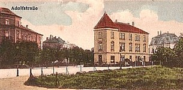

**_Foto:_** _Blick in die Adolfstraße um 1900_

Der Name Am Kaditzer Tännicht weist auf das frühere Waldgebiet hin, welches sich ursprünglich zwischen Radebeul und der Flurgrenze zu Mickten erstreckte. Die Rodung begann um 1890 von Radebeul aus zugunsten von Wohnbebauung. Bis 1927 war das meist aus Kiefern bestehende [Tännicht](../../../nordwest/) fast vollständig verschwunden. Im Südteil entstand 1937/38 eine ausgedehnte Siedlung, deren Straßen ihre Bezeichnungen teilweise nach alten Kaditzer Flurnamen erhielten. In diesem Zusammenhang wurde auch die Straße Am Kaditzer Tännicht angelegt. Architekten der hier befindlichen Gebäude waren Herbert Terpitz und Horst Grabner.

Die Straße Am Kesselgrund wurde 1937 für den zweiten Bauabschnitt der Kaditzer Siedlung angelegt. In der Folgezeit
entstanden hier und an der benachbarten Gleinaer Straße mehrere Doppelhäuser, wobei die vollständige Fertigstellung der
Siedlung durch den Zweiten Weltkrieg verhindert wurde. 1939 erhielt die Straße ihre Bezeichnung nach dem alten Flurnamen “Kesselgründchen”

Mitte der 1930er Jahre wurde in Kleinkaditz, unmittelbar an der Stadtgrenze zu Radebeul, ein neues Wohngebiet errichtet. In
diesem Zusammenhang entstand auch die Straße Am Seegraben, welche im Juni 1939 ihren Namen erhielt. Dieser erinnert an den einstigen Seegraben, einen heute weitgehend verschütteten alten Elbarm.

Die Straße Am Stadtrand wurde zur Erschließung der auf dem Gelände des früheren Kaditzer Tännichts Kaditzer Siedlung
angelegt und im Juni 1937 benannt. In unmittelbarer Nähe verläuft die Stadtgrenze zu Radebeul.

Die Straße wurde 1939 angelegt und nach dem ehemals hier gelegenen bischöflichen Vorwerk Poppewitz Am Vorwerksfeld
benannt. Dieser Ortsteil, der erst im 15. Jahrhundert zu Kaditz kam, wurde früher auch als Kleinkaditz bezeichnet. Die
Siedlungshäuser entstanden in den ersten Jahren des Zweiten Weltkrieges und konnten 1940-42 bezogen werden. Heute erinnern Straßennamen wie Am Seegraben, Gucksbergweg, Weingartenweg und Kathenweg an die Fluren des
verschwundenen Vorwerks und dessen frühere Bewohner. 1951 entstand Am Vorwerksfeld eine Wendeschleife für die neu eingerichtete Buslinie, mit der sich die Verkehrsbedingungen im Ort deutlich verbesserten.

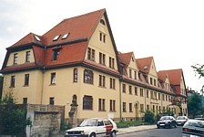Die Straße An den Hufen erinnert seit 1911 an den ältesten Teil des Ortes Kaditz, der im 13. Jahrhundert zunächst aus nur sechs Höfen bestand. Die zugehörigen Felder östlich des Dorfes wurden früher nach einem alten Flächenmaß “die Hufen” genannt. Erst nach 1900 wurde dieses Gebiet mit Wohnhäusern bebaut. Aus dem Jahr 1912 stammt die in Anlehnung an Erlweins Bauten gestaltete Wohnzeile An den Hufen 3-11 _(Foto)_. Die zweigeschossige Zeile besteht aus insgesamt fünf Gebäuden und weist typische Bauformen ihrer Zeit mit Zwerchgiebeln, Mansarddächern und Rundbögen auf. Wegen ihrer städtebaulichen Bedeutung stehen diese Häuser unter Denkmalschutz.

Weitere Wohnhäuser wurden 1928-30 von der Baugenossenschaft Volksheim Dresden errichtet. Die Doppelhäuser An den Hufen 12/14, 13/15 und die beiden Einzelhäuser Nr. 16 und 17 bilden zusammen mit weiteren Gebäuden an der Andersen- und Grimmstraße eine bauliche Einheit und stehen als „Siedlung Volksheim Kaditz“ unter Denkmalschutz. Architekt dieser aus über 200 Wohnungen bestehenden Anlage war Martin Mitzscherling. Im Geist der sozialreformerischen Ideen erhielten alle Mieter nicht nur Bäder, WCs und Loggias sondern auch einen kleinen zur Eigenbewirtschaftung gedachten Garten. Die Fassaden der dreigeschossigen Häuser sind mit expressionistischen Elementen wie Klinkerbändern, dreieckigen Dachfenster und vorkragenden Erkern gestaltet.

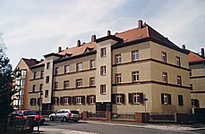Die Andersenstraße wurde 1927 östlich des Dorfkerns angelegt und nach dem dänischen Märchendichter Hans Christian Andersen (1805-1875) benannt. Bekannt wurde er u.a. durch seine Märchen von der “Kleinen Meerjungfrau” und “Des Kaisers neue Kleider”. Mehrfach weilte Andersen in Dresden und verfasste hier einige seiner
Reiseberichte. Eng befreundet war er mit dem Maxener Rittergutsbesitzer und Mäzen Friedrich Anton Serre. Die Wohnhäuser an der Andersenstraße wurden zwischen 1927 und 1930 von der Baugenossenschaft Volksheim Dresden nach Plänen des Architekten Mitzscherling errichtet und weisen expressionistische Stilelemente auf. Als architektonisch wertvolles Zeugnis des sozialen Wohnungsbaus stehen die Gebäude Nr. 2/4, 15/17 und 16/18 unter Denkmalschutz. Im Haus Nr. 18 befand sich ab 1937 eine Postagentur, später das Postamt Dresden 37.

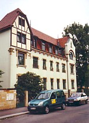Die Baudissinstraße entstand Ende des 19. Jahrhunderts in Neukaditz und erhielt zunächst den Namen Forststraße. Ausschlaggebend war dabei ihre Lage am Rande eines nach 1890 gerodeten Wäldchens in diesem Bereich. 1904 wurde sie in Baudissinstraße umbenannt. Graf Wolf Heinrich von Baudissin (1789-1878) lebte ab 1827 in Dresden und erwarb sich als Übersetzer der Werke Shakespeares und Molieres literarische Verdienste.

Interessant sind einige Wohngebäude mit historistischen und Jugendstilelementen, u.a. das 1899 errichtete Eckhaus zur Peschelstraße (Nr. 11) mit Ladengeschäft und das Mietshaus Nr. 18 _(Foto)_ von 1902. Bemerkenswert sind die farblich gestalteten Männerköpfe am Gebäudesims, welche an Fabelwesen erinnern. 1996 wurde das Haus denkmalgerecht saniert. In dem 1900 erbauten Eckhaus zur Adolfstraße (Nr. 2) gab es ab 1930 eine Lebensmittelverteilungsstelle des Konsumvereins "Vorwärts".

Die Bobestraße wurde 1926 im Zusammenhang mit dem Bau einer kleinen Wohnanlage an der Rankestraße angelegt und
nach Friedrich Hermann Bobe (1860-1925) benannt. Bobe war Mitbegründer und Vorsitzender des Konsumvereins Pieschen und erwarb sich große Verdienste um den Aufbau der Dresdner Konsum-Genossenschaft. Im August 1937 erhielt
die Bobestraße den Namen Strachwitzstraße. Allerdings wurde diese Namensgebung 1956 wieder rückgängig gemacht. Moritz Wilhelm Graf von Strachwitz (1822-1847) schrieb verschiedene Balladen und Gedichte, meist heroisch-patriotischem
Inhalts.

Die Dungerstraße wurde nach dem Ersten Weltkrieg als Seitenstraße der Rankestraße angelegt und zunächst nach dem
Vorsitzenden des Zentralverbandes deutscher Konsumvereine Max Radestock (1854-1913) benannt. 1935 erhielt sie ihren heutigen Namen. Dr. Hermann Dunger (1843-1912) erwarb sich Verdienste als Sprachwissenschaftler und Pädagoge und
war ab 1885 Konrektor des Wettiner-Gymnasiums in der Wilsdruffer Vorstadt.

Nachdem bereits 1913 an der Geibelstraße mit dem Bau einer Arbeiter-Wohnsiedlung begonnen worden war, entstand bis
1926 der Komplex zwischen Ranke-, Bobe- und Dungerstraße. Die Gebäude gruppieren sich um einen begrünten Innenhof
und stellen ein interessantes Zeugnis des sozialen Wohnungsbaus der Zeit nach dem Ersten Weltkrieg dar. Im Eckhaus zur
Rankestraße befand sich bis 1924 die Gaststätte “Zur Elbthalbrauerei”, die zugleich Vereinslokal des Kaditzer Sportvereins „Sportfreunde Kaditz 09“ war.

Die an der Stadtgrenze zu Radebeul gelegene Emilienstraße wurde 1899 nach der Gattin des Hofrats Dr. Karl Kolbe benannt. Kolbe (1855-1909) war Generaldirektor der Chemischen Fabrik von Heyden und trug durch seine Arbeit wesentlich zum Erfolg des Unternehmens bei. U. a. gelang der Firma erstmals die synthetische Herstellung von Salizylsäure, Grundstoff für das noch heute weitverbreitete Medikament Aspirin. Kolbe hatte auch den Bau der Straße unterstützt.

Um 1900 entstanden hier mehrere Fabriken, darunter die weit über die Stadtgrenzen hinaus bekannte Firma Albin Lasch & Co., die Ladeneinrichtungen und Schauvitrinen herstellte. Aus einer 1912 gegründeten Chemischen Fabrik entwickelte sich später die Barock Bürobedarf GmbH, einst bedeutender Hersteller von Farb- und Tintenpatronen. Nach Insolvenz der Firma wurde der Betrieb 2012 geschlossen.

Außerdem prägen Wohnhäuser der Gründerzeit das Straßenbild. Um 1900 entstand das unter Denkmalschutz stehende Doppelmietshaus Emilienstraße 1 / Ecke Rankestraße. Der markante Bau besitzt eine Klinker-Werkstein-Fassade mit für die Dresdner Vororte seltenen neobarocken Schmuckelementen und figürlichen Darstellungen. 2013 wurde das Gebäude saniert. Architektonisch bemerkenswert ist auch das Haus Nr. 7, ein spätgründerzeitlicher Bau von 1898. Auch dieses villenartig gestaltete Gebäude ist mit einer Klinkerfassade versehen und wird durch Balkone und Erker und ein Stuckrelief verziert. Wegen seines weitgehend unveränderten Bauzustandes aus der Entstehungszeit steht auch dieses Gebäude unter Denkmalschutz.

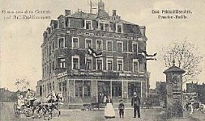Die heutige Fechnerstraße ist Teil eines alten Verbindungsweges zwischen Kaditz und Trachau. Als nach 1890 der Ausbau des Stadtteils Neukaditz an der Leipziger Straße begann, erhielt dieser Weg 1895 zunächst den Namen Albertstraße. Namensgeber war der zu dieser Zeit regierende sächsische König Albert (1828-1902). Um Verwechslungen mit gleichnamigen Straßen in anderen Stadtteilen zu vermeiden, wurde sie nach der Eingemeindung von Kaditz am 1. Januar 1904 in Fechnerstraße umbenannt. Gustav Theodor Fechner (1801-1887) war als Physiker und Philosophie-Professor an der Leipziger Universität tätig und ist Verfasser eines “Hauslexikons”, welches 1834/38 in Leipzig erschien. Zuvor hatte er ab 1815 einige Jahre in Dresden gelebt und hier die Kreuzschule besucht.

Markantestes Gebäude an der Fechnerstraße ist der bereits 1874 eröffnete [Gasthof zu Neukaditz](../../../neustadt/leipziger_vorstadt/leipziger_strasse/rudi_arndt/) _(Foto)_, der nach 1945 unter dem Namen Jugendclubhaus “Rudi Arndt” beliebtes Kulturzentrum des Dresdner Nordwestens war.
Die ersten Wohnhäuser entstanden um 1860 und waren traufständige eingeschossige Bauten mit steilem Satteldach. Sie gehören heute zu den wenigen dörflich geprägten Bauten von Neukaditz, die bis zur Gegenwart erhalten blieben und stehen unter Denkmalschutz (Nr. 4, 6 und 7). Ebenfalls aus dieser Zeit stammt das Wohnhaus Nr. 14. Jüngeren Datums ist das markante Doppelhaus Fechnerstraße 28 / Wächterstraße 39b von 1912, welches ebenfalls auf der städtischen Denkmalliste steht.

>Die Fürstenhainer Straße geht auf einen alten Feldweg zurück und führt von der Kaditzer Kirche zur Kötzschenbroder Straße. 1899 erhielt dieser offiziell den Namen Bernhardstraße. Namensgeber war der Kaditzer Gemeindepfarrer Karl Bernhard Henrici (1837–1924), nach dem auch die Henricistraße in Trachau benannt ist. Im Zusammenhang mit der Eingemeindung erfolgte 1904 die Umbenennung in Fürstenhainer Straße. Der kleine Ort Fürstenhain ist heute ein Stadtteil von Radebeul. Im Zusammenhang mit dem Bau der Kaditzer Siedlung wurde die Fürstenhainer Straße in den 1930er Jahren verlängert.

Architektonisch bemerkenswert ist das Doppelhaus Fürstenhainer Straße 26/28, Teil der zwischen 1936 und 1938 entstandenen „Gemeinschaftssiedlung Kaditz“. Die im Sinne der nationalsozialistischen Siedlungspolitik als „Volkswohnungsbauten“ propagierten Häuser wurden vom Stadtplanungsamt Dresden unter Leitung von Paul Wolf gestaltet und bevorzugt an kinderreiche Familien vergeben. Nach umfassender Sanierung 1998-2000 gehören diese Gebäude heute zum „Familien-Wohnpark Kaditz“.

Die Geibelstraße wurde 1903 angelegt und zu Beginn des darauffolgenden Jahres nach dem Dichter Emanuel Geibel (1815-1884) benannt. Geibel gehörte Mitte des 19. Jahrhunderts dem Münchner Liederkreis an und verfasste zahlreiche Gedichte, darunter das als Volkslied bekannte “Der Mai ist gekommen...”.

Zunächst gab es hier nur ein Haus (Nr. 2). Ab 1913 wurde eine aus mehreren Gebäuden bestehende Wohnanlage errichtet (Nr. 1-19), die bis 1926 vollendet werden konnte. Bauherr war der Konsumverein Pieschen. Die Häuser bilden eine hofartige Anlage, die durch mit Pavillons und Torsäulen gestaltete Einfahrten erschlossen wird. Als in dieser Form in Dresden singuläres Beispiel des Kleinwohnungsbaus dieser Zeit steht die gesamte Anlage unter Denkmalschutz. Die früheren Arbeiterwohnungen wurden 1999 saniert. Im Eckhaus zur Rankestraße (Geibelstraße 1) befand sich ab 1930 eine Verkaufsstelle des Konsumvereins "Vorwärts", die noch bis Anfang der 1990er Jahre existierte.

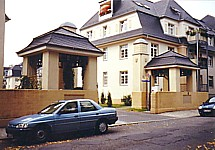

**_Foto:_** _Eingang zur Wohnanlage Geibelstraße/Bobestraße/Rankestraße_

Sportplatz: Der heute vom Sportverein Dresden-Neustadt 1950 e.V. genutzte Hartplatz am Ende der Geibelstraße entstand um 1920 als Sport- und Trainingsgelände des Fußballvereins “Sportfreunde Kaditz 09”. Zuvor besaß der Verein ein Gelände an der Grimmstraße. Neben dem Spielfeld gab es eine Laufbahn, welche u.a. der bekannte Dresdner Läufer Rudolf Harbig als Trainingsstrecke nutzte. 1950 übernahm der Sportverein Dresden-Neustadt das Areal. Das Sportcasino wurde am 12. Mai 1958 eröffnet.

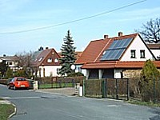Die 1937 angelegte Gleinaer Straße in der Kaditzer Siedlung erinnert an das frühere Dorf [Gleina](../../../nordwest/kaditz/gleina/), welches im 14. Jahrhundert von seinen Bewohnern verlassen wurde. Die wüste Flur kam daraufhin zu Kaditz. Gleina lag in der Nähe der heutigen Autobahnanschlusstelle
Dresden-Neustadt zwischen dem Kaditzer Dorfkern und Mickten und wurde 1250 erstmals erwähnt.

Die Straße entstand im Zusammenhang mit dem Bau einer Gemeinschaftssiedlung, für die
1938 ein Wettbewerb ausgeschrieben wurde. An der Kreuzung Gleinaer Straße/ Spitzhausstraße war eine zentrale Platzanlage mit verschiedenen öffentlichen Gebäuden
und einem Denkmal geplant, welches den “nationalsozialistischen Gemeinschaftsgedanken” symbolisieren sollte. Kriegsbedingt
wurde der Entwurf des Architekten Hans Richter nicht ausgeführt, so dass die Gleinaer Straße bis heute aus zwei voneinander getrennten Abschnitten besteht.

Da der ursprünglich für die Siedlung vorgesehene Kindergarten durch den Beginn des Zweiten Weltkrieges nicht mehr gebaut
werden konnte, entstand 1943 auf dem Grundstück Gleinaer Straße 52 a eine Baracke, in der die Kinder berufstätiger Mütter betreut wurden. Erst 1969 verschwand dieses Provisorium zugunsten eines größeren Neubaus, der bis heute als
Kindertagesstätte genutzt wird.

Die Grimmstraße entstand als Verbindungsweg zwischen Kaditz und Trachau und wurde erst Ende des 19. Jahrhunderts zur Straße ausgebaut. Die im Volksmund auch als Trachauer Kirchweg bezeichnete Straße erhielt 1896 zunächst den Namen Haupt- bzw. Wilhelmstraße. 1904 wurden beide Straßenteile im Zusammenhang mit der Eingemeindung von Kaditz in Grimmstraße umbenannt. Namenspaten waren die als Märchensammler und Sprachwissenschaftler bekannten Brüder Jacob (1785-1863) und Wilhelm Grimm (1786-1859). Heute führt die Grimmstraße nur noch bis zum Damm der Autobahn, durch deren Ausbau der durchgängige Verlauf nach Trachau 1995 unterbrochen wurde. Der Restabschnitt wurde beim Bau des Elbeparks in die Peschelstraße einbezogen.

In der Nähe des Riegelplatzes befinden sich einige Wohnhäuser (Nr. 46-54), die 1927 vom Architekten Martin Mitzscherling entworfen wurden. Bauherr der aus insgesamt Gebäuden bestehenden kleinen Wohnanlage, die sich auch in die Nachbarstraßen erstreckt, war die Baugenossenschaft „Siedlung Volksheim Kaditz“. Die zum Teil mit expressionistischen Gestaltungselementen versehenen Häuser stehen als Zeugnis des Kleinwohnungs- und Siedlungsbaus der Weimarer Republik unter Schutz. Weitere Grundstücke werden vom Kleingartenverein “Seewiesen Kaditz” e.V. eingenommen. Zuvor diente das Areal von 1913 bis 1920 als Sportplatz des Fußballvereins „Sportfreunde Kaditz 09“.

Dorfschmiede: Kaditz erhielt seine erste Schmiede im Jahr 1701, nachdem zuvor alle anfallenden Arbeiten in Kötzschenbroda bzw. Serkowitz erledigt werden mussten. Zu den Aufgaben des Dorfschmieds gehörte neben dem Beschlagen der Pferde die Anfertigung landwirtschaftlicher Geräte und Werkzeuge sowie deren Reparatur. Die Schmiede befand sich in einem Fachwerkbau am Dorfrand (heute Grimmstraße 88), wo sie alle größeren Dorfbrände überstand und somit zu den ältesten Gebäuden des Ortes gehört. Bis heute befindet sie sich im Familienbesitz.

Der Gucksbergweg im Ortsteil Kleinkaditz wurde in den 1930er Jahren beim Bau eines Wohngebietes unmittelbar an der Stadtgrenze zu Radebeul angelegt. Die Namensgebung erfolgte 1939 nach einer kleinen Erhebung, die früher als "der Goppitz", "Guppitz" bzw. als "Gucksberg" bezeichnet wurde.

Die Gustav-Schwab-Straße wurde 1927 angelegt und verdankt ihren Namen dem deutschen Schriftsteller Gustav Schwab (1792-1850). Er gehörte als Lyriker der sogenannten “schwäbischen Dichterschule” an und wurde vor allem als Sammler von Sagen bekannt, die er ab 1838 in mehreren Bänden veröffentlichte. Ende der 1920er Jahre entstanden hier mit den Häusern Nr. 7 und 6 zwei Wohnhäuser der „Siedlung Volksheim Kaditz“, die sich zwischen den Straßen An den Hufen, Andersenstraße, Grimmstraße und Gustav-Schwab-Straße erstreckt und unter Denkmalschutz steht. Erst 1954 wurden die Freiflächen zwischen Gustav-Schwab-Straße und Kötzschenbroder Straße mit Werkswohnungen des VEB TuR Dresden bebaut.

Der Kathenweg liegt im Ortsteil Kleinkaditz, einem in den 1930 Jahren unweit der Radebeuler Stadtgrenze angelegten Wohngebiet. In Erinnerung an die früheren einfachen Wohnhäuser armer Landarbeiter, den Kathen, erhielt der Weg im Juni 1939 seinen Namen.

Der Kleinsiedlerweg entstand Mitte der 1930er Jahre in der Kaditzer Siedlung zwischen Gleinaer und Kötzschenbroder Straße. Nach den hier errichteten "Kleinsiedlerhäusern" erhielt er 1937 seinen Namen.

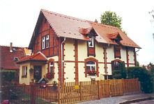Die an der Ortsgrenze zu Trachau im Ortsteil Neukaditz gelegene Straße erhielt 1892 zu Ehren des damaligen Kronprinzen zunächst den Namen Georgstraße. 1904 erfolgte die Umbenennung in Kolbestraße. Hermann Kolbe (1818-1884) arbeitete als Chemiker auf dem Gebiet der organischen Säuren und entwickelte als erster ein Verfahren zur synthetischen Herstellung von Salizylsäure. Industriell verwertet wurde sein Verfahren später von der in Radebeul ansässigen Chemischen Fabrik von Heyden.

Die ab 1929 als “Heinrich-Koch-Häuser” bezeichneten acht Einfamilien-Doppelhäuser an der Kolbe- und Roscherstraße (Nr. 3-17) entstanden ab 1887 und waren eine der ersten genossenschaftlichen Arbeitersiedlungen in Dresden. Erbaut wurden diese nach Vorbildern aus dem norddeutschen Raum mit Fachwerk und Klinkerfassaden durch den “Dresdner Bauverein für Arbeiterwohnungen”. Nach dessen Liquidation 1898 übernahm der Dresdner Spar- und Bauvereins die Gebäude, welche sich heute in Privatbesitz befinden. Zum Komplex gehört auch das repräsentative sogenannte ["Friedrich-August-Haus"](../../../neustadt/leipziger_vorstadt/leipziger_strasse/) an der Leipziger Straße.

Die Kötitzer Straße wurde Mitte der 1930er Jahre in der Kaditzer Siedlung auf dem Gebiet des früheren Tännichts angelegt. Im Oktober 1937 erhielt sie nach dem Dorf Kötitz, heute ein Ortsteil von Coswig, ihren Namen.

Der Name dieser 1937 angelegten Straße in der Kaditzer Siedlung leitet sich von einem alten Flurnamen “Langefeldchen” ab. Ursprünglich gehörten diese Flächen zum Vorwerk Poppewitz und wurden nach dessen Auflösung in 30 schmale Streifen geteilt, die an Kaditzer Bauern abgegeben wurden. Die Gebäude entstanden 1937/38. Im Juni 1937 erhielt die Straße ihre Bezeichnung "Lange Felder".

Die um 1900 angelegte und zunächst nach der Gattin des letzten Kaditzer Gemeindevorstehers Theresienstraße genannte Straße erhielt 1904 ihren heutigen Namen Leuckartstraße. Rudolf Leuckart (1822-1898) wirkte als Zoologe und Parasitenforscher in Leipzig und Gießen und gilt als Entdecker der Trichinen. Von den Wohnhäusern der Straße stehen neben dem "Rankeschlöschen" auch die Mietshäuser Nr. 3 (Baujahr 1902) und Nr. 12 (Baujahr um 1900), beide repräsentative Eckbauten, unter Denkmalschutz.

Rankeschlösschen (Nr. 2):  Das dreigeschossige Eckhaus an der Einmündung der Leuckart- in die Rankestraße entstand 1903 als Wohn- und Geschäftshaus. Architekt war der aus Mickten stammende Benno Hübel, die Ausführung übernahm die Baufirma Wilhelm Tennert aus Radebeul. Der mit Jugendstilelementen und historisierenden Fachwerkgiebeln gestaltete Bau besteht aus zwei Teilen an der Leuckart- und Rankestraße (Nr. 21) und beherbergte von Beginn an eine Gaststätte. Zunächst wurde diese nach ihrem Besitzer Hänsels Restaurant genannt, bevor sich nach dem Ersten Weltkrieg der Name "Zum Rankeschlösschen" etablierte. Nach 1990 wurde das Gebäude denkmalgerecht saniert und wird heute als indisches Restaurant "Taj Mahal" genutzt.

Die Peschelstraße wurde 1896 angelegt und zunächst nach dem Kaditzer Gutsbesitzer Carl Kuhn Carlstraße benannt. 1904
bekam sie ihren jetzigen Namen nach dem Geografen Oskar Peschel (1826-1875), der als Universitätsprofessor in Leipzig tätig war und zu den Begründern der Geomorphologie gehört. Nach 1990 entstand zwischen Peschelstraße und
Lommatzscher Straße das Einkaufszentrum “Elbepark”. Der hier geplante neue Stadtteil wird heute meist als Kaditz-Mickten bezeichnet, da er sich anteilig auf den Fluren beider Stadtteile befindet.

Die unmittelbar am Bahndamm der 1839 eröffneten Bahnstrecke Dresden-Leipzig entlangführende Straße erhielt 1897
zunächst den Namen Bahnstraße, bevor sie im Zusammenhang mit der Eingemeindung von Kaditz 1904 in Quandtstraße umbenannt wurde. Johann Gottlieb von Quandt (1787-1859) besaß in der Neustadt und in Dittersbach bei Pirna
Grundstücke und galt als exzellenter Kunstkenner und Mäzen. Zu seinem Freundeskreis gehörten u. a. Johann Wolfgang von Goethe und viele Personen des Dresdner Kunstlebens des 19. Jahrhunderts.

Die Ende des 19. Jahrhunderts ganz im Osten der damaligen Gemeindeflur angelegte Straße trug zunächst den Namen
Oststraße, bevor sie im Zusammenhang mit der Eingemeindung von Kaditz 1904 nach dem Historiker Leopold von Ranke (1795-1886) benannt wurde. Ranke gilt als bedeutendster Geschichtsschreiber des 19. Jahrhunderts und führte die
Quellenkritik in die Geschichtsforschung ein.

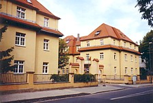Zu den um 1900 entstandenen Gebäuden an der Rankestraße gehörte die weit über
die Ortsgrenzen hinaus bekannte Gastwirtschaft “Zum Rankeschlößchen” (Eröffnung 1903) sowie die frühere Elbthal-Brauerei. Ab 1930 nutzte die Firma KADEMA, Hersteller von Maschinen für die Schokoladenindustrie, deren Gebäude auf der
Rankestraße 56. Auch auf den Nachbargrundstücken ließen sich verschiedene gewerbliche Unternehmen nieder, darunter zwei Dachpappen- und drei Lackfabriken. Außerdem entstanden Wohnhäuser und Villen im Stil der damaligen Zeit. Die
Ranke-Drogerie im Eckhaus zur Leipziger Straße wurde 1931 gegründet. Auf dem Grundstück Rankestraße 1 ist eine seit 1939 unter Schutz stehende Stieleiche
sehenswert, einer der wenigen Bäume des früheren Kaditzer Tännichts. Nach diesem Baum trägt auch die dortige Kleingartenanlage ihren Namen: “An der Eiche”.

Zu Beginn des Ersten Weltkrieges wurde an der Rankestraße mit dem Bau einer kleinen Wohnanlage begonnen, nach ihren
späteren Besitzern “Sluka-Gruppe” genannt. Die fünf Wohnhäuser (Nr. 28-30) erstrahlen nach ihrer Sanierung heute wieder in neuem Glanz _(Foto)_
. Eine weitere Wohnsiedlung entstand zwischen 1913 und 1926 zwischen Ranke- und Bobestraße.

Kaditzer Dachpappenfabrik (Nr. 32):
Das Grundstück zwischen Rankestraße 30 und 40 war früher Standort der Kaditzer Dachpappen-, Holzzement- und Asphaltfabrik mit Sitz auf der Rankestraße 32. Inhaber der Ende des 19. Jahrhunderts
gegründeten Firma war Woldemar Höpfner, der 1910 als Eigentümer und Bewohner der  „Villa Corinna“ (Nr. 32) verzeichnet ist. Höpfner gehörte zwischen 1896 und 1902 dem Kaditzer Gemeinderat an und war zugleich Ehrenvorsitzender
der Sächsischen Fechtschule Dresden-Trachau. Nach ihm ist die Waldemarstraße in Kaditz benannt. 1916 kam das Unternehmen in den Besitz von Hans Korschatz und ist bis 1944 im Adressbuch als Dresden-Kaditzer Dachpappenfabriken
Hans Korschatz eingetragen. Seit 2010 gibt es Pläne, hier eine kleine Wohnanlage zu errichten.

Kleingartenverein Seewiesen:
Die Gartenanlage wurde am 18. April 1918 auf einem Areal zwischen Ranke- und Grimmstraße gegründet und erhielt nach einem Flurnamen den Namen “Seewiesen”. Zuvor befanden sich an dieser Stelle eine
Müllhalde, sumpfige Wiesen und der Gleinenteich, benannt nach dem im Mittelalter untergegangenen Dorf Gleina. 1938
änderten die Nazis den Name der Gartensparte in “Heimatscholle”. Außerdem ordnete das städtische Kleingartenamt an, die Einfriedung der Parzellen künftig durch die Pflanzung von Maulbeerbäumen vorzunehmen. Die Hecken sollten als
Futterpflanzen für Seidenraupen dienen, deren Seidenfäden für die Herstellung von Fallschirmen für die Luftwaffe benötigt
wurde. In der Nachkriegszeit wurde die Umbenennung der Gartensparte wieder rückgängig gemacht und die Anlage als
“staatlich anerkanntes Naherholungsgebiet” eingestuft. Regelmäßig fanden nun wieder Kinderfeste, Ausstellungen und ähnliche
Veranstaltungen statt. Eine geplante Inanspruchnahme für den Autobahnausbau konnte nach 1990 verhindert werden. Heute gehören ca. 100 Gärten zu diesem Verein.

Die heute Riegelplatz genannte Anlage wurde 1887 im Auftrag des Kaditzer Gemeinderates durch den Geometer Emil Ueberall vermessen und sollte Auftakt für das neue Kaditzer Ortszentrum sein. Zwei Jahre später entstanden hier die ersten Gebäude. Zu Ehren des Reichskanzlers Otto von Bismarck wurde 1895 eine 1998 durch einer Neupflanzung ersetzte “Bismarckeiche” gepflanzt und der Platz ab 1899 offiziell als Bismarckplatz bezeichnet. Neben den erwähnten Wohnhäusern befanden sich hier das bis heute genutzte Kaditzer [Schulhaus](../../../nordwest/kaditz/) _(historisches Foto)_ und das Gemeindeamt (Nr. 8). Letzteres fiel allerdings bereits 1901 dem Abbruch zum Opfer und wurde wegen der bevorstehenden Eingemeindung nicht wieder aufgebaut. Markante Gebäude sind auch der ehemalige Gasthof “Zum Fürstenhof” (Nr. 6) und eine 1902 für den letzten Kaditzer Gemeindevorstand Christian Friedrich Findeisen erbaute Villa (Nr. 2).

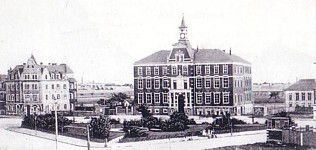

Um Verwechslungen mit einem gleichnamigen Platz im Stadtzentrum zu vermeiden, erhielt der Bismarckplatz 1904 den Namen Simsonplatz. Eduard von Simson (1810-1899) war erster Präsident des deutschen Reichstages und leitete ab 1879 das Reichsgericht in Leipzig. Da die jüdische Herkunft des Politikers den Nazis ein Dorn im Auge war, setzten sie 1935 die Umbenennung in Riegelplatz durch. Der Name erinnert an den Kunsthistoriker Prof. Hermann Riegel (1834-1900), der u. a. Leiter des Sächsischen Museums in Leipzig und Professor für Kunstgeschichte in Braunschweig war. Riegel gründete 1885 den Allgemeinen Deutschen Sprachverein, einen Vorläufer des 1932 gegründeten Goethe-Instituts.

Ab 1928 befand sich am Riegelplatz der Endpunkt einer städtischen Buslinie, deren Betrieb allerdings 1941 kriegsbedingt eingestellt wurde. Rund um den Platz gab es zahlreiche Geschäfte. 1945 beschlagnahmte die Rote Armee die Villa Riegelplatz 4 und richtete hier die sowjetische Ortskommandantur ein. Die Schule und einige Wohnhäuser wurden zeitweise durch eine Pioniereinheit belegt. Heute hat der Riegelplatz vor allem als Verkehrsknotenpunkt Bedeutung und ist seit Ende 2004 Endpunkt einer neuen Straßenbahnlinie.

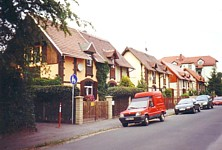Die 1892 angelegte Straße in Neukaditz erhielt zunächst
zu Ehren der Kronprinzessin den Namen Luisastraße. 1904 wurde sie nach dem Ökonomen und Historiker Wilhelm Roscher in Roscherstraße umbenannt. Roscher (1817-1894) lehrte an der Universität
Leipzig und befasste sich vor allem mit der Geschichte der Nationalökonomie. 1889 wurde er für seine Arbeit zum Ehrenbürger von Leipzig ernannt.

Interessant sind die ab 1887 an der Roscher- und Kolbestraße errichteten
Doppelhäuser des Dresdner Bauvereins für Arbeiterwohnungen, die als eine der ersten auf genossenschaftlicher Basis entstandenen Siedlungen Dresdens gelten und 1898
vom Dresdner Spar- und Bauverein übernommen wurden. Heute befinden sie sich in Privatbesitz. 2011 entstand an der Roscherstraße die vor allem von den Mitarbeitern von IKEA genutzte Kindertagesstätte “Lillabo” (“kleines Nest”).

Die heutige Scharfenberger Straße war einst Teil des alten Bischofsweges von Meißen nach Stolpen, der zwischen Briesnitz
und Kaditz/ Übigau mit einer Furt die Elbe durchquerte. Die Straße verläuft über Kaditzer, Micktener und Übigauer Flur. Vor
der Eingemeindung wurde sie zum Teil auch Schulstraße genannt. 1904 erhielt sie ihren heutigen Namen nach der kleinen
Gemeinde Scharfenberg bei Meißen. Im östlichen Teil der Scharfenberger Straße sind noch einige historische Bauten aus der
dörflichen Vergangenheit Micktens erhalten geblieben, welche z. T. unter Denkmalschutz stehen. Im Grundstück Nr. 12
erinnerte noch bis vor wenigen Jahren der letzte erhaltene Reisigschuppen zur Lagerung von Reisig an das bis 1927 gerodete Kaditzer Tännicht.

Die Schenkendorfstraße in Neukaditz wurde 1899 als Marienstraße angelegt, wobei die Gattin des Kaditzer Grundbesitzers
Heinrich Findeisen Namenspatronin war. Seit 1904 heißt diese Straße Schenkendorfstraße. Mit der Benennung wird an den Dichter Gottlob Ferdinand Max von Schenkendorf (1783-1817) erinnert, der zahlreiche Gedichte und Lieder zum Thema
Befreiungskriege 1813 schrieb. Gemeinsam mit Johann Gottlieb Fichte gab er zeitweise auch die patriotische Zeitung “Vesta” heraus, welche sich kritisch mit der napoleonischen Besetzung Deutschlands auseinandersetzte.

Der Seewiesenweg wurde 1937 im Zuge des Ausbaus der Kaditzer Siedlung angelegt. Als Seewiesen wurden früher die
Flächen beiderseits des Seegrabens, eines alten Elbarmes, bezeichnet. Nach dessen Trockenlegung wurde das gewonnene Land meist gartenbaulich genutzt und in den 30er Jahren bebaut.

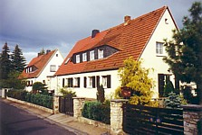

**_Foto:_** _Die Kaditzer Siedlung am Seewiesenweg_

Die Wohnhäuser am Seewiesenweg entstanden in mehreren Bauabschnitten zwischen 1936 und 1939. Im vorderen Teil an
der Kötzschenbroder Straße dominieren sogenannte “Volkshäuser”, die neben preiswerten Arbeiterwohnungen auch Geschäfte im Erdgeschoss beherbergten. Am
“Rundteil” markiert eine mächtige Stieleiche (Naturdenkmal) den Mittelpunkt der Siedlung. Der Baum ist einer der letzten Zeugen des früheren Tännichts. Ursprünglich sollten hier sowie an der Gleinaer
Straße verschiedene öffentliche Gebäude wie Volksschule, Kindergarten und ein kleines Verwaltungsgebäude entstehen. Kriegsbedingt wurden diese Pläne jedoch nicht mehr umgesetzt. Erst nach 1990 konnten die letzten Baulücken am
Seewiesenweg geschlossen werden.

Die Serkowitzer Straße entstand als Verbindungsweg zwischen dem Kaditzer Dorfkern und dem benachbarten Serkowitz
und wurde früher auch Serkowitzer Kirchweg genannt. Hier lagen die von den Einwohnern als Gartenland genutzten Flächen.
Aus diesem Grund trug die Serkowitzer Straße bis 1904 den Namen Gartenstraße. Teile dieser Straße wurden nach 1990 zum Elberadweg ausgebaut.

Nr. 33:
Das zum alten Dorfkern gehörende Wohnhaus Serkowitzer Straße 33 besitzt an der Fassade eine Sandsteintafel mit einer Inschrift, welche vermutlich noch unter dem Eindruck des Siebenjährigen Krieges entstand. Die Buchstaben M.I.G.T.
und die Jahreszahl 1768 weisen auf den früheren Besitzer und das Baujahr hin.

**GOTT DER HERR BEHÜTE DIESES HAUS**

**UND ALLE DIE GEHEN EIN UND AUS, ER**

**WOLLE ES BEHÜTEN UND BEWAHREN FÜR WASER**

**FEUER KRICK UND PRAND U GROSSEN SCHAD**

**U WOLDE US SEINEN SEGEN GEBN BIS WIR**

**KOMMEN ZU DEN EWIGEN LEBN**

**M.I.G.T. 1768 d. 5. Juni**

Ursprünglich entstand diese Straße als Verbindungsweg zwischen den sorbischen Siedlungen an der Elbe und der Oberlausitz.
Die für die Slawen wichtige Verkehrsverbindung wurde auch als “sorbischer Rennsteig” (= Botenweg) bezeichnet und führte
von Kaditz in nördlicher Richtung über Radebeul, entlang dem heutigen Augustusweg bis nach Klotzsche und von dort durch
die Dresdner Heide weiter nach Radeberg. Später nutzten vor allem die Kirchgänger diesen Weg von Radebeul zur Kaditzer Kirche

Ihren heutigen Namen Spitzhausstraße verdankt sie dem Radebeuler Spitzhaus, welches wegen seiner exponierten Lage in
den Lößnitzbergen seit dem 19. Jahrhundert beliebtes Ausflugslokal ist. Bis zur Eingemeindung des Ortes 1904 wurde sie
Radebeuler Straße genannt. Noch bis 1990 gab es hier nur wenige Wohngebäude. 1996 entstand ein kleiner Wohnpark im Bereich Spitzhaus-/ Fürstenhainer Straße.

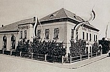Gasthof Kaditz:

Die Ursprünge des Kaditzer Gasthofes reichen bis ins 19. Jahrhundert zurück. 1852 erwarb der Böttchermeister Johann Gottfried Papperitz das Reiheschankrecht und
begann noch im gleichen Jahr mit dem Bau. Als Bauplatz wurde ein Grundstück außerhalb des Dorfkerns am Kirchweg nach Serkowitz gewählt (Spitzhausstraße 1).
Neben einer großen Gaststube gab es im Gasthof ein Vereinszimmer sowie einen kleinen Saal im Obergeschoss. Hinzu kam ein schattiger Lindengarten mit Freiplätzen.

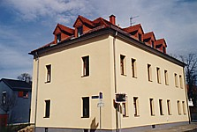Nach mehrfachem Besitzerwechsel entstand um 1900 der heute noch vorhandene
Saalanbau. 1913 ließ Friedrich Hermann Hantzsch, der den Kaditzer Gasthof 1904 erworben hatte, diesen im Neobarockstil ausgestalten. Der ehemalige Tanzsaal diente
nach 1945 noch für Theater- und Filmaufführungen, Ausstellungen und Versammlungen, bevor der Gasthof Anfang der 60er Jahre geschlossen wurde. Im Saal richtete das
Frühgemüsezentrum 1967 eine Werkstatt ein, in der Folienbahnen für die Gewächshäuser geschweißt wurden. Weitere Räume dienten als Kantine und Clubraum der GPG “Nachbarschaft Kaditz”. Während die Gaststätte nach erfolgter Sanierung
des Gebäudes 1991 zeitweise wieder geöffnet hatte und heute als Wohnhaus dient _(Foto)_, blieb der stark verfallene Saalanbau leer und wurde später abgerissen.

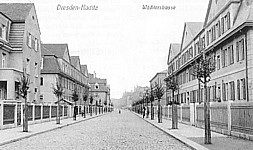Die Wächterstraße wurde 1899 im Zusammenhang mit dem Ausbau von
Neukaditz angelegt und nach dem Oberlößnitzer Privatier Heinrich Findeisen zunächst Heinrichstraße genannt. Findeisen besaß in diesem Teil eine Reihe von Grundstücken, die er als Parzellen an Bauwillige verkaufte. 1904 bekam die
Straße ihren heutigen Namen, mit dem an den Juristen Karl Georg von Wächter (1797-1880) erinnert wird. Wächter lehrte als Professor für Jura in Tübingen und Leipzig und war erster Präsident des Deutschen Juristentages. Für seine
Verdienste erhielt er die Ehrenbürgerwürde von Leipzig sowie das Adelsprädikat verliehen.

Die Waldemarstraße wurde 1900 nach dem Besitzer der Kaditzer Dachpappen-, Holzzement- und Asphaltfabrik Waldemar
Höpfner benannt, die ihren Sitz auf der Rankestraße 32 hatte. Höpfner gehörte zwischen 1896 und 1902 dem Gemeinderat an und war zugleich Ehrenvorsitzender der Sächsischen Fechtschule Dresden-Trachau.
Zu den nach 1900 entstandenen Gebäuden gehört das architektonisch interessante Doppelhaus Waldemarstraße 16/18 _(Foto)_.

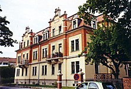

[Kaditz auf OpenStreetMap](https://www.openstreetmap.org/search?query=Dresden+Kaditz)

* * *

 \[ [Home](../../../index.html)\] \[ [Nord](../../../nord/)\] \[ [Nordwest](../../../nordwest/)\] \[ [Neustadt](../../../neustadt/)\] \[ [Nordost](../../../nordost/)\] \[ [West](../../../west/)\] \[ [Zentrum](../../../zentrum/)\] \[ [Südwest](../../../sudwest/)\] \[ [Süd](../../../sud/)\] \[ [Südost](../../../sudost/)\] \[ [Ost](../../../ost/)\] \[ [Register](../../../Register/register.html)\] \[ [Kontakt](../../../Kontakt/kontakt.html)\] \[ [Impressum](../../../impressum/)\]
