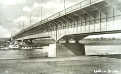
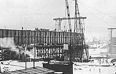
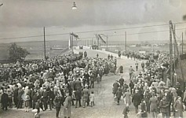
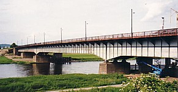

Erste Pläne zum Bau einer Elbbrücke im äußersten Dresdner Westen kamen bereits kurz nach 1900 auf, um die Verkehrsanbindung der Ortschaften in diesem Gebiet zu verbessern und auch hier eine städtische Entwicklung zu fördern. Zuvor standen nur mehrere Fähren zur Verfügung, die jedoch längst nicht mehr den Anforderungen genügten. Vor allem nach Eröffnung des [Luftschiffhafens](../../../../nordwest/kaditz/flugplatz_kaditz/) auf Kaditzer Flur machte sich das Fehlen einer Brücke negativ bemerkbar. Zur Abhilfe wurde der Bau einer Interimsbrücke vorgeschlagen, wofür die Teile der 1907-1910 beim Neubau der Augustusbrücke verwendeten Konstruktion verwendet werden sollten. Diese Pläne wurden jedoch nicht realisiert.

Erst 1929 konnte schließlich mit den Arbeiten begonnen werden. Anlass für den Brückenbau war die geplante Anlage eines Gewerbegebietes zwischen Kaditz, Mickten und Übigau. Die Entwürfe für die Konstruktion stammten von Heinrich Koch, Kurt Beyer und Paul Wolf, die Bauausführung oblag den Firmen M.A.N.-Werk Gustavburg, der Mitteldeutschen Stahlwerke AG Lauchhammer sowie den Dresdner Unternehmen Dykerhoff & Widmann und Grün & Bilfinger.

Offizieller Baubeginn war am 22. Mai 1929 am linkselbischen Uferpfeiler. Am 8. November begann zeitgleich von beiden Seiten die Montage des Stahlüberbaus. Zum Transport der Teile wurde am Altstädter Ufer ein Anschlussgleis verlegt, von dem aus mit Hilfe von Pontons der Transport über die Elbe erfolgte. Fertiggestellt war die neue Elbquerung mit Einbau des letzten Trägerteils am 9. April 1930. Insgesamt wurden ca. 2600 Tonnen Stahl und 150.000 Nieten verbaut. Die zum Zeitpunkt ihrer Entstehung _(Foto links)_ längste genietete Blechträgerbrücke Europas überspannt mit 115 Metern Länge die Elbe und verbindet die Stadtteile Cotta und Kaditz. Ihre Gesamtlänge beträgt 308 m. Der am 1. Oktober 1930 eingeweihte (Foto rechts) und offiziell Kaditzer Brücke genannte Neubau führte zu einer enormen Verbesserung der Verkehrsverhältnisse in diesem Teil Dresdens und beendete die abseitige Lage von Kaditz.

Die neue Brücke sollte ursprünglich Teil des geplanten Außenringes über Weißeritzufer - Zellescher Weg und Karcherallee werden, wobei der Bau einer weiteren Brücke in der Nähe des Waldschlößchens vorgesehen war. Trotz Beginns der Arbeiten konnte dieser Ring bis zum Kriegsbeginn nur in Fragmenten realisiert werden. Auch die im Untergeschoss der Kaditzer Brücke geplante Schnellstraßenbahn Pirna - Meißen wurde nie gebaut, obwohl erste Prototypen der Fahrzeuge bereits entwickelt waren.

1945 war auch die Kaditzer Brücke wie alle anderen Elbbrücken zur Sprengung vorgesehen, die jedoch durch den mutigen Einsatz des Dresdners Gustav Heinrich Gröblehner und seiner Tochter verhindert werden konnte. Allerdings hatten Sprengbomben die Brücke in den letzten Kriegstagen so stark beschädigt, dass sie erst 1947 wieder für den Straßenverkehr genutzt werden konnte. 1984 wurde sie nach dem früheren Chefredakteur der kommunistischen Zeitschrift “Arbeiterstimme” in Rudolf-Renner-Brücke umbenannt, ein Name, der sich jedoch nie durchsetzen konnte.
Am 18. November 1991 hob der Stadtrat diese Namensgebung wieder auf, wobei die Brücke nun auch offiziell in Flügelwegbrücke umbenannt wurde.

**_Foto:_** _die Flügelwegbrücke vor dem Umbau 2002_

Infolge der starken Verkehrsbelastung und daraus resultierender Bauschäden machte sich Ende der 90er Jahre eine komplette Erneuerung der Flügelwegbrücke erforderlich. Am 28. Mai 2001 begannen die Arbeiten mit dem Bau
provisorischer Brückenpfeiler, auf die der erste Teil der neuen Brücke montiert wurde. Im Anschluss wurde in mehreren
Etappen die alte Stahlkonstruktion abgetragen. Auf den Pfeilern entstand ein moderner Neubau mit drei Fahrspuren. Im
letzten Bauabschnitt wurde die zweite Brückenhälfte verschoben und auf die vorhandenen Pfeiler gesetzt, so dass heute
insgesamt sechs Spuren zur Verfügung stehen. Am 24. Juni 2004 konnte der Brückenneubau dem Verkehr übergeben
werden. Die neue Brücke ist insgesamt 285 m lang, 31 m breit und kostete ca. 17,3 Millionen Euro. 2006 erfolgte noch die Fertigstellung des Zufahrtstunnels auf Altstädter Seite, welcher eine kreuzungsfreie Querung der [Hamburger Straße](../../../../west/cotta/strassen_cotta/hamburger_strasse/) ermöglicht
