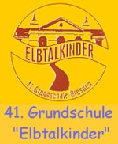
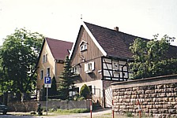
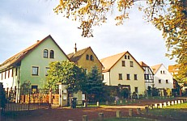
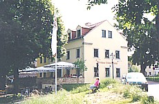
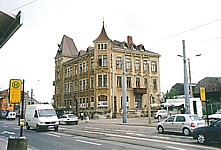
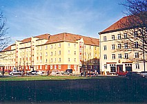
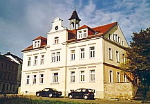
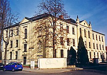
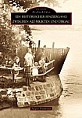

* * *

**Gemeindesiegel von Mickten**

**Sonntagsspaziergang zwischen**

**Mickten und Übigau**

**Stadtteilführungen jeden letzten Sonntag im Monat**

**Treffpunkt: 10.30 Uhr an der “Lindenschänke”**

**(Dauer ca. 120 Min.)**

**Preis: 7,00 Euro**

**(inkl. Getränk und Brez´n)**

**Tel. 0351/859 95 77**

* * *

* * *

**Vereine in Mickten:**

* * *

**Schulen in Mickten:**

Mickten entstand als slawischer Rundling und wurde 1378 erstmals urkundlich als Migtin (slawisch: Leute des Mikota) erwähnt. Ebenso wie der nur reichlich 100 m entfernte Nachbarort Übigau entstand Mickten auf einer hochwassergeschützten Erhebung am Elbufer. 1421 existierte in der Nähe der heutigen Sternstraße ein Vorwerk, welches sich im Besitz der Dresdner Bürgerfamilie Ziegler befand. Diese verkaufte Mickten 1468 an den Bischof von Meißen. Nach Auflösung des Vorwerks teilte man dessen Fluren unter die Micktener Bauern auf. Noch bis ins 16. Jahrhundert unterschied man zwischen den Dörfern Großmickten und Kleinmickten. Klein-Mickten wurde nach 1529 ebenso wie die Siedlung [Bortzschen](../../nordwest/ubigau/bortzschen/) von seinen Bewohnern verlassen und kam dadurch zu Mickten.

Neben der Landwirtschaft betrieben die Bewohner früher auch Weinbau. Einige besaßen sogar eigene Weinberge in der Oberlößnitz. Außerdem lebte man vom Fischfang. Grund- und Gerichtsbarkeit lagen bis ins 19. Jahrhundert teilweise beim Amt Dresden, zum Teil beim Prokuraturamt Meißen, so dass Mickten bis 1836 zwei Ortsrichter besaß. Der bis zur Gegenwart weitgehend erhalten gebliebene Dorfkern _(Fotos oben)_ erhielt sein heutiges Aussehen nach dem letzten großen Dorfbrand 1823. 1869 wurden einige Güter erneut bei einem Großfeuer zerstört. Die Fachwerkgehöfte Altmicktens stehen unter Denkmalschutz und zeigen noch alte Laubengänge und Torschlußsteine. Zum Dorfkern gehört auch die 1862 eröffnete Ausflugsgaststätte “Lindenschänke” _(Foto links)_.

Im 19. Jahrhundert veränderte sich auch in Mickten die Sozial- und Bevölkerungsstruktur. Als erstes Haus außerhalb des Dorfkerns entstand 1804 an der Leipziger Straße eine Gastwirtschaft, aus der um 1900 das [Ballhaus Watzke](../../nordwest/mickten/ballhaus_watzke/) hervorging. Weitere Wohnhäuser wurden auf ehemaligen Feldern als Arbeiterquartiere der Übigauer Industrie errichtet.
1864 begann an der Sternstraße der Aufbau des Ortsteils Neumickten, in dem sich später u.a. die Brotfabrik “Saxonia”, die [Waffelfabrik Hörmann](../../nordwest/mickten/strassen_mickten/waffelfabrik_hormann/) und ein Sägewerk ansiedelten. Bedeutender waren jedoch die nach der
Jahrhundertwende entstandenen Firmen der Elektrotechnik wie Cruse & Co. sowie [Koch & Sterzel](../../nordwest/ubigau/strassen_ubigau/koch___sterzel/). Letztere nahm
1923 an der Washingtonstraße die Transformatorenproduktion auf und entwickelte sich als Transformatoren- und Röntgenwerk nach 1945 zum größten Dresdner Industriebetrieb. Heute werden die Gebäude von Siemens und einigen
weiteren Unternehmen genutzt. Seit dem 1. Januar 1903 ist Mickten Stadtteil von Dresden.

 Zur Verbesserung der Verkehrsverhältnisse richtete man bereits 1892 eine Pferdeomnibuslinie vom Ballhaus Watzke nach Übigau ein, der 1899 die elektrische Straßenbahn folgte. Der im gleichen Jahr entstandene [Straßenbahnhof Mickten](../../neustadt/leipziger_vorstadt/leipziger_strasse/) _(Foto)_ an der Leipziger Straße war bis 1930 Ausgangspunkt der schmalspurigen [Lößnitzbahn](../../nordwest/mickten/lossnitzbahn/) nach Radebeul. Die unter Denkmalschutz stehenden Hallen wurden 1992 von den Verkehrsbetrieben aufgegeben und nach jahrelangem Verfall 2009 zu einem Einkaufszentrum umgebaut.

Kirchlich unterstand Mickten bis 1938 der Kaditzer Emmauskirche. Erst dann richtete man an der Homiliusstraße in einem Wohnhaus ein eigenes [Gemeindezentrum](../../nordwest/mickten/kapelle_mickten/) ein, in dessen Türmchen eine 1480 gegossene Glocke aus der Sophienkirche schlägt. Weitere Neubauten entstanden zwischen 1936 und 1941 am Lommatzscher Platz _(Foto)_ und 1955/57 an der Lommatzscher Straße. Diese Wohnsiedlung wurde in den 1980er Jahren nochmals erweitert und nach 1990 saniert.

Auf den verbliebenen Freiflächen zwischen Mickten und Kaditz , für welche es bereits nach dem Ersten Weltkrieg Bebauungspläne gegeben hatte, begann 1990 die Erschließung eines Gewerbegebietes. Dabei wurden zahlreiche neue Straßen angelegt. In diesem Zusammenhang entstand auch das weit über die Stadtgrenzen hinaus bekannte größte Dresdner Einkaufszentrum “ElbePark”. Außerdem wurden auf dem Areal der ehemaligen Brotfabrik zwischen Stern- und Kötzschenbroder Straße einige Wohnhäuser errichtet, die als “Elbvillenpark” bezeichnet werden. Weitere Projekte konnten zunächst jedoch nur in Ansätzen realisiert werden. Erst im September 2017 begann man mit der Erweiterung des Wohngebietes Kaditz-Mickten um ca. 2200 Wohnungen.

Schulen in Mickten:

Dorfschule: Die Micktener Kinder mussten bis Ende des 19. Jahrhunderts die Kaditzer Schule besuchen. Erst 1873/74 errichteten die Gemeinden Mickten und Übigau an der Böcklinstraße 17 ein gemeinsames Schulhaus. Am 12. August 1874 wurde dieses eröffnet. Zunächst wurden hier nur zwei, seit 1877 vier Klassen unterrichtet. Außerdem gab es eine kleine Volksbibliothek. Diese Schule war bis 1898 in Betrieb und diente im Anschluss als Gemeindeamt des Ortes. Das Gebäude ist heute noch als Wohnhaus erhalten _(Foto)_.

9\. Oberschule: In den 1980er Jahren entstanden auf Micktener Flur an der Lommatzscher Straße zahlreiche Neubauten, vor allem für die Beschäftigten der zahlreichen Industriebetriebe in diesem Stadtviertel. Im Februar 1987 wurde an der Lommatzscher Straße 121 auch eine neue Schule eröffnet. Diese erhielt den Namen 9. POS "Johann Riesner". Hans bzw. Johann Riesner (1902-1976) war ein Parteifunktionär, der 1951/52 sächsischer Minister für Kultur und Volksbildung war und später verschiedene Funktionen in der Volksbildung der DDR innehatte. Heute nutzt die 9. Oberschule "Am ElbePark" das Schulgebäude.

41\. Grundschule: Als das alte Schulhaus nicht mehr für die stark angewachsene Bevölkerung ausreichte, entstand 1899 ein Schulneubau an der damaligen Jahnstraße (heute Hauptmannstraße 15). Zwei Jahre zuvor war der Nachbarort Übigau aus dem gemeinsamen Schulverband ausgeschieden und hatte sich ein eigenes Schulhaus gebaut. Der Neubau, zu dem auch eine Turnhalle gehörte, wurde vom Micktener Baumeister Gustav Richard Martin entworfen und am 31. Mai 1899 übergeben. Zu Beginn lernten hier ca. 600 Kinder in 15 Klassen.

 Nach der Eingemeindung übernahm die Stadt Dresden das Gebäude als 41. Volksschule. In den letzten Kriegsmonaten 1945 diente es als Kaserne, Lazarett und Flüchtlingsunterkunft. 1946/47 wurden hier die Kinder der im nahen Übigau stationierten sowjetischen Soldaten unterrichtet, bevor man das Haus wieder an die Dresdner Schulverwaltung zurückgab. 1959 erfolgte im Rahmen der Neugliederung des DDR-Schulsystems die Umwandlung zur 41. POS. 1968 erhielt diese den Namen des Dresdner Antifaschisten Franz Lehmann. In diesem Zusammenhang wurde auch ein Gedenkstein auf dem Schulhof aufgetellt. Seit 1992 wird das Haus von der 41.Grundschule genutzt _(Foto)_ und in mehreren Bauabschnitten bis 2011 saniert und um einen modernen Anbau ergänzt. Am 20. Juni 2008 erhielt die Schule offiziell den Namen 41. Grundschule "Elbtalkinder".

9\. Oberschule: In den 1980er Jahren entstanden auf Micktener Flur an der Lommatzscher Straße zahlreiche Neubauten, vor allem für die Beschäftigten der zahlreichen Industriebetriebe in diesem Stadtviertel. Im Februar 1987 wurde auch eine neue Schule eröffnet (Lommatzscher Straße 121). Heute nutzt die 9. Oberschule “Am ElbePark” das Schulgebäude.

144\. Grundschule: Um dem wachsenden Bedarf an Grundschulplätzen im Dresdner Nordwesten zu begegnen, entstand 2013/14 an der Micktener Straße 10 der Neubau einer Schule. Das Gebäude bietet Platz für bis zu drei Klassen pro Jahrgang und ca. 300 Schüler und war bei seiner Eröffnung erster komplett neuer Schulstandort in Dresden nach 1990. Zum Komplex gehören auch ein Schulgarten, eine Einfeld-Sporthalle sowie ein für Schul- und Vereinssport nutzbares Außengelände. Die Eröffnung des ca. 11 Millionen Euro teuren Neubaus erfolgte am 10. Oktober 2014.

[_Weiterführende Literatur und Quellen_](../../impressum/quellenverzeichnis/)

**Buchtipp: Jürgen Naumann “Ein historischer Spaziergang zwischen Alt-Mickten und Übigau”, Sutton Verlag Erfurt (ISBN 978-3-86680-703-7)**

Der Bildband zeigt zahlreiche historische Aufnahmen der beiden Stadtteile aus
dem 19. und 20. Jahrhundert und wurde von Jürgen Naumann verfasst. Texte mit historischen Hintergründen ergänzen die Bilder. Interessierte können das Buch für 17,90 Euro im Buchhandel erwerben.

 \[ [Home](../../index.html)\] \[ [Nord](../../nord/)\] \[ [Nordwest](../../nordwest/)\] \[ [Neustadt](../../neustadt/)\] \[ [Nordost](../../nordost/)\] \[ [West](../../west/)\] \[ [Zentrum](../../zentrum/)\] \[ [Südwest](../../sudwest/)\] \[ [Süd](../../sud/)\]
 \[ [Südost](../../sudost/)\] \[ [Ost](../../ost/)\] \[ [Register](../../Register/register.html)\] \[ [Kontakt](../../Kontakt/kontakt.html)\] \[ [Impressum](../../impressum/)\]
