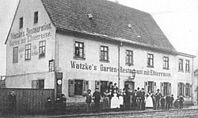
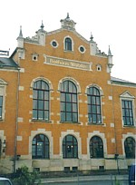
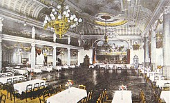

* * *

* * *

* * *

* * *

* * *

* * *

An Stelle des heutigen Ballhauses Watzke an der Kötzschenbroder Straße 1
entstand um 1790 als erstes Gebäude außerhalb des Dorfkerns eine kleine Bauernschänke, welche 1804 aufgestockt und vergrößert wurde. Das Haus gehörte dem Häusler Johann Gottlob Dietzen, der hier eine Branntwein-
Destillerie einrichtete. Die erhoffte Schankgenehmigung blieb ihm jedoch verwehrt, so dass er sein Haus für 855 Taler an den Brauer Gottlieb Wilhelm Hübel verkaufen musste. Dieser bekam am 30. September 1821 eine
Konzession zum Ausschank und Verkauf von Dresdner Stadtbier und richtete auf dem Grundstück eine Gaststätte ein.

1838 wurde die Gastwirtschaft an Carl Joseph Watzke verkauft, dem sie ihren Namen verdankt. ”Watzkes Bier- und Gartenrestaurant” blieb auch später im Familienbesitz und
wurde mehrfach erweitert. Nach Abbruch des alten Hauses _(Foto oben)_ entstand 1897/98 der heutige Bau mit dem großem Ballsaal im Obergeschoss _(Foto rechts)_. Architekt des
Gebäudes war Benno Hübel, die Deckenmalerei im Saal stammt von Emil Schulz. Das Ballhaus Watzke blieb bis zum Zweiten Weltkrieg wichtigstes Tanz- und Vergnügungslokal
der Umgebung und wurde gern von den Arbeitern der angrenzenden Wohnviertel besucht. Die Geschäftsführung oblag Wilhelmine Watzke und ihrem Sohn Paul, ab 1937 seiner Witwe
Alma Watzke.Während des Ersten und Zweiten Weltkrieges dienten die Räume zeitweise als Soldatenquartier.

Da im zerstörten Dresden in der Nachkriegszeit Mangel an geeigneten Räumlichkeiten war, zog 1946 ein Varieté in das
Ballhaus ein. Einige Jahre wurde der Gaststättenbetrieb noch aufrecht erhalten, bevor das Ballhaus Watzke im Jahr 1950
geschlossen wurde. Viele Jahre diente das Gebäude nun als Lager der HO für Sportartikel. Erst 1993/96 erfolgte eine umfassende Rekonstruktion des Hauses. Dabei wurde der historische Saal weitgehend originalgetreu wieder
hergerichtet. Er wird heute für vielfältige Veranstaltungen genutzt. Im Erdgeschoss entstand eine Gasthausbrauerei, die
eigenes Bier produziert (“Watzke-Pils”), welches nur hier ausgeschenkt wird. Zum Gasthaus gehört auch ein Biergarten unmittelbar am Elbufer.

**_Foto:_** _Der Ballsaal des “Watzke” im Ursprungszustand um 1910_

Video: Die Jazzband “Lamarotte” bei einem Auftritt im Ballsaal des “Watzke”
