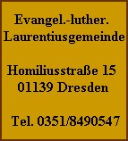
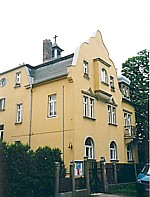

* * *

* * *

* * *

* * *

* * *

* * *

Mickten gehörte ursprünglich, ebenso wie seine Nachbarorte, zum Kaditzer Kirchspiel. Während Pieschen, Trachau, Trachenberge und Radebeul Ende des 19. bzw. Anfang des 20. Jahrhunderts aus dieser Parochie ausschieden und eigene Gotteshäuser errichteten, blieben Mickten und Übigau zunächst weiterhin nach Kaditz gepfarrt.

Erst 1938 entschieden sich die Micktener Christen für die Bildung eines eigenen
Pfarrbezirks. Dafür erwarb die Gemeinde von der Witwe Gertrud Hübel eine 1902 gebaute Villa auf der Homiliusstraße 15 und richtete hier eine Kapelle ein. Ihr Mann, der Baumeister Benno Hübel, hatte hier von 1910 bis 1926 sein Büro für Architektur und Bauausführungen betrieben. Weitere Räume nutzte man für die Jugendarbeit sowie als Büroräume. Die Ausgestaltung des Andachtsraumes mit Altar, Taufstein und einer kleinen Orgel übernahm der Tischlermeister Walter Selle. Zunächst nutzten Micktener und Übigauer Christen dieses Haus gemeinsam. Erst 1955 wurde auch in Übigau eine eigene Kapelle eingerichtet.

Im Dachreiter des Micktener Gemeindehauses hängt bis heute eine um 1480 von Heinrich Kannegießer gegossene Glocke, die ursprünglich aus der Sophienkirche stammt. Der Legende nach soll diese einen ungewöhnlich hohen Silberanteil besitzen und wurde deshalb auch “die Silberne” genannt (Curiosa Saxoniae 1737). Nach 1945 kam sie aus der zerstörten Kirche nach Mickten. Ihre Rückkehr in die Busmannkapelle ist jedoch geplant.

Im Zuge innerkirchlicher Umstrukturierungen wurden die Gemeinden im Nordwesten Dresdens nach 1990 wieder vereinigt und bilden seit 1999 die Laurentiuskirchgemeinde. Diese nutzt heute die Kirchen in [Kaditz](../../../nordwest/kaditz/emmauskirche/) und Pieschen [(Markuskirche)](../../../nordwest/pieschen/markuskirche/) als Gotteshäuser, während das Micktener Gemeindehaus als Sitz des Pfarramtes gewählt wurde.

* * *

 \[ [Home](../../../index.html)\] \[ [Nord](../../../nord/)\] \[ [Nordwest](../../../nordwest/)\] \[ [Neustadt](../../../neustadt/)\] \[ [Nordost](../../../nordost/)\] \[ [West](../../../west/)\] \[ [Zentrum](../../../zentrum/)\] \[ [Südwest](../../../sudwest/)\] \[ [Süd](../../../sud/)\] \[ [Südost](../../../sudost/)\] \[ [Ost](../../../ost/)\] \[ [Register](../../../Register/register.html)\] \[ [Kontakt](../../../Kontakt/kontakt.html)\] \[ [Impressum](../../../impressum/)\]
