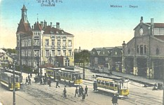
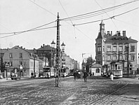
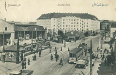

* * *

* * *

Die Lößnitzbahn entstand ab 1898 im Auftrag des sächsischen Staates, der mit dem Bau eine bessere Verkehrsanbindung der Lößnitzgemeinden mit der Stadt Dresden schaffen wollte. Die Finanzierung der Straßenbahnstrecke erfolgte durch die damals noch selbständigen Orte Mickten, Trachau, Ober- und Niederlößnitz, Serkowitz, Kötzschenbroda und Zitzschewig. Für den Bau war neben Straßenverbreiterungen auch die Errichtung eines neuen Elektrizitätswerkes erforderlich, welches im Lößnitzgrund bei Radebeul entstand. Im Gegensatz zur Dresdner Stadtspur entschied man sich für eine Spurweite von 1000 mm. Die Betriebsführung der zunächst 7,2 km langen Strecke übernahm die Dresdener Straßenbahngesellschaft. Ab 1905 wurde sie als Linie 29 in das damals bestehende Streckennetz einbezogen.

Ausgangspunkt der Lößnitzbahn war der Straßenbahnhof in Mickten _(Fotos)_, wo Anschluss an die Dresdner Straßenbahn bestand. Allerdings mussten die Fahrgäste, bedingt durch die unterschiedlichen Spurweiten, hier umsteigen. Am 21. August 1899
konnte der erste Streckenabschnitt bis zum Weißen Roß in Betrieb genommen werden. Noch im gleichen Jahr erfolgte am 12. Oktober die Verlängerung bis zur Bahnhofstraße in Kötzschenbroda. Ursprünglich sollte die Strecke von dort über Coswig und Weinböhla bis nach Meißen geführt werden, was jedoch aus finanziellen Gründen nicht zustande kam. Neben dem Berufsverkehr diente die Bahn an den Wochenenden der Beförderung von Ausflüglern in die Lößnitz. In den Sommermonaten kamen sogar eigens angeschaffte “Sommerwagen” zum Einsatz, die statt verglaster Seitenfenster mit Segeltuchvorhängen bespannt waren.

Sowohl der Erste Weltkrieg als auch die folgenden Inflationsjahre brachten für die Lößnitzbahn Einschränkungen im Betrieb und zeitweise Stillegungen mit sich. Trotz dieser Schwierigkeiten konnte die Strecke am 25. Oktober 1920 bis zum Gasthof Zitzschewig verlängert werden. Mit dem weiteren Anwachsen der Fahrgastzahlen erwies sich der “Inselbetrieb” aber immer mehr als unwirtschaftlich, weshalb man sich 1926 zum Umbau der Lößnitzbahn in Stadtspur entschloss. Diese Strecke sollte zugleich Teil einer geplanten Überland-Schnellstraßenbahn zwischen Meißen und Pirna werden, die jedoch über erste Vorplanungen nie hinauskam. Im Folgejahr übernahm die Dresdner Überland-Verkehrs- Gesellschaft mbh (DRÜVEG) die Lößnitzbahn.

1928 begannen in Coswig die Arbeiten zum Umbau der inzwischen auch technisch verschlissenen Anlagen auf die neue Spurweite von 1450 mm. Am 20. Juli 1929 ging der neue Straßenbahnhof Coswig in Betrieb. Hier waren während der Bauarbeiten vier Triebwagen stationiert, die im Pendelverkehr zwischen Straßenbahnhof und Gleisbaustelle verkehrten. Erst 1930 war die Verbindung bis Mickten hergestellt, so dass die alte Lößnitzbahn am 27. Juni 1930 ihren Betrieb einstellen konnte. 1931 wurde die modernisierte Strecke schließlich noch bis Weinböhla verlängert.

Die Betriebsführung oblag der Dresdner Straßenbahn AG, welche auf dieser Strecke bevorzugt die modernen großen Hechtwagen einsetzte. In nur 47 Minuten konnten die Fahrgäste vom Endpunkt Weinböhla aus den Neustädter Markt erreichen und von dort weiter durch die Altstadt bis nach Niedersedlitz fahren. 1959 wurde der bisherige Endpunkt Weinböhla durch eine noch heute genutzte Gleisschleife ersetzt. Statt der Hechtwagen fuhren später Einheitswagen aus DDR-Produktion, nach einer Linienreform 1969 Tatra-Straßenbahnen der Linie 5 auf dieser Strecke. Heute kommen moderne Stadtbahnwagen der Linie 4 zum Einsatz.

* * *

 \[ [Nord](../../../nord/)\] \[ [Nordwest](../../../nordwest/)\] \[ [Neustadt](../../../neustadt/)\] \[ [Nordost](../../../nordost/)\]
 \[ [West](../../../west/)\] \[ [Zentrum](../../../zentrum/)\] \[ [Südwest](../../../sudwest/)\] \[ [Süd](../../../sud/)\] \[ [Südost](../../../sudost/)\] \[ [Ost](../../../ost/)\] \[ [Register](../../../Register/register.html)\] \[ [Kontakt](../../../Kontakt/kontakt.html)\] \[ [Impressum](../../../impressum/)\]
