* * *

Als Altmickten wird seit 1904 der frühere Dorfplatz bezeichnet. Um den Platz gruppieren sich die gut erhaltenen Bauernhöfe des
Dorfes. Deutlich ist noch die Anlage des slawischen Rundlings erkennbar. Die Gehöfte entstanden in ihrer heutigen Form nach
den Dorfbränden von 1823 bzw. 1869 und wurden in den letzten Jahren denkmalgerecht saniert. Zahlreiche Gebäude weisen
Fachwerkkonstruktionen in den Obergeschossen auf. An einigen Häusern erinnern Schlusssteine an frühere Besitzer bzw. Ereignisse der Ortsgeschichte.

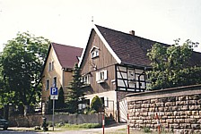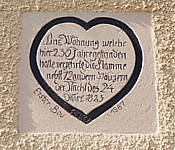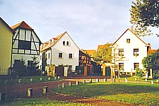

**_Foto:_** _Fachwerkhäuser im alten Micktener Dorfkern - in der Mitte Hausanschrift Scharfenberger Straße 12:_

_“Eine Wohnung welche hier 230 Jahre gestanden hatte,_

_verzehrte die Flamme nebst 12 andern Häusern der Nacht des 24. März 1823”._

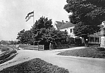Lindenschänke:Die am Rande Altmicktens am Elbufer gelegene Lindenschänke öffnete 1862 erstmals ihre Pforten und ist seit ihrer Neueröffnung 1998 nicht nur wegen ihres
schattigen Biergartens wieder ein beliebtes Ausflugsziel. Ursprünglich ging sie aus dem früher in den meisten Dörfern üblichen Reiheschank hervor. 1862 wurde dieser für 30.000
Taler an Johann Gottlieb Selle verkauft, welcher am 18. Oktober dieses Jahres die Schankgenehmigung erwarb. 1876 ging sie in den Besitz seines Sohnes Wilhelm über und blieb bis 1993 in Familienbesitz.

Das Gasthaus am Elbufer entwickelte sich schnell zum viel besuchten Ausflugslokal und war zugleich Treffpunkt und Versammlungslokal der Dorfbewohner. Während des Zweiten Weltkrieges waren hier französische
Zwangsarbeiter untergebracht. Nach mehrjährigem Leerstand erwarb 1997 der bekannte Gastronom Gerd Kastenmeier die
Lindenschänke und ließ sie renovieren. Bis heute lädt sie, seit 2010 unter einem neuen Betreiber, im rustikalem Ambiente zum Besuch ein.

Die Straße An der Flutrinne wurde nach 1990 im neuen Wohn- und Gewerbegebiet Kaditz-Mickten angelegt. Gleichzeitig
entstand ein umfassendes Netz neuer Nebenstraßen, die die vorgesehene Bebauung der “Landschaftsstadt” Kaditz-Mickten
beschleunigen sollten. 1995 erhielten diese die Namen Flößerstraße, Treidlerstraße und Pieschener Straße. Leider scheiterten die
Pläne am fehlenden Bedarf und den wirtschaftlichen Möglichkeiten. Realisiert wurden bislang lediglich eine Wohnzeile direkt an der Flutrinne sowie der Bürobau der Sparkassen-Versicherung.

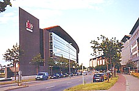

**_Foto:_** _An der Flutrinne, links der Neubau der Sparkassenversicherung_

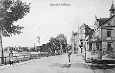Die heutige Böcklinstraße ist Teil des alten Bischofsweges von Meißen nach Stolpen und wurde früher auch als Hohe Straße bezeichnet. Ihren heutigen Namen erhielt sie 1904 nach dem Schweizer Maler Arnold Böcklin (1827-1901), der mit seinen Bildern zu den Vertretern der Neoromantik gehört.

An der Böcklinstraße ist bis heute das erste Micktener [Schulhaus](../../../nordwest/mickten/) erhalten geblieben (Nr.17), welches seit 1898 als Gemeindeamt und seit 1903 nur noch als Wohnhaus dient. Zwischen 1913 und 1928 verkehrte die Straßenbahn nach Mickten über die Böcklinstraße, wurde dann jedoch durch die neue Gleistrasse an der Sternstraße ersetzt. Nach 1945 nutzten die Dresdner Verkehrsbetriebe die Straße zeitweise als Busabstellplatz, welcher 1985 jedoch wegen der Hochwassergefahr aufgegeben wurde.

Die Brockwitzer Straße wurde erst nach 1990 bei der Erschließung des geplanten Baugebietes zwischen Kaditzer Flutrinne und
Lommatzscher Straße angelegt. Ihren Namen erhielt sie am 29. August 1996 nach dem Dorf Brockwitz, einem Ortsteil von Coswig.

Die zu den kürzesten Straßen Dresdens gehörende Dahlener Straße ist eine kleine Sackgasse, die von der Wurzener Straße in
nördliche Richtung abgeht. Einziges Gebäude ist ein Doppelhaus (Nr. 1/3). Ihren Namen erhielt die Straße 1940 nach der nordsächsischen Kleinstadt Dahlen.

Die Dettmerstraße entstand Ende des 19. Jahrhunderts an der Flurgrenze zwischen Mickten, Trachau und Pieschen und wurde
damals Feldstraße genannt. Erst nach der Eingemeindung erhielt sie 1904 ihren jetzigen Namen nach dem Hofschauspieler
Friedrich Dettmer (1835-1880), der seit 1856 dem Ensemble des Königlichen Hoftheaters angehörte. Neben Emil Devrient gehört Dettmer zu den bedeutendsten Dresdner Theaterpersönlichkeiten des 19. Jahrhunderts.

Als Dreyßigplatz wird die Platzanlage an der Kreuzung Leipziger Straße, Lommatzscher Straße und Wurzener Straße bezeichnet.
Hier befindet sich, in unmittelbarer Nachbarschaft zum 1998 stillgelegten Straßenbahnhof Mickten, auch eine Gleisschleife der
Straßenbahn. Seinen Namen erhielt der Platz 1927 nach dem Dresdner Hoforganisten Johann Anton Dreyßig (1774-1815),
Gründer der Dreyßigschen Singakademie, die sich von 1807 bis zu ihrer Auflösung 1930 der Pflege klassischer Chormusik widmete.

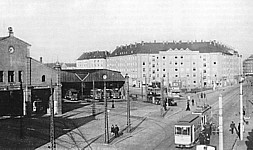

**_Foto:_** _Der Dreyßigplatz in den Zwanziger Jahren, links im Bild der Straßenbahnhof Mickten_

Video: Tatra-Straßenbahn in der Gleisschleife Mickten beim Kirchentag 2013

Auf dem Areal des heutigen Elbvillenweg befand sich ursprünglich die frühere [Waffelfabrik Gebr. Hörmann](../../../nordwest/mickten/strassen_mickten/waffelfabrik_hormann/), welche zuletzt zum VEB Dauerbackwaren Dresden gehörte. Nach Schließung der Firma 1992 wurden die Produktionshallen zum Großteil
abgerissen und stattdessen ein kleines Wohnviertel errichtet. Da dieses vom Investor als “Elbvillenpark” vermarktet wurde, erhielt die Erschließungsstraße im November 1995 amtlich den Namen Elbvillenweg.

Die Flößerstraße entstand erst nach 1990 bei der Erschließung eines hier geplanten Wohn- und Gewerbegebietes auf Kaditz- Micktener Flur. Allerdings kam dieses nur in Ansätzen zustande, so dass die Flächen an der Flößerstraße bis heute weitgehend unbebaut blieben. Mit der im November 1995 erfolgten Benennung soll, wie auch bei der benachbarten Treidlerstraße, an einen einst eng mit der Elbe verbundenen Beruf erinnert werden.

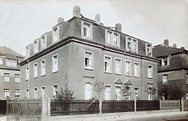Die Franz-Lehmann-Straße in Neumickten trug ursprünglich ab 1892 den Namen Jägerstraße. Johann Gottfried Jäger hatte viele Jahre das Amt eines Gemeindevorstandes in Mickten ausgeübt und ließ in seiner Amtszeit u.a. eine Bauordnung und einen Bebauungsplan für den Ort aufstellen. Nach der Eingemeindung Micktens wurde sie ab 1904 Lützowstraße genannt. Ludwig Adolf Wilhelm von Lützow (1782-1834) war ein preußischer General und wurde als Führer des Lützowschen Freicorps im Kampf gegen die napoleonische Fremdherrschaft bekannt.

Am 1. Juli 1946 erhielt die Lützowstraße ihren heutigen Namen Franz-Lehmann-Straße. Lehmann (1899-1945) arbeitete in den Zwanziger Jahren im Leuna-Werk und schloss sich 1922 der KPD an. Ab 1933 wohnte er in Dresden-Kaditz. 1944 wurde er als Mitglied der illegalen Widerstandsgruppe um Georg Schumann verhaftet und kam ein Jahr später während des Luftangriffes im Untersuchungsgefängnis am Münchner Platz ums Leben. An Franz Lehmann erinnert auch ein Gedenkstein vor der Micktener Schule.

Das Straßenbild prägen bis heute vor allem Einzelwohnhäuser aus der Gründerzeit, in deren Erdgeschossen es einst teilweise kleinere Läden gab _( **Foto:** Franz-Lehmann-Straße 7)_. Das Eckhaus zur Sternstraße (Nr. 20) ist 1910 als "Sternhof" im Adressbuch verzeichnet. Bis heute wird es als Eiscafe Venezia gastronomisch genutzt.

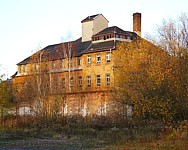Firma Cruse & Co. (Nr. 5): Die Geschichte des Unternehmens begann im Jahr 1911, als der Fabrikdirektor a. D. Edmund Kussi und die Gebrüder Johann und Friedrich Cruse die Firma „RHEOSTAT- Spezialfabrik elektrischer Apparate“ gründeten. Zunächst befand sich der Firmensitz auf der Freiberger Straße Nr. 75. Zwei Jahre später bezog die Firma im September 1913 eine neue Produktionsstätte auf der [Leipziger Straße 31](../../../neustadt/leipziger_vorstadt/leipziger_strasse/). 1914 trennten sich die Geschäftspartner und Johannes und Friedrich Cruse führten das Unternehmen fortan als „Spezialfabrik elektrischer Steuerapparate Gebr. Cruse & Co.“ weiter. Ab 1916 befand sich der Firmensitz in der Friedrichstadt (Wachsbleichstraße 26/28). Nach dem Tod Friedrich Cruses 1920 stellte sein Bruder den bisherigen AEG-Chefkonstrukteur Herman Wencken ein. Hergestellt wurden verschiedene elektronische Bauteile wie Schalter, Regler und Anlasser. Aus Platzgründen entschloss man sich, das Unternehmen 1928 zur damaligen Lützowstraße 5 in Mickten zu verlegen _( **Foto:** Holger Rohland / Wikipedia)_. Hier bezog man die früheren Räume der Zigarettenfabrik „L. Kulenkampff & Co. GmbH“.

Nach dem Tod des zweiten Firmengründers übernahm 1931 dessen Witwe den Betrieb. Die Rüstungsvorbereitungen der Nazis führten in den 1930er Jahren zu einem erheblichen Umsatzanstieg. 1939 arbeiteten bereits über 300 Angestellte in dem Betrieb. Mit Kriegsbeginn wurde die Belegschaft noch um ca. 60 Zwangsarbeiter vergrößert. Für die Versorgung der Mitarbeiter erwarb man 1939 die Gaststätte „Elbsalon“ auf der Kötzschenbroder Straße 20.

1945 konnte die Produktion im Juni 1945 wieder aufgenommen werden. Produziert wurden vorerst dringend benötigte elektrische Haushaltgeräte wie Bügeleisen,Kochplatten u.a. Im Zuge der Enteignungen nach dem Volksentscheid 1945 wurde die Firma Cruse & Co. der volkseigenen Industrieverwaltung 4 angegliedert und 1948 zum VEB Elektroschaltgeräte Dresden mit mehreren Betriebsteilen. Betriebsdirektor war bis 1956 der als Kunstsammler bekannt gewordene Friedrich Pappermann (1909–1995). Zum Produktionsprofil gehörten nun bis 1989 Elektroschaltgeräte aller Art für die Bauindustrie, den Schiffs-, Kran- und Anlagenbau. Hinzu kamen kleinere elektronische Geräte und Konsumgüter für die privaten Haushalte. Ab 1960 gehörte der Betrieb zum VVB Elektroapparate Berlin, ab 1970 bis 1975 zum VEB Kombinat Schaltelektronik Oppach und anschließend bis zur Wende zum Elektro-Apparate-Werke „Friedrich Ebert“ in Berlin-Treptow. 1990 erfolgte die Abwicklung und Schließung des Werkes durch die Treuhand. Die Gebäude wurden wenig später abgerissen.

Die heutige Hauptmannstraße wurde 1898 im Zusammenhang mit dem Bau der [41\. Volksschule](../../../nordwest/mickten/) angelegt und zunächst nach dem “Turnvater” Friedrich Ludwig Jahn (1778-1852) Jahnstraße benannt. Im Zusammenhang mit der Eingemeindung Micktens erfolgte 1904 die Umbenennung der Jahnstraße in Hauptmannstraße. Moritz Hauptmann (1792-1868) wurde in Dresden geboren und wirkte viele Jahre als Komponist und Kantor an der Thomaskirche zu Leipzig.

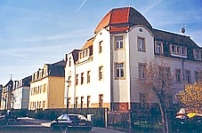Die 1899 amtlich benannte Herbststraße entstand Ende des 19. Jahrhunderts im Zusammenhang mit dem Bau neuer Wohnviertel in Neumickten und war Teil eines “Jahreszeitenviertels”. Zu diesem gehörte auch die noch heute vorhandene Winterstraße, während die Sommerstraße in den 1930er Jahren in der Lommatzscher Straße aufging. Zuvor war bereits im Zusammenhang mit der Eingemeindung der Vorstadt die ehemalige Frühlingstraße in Wüllnerstraße umbenannt worden. 1993/95 entstand auf dem Areal der früheren Backwarenfabrik “Saxonia” zwischen Stern-, Herbst- und Kötzschenbroder Straße der “Elbvillenpark”. Die Wohnhäuser Nr. 1, 9, 11, 21 und 23 sind als Kulturdenkmale ausgewiesen.

Ursprünglich wurde diese Straße ab 1898 als Pestalozzistraße bezeichnet. Hier befand sich das neue Micktener Schulhaus, welches die Namensgebung nach dem bekannten Pädagogen Johann Heinrich Pestalozzi (1746-1827) erklärt. Nach der Eingemeindung Micktens wurde die Pestalozzistraße 1904 in Homiliusstraße umbenannt. Gottfried August Homilius (1714-1785) wirkte an der Frauenkirche als Organist und war von 1755 bis zu seinem Tod Kreuzkantor und Musikdirektor der Kreuz-, Frauen- und Sophienkirche. Seit 1938 befindet sich an der Homiliusstraße 15 das in einer früheren Villa untergebrachte [Gemeindehaus](../../../nordwest/mickten/kapelle_mickten/) der Micktener Christen. Unweit davon wurde 2006 nach Plänen des Architekten Jens Voigt die kleine Wohnsiedlung “Haselnussgrund” errichtet. Im Haus Nr. 1 befand sich früher die bereits 1916 erwähnte Gaststätte "Zur Baubörse".

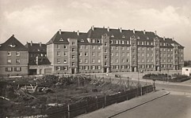Die Lommatzscher Straße entstand Ende des 19. Jahrhunderts und wurde 1898 zunächst in Anlehnung an die benachbarten Frühlings-, Herbst- und Winterstraße Sommerstraße genannt. Da es jedoch bei der Eingemeindung Micktens 1903 bereits eine Sommerstraße in Striesen gab, erfolgte 1904 die Umbenennung in Lommatzscher Straße. Namensgeber war die Kleinstadt Lommatzsch im Landkreis Meißen.

Ursprünglich befand sich in diesem Bereich der Micktener Flur die Siedlung Klein-Mickten, die nach 1529 zur Wüstung wurde. Nach Aufgabe des Ortes wurden deren Felder von den Bauern Groß-Micktens übernommen, die das sumpfige Areal der “Micktener Alm” vor allem als Weideland nutzten.

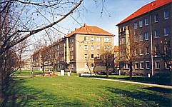In den 1930er Jahren erfolgte im Zusammenhang mit einem Neubauvorhaben eine Verlängerung, 1932 zunächst bis zur Rietzstraße, dann bis zur Kötzschenbroder Straße. Dabei entstand auch der 1940 amtlich benannte angrenzende Lommatzscher Platz. Die Pläne für die zwischen 1936 und 1941 errichteten Wohngebäude stammen vom Architekten Steinert. Weitere Wohnhäuser wurden 1955/57 für die Beschäftigten der Micktener und Übigauer Großbetriebe erbaut (Nr. 8-36). Auftraggeber für diesen Wohnkomplex, der von Hans Pistorius und Günther Wild projektiert wurde, war die AWG TRARÖ des VEB Transformatoren- und Röntgenwerkes _(Foto)_. Hinzu kam eine Konsum-Kaufhalle (Nr. 53) und eine am 2. Mai 1985 eröffnete kombinierte Kindereinrichtung aus Krippe und Kindergarten. Heute wird das Gebäude als Integrative Kindertagesstätte "Lommi-Kids" genutzt. Zwei Jahre später erfolgte die heutige 9. Oberschule “Am ElbePark” (Nr. 121).

Die Marie-Curie-Straße entstand Anfang der 1990er Jahre im Gewerbegebiet zwischen der Autobahn und der Washingtonstraße. Im November 1995 erhielt sie ihren Namen nach der französischen Physikerin Marie Sklodowska-Curie (1867-1934). 1903 erhielt sie für ihre Untersuchungen zur Radioaktivität den Nobelpreis für Physik, 1911 für die Isolierung des Radiums den Nobelpreis für Chemie.

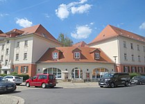Die Naundorfer Straße erhielt ihren ursprünglichen Namen Kaditzer Straße im Jahr 1901, da sie in Richtung Kaditz führte. Um Verwechslungen mit einer gleichnamigen Straße im Nachbarort Übigau zu vermeiden, erfolgte 1904 die Umbenennung nach dem Ort Naundorf, heute ein Ortsteil von Radebeul. Im Eckhaus zur Hauptmannstraße (Nr. 20) befand sich früher das schon vor dem Ersten Weltkrieg genannte Lokal "Zur Sängerburg".

Die Overbeckstraße war einst Teil des früheren Kirchweges von Mickten nach Kaditz und wurde deshalb ab 1891 Kirchstraße
genannt. Die über Micktener und Kaditzer Flur führende Straße erhielt 1904 ihren heutigen Namen nach dem Maler Johann Friedrich Overbeck (1789-1869), der vor allem in Italien tätig war.

Bereits in den Zwanziger Jahren kamen Pläne auf, in diesem Teil Micktens ein großes Gewerbegebiet zu schaffen. Trotz verbesserter Verkehrsanbindung durch den Bau der [Flügelwegbrücke](../../../nordwest/kaditz/strassen_kaditz/flugelwegbrucke/) konnte die Planungen nur zu einem geringen Teil realisiert werden. 1922/23 gründete die Firma [Koch & Sterzel](../../../nordwest/ubigau/strassen_ubigau/koch___sterzel/) an der Overbeckstraße ihr Zweigwerk Mickten, aus dem nach 1945 der
VEB Transformatoren- und Röntgenwerk hervorging. Nach 1933 entstanden außerdem einige Wohnblocks für die Angestellten des Betriebes.

Der zuvor als Abschnitt der Kötzschenbroder Straße betrachtete Abschnitt zwischen Zelenkastraße und An der Elbaue erhielt im
März 2008 den Namen Pisendelstraße. Johann Georg Pisendel (1687-1755) war im Spätbarock einer der bedeutendsten deutschen Geiger und ab 1728 Konzertmeister der Dresdner Hofkapelle.

Ursprünglich lagen im Bereich der heutigen Sternstraße die Felder des Micktener Vorwerks, welches sich ab 1468 im Besitz der Meißner Bischöfe befand. 1864 begann der Ausbau des Ortsteils Neumickten, in dem sich verschiedene Industriebetriebe ansiedelten. Bekannte Fabriken an der Sternstraße waren die [Waffelfabrik Gebrüder Hörmann](../../../nordwest/mickten/strassen_mickten/waffelfabrik_hormann/) AG (Nr. 35) und Lelanskys Dampfsägewerk (Nr. 12. Die übrigen Flächen wurden bis zum Beginn des Zweiten Weltkrieges mit Arbeiterwohnhäusern bebaut. Im Eckhaus Nr. 13 zur heutigen Franz-Lehmann-Straße gab es einst das Restaurant "Moselschlößchen". 1928 erfolgte eine Verlängerung der Straße bis ins benachbarte Übigau. Dafür entstand die 132 Meter lange im Oktober 1928 übergebene [Flutrinnenbrücke](../../../nordwest/). Bis zum Hochwasser 2002 wurde diese Strecke auch von der zum Endpunkt Übigau verkehrenden Straßenbahnstrecke genutzt.

Dampfsägewerk Lelansky: Das Dampfsägewerk Lelansky wurde 1938 auf dem Grundstück Sternstraße 12 gegründet und entwickelte sich innerhalb weniger Jahre zu einem bedeutenden Betrieb der Holzverarbeitung in der Stadt. Neben den Produktionshallen, einem Heizhaus und einem Trockenschuppen existierte auch eine ausgedehnte Feldbahnanlage, welche bis zum Elbufer reichte. Hier wurden die meist aus Böhmen stammenden Holzstämme auf Loren verladen und dann per elektrisch betriebener Winde direkt zur Weiterverarbeitung befördert. Die Gleise führten dabei sogar durch einen Tunnel unter der Kötzschenbroder Straße, dann am Areal der Waffelfabrik Hörmann vorbei bis zu den Lagerplätzen an der Sternstraße.

Hauptsächlich wurde das hier verarbeitete Holz in der Bauwirtschaft verwendet, teilweise aber auch an die Papierindustrie geliefert. Im Zuge der Reparationsforderungen der Sowjetunion fiel das Sägewerk 1945 unter die Demontagebestimmungen und konnte erst in mehrjähriger Arbeit mühsam wieder aufgebaut werden. Trotzdem gelang es nicht, an die Leistungsfähigkeit der Anfangsjahre anzuknüpfen. Der in die Rechtsform einer Kommanditgesellschaft überführte Betrieb wurde 1957 in den Besitz der DDR-Staatsbank überführt und kurz darauf geschlossen. Mit der formellen Liquidation endete am 31. Mai 1988 endgültig die Firmengeschichte.

Die Winterstraße entstand als eine der ursprünglich vier Micktener "Jahrszeitenstraßen", von denen heute nur noch Winter- und Herbststraße ihren Namen erhalten haben. 1897 erhielt sie offiziell diesen Namen. Im Eckhaus zur Herbststraße (Nr. 12) befand sich früher die Gastwirtschaft "Zur Eintracht".

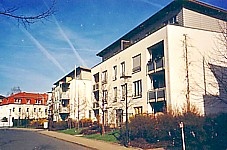Die Wüllnerstraße enstand als erste der Micktener "Jahreszeitenstraßen" und wurde ab 1896 zunächst Frühlingstraße genannt. In den Folgejahren folgten die Winter-, Sommer- und Herbststraße. Straßendoppelungen nach der Eingemeindung machten später jedoch Umbenennungen der Frühlings- und Sommerstraße (heute Lommatzscher Straße) erforderlich. 1904 erhielt die Frühligsstraße ihren heutigen Namen nach dem Dresdner Hofkapellmeister Franz Wüllner (1832-1902), der dieses Amt zwischen 1877 und 1882 innehatte. Später lebte er in Berlin und Köln und war dort ab 1884 Direktor des Städtischen Konservatoriums. Zwischen 1896 und 1904 wurde die Straße Frühlingsstraße genannt.

In den 1930er Jahren war geplant, die Wüllnerstraße von der Micktener bis zur Rehefelder Straße durchzuführen, was jedoch nicht zustande kam. Heute befinden sich hier Kleingärten. Im Ostteil entstand in den letzten Jahren eine kleine Wohnanlage mit Ein- und Mehrfamilienhäusern _(Foto)_.

Die kurze Zelenkastraße wurde 1997 in Verlängerung der Homiliusstraße angelegt und nach dem böhmischen Musiker Jan
Dismas Zelenka (1679-1745) benannt. Zelenka wirkte als Kontrabassist und Komponist kirchlicher Musik und war viele Jahre
Musiker der kurfürstlichen Hofkapelle in Dresden. Ab 2003 entstanden hier in mehreren Bauabschnitten neue Wohnhäuser.

[Mickten auf OpenStreetMap](https://www.openstreetmap.org/search?query=Dresden+Mickten)

* * *

 \[ [Home](../../../index.html)\] \[ [Nord](../../../nord/)\] \[ [Nordwest](../../../nordwest/)\] \[ [Neustadt](../../../neustadt/)\] \[ [Nordost](../../../nordost/)\] \[ [West](../../../west/)\] \[ [Zentrum](../../../zentrum/)\] \[ [Südwest](../../../sudwest/)\] \[ [Süd](../../../sud/)\] \[ [Südost](../../../sudost/)\] \[ [Ost](../../../ost/)\] \[ [Register](../../../Register/register.html)\] \[ [Kontakt](../../../Kontakt/kontakt.html)\] \[ [Impressum](../../../impressum/)\]
