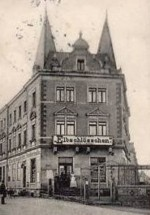
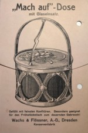
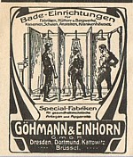
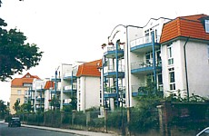
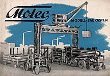
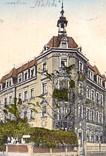
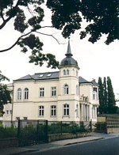
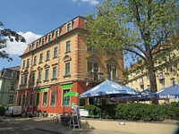
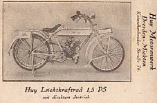
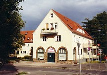

* * *

* * *

* * *

_Gaststätte "Elbschlösschen"_

_(Nr. 42)_

_Werbung der Konservenfabrik_

_Wachs & Flössner_

_Werbung der Firma Göhmann & Einhorn - Spezialfabrik für gesundheitstechnische Anlagen (Kötzschenbroder Straße 146)_

Die heute Kötzschenbroder Straße genannte Verbindung zwischen Mickten, Kaditz und Radebeul-Serkowitz war einst Teil der bereits im Mittelalter genutzten Landstraße nach Meißen. Im 18. Jahrhundert erhielt diese ihren heutigen Verlauf, womit die bisherige Alte Meißnische Landstraße an Bedeutung verlor. Beginnend am Ballhaus Watzke in Mickten folgte die alte Straße zunächst dem Elbufer, bevor sie an der Trachauer Straße in nordwestlicher Richtung abknickt.

Der auf Kaditzer Flur gelegene nördliche Abschnitt hieß seit 1899 Meißner Straße, der südliche Dresdner Straße. Diesen Namen trug die Straße damals auch in Mickten. Um Namensdoppelungen zu vermeiden, wurden diese Straßenabschnitte nach der Eingemeindung von Kaditz und Mickten zusammengefasst und 1904 nach dem damals noch selbständigen Ort Kötzschenbroda, seit 1935 ein Stadtteil von Radebeul, in Kötzschenbroder Straße umbenannt. An der Stadtgrenze von Dresden geht sie in die Kötzschenbrodaer Straße in Radebeul über.

Mickten:

Noch bis ins letzte Drittel des 19. Jahrhunderts waren die Flächen an der Kötzschenbroder Straße weitgehend umgebaut. An Stelle des heutigen [Ballhauses Watzke](../../../../nordwest/mickten/ballhaus_watzke/) (Kötzschenbroder Straße 1) stand ab 1790 als erstes Gebäude außerhalb des Dorfkerns eine kleine Bauernschänke. Auf dem Grundstück Nr. 9 befand sich die Micktener Windmühle, deren Baukörper später in die Brotfarik “Saxonia” einbezogen wurde. Ab 1880 siedelten sich auf dem Areal zwischen Kötzschenbroder und Sternstraße die ersten Fabriken an. Zu diesen gehörte die 1919 auf dem Gelände einer ehemaligen Ziegelei gegründeten “Dresdner Flugtechnischen Werkstätten” des Luftfahrtpioniers Alfred Lipfert. Lipfert hatte bereits 1914 die Firma [AERO Flugzeugbau GmbH](../../../../nordwest/kaditz/flugplatz_kaditz/) seines verunglückten Freundes Hermann Reichelt in Kaditz übernommen, musste diese jedoch aus wirtschaftlichen Gründen 1919 verkaufen. Auch sein neues Unternehmen hatte keinen langen Bestand. Nach Rückübernahme des Kaditzer Betriebes ging das Unternehmen 1921 in Konkurs.

Mit dem Niedergang der örtlichen Industrie nach 1990 stellten auch die Betriebe an der Kötzschenbroder Straße ihre Produktion ein und wurden daraufhin größtenteils abgetragen. Zwischen 1993 und 1995 wurde auf dieser Fläche das Wohnviertel “Elbvillenpark” mit Stadtvillen gehobenen Stils errichtet. Die geplante Bebauung der übrigen Freiflächen zwischen Kaditz und Mickten konnte bislang jedoch nur in Ansätzen realisiert werden.

**_Fotos:_** _Blick in die Kötzschenbroder Straße mit dem “Elbvillenpark”_

Brotfabrik “Saxonia”: Das Gelände der späteren Brotfabrik “Saxonia” war ursprünglich Standort der Micktener Windmühle, deren Mühlenturm noch erhalten ist. Ende des 19. Jahrhundert wurde der Mahlbetrieb auf Elektrizität umgestellt und die Mühle Teil einer Brotfabrik. Das Unternehmen befand sich ursprünglich im Besitz von C. A. Tippmann, später von Wilhelm Rämisch. Hergestellt wurden hier verschiedene Brotsorten für den Verkauf an Dresdner Händler. Nach 1900 entstanden weitere Gebäude.

Der Betrieb blieb auch nach dem Zweiten Weltkrieg zunächst in Familienbesitz, stellte jedoch seine Produktion nach dem Tod des Inhabers ein. Stattdessen übernahm der Elektroningenieur Eberhard Päßler das Gelände und richtete hier seine Firma für Mechanik, Elektrotechnik und Keramik ein. Die Firma war am 11. November 1945 auf der Williamstraße 11 in Naußlitz gegründet worden, musste aus Platzgründen jedoch umziehen. Im Mickten gelang es Päßler, sein Unternehmen zum Hersteller elektrischer Haushaltgeräte (“LAVA”) sowie für Spielwaren (“Motec”) zu erweitern. Der bereits in den 1950er Jahren in eine Kommanditgesellschaft mit staatlicher Beteiligung umgewandelte Betrieb wurde 1972 verstaatlicht und stellte bis zur Liquidation 1991 u.a. Heizplatten, Bügeleisen, Kleingeräte und technisches Spielzeug her (Firma ELKO). Heute wird das Gelände von verschiedenen Kleinbetrieben genutzt.

Elbsalon (Nr. 20): Das Gebäude wurde 1889/90 an der damaligen Meißner Straße 26b für den Restaurateur Max Bachmann als Wohn- und Geschäftshaus errichtet. Im Erdgeschoss existierte bis 1939 die Gaststätte “Elbsalon”. Danach wurden die Räume als Kantine der nahen [Spezialfabrik elektrischer Steuerapparate Gebr. Cruse & Co.](../../../../nordwest/mickten/strassen_mickten/) genutzt. Nach 1990 befand sich hier zeitweise das in Anlehnung an einen Roman von Agatha Christie gestaltete Restaurant “Orientexpress”. Heute wird das Lokal als Gaststätte “Zum Landstreicher” betrieben.

**_Foto:_** _Das Restaurant “Elbsalon” auf einer historischen Ansicht von ca. 1910_

VEB Kofa Dresden (Nr. 24/26):  Das Unternehmen entstand 1884 als Konservenfabrik Wachs & Flößner. Gründer war der Unternehmer Carl Hermann Wachs, der gemeinsam mit seinem Geschäftspartner einen Großhandel für landwirtschaftliche Produkte besaß und in Mickten mit der Herstellung von Obst- und Gemüsekonserven, Marmelade und Konfitüre begann. Wachs besaß zudem die noch heute erhaltene Villa [Großenhainer Straße 241](../../../../neustadt/leipziger_vorstadt/grossenhainer_strasse/).

Nach 1945 wurde der Betrieb verstaatlicht und in VEB Kofa Dresden (Konservenfabrik Dresden) umbenannt. Stammsitz blieb das Areal an der Kötzschenbroder Straße 24/26, Zweigbetriebe gab es auf der Bautzner Straße 13 und der Tharandter Straße 38. Unter den Markenzeichen "Kofa" und "Rotsiegel" wurden vorrangig Obstkonserven produziert, im Neustädter Betriebsteil auch Rohkonserven, eingelegte Gurken und Essiggemüse. Die Reinigung der zu einem Großteil aus dem Borthener Anbaugebiet stammenden Ware erfolgte hauptsächlich in Mickten, anschließend deren Abfüllung und Sterilisierung in Konservengläser. In Spitzenzeiten verließen bis zu 22.000 Gläser pro Tag das Werk. Außerhalb der Saison nutzte man die Anlagen für die Konservierung von Fertiggerichten wie Kohlrouladen und Spaghetti. Bis 1989 beschäftige der VEB Kofa ca. 180 Angestellte.

Nach Auflösung des Kombinats VEB OGS Dresden, dem die "Kofa" zuletzt angehört hatte, stellte man den Betrieb kurz nach der Wende ein. Mitte der 1990er Jahre wurden die Produktionsgebäude mit Ausnahme der Villa (Nr. 26 - _Foto_)abgerissen.

Elbschlößchen (Nr. 42): Auch in diesem Haus befindet sich seit vielen Jahren eine Gaststätte. Bereits vor dem Ersten Weltkrieg wurde diese unter Namen "Elbschlößchen Mickten" betrieben und befand sich 1912 im Besitz von Pauline Richter. Das "Elbschlößchen" blieb bis in die 1950er Jahre geöffnet und wurde dann bis zu Schließung als Speisesaal einer benachbarten Firma genutzt. Nach 1990 erfolgte eine Sanierung des Gebäudes und die Neueröffnung des Lokals, zunächst unter dem Namen "Saufnichab - Die Piratenbucht" als maritimes Fischrestaurant. Seit April 2011 trägt das umgestaltete Lokal den Namen "Spitzwegerich - Das Landhaus".

Huy Motorenwerk (Nr. 76): In den 1920er Jahren befand sich auf diesem Grundstück die Firma von Walter Huy, einer von zahlreichen kleinen Motorradherstellern dieser Zeit. Das bereits nach dem Ersten Weltkrieg gegründete Unternehmen besaß um 1920 seinen Sitz am Schlachthofring 2; die Produktionsräume befanden sich auf der Moritzburger Straße 19. Eigentlicher Geschäftszweck war die Herstellung von Fleischereiwerkzeugen und Maschinen. Außerdem betrieb Huy 1923 eine Automobilhandlung und -ausbesserungswerkstatt. Wenig später stieg er mit seinen Geschäftspartnern Arthur Bruno Oskar Winkler, Paul Gahr und Hermann Arthur Thiele in den Bau von Leichtkrafträdern ein und nutzte dafür 1924/25 das Grundstück Kötzschenbroder Straße 76. Allerdings war dem Unternehmen kein Erfolg beschieden, so dass der Motorradbau wenig später wieder aufgegeben wurde.

Kaditz:

Nr. 142: Zu den Baudenkmalen im Stadtteil Kaditz gehört das um 1900 errichtete dreigeschossige Mietshaus Kötzschenbroder Straße 142. Das Gebäude entstand kurz vor der Eingemeindung von Kaditz in Formen des Späthistorismus und besitzt eine repräsentative Putzfassade mit hervorgehobenem Mittelrisalit, die an Bauten der Zeit um 1800 erinnert. Es steht exemplarisch für das Vordringen großstädtischer Bauweisen in die Vororte.

Kaditzer Siedlung (Nr. 160-186): Mitte der 1930er Jahre wurde auf Kaditzer Flur mit dem Bau der „Gemeinschaftssiedlung Kaditz“ begonnen, deren Straßen ihre Namen meist nach alten Flurnamen bekamen. Bis dahin standen hier nur wenige Gebäude in der Nähe des Riegelplatzes, darunter die sogenannte “Waldschule” Kötzschenbroder Straße 140. Außerdem gab es im Bereich Spitzhausstraße einige Kiesgruben zur Versorgung der örtlichen Baustoffindustrie.

In mehreren Bauabschnitten wurden zwischen 1936 und 1942 17 preisgünstige Einfamilien- und Doppelhäuser sowie “Volkswohnungen” errichtet, die ganz im Sinne der nationalsozialistischen Siedlungspolitik bevorzugt an kinderreiche Familien mit geringem Einkommen vergeben wurden. Vorschrift war auch eine Mitgliedschaft im “Deutschen Siedlerbund” und die Vorlage eines “Eignungsnachweises”. Die Gebäude gruppieren sich zwischen Kötzschenbroder Straße, Fürstenhainer Straße und Seewiesenweg um begrünte Innenhöfe und eine namenlose zentrale Platzanlage. An der Kötzschenbroder Straße und im Haus Seewiesenweg 8 gab es zudem kleine Läden. Die Planungen stammen vom Dresdner Stadtplanungsamt unter Leitung des Stadtbaurates Paul Wolf. Heute werden die 1998/2000 renovierten Gebäude als “Familien-Wohnpark Kaditz” bezeichnet _(Foto)_. Weitere Häuser befinden sich in Privatbesitz.

Irmgard-Fischer-Eiche: Die zu den Dresdner Gedenkbäumen zählende Stieleiche steht am Südrand der Kaditzer Siedlung im Vorgarten des Wohnhauses Kötzschenbroder Straße 160. Der Baum wurde 1946 von der Anwohnerin Irmgard Fischer aus unbekanntem Anlass gepflanzt und ist mit einem Gedenkstein markiert: "Stieleiche. Geschützt. Gepflanzt von Irmgard Fischer."

* * *

 \[ [Home](../../../../index.html)\] \[ [Nord](../../../../nord/)\] \[ [Nordwest](../../../../nordwest/)\] \[ [Neustadt](../../../../neustadt/)\] \[ [Nordost](../../../../nordost/)\] \[ [West](../../../../west/)\] \[ [Zentrum](../../../../zentrum/)\] \[ [Südwest](../../../../sudwest/)\] \[ [Süd](../../../../sud/)\] \[ [Südost](../../../../sudost/)\] \[ [Ost](../../../../ost/)\] \[ [Register](../../../../Register/register.html)\] \[ [Kontakt](../../../../Kontakt/kontakt.html)\] \[ [Impressum](../../../../impressum/)\]
