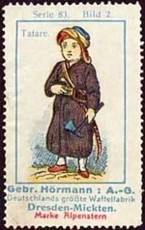
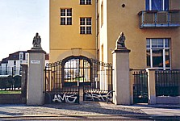
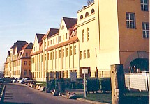
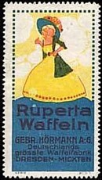
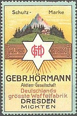
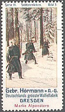

Das Unternehmen wurde 1895 in Dresden-Altstadt von den Brüdern Max
Ludwig (1866- 1919) und Robert Leo Hörmann (1870-1907) gegründet und zwei Jahre später aus Platzgründen von der Liliengasse 26 zur Sternstraße nach
Mickten verlegt. Um 1911 gehörte der als Aktiengesellschaft organisierte Betrieb zu den größten Herstellern der Branche in Deutschland. Produziert wurden vor
allem Kekse, Baumkuchen und Lebkuchen, später unter dem Markennamen “Alpenstern” auch Waffeln sowie Frucht- und Schokoladenbiskuits. 1911 ließ sich Firmeninhaber Max Hörmann auf der [Wilder-Mann-Straße](../../../../nordwest/trachau/strassen_trachau/wilder-mann-strasse/) 29 eine noch heute erhaltene Villa errichten. Auch die Fabrikanlagen wurden mehrfach
erweitert und umfassten später das gesamte Areal zwischen Kötzschenbroder, Trachauer und Sternstraße.

Nach 1945 wurde die Gebrüder Hörmann AG enteignet und als Betriebsteil in den
VEB Waffelfabrik Radebeul integriert. Zeitweise befand sich auf dem Gelände außerdem eine Produktionsstätte für Struves Mineralwasser. Zwischen 1972 und
1990 hatte hier der VEB Dauerbackwaren Dresden seinen Verwaltungssitz. Auf dem Gelände des 1990 vom Bahlsen-Konzern übernommenen, 1992 geschlossenen und später teilweise abgerissenen Unternehmens entstanden
1995/96 die Wohnhäuser an der neu angelegten Straße Elbvillenweg.. Der unter Denkmalschutz stehende Gebäudekomplex zwischen Stern-, Trachauer und  Kötzschenbroder Straße _(Fotos)_
beherbergt nach seiner Sanierung heute ebenfalls Wohnungen.

_Sammelbilder-Werbemarken der Firma Hörmann aus der Zeit vor dem Zweiten Weltkrieg_

* * *

 \[ [Home](../../../../index.html)\] \[ [Nord](../../../../nord/)\] \[ [Nordwest](../../../../nordwest/)\] \[ [Neustadt](../../../../neustadt/)\] \[ [Nordost](../../../../nordost/)\] \[ [West](../../../../west/)\] \[ [Zentrum](../../../../zentrum/)\] \[ [Südwest](../../../../sudwest/)\] \[ [Süd](../../../../sud/)\] \[ [Südost](../../../../sudost/)\] \[ [Ost](../../../../ost/)\] \[ [Register](../../../../Register/register.html)\] \[ [Kontakt](../../../../Kontakt/kontakt.html)\] \[ [Impressum](../../../../impressum/)\]
