* * *

**Gemeindesiegel von Pieschen**

* * *

* * *

**Pieschener Stadtteilseiten:**

[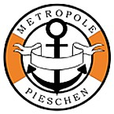](http://www.metropole-pieschen.org)

* * *

**Bildungseinrichtungen in Pieschen:**

[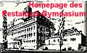](http://www.sn.schule.de/~pesta-dd)

**Vom Schmuddelviertel zum Vorzeige-Stadtteil**

**Stadtteilführungen immer am dritten Sa. im Monat**

**(im Wechsel mit Neudorf)**

**Treffpunkt: 10.00 Uhr am  “Savoir vivre” Oschatzer/Bürgerstr.**

**Preis: 8,00 Euro**

**(inkl. Getränk und Gebäck)**

**Anmeldung:**

**Tel. 0351/874 82 73**

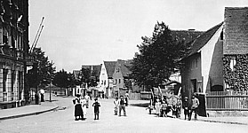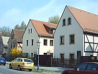Pieschen wurde 1292 erstmals als “Peschen” urkundlich erwähnt. Der Name stammt aus dem altsorbischen (pesk) und bedeutet Sandgegend in Anspielung auf den sandigen Boden in diesem Gebiet. Das Dorf war zunächst im Besitz des Ritters Johann von Peschen und bildete ein Gassendorf entlang der heutigen Straße [Altpieschen](../../nordwest/pieschen/strassen_pieschen/altpieschen/) _(Fotos)_. Größter Hof war das sogenannte Bischofsgut an der Mohnstraße, welches 1899 abgerissen wurde. Ab 1378 unterstand Pieschen dem Dresdner Amt, gehörte jedoch zu fünf verschiedenen Grundherrschaften. Aus diesem Grund besaßen noch bis Mitte des 19. Jahrhunderts das Prokuraturamt Meißen, das Dresdner Brückenamt, das Altstädter und Neustädter Religionsamt und das kurfürstliche Amt Dresden Rechte in Pieschen. Die fünf Weinstöcke im Gemeindewappen erinnern noch an diese komplizierten Besitzverhältnisse. Abgaben mussten u.a. an den Landesherrn, den Bischof von Meißen und das Neustädter Augustinerkloster geleistet werden. Hinzu kamen Spann- und Handdienste, Sicheltage und weitere Lasten.

Infolge der verkehrsgünstigen Lage an der Meißner Landstraße erlebte Pieschen immer wieder Durchzüge fremder Truppen, die im Ort Schäden hinterließen. Während des Dreißigjährigen Krieges 1637, im Nordischen Krieg 1707, im Siebenjährigen Krieg 1758/60 und auch in der Napoleonzeit entstanden Schiffsbrücken über die Elbe in der Nähe des Dorfes. Besonders 1813 hatten die Bewohner zu leiden, da wiederholt russische und französische Truppen den Ort besetzten und plünderten.

1674 brannte Pieschen nach einem Blitzschlag fast vollständig nieder. Weitere größere Dorfbrände sind 1763 und 1805 verzeichnet, die jeweils große Teile des Ortes vernichteten. Bis ins 19. Jahrhundert dominierte die Landwirtschaft. Außerdem betrieben die Pieschener Bewohner Obst- und Weinbau sowie Imkerei. Da der karge Boden nur wenig Ertrag abwarf und größere Gehöfte fehlten, blieb Pieschen immer ein armes Dorf, in dem vor allem Kleinbauern, Gärtner und Häusler ihr Auskommen suchten. Erst 1856 entstand am Leisniger Platz eine eigene Windmühle _(Bild links)_, nachdem der jahrhundertealte Mahlzwang der Neudorfer Schiffsmühle aufgehoben worden war. Die ländliche beschauliche Lage an der Elbe machte das Dorf gegen Mitte des 19. Jahrhunderts zum beliebten Ausflugsziel der Dresdner Bevölkerung mit zahlreichen kleinen Weinschänken und Gartenlokalen.

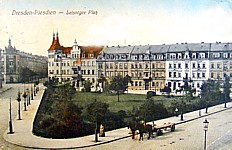Begünstigt durch den Ausbau der [Leipziger](../../neustadt/leipziger_vorstadt/leipziger_strasse/) und der [Großenhainer Straße](../../neustadt/leipziger_vorstadt/grossenhainer_strasse/) sowie die Trassenführung der [Dresden - Leipziger Eisenbahn](../../neustadt/leipziger_vorstadt/dresden_-_leipzig/) über Pieschener Flur siedelten sich in der zweiten Hälfte des 19. Jahrhunderts Industriebetriebe an, vor allem nördlich der Bahnlinie und an der Großenhainer Straße. 1868 entstand an der Harkortstraße der Maschinenbauhof der Eisenbahn. Einen Haltepunkt für den Personenverkehr erhielt der Ort jedoch erst 1899. Wichtigste Pieschener Unternehmen waren die [Eschebach-Werke](../../nordwest/pieschen/eschebach-werke/) an der Riesaer Straße, die [Nähmaschinenteile AG](../../nordwest/pieschen/strassen_pieschen/) an der Barbarastraße, das Elektromaschinenwerk, die Windmotorenfabrik Herzog und eine Malzfabrik an der Heidestraße. Pieschen wurde so zu einem Zentrum der Arbeiterbewegung, welche 1882 auf der Konkordienstraße den ersten Sächsischen Konsumverein gründete. Außerdem entstanden zahlreiche Gesangs-, Sport- und Arbeiterbildungsvereine, meist unter dem Einfluss der in Pieschen besonders starken Sozialdemokratie.

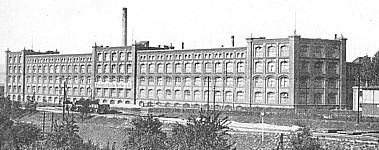

**_Foto:_** _Die Eschebach-Werke um 1920_

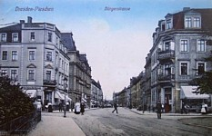Für das Bauerndorf brachte diese Entwicklung einschneidende Veränderungen mit sich. Pieschen wurde immer stärker zum Arbeiterwohnort. Infolge der Zuzüge stieg die Einwohnerzahl zwischen 1858 und 1905 von 400 auf ungefähr 30.000 Menschen an. Allerdings fehlte es an Wohnmöglichkeiten und Sozialeinrichtungen. Noch vor der Eingemeindung ließ die Gemeinde deshalb 1878 einen Bebauungsplan aufstellen, in dessen Folge rund um Altpieschen, an der Oschatzer und Bürgerstraße _(Foto)_ neue Straßen und Wohnviertel mit mehrstöckigen Mietshäusern entstanden. Da die Bewohner in der Regel einkommensschwächeren Schichten angehörten, nahm die finanzielle Lage des Ortes dramatische Züge an. Das Einkommensteuermittel lag um 1895 in Pieschen bei nur 3,58 Mark wöchentlich (Stadt Dresden: 16 Mark) je Einwohner. Aus diesem Grund bemühte sich Pieschen bereits 1893 um einen Anschluss an Dresden, der am 1. Juli 1897 vollzogen wurde. Bereits seit 1882 war der Ort durch eine Pferdebahnlinie mit Dresden verbunden, ab 1899 durch eine elektrische Straßenbahn.

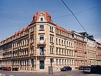Nach dem Pieschen Stadtteil geworden war, entstanden weitere Wohnviertel, meist in geschlossener Bauweise _(Foto: Mohnstraße)_. Hinzu kamen neue Gaststätten, Sozial- und Kultureinrichtungen. Zu den bekannten Pieschener Arbeiterlokalen dieser Zeit gehörten u. a. der “Deutsche Kaiser” und das “Stadt Leipzig” an der [Leipziger Straße](../../neustadt/leipziger_vorstadt/leipziger_strasse/) (später Kino “Faunpalast”). 1912 errichte die Stadt in Altpieschen Nr. 9 ein für damalige Verhältnisse modernes Asyl für obdachlose Männer, welches 1926 in ein Familienasyl umgewandelt wurde. Die Bebauung der Pieschener Flur setzte sich nun auch in Richtung Trachau und Trachenberge fort, so dass beide Stadtteile immer stärker zusammenwuchsen.

Kirchlich gehörte Pieschen bis 1884 zur Kaditzer Kirche und bildete dann eine eigene Kirchgemeinde, für die 1886/88 die [Markuskirche](../../nordwest/pieschen/markuskirche/) entstand. 1910 folgte die katholische [St.-Josefs-Kirche](../../nordwest/pieschen/st_-josefs-kirche/). Weitere Wohnsiedlungen wurden in den 1920er Jahren an der Wurzener und Rehefelder Straße errichtet. Architekt der modernen Häuser mit Flachdächern war Hans Richter, der auch für die Trachauer Siedlung verantwortlich war. 1927/28 entstand an der Wurzener Straße das [Sachsenbad](../../nordwest/pieschen/strassen_pieschen/sachsenbad/) _(Foto)_. Trotz der dichten Besiedlung Pieschens blieben einige Freiflächen zwischen den Wohn- und Gewerbevierteln erhalten, die heute meist von Kleingartenanlagen eingenommen werden. 1932 legte der Arbeitersportverein Pieschen an der Wurzener Straße einen Sportplatz an. Gemeinsam mit dem Pieschener Volkschor und dem Deutschen Arbeiter-Sängerbund veranstaltete dieser Verein ab 1921 bis 1932 regelmäßige Strandfeste, aus denen das 1965 wiederbelebte Pieschener Hafenfest hervorging.

Obwohl in Pieschen noch während des Zweiten Weltkrieges einer der größten Dresdner Rüstungsbetriebe entstand (Göhle-Werk der Zeiss-Ikon AG), blieb der Stadtteil von größeren Luftangriffen verschont. Dennoch gab es beim letzten Bombenabwurf auf Dresden am 17. April 1945 auch hier einige Schäden, so an der Oschatzer und Leipziger Straße. In der Nachkriegszeit übernahm Pieschen einige kulturelle und wirtschaftliche Funktionen des zerstörten Stadtzentrums. So wurden die ehemaligen Göhle-Werke als Veranstaltungsort für Konzerte und Theateraufführungen sowie durch die Druckerei der “Sächsischen Zeitung” genutzt. Die bestehenden Industrieunternehmen blieben, in VEB´s umgewandelt, zum Großteil erhalten, so dass Pieschen auch seine Bedeutung als Wirtschaftsstandort behielt. Um die Oschatzer und Bürgerstraße entwickelten sich stadtweit beliebte Einkaufszentren.

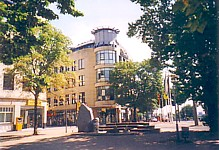Mangelnde Werterhaltung der Altbausubstanz führte jedoch zum schleichenden Verfall ganzer Straßenzüge, so dass 1989 ein Großteil der Gebäude zum Abriss vorgesehen war. Erst die politischen Veränderungen 1989/90 ermöglichten, das der Stadtteil 1991 zum zweitgrößten städtischen Sanierungsgebiet erklärt wurde. Zahlreiche Häuser wurden seitdem modernisiert. Aus ehemaligen Industriebetrieben entstanden das Einkaufszentrum “Mälzerei” und das inzwischen wieder geschlossene Sozialrathaus an der Riesaer Straße. 1993 wurde an der Leipziger Straße mit dem Bau des “Elbcenters” begonnen, welches sich nach seiner Fertigstellung zum neuen Stadtteilzentrum entwickelte _(Foto)_. Auch einige weitere Baulücken konnten in den letzten Jahren geschlossen werden.

Schulen in Pieschen:

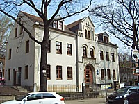Alte Schule: Pieschen gehörte ursprünglich zur Kaditzer Kirchschule. Um den weiten Weg nach dort abzukürzen, entstand um 1613 eine Winkelschule in Pieschen, die 1730 als unabhängig anerkannt wurde. Der Unterricht erfolgte zunächst in Pieschener Bauernhäusern, bevor 1805 an der Bürgerstraße 76 ein eigenes Schulhaus errichtet wurde. Dieses Haus blieb, zuletzt als Wohnhaus genutzt, noch bis in die 1970er Jahre erhalten. Bekanntester Lehrer dieser Schule war ab 1832 Gottlieb Mohn, nach dem heute die Mohnstraße benannt ist. Diese Schule besuchten in den 1850er Jahren bis zu 200 Kinder, die ab 1856 in "Ober-, Mittel- und Unter-Classe" geteilt waren.

1860/61 entstand ein Neubau an der Bürgerstraße 68 _(Foto rechts)_, der 1871 nochmals erweitert und bis 1878 für den Unterricht genutzt wurde. Die Grundsteinlegung erfolgte am 6. März 1861, das Richtfest bereits 15. April des gleichen Jahres. Neben Pieschener Schülern wurden hier auch die Kinder aus Trachau und Trachenberge sowie Teilen von Mickten unterrichtet. Bis 1880 wuchs, parallel zur Einwohnerzahl, die Zahl der Schüler auf über 900 an, was den Bau neuer Schulen erforderlich machte. Nach deren Fertigstellung diente das alte Schulhaus bis zum Bau des Rathauses 1891 Sitz der Pieschener Gemeindeverwaltung. Später war hier eine Sparkiassenfiliale, danach ein Kindergarten untergebracht. Heute dient dieses Gebäude als Stadtteilhaus “Emmers” kulturellen Zwecken und wird vom Jugendverein “Outlaw” betrieben. Regelmäßig finden Filmvorführungen, Konzerte und andere Veranstaltungen statt. Außerdem gibt es einen Jugendclub, ein kleines Café und den “Jobladen” der QAD.

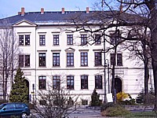26\. Grundschule: 1879 folgte als Nachfolger der alten Dorfschule die bis heute als 26. Grundschule genutzte Schule an der Osterbergstraße 22 _(Foto links)_. Die Planung und Ausführung übernahmen die Baumeister Ernst Ehregott Schletter und Karl Wilhelm Richter. Bereits 1885 musste dieses Schulhaus um einen Seitenflügel erweitert werden. In dem ab 1890 als reine Knabenschule genutzten Gebäude hatten bis 1918 die 26. Bezirks- und die XI. Bürgerschule ihren Sitz. Zeitweise gab es hier auch die V. Hilfs- und Fortbildungsschule sowie die 1929 zur Wurzener Straße verlegte 12. Städtische Volksbibliothek. Nach 1918 wechselte die Schulbezeichnung in 26. Volksschule. Ein gemeinsam mit der 27. Volksschule genutzter Schulgarten befand sich an der Ecke Robert-Matzke-/Rehefelder Straße. Heute steht auf diesem Grundstück ein DRK-Altenpflegeheim.

In der Nachkriegszeit war das Schulhaus an der Osterbergstraße Schauplatz für verschiedene Kulturveranstaltungen, da es im Zentrum der Stadt an geeigneten Sälen mangelte. Zu DDR-Zeiten wurde die Schule ab 1969 nach einem Pieschener Antifaschisten 26. POS “Arno Lade” genannt. Nach 1990 erhielt sie ihren heutigen Namen “Am Markusplatz”.

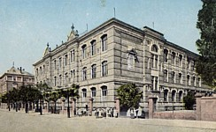27\. Volksschule: Aufgrund der ständig wachsenden Bevölkerung wurde am 1. September 1890 an der Moltkestraße (heute Robert-Matzke-Straße) 14 ein weiterer Schulbau als Volksschule für Mädchen eröffnet (27. Bezirksschule). Architekten des Gebäudes waren Richard Walter Gänzel und Gustav Walter Martin. Auch für diese Schule machten sich bereits 1894 zwei Flügelanbauten erforderlich. Nach dem Ersten Weltkrieg nutzte die 27. Volksschule, zu DDR-Zeiten die 27. POS “Robert Matzke” das Haus. Robert Matzke (1884-1943) gehörte seit 1920 der Pieschener Ortsgruppe der KPD und der “Roten Hilfe” an und war nach 1933 im illegalen Widerstand gegen die NS-Herrschaft aktiv. Ab 1991 diente das Gebäude bis 2006 als 27. Mittelschule. Im Anschluss übernahm die 2007 als Schulversuch mit zwei Klassen gestartete “Gemeinschaftsschule Pieschen “den Betrieb. Nach schrittweiser Erweiterung folgt sie als Schule in freier Trägerschaft einem besonderem pädagogischen Konzept.

106\. Grundschule: Eine weitere Schule entstand in der DDR-Zeit. Das am 1. September 1976 als Polytechnische Oberschule eröffnete Gebäude vom Typ "Dresden Atrium" befindet sich an der Flurgrenze zwischen Pieschen und Trachau zwischen Weixdorfer und Großenhainer Straße (Nr. 187). Ein halbes Jahr später folgten die Sporthalle und die Außenanlagen. Am 1. Juni 1982 erhielt die 106. POS den Namen des Dresdner Antifaschisten Albert Hensel verliehen. Seit der Umgestaltung des Schulsystems nach 1990 nutzt die 106. Grundschule "Am Wilden Mann" das Schulhaus. 2008/09 wurde das Haus komplett saniert und die alte Turnhalle durch einen modernen Neubau ersetzt.

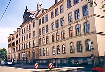XI. Bürgerschule: Als höhere Schule Pieschens entstand 1901/02 an der Wurzener Straße 5 die XI. Bürgerschule, deren Gebäude ab 1919 von der 28. Volksschule genutzt wurden. Außerdem gab es hier vor dem Ersten Weltkrieg die V. Mädchenfortbildungsschule. Während des Zweiten Weltkrieges diente das Gebäude als Lazarett und beherbergt seit 1959 eine Poliklinik bzw. ein Ärztehaus _(Foto rechts)_.

Katholische Volksschule: Als letzter Schulneubau in Pieschen vor dem Ersten Weltkrieg folgte 1905 die katholische Volksschule (später V. Katholische Bezirksschule) an der Leisniger Straße 76, die heute Sitz der Förderschule für Lernbehinderte “A. S. Makarenko” ist. Entworfen wurde das Gebäude von Louis Geyer und Franz Anton Löbmann. 1913 richtete man im Haus zusätzlich eine Kinderbewahranstalt für kleinere Kinder ein. Außerdem gab es während des Ersten Weltkriegs eine Kriegerfrauenküche. Bis zur Zwangsverstaatlichung 1933 befanden sich im Schulhaus auch die Gemeinderäume der katholischen St.-Josefs-Kirche.

Mit Machtübernahme der Nationalsozialisten wurde die Katholische Volksschule wie alle konfessionsgebundenen Schulen aufgelöst und zur staatlichen 5. Mädchenschule. Zu DDR-Zeiten übernahm die nach dem sowjetischen Pädagogen Anton Semjonowitsch Makarenko benannte Förderschule für Lernbehinderte das Gebäude. 2018 entstand für die Grundschulklassen dieser Förderschule ein moderner Schulneubau auf dem Nachbargrundstück Nr. 78. Ursprünglich war dieser Neubau für die 146. Grundschule vorgesehen, deren Gründung jedoch nicht zustande kam. Letztlich entschied man sich, das Gebäude und die zugehörige Einfeldsporthalle an die Förderschule zu übergeben.

Postwesen in Pieschen:

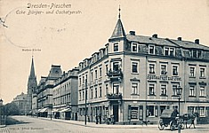Die erste Poststelle Pieschens entstand in den 80er Jahren des 19. Jahrhunderts und befand sich in einem Gebäude an der Ecke Bürger-/Oschatzer Straße. Nach Verlegung in das neue Pieschener Rathaus nutzte man diese Räume viele Jahre als Gaststätte “Zur Post” und hielt so die Erinnerung an dieses erste Postamt wach _(Foto)_. Ab 1892 gab es im Rathaus eine Poststelle, die 1902 zur Torgauer Straße 25 verlegt wurde. Nach dem Ersten Weltkrieg wurde dieses Postamt als Dresden N 22 bezeichnet.

Trotz Protesten der örtlichen Geschäftsleute und vieler Einwohner ließ die Deutsche Post das Amt 1933 aus wirtschaftlichen Gründen schließen. Erst 1941 erhielt Pieschen wieder eine Poststelle auf der Osterbergstraße 24. Noch bis 1954 konnten die Einwohner hier ihre Postgeschäfte erledigen, bevor die Pieschener Post 1955 erneut zur Torgauer Straße umzog (Nr. 31). 1991 wurde dieses Postamt geschlossen. Seit 2007 bietet eine private Postagentur auf der Trachenberger Straße 19 verschiedene Postdienstleistungen an.

Rathaus Pieschen:

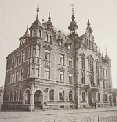Das Rathaus entstand 1890/91 als Verwaltungssitz für die damals noch selbstständige Gemeinde an der Bürgerstraße 63. Architekten des Neorenaissancebaus waren Schilling & Graebner, die hier ihren ersten öffentlichen Auftrag realisierten. Im Vorfeld hatte es einen beschränkten Wettbewerb gegeben, den das damals noch junge Architektenbüro gewann. Sie entschieden sich für einen Neorenaissancebau im Stil der deutschen Renaissance. Baubeginn war der 22. September 1890, die offizielle Grundsteinlegung erfolgte am 13. Oktober. An der Fassade des am 30. November 1891 eingeweihten Baus befinden sich eine Darstellung des früheren Pieschener Gemeindewappens und die Porträtreliefs einiger damaliger Gemeinderäte. Auch die Innenräume wurden entsprechend gestaltet und mit Holzdecken und Wandornamenten versehen. Im Erdgeschoss gab es die über einen kleinen Seiteneingang erreichbare und im altdeutschen Stil eingerichtete Gaststätte “Ratskeller”.

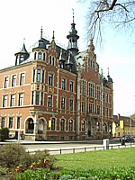Neben dem Sitz der Gemeindeverwaltung war hier von 1913 bis 1937 auch die Ortssparkasse untergebracht. Weitere Räume nutzten bis 1902 die Post und danach die Polizeiwache des 15. Bezirks. Zu DDR-Zeiten war das Haus Sitz des Stadtbezirkes Dresden-Nord. In dem 1991-94 gründlich sanierten Gebäude befindet sich heute das Ortsamt Pieschen mit Bürgerbüro. Leider sind von der ehemaligen Innendekoration nur noch Reste erhalten geblieben. 2011 bezog das private Puppentheater “August - das starke Theater” die Räume des ehemaligen Ratsherrenstübels. Betreiber sind die Puppenspieler Randi und Grigorij Kästner-Kubsch sowie Detlef Heinichen. Das im Gründerzeitstil eingerichtete Theater verfügt über ca. 80 Plätze und wird auch für gelegentliche Gastspiele genutzt.

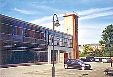Im Zusammenhang mit dem Rathausbau erhielt auch die Pieschener Ortsfeuerwehr in einem Hintergebäude des Rathauses ein neues Domizil. Diese war bereits 1877 als sogenannte "Turnerfeuerwehr" (Freiwillige Feuerwehr) gegründet worden. Das Haus erhielt neben den Diensträumen auch einen Spritzenturm, Remisen und eine Arrestzelle. Im Zuge der Eingemeindung forderten der Pieschener Gemeinderat und Branddirektor Thomas, auch künftig eine eigene Feuerwehr im Ort zu behalten. Dieser Vorschlag wurde akzeptiert und am 1. April 1898 bezog die Berufsfeuerwache 6 der Stadt Dresden das Gebäude. Fortan waren hier fünf Schlauchwagen, zwei Rettungsapparate und das für die Bedienung notwendige Personal stationiert.

Ein erster Umbau der der Wache wurde im Jahr 1912 vorgenommen, wobei die Aufenthaltsräume direkt ins Rathaus verlegt wurden. Beim Luftangriff am 13. Februar 1945 wurde die Feuerwache schwer beschädigt. Die Reservehalle brannte völlig aus. Die nur notdürftig behobenen Schäden führten 1950 zur Sperrung der Räume und der Verlegung in ein Ausweichquartier in Radebeul. Erst mit dem Neubau der Dresdner Zentralfeuerwache an der Washingtonstraße in Übigau endetete 1998 dieses Provisorium. Das frühere Gebäude in Pieschen wurde Ende der 1990er Jahre modernisiert und ist heute Sitz der Pieschener Stadtteilbibliothek und der Dresdner Fahrbücherei _(Foto links)_.

Pieschener Hafen:

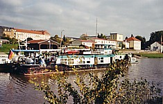Der Pieschener Hafen wurde zwischen 1856 und 1859 im Auftrag der sächsischen Staatsregierung angelegt. Grund war die starke Zunahme des Schiffsverkehrs auf der Elbe, die neue Hafenanlagen an verschiedenen Stellen im Stadtgebiet erforderlich machten. In dem 500 Meter langen und ca. 30 Meter breitem Hafenbecken fanden bis zu 30 Schiffe Platz. Unweit des Hafens gab es auch eine Anlegestelle der Dampfschiffahrt sowie ein von den Einwohnern gern genutztes Elbebad. Zeitweise existierte hier auch eine kleine Werft zur Reparatur von Frachtkähnen.

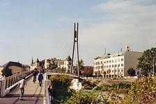Mit Inbetriebnahme des Alberthafens sank die Bedeutung des Pieschener Hafens, der heute nur noch als Winterhafen genutzt wird. Außerdem haben hier die Wassersportsektion des TSV Rotation 1990 e. V. und das Wasserstraßen- und Schiffahrtsamt Dresden ihr Domizil. Stadtweit bekannt ist jedoch das erstmals 1921 als Strandfest begangene Pieschener Hafenfest. Am 9. September 2010 wurde eine im Zuge des Elberadweges entstandene Fußgängerbrücke über die Hafeneinfahrt eingeweiht. Unweit davon steht an der Spitze der Hafenmole die Plastik “Undine kommt” der Künstlerin Angela Hampel _(Foto links)_. Das Gegenstück “Undine geht” befindet sich in Johannstadt in der Nähe des Fährgartens. Beide Stahlfiguren entstanden 1998 im Rahmen des Projektes “An Elbe und Rhein”.

Elbfähre:

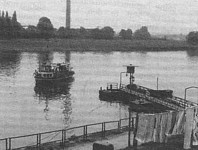Die Pieschener Elbfähre wurde 1764 als Kahnfähre eingerichtet und verband den Ort mit dem gegenüberliegenden [Ostragehege](../../zentrum/friedrichstadt/ostragehege/). Auf Pieschener Seite lag die Fährstelle in der Nähe der Einmündung Mohnstraße/Leipziger Straße, im Ostragehege an der Nordspitze der “Schlachthofinsel”. Unweit davon gab es auch eine Elbebadeanstalt. Betreiber war ab 1885 die Familie Jacob. Als erster Fährmann besaß Karl Jacob (1851-1931) das Fährrecht, der zugleich das Amt des Lokalrichters und Friedensrichters für den IX. und XV. Polizeibezirk ausübte. 1898 übernahm sein Sohn Albert, später dessen Sohn Christian Albert Hellmuth den Fährbetrieb. Am 7. Mai wurde der Fährmann, vermutlich von abziehenden Soldaten, erschossen. Daraufhin führte seine Witwe Lotte Jacob das Unternehmen noch bis 1962 weiter. Danach wurde die Fähre von den Dresdner Verkehrsbetrieben übernommen. Die Grabstätte der Pieschener Fährmannsfamilie befindet sich auf dem Markusfriedhof.

Hauptnutzer der Fähre waren neben Ausflugsgästen vor allem die Angestellten des [Schlachthofs](../../zentrum/friedrichstadt/ostragehege/schlachthof/) im Ostragehege. Nach dessen Schließung 1994 gingen die Fahrgastzahlen jedoch deutlich zurück. Die DVB entschlossen sich daraufhin, den unwirtschaftlichen Betrieb einzustellen. Letztmals querte am 29. März 1996 die Pieschener Fähre die Elbe. Später war hier zeitweise der Bau einer neuen Elbbrücke geplant. Eine kurzzeitige Reaktivierung gab es während des Kirchentags im Jahr 2011, als nochmals für einige Wochen eine Fähre zwischen Pieschen und Ostragehege verkehrte. Alle Forderungen, wieder eine ständige Verbindung einzurichten, scheiterten bislang an den hohen Kosten.

[_Weiterführende Literatur und Quellen_](../../impressum/quellenverzeichnis/)

 \[ [Home](../../index.html)\] \[ [Nord](../../nord/)\] \[ [Nordwest](../../nordwest/)\] \[ [Neustadt](../../neustadt/)\] \[ [Nordost](../../nordost/)\] \[ [West](../../west/)\] \[ [Zentrum](../../zentrum/)\] \[ [Südwest](../../sudwest/)\] \[ [Süd](../../sud/)\]
 \[ [Südost](../../sudost/)\] \[ [Ost](../../ost/)\] \[ [Register](../../Register/register.html)\] \[ [Kontakt](../../Kontakt/kontakt.html)\] \[ [Impressum](../../impressum/)\]
