* * *

* * *

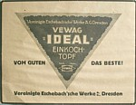

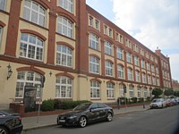Die Geschichte der Firma Eschebach begann im Jahr 1872, als seine Ehefrau Bertha Emma am 10. Juli 1872 ein "Blechwaaren-Fabrikgeschäft" auf der Neuen Gasse 14 in der Pirnaischen Vorstadt erwarb. Gemeinsam mit drei Arbeitern fertigte der aus Wittenberg stammende Unternehmer Carl August Emil Eschebach (1842-1905) hier verschiedene hauswirtschaftliche Gegenstände. Zuvor hatte der gelernte Klempner u.a. in Könnern, Hannover, Berlin und Köthen gearbeitet und kam vermutlich um 1870 nach Dresden. Der schnelle wirtschaftliche Erfolg des jungen Unternehmens zwang bereits drei Jahre später zur Verlegung der Produktionsräume zum Pirnaischen Platz. Nach Aufnahme des Kaufmanns Julius Haussner wurde die Firma ab 1. Mai 1877 unter dem Namen Eschebach & Haussner geführt.

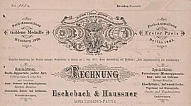

_Briefkopf der Firma Eschebach & Hausner aus der Zeit um 1885_

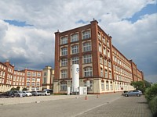Um der wachsenden Nachfrage gerecht zu werden, machte sich schon bald ein weiterer Umzug erforderlich, zunächst 1878 in die Pontonschuppen am Elbufer, 1880 in das Gebäude des früheren Garnisonslazaretts in der Neustadt am Hospitalplatz 2. Zu diesem Zeitpunkt waren bereits 150 Arbeiter für die Firma Eschebach beschäftigt.Zum Produktionsprogramm gehörten nun auch Eisschränke, Badewannen, Toiletten, Ofenschirme und andere Haushaltgegenstände. 1886 gründete Carl Eschebach ein weiteres Werk in Radeberg (Radeberger Guß- und Emaillierwerke Carl Eschebach & Co.). Beide Betriebe wurden vier Jahre später zu einer Aktiengesellschaft zusammengeschlossen und nun als “Vereinigte Eschebach´sche Werke AG” bezeichnet. Geleitet wurde das Unternehmen mit Stammsitz in Dresden von Carl Eschebach und seinem ehemaligen Prokuristen Richard Schumann. Zu diesem Zeitpunkt beschäftigte der Betrieb ca. 800 Mitarbeiter, überwiegend in der Metallbearbeitung- und in der Holzwarenherstellung. Nur die Hälfte der Erzeugnisse wurde in Deutschland vertrieben, der Rest in alle Welt exportiert.

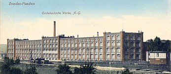

Im Juni 1900 bezog Carl Eschebach einen neu errichteten Gebäudekomplex an der Riesaer Straße in Pieschen. Bereits 1894 hatte man zu diesem Zweck ein ca. 24.000 Quadratmeter großes Grundstück unmittelbar an der Bahnstrecke erworben. Der zur Bauzeit allen modernen Ansprüchen genügende Bau erstreckte sich entlang der Riesaer und Barbarastraße und wurde mit einer repräsentativen Klinkerfassade versehen. Zu ihm gehörten neben den Produktionsräumen für die Metall- und Holzwaren eine eigene Lackiererei, ein Verwaltungs- und Sozialgebäude und als Herzstück die Kraftzentrale für die Energieversorgung des Werkes.

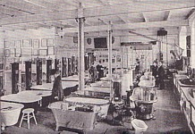Hier entstanden emaillierte Metallwaren unterschiedlichster Art, vor allem aber Küchenzubehör und Sanitäreinrichtungen wie Eisschränke, Badewannen, Waschbecken u.ä. Beispielhaft waren die modernen Sozialräume für die Angestellten, eine Werkskantine und ein 75 m langer Mustersaal _(Foto)_, in dem das gesamte Produktionsprogramm ausgestellt war. Die Beschäftigtenzahl wuchs damit auf über 1200 Arbeiter an, die über eine vom Firmengründer eingerichtete Stiftung in Notfällen versichert waren.
Der für seine Verdienste zum Geheimen Kommerzienrat ernannte Firmengründer besaß neben seinen beiden Betrieben auch eine prunkvolle Villa am Albertplatz, die nach Zerstörung 1945 inzwischen wieder aufgebaut ist und von der Volksbank genutzt wird.

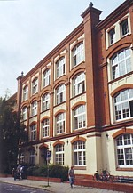Auch nach dem Tod Carl Eschebachs 1905 blieb sein Unternehmen einer der bedeutendsten Hersteller der Branche. Bedingt durch die rapide wachsende Bevölkerung und den dadurch entstehenden Bedarf an Küchenausstattungen konnten die Umsätze bis zum Ersten Weltkrieg ständig gesteigert werden. Ab 1906 wurden als zweites Standbein auch Schlafzimmermöbel hergestellt, die das Werk erstmals auf der Dritten Deutschen Kunstgewerbeausstellung in Dresden präsentierte. Mehrfach erhielten Entwicklungen des Hauses internationale Auszeichnungen, so in Leipzig auf der Kochkunstausstellung 1905 die Sächsische Staatsmedaille, 1907 die Große Silberne Staatsmedaille der Thüringer Gastwirtsgewerbeausstellung und 1911 den Großen Preis der I. Internationalen Hygieneausstellung in Dresden. Weniger erfolgreich verlief die Gründung eines Zweigbetriebes in Aussig, welcher schon wenige Jahre nach dem Produktionsstart 1909 wieder verkauft wurde.

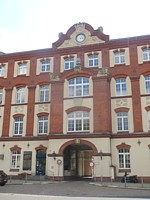Nach dem Ersten Weltkrieg brach die Erfolgsserie der Eschebach-Werke ab. Trotz mehrfacher Kapitalerhöhungen gelang es nicht, das Unternehmen dauerhaft wirtschaftlich zu stabilisieren. Gründe waren neben dem Kapitalverfall in den Inflationsjahren auch rückgängige Exportzahlen und die zunehmende Konkurrenz von Billiganbietern, was zu einem ständigen Preisverfall führte. Auch die von Fachleuten hoch gelobte Eschebach-Reform-Küche von 1927 konnte deshalb die Schließung des Dresdner Werkes nicht verhindern. 1931 verlegte das Unternehmen seinen Sitz nach Radeberg. Die Betriebsgebäude verkaufte man 1931 an die Aktiengesellschaft für Cartonagen-Industrie, die hier fortan verschiedenartige Verpackungsmaterialien herstellte.

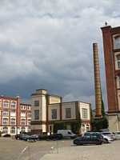Der von größeren Kriegsschäden weitgehend verschont gebliebene Betrieb wurde 1946 enteignet. Den Dresdner Betriebsteil übernahm der VEB Kartonagenindustrie (später VEB Polypack Dresden). 1990 wurde die Produktion in Pieschen eingestellt und das denkmalgeschützte Gebäude Riesaer Straße 5-7 zum Bürohaus umgebaut. Nach 1990 nutzte es die Stadt zeitweise als Sozialrathaus. Außerdem haben hier verschiedene Unternehmen Büroräume gemietet.

In Radeberg stellte die 1946 enteignete und zum volkseigenen Betrieb umgewandelte Firma unter dem traditionellen Namen Eschebach weiterhin Küchenmöbel her. Ab 1972 gehörte das Werk bis zur Privatisierung 1990 zum Möbelkombinat Hellerau. Bereits 1991 musste das Unternehmen jedoch Insolvenz anmelden. Trotz mehrerer Besitzerwechsel gelang es nicht, an die wirtschaftlichen Erfolge der Vergangenheit anzuknüpfen. Nach erneuter Insolvenz wurde die Produktion im April 2004 eingestellt. Erhalten blieben zahlreiche Exponate der nach 1990 zusammengetragenen Werksausstellung, welche die Geschichte des Traditionsbetriebes dokumentiert. Seit 2015 sind Teile der Sammlung, darunter eine der bekannten "Reformküchen" in der Dauerausstellung des Radeberger Heimatmuseums Schloss Klippenstein zu sehen.

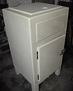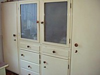

_Fotos: Eschebach-Eisschrank (links) und Eschebach-Küchenschrank aus den 1920er Jahren_

_(Die rechte Aufnahme wurde von Martin Kraus/Leipzig zu Verfügung gestellt)_

* * *

 \[ [Home](../../../index.html)\] \[ [Nord](../../../nord/)\] \[ [Nordwest](../../../nordwest/)\] \[ [Neustadt](../../../neustadt/)\] \[ [Nordost](../../../nordost/)\] \[ [West](../../../west/)\] \[ [Zentrum](../../../zentrum/)\] \[ [Südwest](../../../sudwest/)\] \[ [Süd](../../../sud/)\] \[ [Südost](../../../sudost/)\] \[ [Ost](../../../ost/)\] \[ [Register](../../../Register/register.html)\] \[ [Kontakt](../../../Kontakt/kontakt.html)\] \[ [Impressum](../../../impressum/)\]
