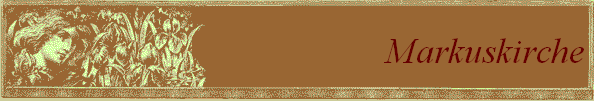
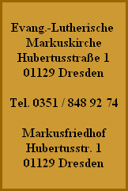
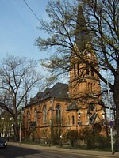
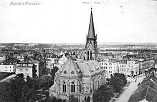
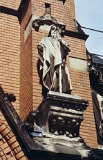
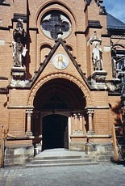
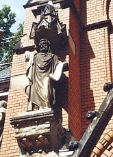
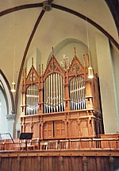
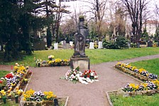

* * *

* * *

* * *

* * *

* * *

* * *

Pieschen bildete gemeinsam mit Trachenberge ab 1884 eine eigene Kirchgemeinde,
nachdem der Ort zuvor jahrhundertelang zur Kaditzer Kirche gehört hatte. Um den langen Kirchweg zu verkürzen, stellte Gemeindevorstand Ziller 1876 in seiner Tischlerei auf der
Konkordienstraße Räume für die Gottesdienste zur Verfügung. Auch die 1879 auf der Osterbergstraße errichtete Schule diente zeitweise als Notkirche. Zunächst fanden die
Gottesdienste in einem Schulzimmer, später in der Turnhalle der Schule statt.

Um 1880 entschloss sich die Gemeinde zum Bau eines eigenen Gotteshauses und rief dafür
eine Spendenaktion ins Leben. Aus diesem Geld wurden 1883 zunächst drei Bronzeglocken erworben, die in einem Glockenstuhl auf dem Schulhof aufgehängt wurden.
Nach mehrjähriger Diskussion, die zeitweise sogar den Kauf einer gußeisernen Fertigteilkirche aus Großbritannien in Erwägung zog, konnte am 18. Oktober 1886 an der Bürgerstraße der
Grundstein zur Markuskirche gelegt werden. Zuvor befand sich auf diesem Areal ein Weinberg, der für den Kirchenbau eingeebnet werden musste.

Die Kirche im neogotischen Stil entstand in nur zweijähriger Bauzeit nach
Entwürfen von Christian Gottfried Schramm und wurde am 21. März 1888 festlich geweiht. Der Ziegelbau besitzt einen 45 Meter hohen Turm, der bis heute das Ortsbild Pieschens prägt. An der Fassade sind Statuen der vier
Propheten Jesaja, Jeremia, Hesekiel und Daniel angebracht, die von Robert Henze aus französischem Kalkstein geschaffen wurden. Das Sinnbild des Evangelisten Markus, der der Kirche den Namen gab, befindet sich mit einer
Löwenplastik am Turm. 1891 konnte die junge Markusgemeinde auch ihr Pfarrhaus beziehen. Ein 1895 auf dem Vorplatz der Kirche aufgestelltes
Kriegerdenkmal für die Gefallenen des Deutsch-Französischen Krieges 1870/71 fiel nach 1945 der Bilderstürmerei zum Opfer.

**_Fotos:_** _Eingang zur Markuskirche - links und rechts zwei der vier Propheten-Statuen_

1945 erlitt auch die Markuskirche einige Schäden durch in der Nähe niedergegangene Sprengbomben. Fenster, Dach, Turmhaube und Statuen konnten jedoch schon bald wieder repariert werden. Die zerstörten Kirchenfenster
ersetzte der Dresdner Kunstmaler Helmar Helas bis 1951 durch eigene Gestaltungen. In den 60er Jahren erfolgte eine
umfassende Renovierung des Inneren, ab 1978 auch der Außenfassade. Dabei verschwanden auch die vier einst vorhandenen Ecktürmchen am Turm. Seit 1999 gehört die Markuskirche gemeinsam mit der Kaditzer Emmauskirche
zur Evangelisch-Lutherischen Laurentiusgemeinde.

Im Inneren befinden sich ein Altar mit geschnitztem Abendmahlsrelief von Oskar Rassau
sowie eine Kanzel mit Darstellungen der vier Evangelisten. Bemerkenswert ist die zeitgleich mit dem Kirchenbau entstandene Orgel der Firma Eule, die eine originelle und im Orgelbau
selten anzutreffende mechanische Kegellade besitzt. Die Orgel hat 26 Register und 1539 Pfeifen und genoß einst wegen ihres romantischen Klangbildes überregionale Anerkennung.
Leider fiel dieses zum Teil späteren Umbauten zum Opfer, so dass 2005/06 eine komplette Restaurierung des Instrumentes notwendig war. Jüngeren Datums sind die Glasfenster in
der Apsis. Sie entstanden als Ersatz für ihre zerstörten Vorgänger und zeigen Motive aus dem Alten und Neuen Testament. Schöpfer war der Maler und Glasgestalter Helmar Helas.
Die drei Stahlgussglocken im Turm der Kirche stammen aus Bochum und wurden 1929 gegossen.

Markusfriedhof:

Der Friedhof der Markuskirche wurde nach Gründung der Kirchgemeinde angelegt und am 6. Januar 1884 geweiht.
Bereits am Tag seiner Einweihung fanden hier sechs Begräbnisse statt. Zum Friedhof gehören eine Kapelle und ein
Wohn- und Verwaltungsgebäude. Hier fanden Pieschener und Trachenberger Bürger ihre letzte Ruhestätte, darunter
auch einige Industrielle. Vorrangig wurden jedoch einfache Arbeiter und Angestellte beerdigt, darunter zahlreiche
Kinder. Pieschen und die benachbarten Stadtteile gehörten um 1900 zu den ärmsten Gegenden Dresdens, was eine hohe Kindersterblichkeit von bis zu 43 % zur Folge hatte.

_Foto: Gemeinschaftsanlage auf dem Markusfriedhof_

1921 wurde auf Betreiben des Pieschener Militärvereins ein Kriegerdenkmal eingeweiht. Das Denkmal zeigt einen
sterbenden Soldaten in den Armen eines Kameraden und trägt die Inschrift: “Unseren Helden 1914-1918”.

* * *

 \[ [Home](../../../index.html)\] \[ [Nord](../../../nord/)\] \[ [Nordwest](../../../nordwest/)\] \[ [Neustadt](../../../neustadt/)\] \[ [Nordost](../../../nordost/)\] \[ [West](../../../west/)\] \[ [Zentrum](../../../zentrum/)\] \[ [Südwest](../../../sudwest/)\] \[ [Süd](../../../sud/)\] \[ [Südost](../../../sudost/)\] \[ [Ost](../../../ost/)\] \[ [Register](../../../Register/register.html)\] \[ [Kontakt](../../../Kontakt/kontakt.html)\] \[ [Impressum](../../../impressum/)\]
