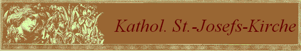
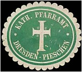
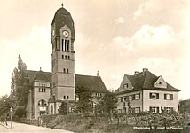
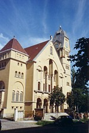
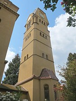
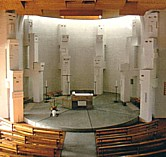

* * *

* * *

* * *

* * *

* * *

* * *

Die katholische Kirchgemeinde Pieschen entstand 1903 als Vikarie der St.-Franziskus-Xaverius-Kirche Dresden-Neustadt für die zahlreichen zugezogenen Katholiken, die meist aus Böhmen und Schlesien stammten. Bereits 1892 war ein “Katholischer Volksverein für Pieschen und Umgebung” gegründet worden, der am 14. Juni 1896 im kleinen Saal des Ballhauses “Deutscher Kaiser” auf der Leipziger Straße seinen ersten Gottesdienst abhielt. Im April 1904 wurde die Gemeinde zu einer selbstständigen Pfarrei erhoben, zu der neben Pieschen auch 35 weitere Orte der Umgebung gehörten. Ab 1905 fanden die Andachten in einem Raum der katholischen Bürgerschule auf der Leisniger Straße statt.

Nachdem 1909 ein Grundstück an der Rehefelder Straße erworben und am 9. Juni der Grundstein für eine eigene Kirche gelegt worden war, konnte die Gemeinde bereits am 2. Oktober 1910 die St.-Josefs-Kirche einweihen. Architekt des Eisenbetonbaus war Alexander Tandler, der das Gebäude im neoromanischen Stil mit Anklängen an den Jugendstil gestaltete. Auch im monumentalen Kirchenschiff fanden sich Jugendstilmotive, meist aus Gips gestaltet. Hinzu kam ein 36 Meter hoher Turm, in dem drei Glocken läuten. Die beiden älteren stammen von 1930/31, die jüngere aus dem Jahr 1959. Bis zur Fertigstellung des Kirchturms nannten die Pieschener das für die damalige Zeit ungewöhnlich moderne Gebäude wegen seiner Konstruktion und der Nähe zur Bahnlinie den “katholischen Bahnhof”.

Ursprünglich war das Kircheninnere als dreischiffige Prozessionskirche mit einer halbrunden Apsis im Mittelschiff gestaltet. Hier befand sich auf einem Treppenpodest der Altar, umgeben von vier Säulen mit Marmorimitation und einem vergoldeten Stuckbaldachin. Auch die zwei Seitenschiffe besaßen Altäre, welche der Jungfrau Maria und dem Kirchenpatron St. Josef gewidmet waren. Hinzu kam eine Orgel aus der Dresdner Orgelbauwerkstatt Jehmlich. Die dunklen schlichten Glasfenster, welche nur wenig Licht in den Innenraum ließen, wurden 1945 zerstört.

Da die Akustik- und Lichtverhältnisse im Inneren der Kirche schon bei ihrer Eröffnung kritisiert wurden, entschied sich die Gemeinde Mitte der 1960er Jahre für einen Umbau. Dabei entstanden ab 1970/71 neue Zwischendecken und Wandverkleidungen, um die Bedingungen für die Gottesdienste zu verbessern. Die Neugestaltung des Gotteshauses übernahm der Architekt Hubert Paul, wobei der bekannte Dresdner Bildhauer Friedrich Press einige Kunstwerke schuf. Gleichzeitig entstanden auf der Rehefelder Straße 59/61 neue Gemeinderäume. Zwischen 1992 und 2000 wurde auch das Äußere des Gebäudes saniert und eine neue Heizungs- und Elektroanlage eingebaut.

Bemerkenswert ist die Altargestaltung von Press zum Thema “Himmlisches Jerusalem” sowie die vom gleichen Künstler geschaffene Sakramentskapelle. Der treppenartige Altarraum wurde zu einem schräg liegenden Kreis erweitert. Die sechs gemauerten weißen Stelen mit insgesamt zwölf Durchbrüchen und ihren Gesichtern stellen die zwölf Tore der Stadt Jerusalem und die sie beschützenden Engel dar _(Foto)_. Davor befindet sich der aus Beton gegossene schlichte Altartisch. Erst durch Hinzutreten des Priesters gerät dieser in den Mittelpunkt des Raumes und verdeutlicht so die Einheit von architektonischer Gestaltung und der religiösen Zeremonie. Weitere Werke von Friedrich Press sind das Gebetspult (Ambo) im Altarraum, eine Christusfigur aus Beton und Stahl in der Sakramentskapelle und eine Marienplastik an der rechten vorderen Säule im Kirchenraum. Erst 2017 angebracht wurde ein ebenfalls von Press entworfener Fries an der Orgelempore mit Darstellungen aus dem Leben Jesu.

1995 konnte eine 1953 für eine Kirche in Traunstein (Bayern) gebaute Orgel der Firma Rieger in Dienst gestellt werden. Außerdem sollte die für eine Kirche ungewöhnliche abstrakt-künstlerische Ausgestaltung noch mit passenden Glasfenstern vervollständigt werden. Ein entsprechender Wettbewerb fand im Frühjahr 2003 statt. Diesen gewann der Chemnitzer Künstler Michael Morgner mit seiner Darstellung des Menschen in verschiedenen Lebensphasen. Die neuen Fenster sind seit 2008 in der St.-Josefs-Kirche zu sehen.

* * *

 \[ [Home](../../../index.html)\] \[ [Nord](../../../nord/)\] \[ [Nordwest](../../../nordwest/)\] \[ [Neustadt](../../../neustadt/)\] \[ [Nordost](../../../nordost/)\] \[ [West](../../../west/)\] \[ [Zentrum](../../../zentrum/)\] \[ [Südwest](../../../sudwest/)\] \[ [Süd](../../../sud/)\] \[ [Südost](../../../sudost/)\] \[ [Ost](../../../ost/)\] \[ [Register](../../../Register/register.html)\] \[ [Kontakt](../../../Kontakt/kontakt.html)\] \[ [Impressum](../../../impressum/)\]
