* * *

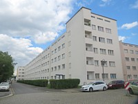Die heutige Arno-Lade-Straße am östlichen Rand des Pieschener Dorfkerns trug ursprünglich den Namen Dorffrieden, wurde jedoch ab 1904 Yorckstraße genannt. Als „Dorffrieden“ bezeichnete man früher den meist von einem Zaun umgebenen Kernbereich des Ortes, in dem besondere Rechtsverhältnisse galten. Johann David Ludwig Graf Yorck von Wartenburg (1759-1830) schloss als preußischer Generalmajor 1812 die Konvention von Tauroggen, die als Auslöser der antinapoleonischen Befreiungsbewegungen in Deutschland gilt. Mitte der 1920er Jahre entstanden zwischen Yorck- und Rehefelder Straße einige Wohnbauten der GEWOBAG (Nr. 10-22), die von Hans Richter entworfen wurden _(Foto)_. Hier gab es auch ein der Wärmeversorgung der Gebäude dienendes kleines Heizwerk, eine Zentralwäscherei und mehrere Läden. Richter ist vor allem als Architekt der Trachauer Siedlung bekannt. An der Grundstücksmauer des Hauses Arno-Lade-Straße 9 erinnert eine Sandsteintafel an die Zerstörung des Vorgängerbaus durch einen Brand am 24. Juni 1875.

Am 28. Mai 1946 wurde die Yorckstraße in Arno-Lade-Straße umbenannt. Arno Lade (1892-1944), der in Pieschen auf der Wurzener Straße 12 wohnte, gehörte seit 1920 der KPD an und war ab 1924 Stadtrat in Dresden. Außerdem war er Mitglied des Betriebsrates der Dresdner Straßenbahn. Nach 1933 engagierte er sich im antifaschistischen Widerstand und wurde mehrfach verhaftet. 1944 verstarb Arno Lade an den Folgen eines Gestapo-Verhörs im Dresdner Polizeigefängnis.

Die Barbarastraße entstand Ende des 19. Jahrhunderts im Zusammenhang mit der Bebauung der Freiflächen nördlich der Bahnlinie. Am 5. Februar 1878 hatte die Gemeinde Pieschen ein Ortsgesetz erlassen, wonach neue Fabrikbauten in dem Gebiet zwischen Eisenbahn und Großenhainer Straße konzentriert werden sollten. Daraufhin siedelten sich hier bis zur Jahrhundertwende eine Reihe von Unternehmen an, darunter die Nähmaschinenteile-Fabrik Würker und die Filz- und Strohhutfabrik Gebr. Köckritz. Ihre Namen erhielt die Straße 1898 wegen ihrer Nähe zu den einstigen Artillerie-Übungsplätzen nach der Schutzpatronin der Artilleristen und der Berg- und Hüttenleute. Ursprünglich war ihre Verlängerung bis in die Hellerberge geplant.

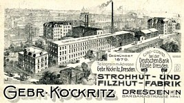Filz- und Strohhutfabrik Gebr. Köckritz (Nr. 41): Das Unternehmen wurde 1879 ursprünglich in Radeberg gegründet und 1896 nach Pieschen verlegt. Drei Jahre zuvor, am 15. April 1893, hatten die Gebrüder Clemens und Ernst Köckritz einen Bauantrag zum Bau eines Fabrikgebäudes und einer Villa auf dem Grundstück Barabarastraße 41 gestellt, dem auch stattgegeben wurde. Nach Fertigstellung der "Villa Barbara" und der Fabrikationsgebäude öffnete 1896 die Filz- und Strohhutfabrik der Brüder.

Das Unternehmen existierte bis Anfang der 1930er Jahre. Nach der Produktionseinstellung baute man die Gebäude für Wohnzwecke um. 1935 werden im Adressbuch der Stadt Dresden mehrere Mieter in den Eingängen 41 b, c und d aufgeführt. Zu DDR-Zeiten diente die Villa (Nr. 41) als Betriebskindergarten des benachbarten Nähmaschinenteilewerks. Nach der Wende erfolgte eine umfassende Sanierung und der Umbau des Gebäudes als Büro- und Wohnhaus.

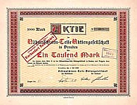Nähmaschinenteilewerk (Nr. 43): Der Betrieb wurde 1897 von Carl Eduard Würker (1843-1917) auf der Großenhainer Straße 109 gegründet. Würker war zuvor als Kontorist in einem Zulieferbetrieb der Nähmaschinenfabrik [Seidel & Naumann](../../../west/cotta/strassen_cotta/hamburger_strasse/seidel___naumann/) beschäftigt, machte sich dann jedoch zusammen mit seinem ehemaligen Arbeitskollegen, dem Schlosser Carl Ernst Knirsch, selbstständig. Das Unternehmen, offiziell als "Dresdner Specialfabrik für Nähmaschinen-Schiffchen und Apparate - Carl Würker & Co." im Handelsregister verzeichnet, stellte ebenfalls Teile für Nähmaschinen, vor allem Schiffchen her und wurde im April 1899 zur Barbarastraße 43 verlegt. Ab 1912 firmierte es unter der Bezeichnung Würker & Knirsch AG. 1898/99 hatten beide an der Barbarastraße die zum Teil noch bestehenden Wohn- und Fabrikgebäude errichten lassen.

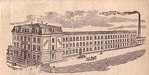Ein weiterer Betrieb produzierte ab 1898 in den Gebäuden der ehemaligen Ziegelei in Kötzschenbroda. Diese Firma war 1868 vom Mechaniker Gustav Schmidt (1844-1886) ebenfalls in Dresden gegründet worden. Zunächst orientierte sich Schmidt auf den Verkauf und die Reparatur von Nähmaschinen, begann jedoch kurz darauf mit der Produktion von Nähmaschinenteilen. Am 24. April 1875 wurde die Firma als "Gustav Schmidt - Fabrikation von Nähmaschinenteilen und Schiffchen" ins Handelsregister eingetragen. Nach Schmidt´s Tod verkauften die Erben das Unternehmen an neue Betreiber, die sich aus Platzgründen Mitte 1897 zur Verlegung in die Gebäude der Höppnerschen Ziegelei entschieden. Gefertigt wurden vor allem Nähmschinenschiffchen und andere Kleinteile.

1918 vereinigten sich beide Unternehmen zur Nähmaschinen-Teile-Aktien-Gesellschaft (Nähmatag) und entwickelten sich mit zu 1000 Angestellten zu einem der wichtigsten Betriebe der Branche. 1945 unter sowjetische Zwangsverwaltung gestellt und 1946 als VEB Nähmaschinenteilewerke Dresden verstaatlicht, entstanden in dem ausgedehnten Gebäudekomplex noch bis 1990 Schiffchen und andere Kleinteile für den Nähmaschinenbau, bevor der Traditionsbetrieb, zuletzt ein Teil der westdeutschen Firma Pfaff, Konkurs anmelden und seine Produktion einstellen musste. 2015 begann der Umbau der ehemaligen Betriebsgebäude zur Wohnanlage “Barbarahof”.

Die kurz vor dem Ersten Weltkrieg angelegte Braunschweiger Straße erhielt ihren Namen am 3. Februar 1911. Namensgeber ist die niedersächsische Stadt Braunschweig. Im Eckhaus zur Moltkestraße (heute Robert-Matzke-Straße 38) gab es noch bis in jüngere Vergangenheit die Gaststätte "Pieschener Hof", an die noch alte Inschriften an der Fassade erinnern.

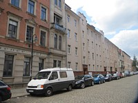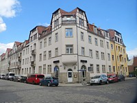

**_Fotos:_** _Blick in die Braunschweiger Straße - ganz links der "Pieschener Hof",_

_rechts das Wohnhaus Braunschweiger Straße 2_

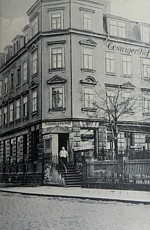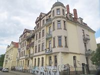Die heutige Coswiger Straße wurde 1883 zur Erschließung des Pieschener Industriegebietes angelegt und zunächst Kleine Maschinenhausstraße genannt. Nachdem die nahegelegene Große Maschinenhausstraße drei Jahre später in Fabrikstraße umbenannt worden war (heute Riesaer Straße), änderte sich der Name in Maschinenhausstraße. Nach der Eingemeindung Pieschens erfolgte 1897 die Umbenennung nach der Stadt Coswig.

Im Eckhaus zur Riesaer Straße (Nr. 17 - _Foto links_) befand sich einst Oswin Rietschel´s Restaurant, später Hotel "Coswiger Hof" genannt. Heute dienen die Räume Wohnzwecken.

Die Eschebachstraße, 1911 im Nordteil der Pieschener Flur angelegt, verdankt ihren Namen dem Industriellen Carl Eschebach (1842-1905). Eschebach begann seine berufliche Laufbahn als Klempner und war gründete 1872 die [Eschebach-Werke](../../../nordwest/pieschen/eschebach-werke/). Das Unternehmen wurde vor allem als Hersteller von Küchenmöbeln und Haushaltwaren bekannt und hatte seinen Stammsitz seit 1900 auf der Riesaer Straße in Pieschen.

Die Friedewalder Straße entstand erst in den 1990er Jahren und führt von der Hubertusstraße in ein Wohngebiet. Zur Erschließung der kleinen Siedlung wurde außerdem der Friedewalder Weg angelegt. Beide Straßen erhielten ihre Namen im Juni 1994 nach dem Luftkurort Friedewald, heute ein Ortsteil von Moritzburg.

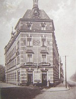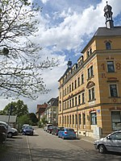Die Ende des 19. Jahrhunderts angelegte Grimmaische Straße erhielt 1880 nach ihrer Lage den Namen Thalstraße. Da es nach der Eingemeindung Pieschens nach Dresden eine weitere Talstraße in der Äußeren Neustadt gab, machte sich 1897 eine Namensänderung erforderlich. Der Name Grimmaische Straße erinnert an die Stadt Grimma an der Mulde in der Nähe von Leipzig. Die ursprünglich bis zur Hubertusstraße durchgehende Straße wurde nach dem Zweiten Weltkrieg durch den Bau einer Kleingartenanlage unterbrochen.

Restaurant Trachenberge (Nr. 2): Das Eckhaus zur Döbelner Straße _(Fotos)_ entstand Ende des 19. Jahrhunderts. Im Erdgeschoss gab es ab 1897 das Restaurant "Trachenberge", welches sich ab 1913 viele Jahrzehnte im Besitz der Familie Sauer befand und noch bis nach dem Zweiten Weltkrieg existierte. Seit 2012 dienen die einstigen Gaststättenräume als Atelier einer Künstlergemeinschaft, zu der die Künstlerinnen Alexandra Wegbahn, Steffi Köhler und Claudia Bieberstein, die Bildhauerin Martina Beyer und die Fotografin Anja Schneider gehören.

Die Hans-Fromm-Straße wurde 2016 im Zusammenhang mit dem Neubauviertel "Markuspassage" (später "Markusprojekt") angelegt und verbindet in der Nähe des Pieschener Rathauses Bürger- und Leipziger Straße. Benannt wurde sie nach dem ehemaligen Kantor der Markuskirche Hans Fromm (1937-1982), der auch als Dozent an der Kirchenmusikschule tätig war.

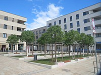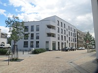

**_Fotos:_** _Blick in die Hans-Fromm-Straße im Frühjahr 2020_

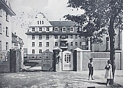Die Hans-Sachs-Straße wurde im Zusammenhang mit dem Bau einer kleinen Wohnsiedlung um 1895 angelegt. Ihren Namen erhielt sie 1896 nach dem Dichter Hans Sachs (1494-1576), der durch seine volkstümlich-kritischen Stücke bekannt wurde. Die ersten Wohnhäuser entstanden Ende des 19. Jahrhunderts für Pieschener Arbeiterfamilien. In den Eckhäusern zur Kleiststraße (Nr. 14) und zur Seumestraße (Nr. 23) gab es mit der "Kleistschänke" und dem "Köpenicker Hof" zwei für die Vorstadt typischen Eckkneipen.

Zwischen 1912 und 1914 errichtete an der Hans-Sachs- und der benachbarten [Marienhofstraße](../../../nordwest/trachenberge/strassen_trachenberge/) der Dresdner Spar- und Bauverein die sogenannten “Palmié-Häuser” _(Foto)_. Architekt der kleinen Wohnanlage (Nr. 33-35) war Heinrich Koch. In den Zwanziger Jahren wurden am Straßenrand zahlreiche Gingko-Bäume angepflanzt. Die ursprünglich aus China stammenden Bäume bilden eine der in Sachsen äußerst seltenen Gingko-Alleen und stehen seit 2004 unter Naturschutz.

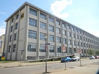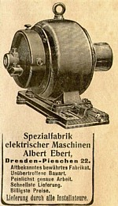Die Heidestraße, Teil eines alten Verbindungsweges zwischen Pieschen und der Dresdner Heide, führt durch das Pieschener Fabrikviertel. 1879 hatte die damals noch selbstständige Gemeinde Pieschen das Areal zwischen Eisenbahn und Großenhainer Straße per Ortsgesetz als Industriegebiet ausgewiesen. Der in diesem Zusammenhang ausgebaute Weg erhielt 1886 den Namen Haidestraße. Seine westliche Verlängerung wurde zwischen 1892 und 1897 Moltkestraße genannt, bevor man den Abschnitt zwischen Riesaer und Großenhainer Straße ebenfals der Haidestraße zuordnete. 1906 wurde die Schreibweise in Heidestraße verändert.

Ende des 19. Jahrhunderts begann in mehreren Abschnitten der Bau von Fabriken und anderen gewerblichen Unternehmungen. Zu diesen gehörte u.a. Königs Malzfabrik (Nr. 1-3), die Spezialfabrik elektrischer Maschinen vorm. Albert Ebert GmbH (Nr. 5 - _Bild rechts_) die Dresdner Wäschemanufaktur Grohmann und Senf (Nr. 36) und das "Goehle-Werk" der Zeiss-Ikon AG (Nr. 2-4 - _Foto links_). Im Eckhaus zur Großenhainer Straße (Nr. 15) befand sich um 1910 die Schankwirtschaft "Großenhainer Hof", später auch Kösters Gaststätte genannt. Ein Jahr später entstand die Kleingartensparte "Dorndorf e.V.", 1915 die Sparte "Heidegruß" mit Vereinsheim und 35 Gärten. Zu den jüngsten Gebäuden der Heidestraße gehören die städtische Kita "Haus der Kinder" (erbaut 2005) und eine weitere 2015 eröffnete Kindertagesstätte (Nr. 35).

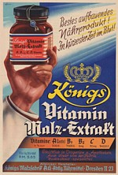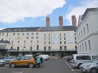Mälzerei (Nr. 1-3): Das Unternehmen wurde am 6. April 1889 unter Übernahme der bereits seit 1885 bestehenden Malzfabrik Paul König gegründet und firmierte um 1900 als Dresdner Malzfabrik AG vorm. Paul König. Hergestellt wurde vorrangig Braumalz für verschiedene Brauereien, aber auch Malzextrakt und Malzkaffee. 1922 erfolgte nach Übernahme der Woldemar Schmidt GmbH eine Umbenennung in Mitteldeutsche Spritwerke AG, 1926 in Woldemar Schmidt AG. Am 28. Mai 1931 wurde die Firma Dresdner Malzfabrik AG ins Handelsregister eingetragen.

Ebenso wie viele andere private Unternehmen erfolgte auch bei diesem Betrieb nach 1945 die Umwandlung in Volkseigentum und die Zusammenlegung mit anderen Betrieben der Branche. Unter der Bezeichnung VEB Vereinigte Mälzereien wurden noch bis 1990 an der Heidestraße Malz und Malzextrakte produziert. Nach Einstellung der Produktion und Umbau der Gebäude öffnete hier am 1. Dezember 1990 mit dem Warenhaus Mälzerei eines der ersten größeren Dresdner Einkaufszentren nach der Wende. In dem Komplex entstanden mehrere Märkte, Shops und Restaurants _(Foto)_. Rückgängige Kundenzahlen führten nach der Jahrtausendwende zu einer teilweisen Schließung und Umwandlung in ein Lagerhaus.

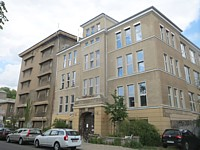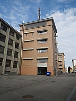Sächsisches Druck- und Verlagshaus (Nr. 2-10): Der Gebäudekomplex zwischen Heidestraße, Riesaer und Großenhainer Straße entstand 1940/41 als Zweigbetrieb der Zeiss-Ikon AG und erhielt den Namen Goehle-Werk. In dem von Georg Rüth und Emil Högg projektierten Stahlbetonbau wurden bis zum Kriegsende Zubehörteile für die Flugzeugindustrie und den U-Boot-Bau hergestellt, wobei auch zahlreiche Zwangsarbeiter eingesetzt waren. Auftraggeber für den Bau war das Oberkommando der Kriegsmarine, wobei die Gebäude durch ihre Bauweise als "bombensicher" galten. Die Namensgebung erfolgte nach dem Konteradmiral Herbert Goehle (1878-1947).

Da die Gebäude 1945 unzerstört blieben, wurde hier im August 1945 die Druckerei der “Sächsischen Volkszeitung” untergebracht. 1946 übernahm der Verlag der “Sächsischen Zeitung” den Komplex und nutzte diesen bis 1996 als Verlagshaus und Druckerei (Grafischer Großbetrieb Völkerfreundschaft). 2013 bezog der Kulturverein “Friedrichstadt zentral” die leerstehenden Gebäude C und D und möchte diese schrittweise zu einem Kreativzentrum mit Ateliers, Künstlerwerkstätten und Wohnungen ausbauen. Dafür wurde eigens die Dresdner Kulturgenossenschaft “ZentralWerk” gegründet, die das Haus in Erbpacht übernahm und 2015 bezog. Die Gebäudeflügel an der Großenhainer Straße 101 (Haus A und B) beherbergen als Gewerbehof verschiedene Unternehmen.

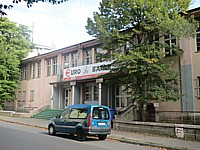Kulturhaus (Nr. 2): Das Gebäude an der Heidestraße wurde als Versammlungsort des Goehle-Werkes gebaut und diente nach Ende des Zweiten Weltkriegs bis März 1946 als Varietétheater “Scala”. Nach Schließung des privaten Theaters übernahm die “Sächsische Zeitung” den Bau und richtete hier ein Betriebskulturhaus ein. In dem ab 1953 “Karl-Herrmann-Saal” genannten Veranstaltungsraum fanden betriebliche und kulturelle, aber auch einige wichtige politische Veranstaltungen statt, u. a. die letzte Landeskonferenz der KPD und die Gründung der sächsischen FDJ. Am 7. Juli 1956 gaben die beiden Dresdner Musiker Günter Hörig und Karlheinz Drechsel hier das erste öffentliche Jazzkonzert in der DDR. Namensgeber des 900 Personen fassenden Saals war der Redakteur Karl Herrmann (1889-1952), der ab 1924 Redakteur der KPD-Zeitung "Echo des Ostens" in Königsberg war und 1946 zu den ersten Redakteuren der "Sächsischen Zeitung" gehörte. Nach der Wende dienten die leer stehenden Räume zeitweise als Quartier eines Möbel- und Gebrauchtwarenhandels. Künftig wird das Haus Teil des "Zentralwerk"-Konzeptes.

Purotex (Nr. 36): Ursprünglich wurden die heute nicht mehr vorhandenen Gebäude von der Wäschemanufaktur Grohmann und Senf genutzt, bevor hier nach 1945 die volkseigene Großwäscherei Purotex ihren Hauptsitz bezog. Das Unternehmen ging aus der [Paul Märksch AG](../../../ost/striesen/strassen_striesen/schandauer_strasse/wascherei_marksch/) hervor, die ihren Stammsitz ursprünglich an der Schandauer Straße 46 hatte. Nach der Enteignung 1946 erfolgte eine Zusammenlegung mit anderen Dresdner Wäschereibetrieben und die Verlegung der Firmenleitung nach Pieschen (Werk I). Zweigbetriebe gab es u.a. in der Friedrichstadt, in Trachau und in der Wilsdruffer Vorstadt, Annahmestellen im gesamten Stadtgebiet. Eine Lehrwerkstatt befand sich auf der Maxim-Gorki-Straße 4. Bis 1990 gehörte Purotex zum VEB Textilreinigungskombinat Dresden und wurde 1993 von der Bardusch-Gruppe übernommen. Die Zentrale wurde daraufhin zur Rosenstraße 62 verlegt und der Betrieb auf der Heidestraße geschlossen. 1996 erfolgte der Abriss.

Kleingartenverein “Heidegruߔ: Die Gartensparte wurde 1915 auf private Initiative angelegt, um die Versorgung der Bevölkerung mit Lebensmitteln während des Ersten Weltkriegs zu verbessern. 1917 erhielten die Gärten Wasseranschluss. Nach Kriegsende schlossen sich die Pächter 1919 zu einem gemeinnützigen Verein zusammen, der den Namen “Heidegruߔ erhielt. Das Spartenheim der Anlage entstand 1956.

Die Hellerauer Straße entstand Mitte der 1920er Jahre zur Erschließung eines Wohngebietes zwischen Boxdorfer und Hubertusstraße. Am 22. August 1929 erhielt sie nach dem im Norden der Stadt gelegenenen Ort Hellerau, seit 1950 Stadtteil von Dresden, ihren Namen. Die Wohnhäuser der Hellerauer Straße entstanden zwischen 1935 und 1936 nach Plänen von Paul Beck für den Dresdner Spar- und Bauverein.

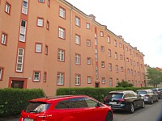

**_Foto:_** _Blick in die Hellerauer Straße_

Der Hubertusplatz befindet sich an der als Verkehrsknotenpunkt wichtigen Kreuzung Großenhainer Straße / Hubertusstraße / Maxim-Gorki-Straße. Seinen Namen erhielt er im April 1930 nach der kreuzenden Hubertusstraße. Hier steht seit 1997 die Seniorenresidenz “Alexa” mit fünf modernen Gebäuden. Zuvor wurde das Gelände von einer Tankstelle und dem Spielwarenhersteller “Prefo” genutzt.

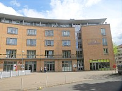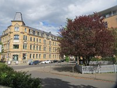

**_Fotos:_** _Hubertusplatz mit Seniorenresidenz "Alexa"_

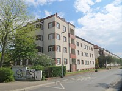Die Hubertusstraße geht auf einen alten Verbindungsweg zurück, der vom Pieschener Ortskern in nördlicher Richtung nach Trachenberge führte, wo einst auch Pieschener Bauern Weinberge besaßen. Der seit 1897 verwendete Name erinnert an den Schutzpatron der Jäger, den 743 heilig gesprochenen Bischof Hubertus von Lüttich, und entstand vermutlich wegen der Nachbarschaft der Straße zum Heidewald. 1884 wurde im südlichen Teil unmittelbar an der Bahnbrücke der [Markusfriedhof](../../../nordwest/pieschen/markuskirche/) angelegt. Aus diesem Grund wurde die vorbeiführende Straße von 1895 bis 1897 Friedensstraße genannt.

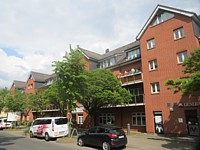Das Straßenbild zwischen Großenhainer und Riesaer Straße prägen in den Jahren nach dem Ersten Weltkrieg entstandene Wohnblocks _(Foto links)_. Jenseits der Großenhainer Straße dominieren hingegen Einzelhäuser aus der Gründerzeit. In den Hausnummern 10 (Ecke Riesaer Straße) und 30 (Ecke Marienhofstraße) gab es früher kleine Lokale, in letzterem später eine Filiale der Sparkasse. In der Nr. 51 hatte die Maschinenfabrik E. Kohl ihren Sitz, die u.a. Turbinen, Ventilatoren, Lüftungs- und Heizungsanlagen herstellte. Nach 1990 entstand gegenüber dem Markusfriedhof ein modernes Wohn- und Geschäftshaus (Nr. 8) mit Klinkerfassade und mehreren Läden und einer Tagespflegeeinrichtung _(Foto rechts)_.

Die Kleiststraße entstand Ende des 19. Jahrhunderts beim Bau einer Arbeiterwohnsiedlung im Norden der Pieschener Flur. Mit der Namensgebung wird seit 1899 an den deutschen Dramatiker Heinrich von Kleist (1777-1811) erinnert. Kleist gehört zu den bedeutendsten Vertretern der Spätklassik und verfasste zahlreiche Dramen und Lustspiele. Im Haus Nr. 10 hatte früher die Firma G. Heyde KG - Werkstätten für Feinmechanik und Optik ihren Sitz.

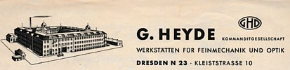

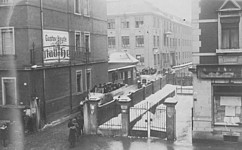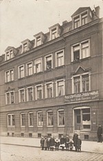

**_Fotos:_** _Eingang zum Firmengelände G. Heyde (links) und Kleiststraße 15 (rechts)_

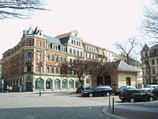Der Konkordienplatz an der Kreuzung der Oschatzer Straße mit der Konkordienstraße entstand um 1890 und erhielt im Jahr 1893 in Bezug auf diese Straße seinen Namen. Bis 1906 war die Schreibweise Concordienplatz gebräuchlich. Um den Platz stehen Wohn- und Geschäftshäuser, deren Anlage noch die bereits damals geplante Straßenführung erkennen lassen. Komplettiert wurde diese erst 2015 mit dem Ausbau der heutigen Rosa-Steinhart-Straße. Hier befindet sich auch die 1900 gegründete Kleingartensparte "Concordia".

Im Wohnhaus Konkordienplatz 1 gab es früher eine Gaststätte. In der Nr. 2 produzierte bis 1918 die Zigarettenfabrik Isaak Leon Sulkin. Der ehemalige Zigarettenarbeiter hatte sich 1907 selbständig gemacht und besaß ein Ladengeschäft auf der Oschatzer Straße 7. Wenig später nutzte die Firma Geschäftsräume im Erdgeschoss der Oschatzer Straße 8 und am Konkordienplatz 2. Nach dem Tod Sulkins wurde die Firma bis Anfang der 1930er Jahre von seiner Witwe Sofie weitergeführt. Die Geschäftsräume befanden sich auf der Leipziger Straße 129.

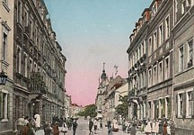Die Konkordienstraße, die sowohl über Pieschener als auch Neudorfer Flur führt, ist Teil des bereits im Mittelalter existierenden Bischofsweges, der von den Bischöfen bis 1559 auf ihrem Weg von Meißen über Briesnitz nach Stolpen genutzt wurde. Zeitweise wurde der Abschnitt zwischen Moritzburger und der heutigen Gehestraße als Neudörfer Mittelweg bezeichnet. 1866 erhielt dieser Weg auf Neudorfer Flur den Namen Concordienstraße, während der Pieschener Teil noch bis zur Eingemeindung 1897 Elbstraße genannt wurde. Erst 1906 setzte sich die heutige Schreibweise Konkordienstraße für den gesamten Straßenzug durch.

Die Bezeichnung erinnert an die 1577 von Kurfürst August verfasste kirchliche “Concordienformel”, die zur “Eintracht in orthodoxer Rechtgläubigkeit” aufrief und als “Grundgesetz” der lutherischen Lehre gilt. Mit dem Erlass sollte der nach Luthers Tod entstandene Konflikt zwischen streng lutherischen Gläubigen und den eher gemäßigten Anhängern Melanchtons beigelegt werden. Der Name wurde 1893 auch auf den angrenzenden Konkordienplatz sowie die 1875 errichtete, heute jedoch nicht mehr existierende Concordienbrücke über die Bahnanlagen übertragen.

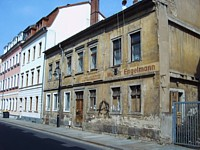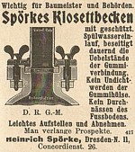Im letzten Drittel des 19. Jahrhunderts begann die Bebauung der Konkordienstraße mit meist mehrgeschossigen Wohn- und Geschäftshäusern. In vielen dieser Gebäude und in den Hinterhöfen gab es kleine Läden, Handwerksbetriebe, Werkstätten, Kohlenhändler und Gaststätten. In der Nr. 48 befand sich im früheren Lokal “Zum Turnergarten” bis 1933 das Parteihaus der KPD im Dresdner Nordwesten, welches nach der nationalsozialistischen Machtübernahme als “Braunes Haus” Sitz der NSDAP-Ortsgruppe wurde. Um 1900 war die 1898 von Max Kirchhof gegründete Gaststätte als "Kirchhofs Restaurant zum Lindengarten" bekannt. Weitere Gaststätten gab es mit der “Concordia” auf der Konkordienstraße 4 und dem Lokal "Zum Freischütz" in der Nr. 38. Das Foto (links) zeigt das Haus Konkordienstraße 30, um 1910 Gartenrestauration von Oswald Schulze

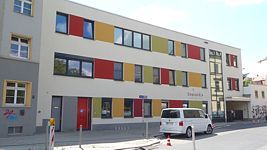1880/81 entstand auf dem Grundstück Konkordienstraße 12 das Schulhaus der VIII. Bezirksschule (heute [8\. Grundschule)](../../../neustadt/leipziger_vorstadt/neudorf/). Ab 1894 befand sich auf der Konkordienstraße auch der erste Sitz der Dresdner Konsumgenossenschaft. Beim letzten Bombenangriff auf Dresden im April 1945 wurden mehrere Häuser der Konkordienstraße, darunter die Schulturnhalle, zerstört. In jüngerer Vergangenheit wurden diese Baulücken durch Neubauten ersetzt. In unmittelbarer Nachbarschaft der Kleingartensparte "Concordia" öffnete am 18. August 2014 eine gleichnamige Kita mit 114 Plätzen (Nr. 3 - _Foto_).

Kleingartenverein “Concordia”: Die Gartensparte wurde als eine der ersten in Dresden im Jahr 1900 unmittelbar am damaligen Concordienplatz angelegt. Auch nach dem Wechsel der Schreibweise des Straßennamens vom “C” zum “K” behielt der Verein seinen Namen aus Traditionsgründen bei. Nutzer der ca. 25 Parzellen waren zumeist Arbeiter, Handwerker und Kleinunternehmer der benachbarten Wohnviertel, die sich hier der Eigenversorgung mit Obst und Gemüse widmeten. Außerdem war der Verein bis in die 1950er Jahre Veranstalter eines alljährlichen Festumzugs durch die Pieschener Straßen.

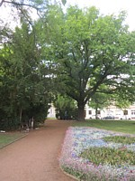Der Leisniger Platz entstand im Zuge des Ausbaus der Vorstadt Striesen und erhielt aus Anlass des 80. Geburtstag Helmuth Graf von Moltkes am 26. Oktober 1880 zunächst den Namen Moltkeplatz. Verbunden war die Namensweihe mit der Pflanzung einer "Moltke-Eiche" im Zentrum der dreieckigen Grünanlage _(Foto rechts)_. Helmuth Karl Bernhard Graf von Moltke (1800-1891) nahm als preußischer Generalfeldmarschall am Deutsch-Französischen Krieg teil und erwarb sich als strategischer Leiter militärische Verdienste. Bereits im Juli 1871 hatte er die Dresdner Ehrenbürgerwürde erhalten. Da es in Dresden jedoch bereits einen Moltkeplatz in der Südvorstadt gab, erfolgte nach der Eingemeindung Pieschens am 1. Juli 1897 die Umbennung in Leisniger Platz. Die benachbarte Ringstraße erhielt den Namen Leisniger Straße. Namensgeber ist die mittelsächsische Kleinstadt Leisnig an der Mulde.

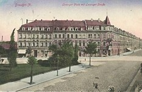Um den Platz stehen mehrstöckige Mietshäuser aus den letzten beiden Jahrzehnten des 19. Jahrhunderts. Im Norden führt eine Unterführung unter der [Bahntrasse Dresden - Leipzig](../../../neustadt/leipziger_vorstadt/dresden_-_leipzig/) und den Gleisen zum früheren Neustädter Güterbahnhof hindurch. Die beiden Brücken ersetzen seit 1898/99 die ursprünglich niveaugleiche Gleiskreuzung. In den Häusern um die Platzanlage gab es bereits früher Läden und Gewerberäume. Diese werden heute unter anderem vom "Treff- und Lebensmittelpunkt Pieschen" (Nr. 8) und der "Help-Line" (Nr. 10) der Treberhilfe genutzt. Im zweiten Hintergebäude Leisniger Platz 1 besaß bis zum Ende des Zweiten Weltkriegs der Lichtbildner Hermann Groß sein Atelier.

Pieschener Windmühle: Am Rande des heutigen Leisniger Platzes befand sich einst die Pieschener Windmühle. Diese war 1867 vom Windmüller Karl Friedrich Trentzsch (1822-1887), der bereits im benachbarten Trachau eine [Windmühle](../../../nordwest/trachau/) besaß, gebaut worden. Die Mühle blieb jedoch nur zehn Jahre in Betrieb und musste dann der wachsenden Konkurrenz dampfbetriebener Großmühlen weichen. Ihr Abbruch erfolgte fünf Jahre später.

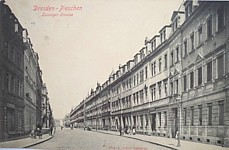Die ab 1889 wegen ihres bogenförmigen Verlaufs als Ringstraße bezeichnete Straße entstand im Zusammenhang mit der zunehmenden Bebauung der Pieschener Flur und bildet den nördlichen Abschluss des Ortskerns in Richtung Bahnlinie. Nach der Eingemeindung wurde sie 1897 nach der Kleinstadt Leisnig bei Döbeln in Leisniger Straße umbenannt.

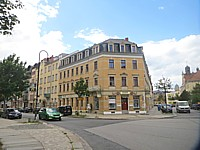Das Straßenbild prägen vorrangig mehrgeschossige Wohnhäuser der Gründerzeit. Teile der geschlossenen Bebauung im östlichen Teil der Leisniger Straße fielen 1945 den Bomben zum Opfer und wurden erst nach 1990 durch Neubauten ersetzt. Im 1945 zerstörten Haus Leisniger Straße 12 gab es früher die Gaststätte “Zum Grundstein”, welche später nach Übernahme durch den Gastwirt Gustav Zirkel bis 1945 “Restaurant Zirkel” genannt wurde. Eine weitere Gaststätte beherbergt das Eckhaus zur Wurzener Straße (heute Nr. 45). Früher wurde diese "Wurzener Hof" genannt, heute ist hier ein griechisches Restaurant _(Foto rechts)_.

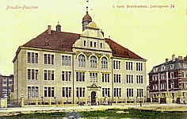1905 wurde an der Leisniger Straße 76 die [V. Katholische Bezirksschule](../../../nordwest/pieschen/) errichtet, die heute von der Förderschule für Lernbehinderte "A. S. Makarenko" genutzt wird _(Foto)_. Zugleich gab es hier ab 1912 eine privat finanzierte Kinderbewahranstalt der Baronin-von-Knorring-Stiftung. Auf dem Nachbargrundstück entstand 2016 eine moderne Einfeld-Sporthalle. Eine weitere Kindereinrichtung gibt es auf der Leisniger Straße 70. Die von der Diakonie-Stadtmission Dresden betriebene christliche Kita "Himmelsblau" besitzt ca. 160 Plätze und wurde 2007 eröffnet.

Nr. 53 (Tanzschule Graf): Das Gebäude entstand Ende des 19. Jahrhunderts als Vereinshaus des Allgemeinen Turnvereins Dresden-Pieschen. Im Erdgeschoss gab es die Gaststätte Turnerschänke. An der Fassade erinnert noch ein Relief des “Turnvaters” Jahn an die einstige Nutzung. Im hinteren Teil des Grundstücks wurde früher in den Wintermonaten eine private Eislaufbahn angelegt. Der Eingang dazu befand sich an der Rehefelder Straße 68.

Anfang der 1950er Jahre begannen die Turniertänzer Werner und Elfriede Graf, ihre ersten Anfängerkurse durchzuführen. Beide waren ab 1954 als Tanzlehrer tätig und übernahmen zwei Jahre später das Training des Dresdner Tanzkreises “Schwarz/Gelb”. Zunächst fanden die Kurse in der “Kakadu-Bar” am Weißen Hirsch statt, bevor 1958 die Räume des ehemaligen Pieschener Turnvereins auf der Leisniger Straße 53 bezogen werden konnten. Neben der Ausbildung von jungen Turniertänzern nahm das Paar auch selbst an zahlreichen Turnieren im In- und Ausland teil und konnte mehrere Meistertitel erringen. Sohn Rainer Graf, der 1964 seine Tanzlehrer-Prüfung ablegte, setzte diese Tradition später fort. Die Tanzschule war auch Mitinitiator des seit 1970 durchgeführten Tanzfestivals in Dresden. 1996 erfolgte eine umfassende Sanierung des Gebäudes _(Foto unten rechts)._ Zuletzt war die Tanzschule ab dem 1. März 2013 eine Außenstelle der Tanzschule Lax, wurde später jedoch geschlossen.

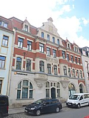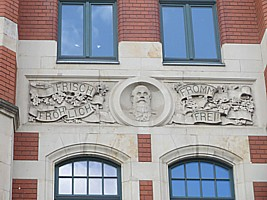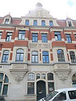

**_Fotos:_** _Das frühere Gebäude des Pieschener Turnvereins_

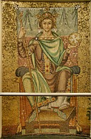Baufirma Johann Odorico (Nr. 74): Das Unternehmen, das seinen Standort unmittelbar neben der Katholischen Volksschule hatte, wurde Ende des 19. Jahrhunderts gegründet. Firmengründer war der aus dem italienischen Friaul (andere Quellen nennen Österreich) stammende Mosaikgestalter Johann Odorico. Ab 1890 entstanden in verschiedenen Orten Zweigbetriebe, u.a. in Berlin, München und in Dresden, wo sich der Sitz zunächst auf der Kurfürstenstraße 28, ab 1894 auf der Bautzner Straße 9 befand. Eine besondere Spezialität von Odorico war das Verlegen von Mosaik- und Terrazzofußböden. Bedeutende Mosaikarbeiten haben sich bis heute in der Eingangshalle des Hauptbahnhofes Eisenach und aus dem "Minnesängersaal" des renommierten Berliner "Bayernhofes" in der Nähe des Potsdamer Platzes erhalten. Das 1975 aus der Ruine des Lokals geborgene Glasmosaik ist heute im U-Bahnhof Richard-Wagner-Straße zu sehen _(Foto links / Wikipedia - Axel Mauruszat)_. Beteiligt war Odorico auch bei der Ausgestaltung des Berliner Doms und der Münchner Maximilians-Universität.

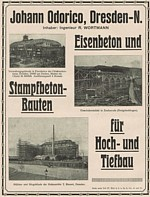Spätestens mit der Verlagerung zur Leisniger Straße 74 im Jahr 1900 befand sich die Dresdner Niederlassung im Besitz des Ingenieurs Hermann Richard Wortmann. Der auch weiterhin als Fabrik für Mosaik-, Terrazzo und Cementausführung firmierende Betrieb gehörte wenig spätern zu den Wegbereitern des modernen Eisenbetonbaus und war an zahlreichen Bauprojekten in ganz Deutschland beteiligt. U.a. errichtete man Brücken, Werkshallen, Hochbauten für den Eisenbahnbetrieb und ähnliche Bauwerke. Dabei wurden sowohl Hoch- als auch Tiefbauaufträge übernommen.

Im Dresdner Raum war die nach dem Ersten Weltkrieg in eine GmbH umgewandelte Firma Johann Odorico u.a. am Bau des Wasserturms und des Hochbehälters Niederlößnitz und an den Hochbauten der Eisenbahnstrecke Bühlau - Dürrröhrsdorf beteiligt, für die man die Gesamtleitung übernahm. Auch das AOK-Gebäude am Sternplatz, die Hafenmühle, die Nesselgrundbrücke und mehrere Eisenbahnbrücken der Strecke Löbau-Zittau stammen vom Pieschener Unternehmen. Mit dem Tod Wortmanns um 1920/21 ging die Firma in den Besitz seiner Witwe über und stellte Anfang der 1930er Jahre ihre Tätigkeit ein. Der Aufriss (links) zeigt den Wasserturm im Radebeuler Ortsteil Niederlößnitz.

Nr. 80 (Aprikosengarten): Das Projekt "Aprikosengarten" entstand 2011 nach einer Idee der Landschaftsarchitektin Ina Franzke und des Stadtplaners Markus Weber. Um in der dicht bebauten Vorstadt Pieschen eine grüne Oase zu schaffen, entwickelten sie einen Gemeinschaftsgarten nach dem Prinzip des "Urban Gardening". Dabei übernehmen Freiwillige die gemeinsame Bewirtschaftung eines Gartens und teilen sich dabei Arbeit und Ernte. Benannt wurde das Areal nach den zu Beginn hier gepflanzten Aprikosenbäumen.

Der Markusplatz wurde 1886 angelegt und zunächst nach der hier 1879 eröffneten Schule (heute 26. Grundschule) Schulplatz genannt. Zeitgleich begann der Bau der [Markuskirche](../../../nordwest/pieschen/markuskirche/), nach deren Fertigstellung er 1889 gemeinsam mit der angrenzenden Straße den Namen Markusplatz bekam.

Die Markusstraße verdankt ihren Namen, ebenso wie der angrenzende Markusplatz der 1889 eingeweihten Markuskirche. Erstmals benannt wurde sie im Jahr 1889. Hier befindet sich auch das Pfarrhaus der Kirche (Nr. 2). Im 1945 zerstörten Eckhaus zur Robert-Matzke-Straße (Nr. 15) befand sich einst die Gaststätte "Stettiner Hof", nach einem früheren Besitzer auch "Bernhardts Restaurant" genannt.

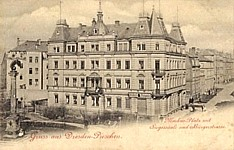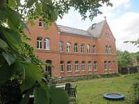

**_Fotos:_** _Der Markusplatz mit dem Pieschener Kriegerdenkmal um 1900 (links)_

_und das Pfarrhaus der Markuskirche (rechts)_

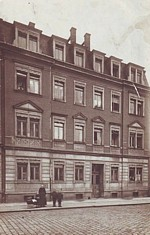Die Mohnstraße verdankt ihren Namen dem früheren Pieschener Lehrer Gottlieb Mohn (1811-1881), der 48 Jahre an der Pieschener Schule tätig war. Ihren Namen erhielt sie 1889. Hier befand sich an der Ecke Mohnstraße/Altpieschen einst das größte Bauerngut Pieschens (Nr. 46), welches auch als Bischofsgut bekannt war. Ursprünglich gehörte es als Herrengut zum Besitz der Meißner Bischöfe, die es als Raststätte auf dem Weg von Meißen nach Stolpen nutzten. 1899 wurde das Gut abgerissen. Wenig später entstanden hier Wohnhäuser und die von Hans Erlwein entworfene Wohnanlage [Altpieschen 5-15](../../../nordwest/pieschen/strassen_pieschen/altpieschen/). Da sie in ihrem Verlauf teilweise dem alten Kirchweg von Pieschen nach Kaditz folgt, war ein Teil der Mohnstraße ab 1886 als Kirchstraße benannt und wurde erst 1897 ebenfalls der Mohnstraße zugeordnet.

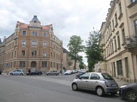Mit ihren zahlreichen Mietshäusern der Gründerzeit gehört die Mohnstraße heute zu den typischen Beispielen der nach 1880 entstandenen Bebauung der Vorstadt _(Foto rechts: Nr. 35)_. Neben Arbeiterwohnungen und kleinen Werkstätten in den Hinterhöfen gab es hier einst verschiedene Lokale und Läden. So ist im Eckhaus Nr. 1 _(Foto links)_ bereits 1898 die Schankwirtschaft "Adolphs Restaurant" erwähnt, die später unter dem Namen "Pieschener Vereinshaus" Treffpunkt örtlicher Vereine war. Zu DDR-Zeiten setzte das "Klubhaus der Werktätigen" diese Tradition fort, bevor nach 1990 der Kinder- und Jugendtreff "M 1" einzog. Nach dessen Umzug zur Bürgerstraße 68 ("Emmers") dienten die einstigen Gasträume noch einige Jahre als Künstleratelier. Eine weitere Gaststätte gab es auf der Mohnstraße 15, die unter dem Namen "Mohnklause" bzw. als "Pilsner Bierbar" noch bis nach 1990 existierte. Ab 1996 war hier das Lokal "Zum Stallknecht"ansässig.

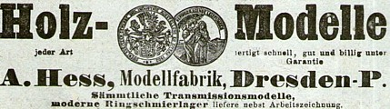

Von den einstigen Handwerksbetriebe soll hier die um 1900 erstmals genannte Böttcherei Eduard Stockmann erwähnt werden (Nr. 13). Zwischen 1910 und 1934 betrieb der Hauseigentümer Paul Richter im gleichen Gebäude einen Handwagenverleih. Nach dessen Verkauf an Böttchermeister Fritz Knippe firmierte das Unternehmen als "Pieschener Böttcherei" und existierte noch bis ca. 1960. Knippes Sohn Karlheinz Knippe wechselte nach der Schließung zur PGH "Sachsenfaß". Im Hintergebäude Mohnstraße 24-26 besaß Adolf Hess ab 1898 eine Fabrik für Gießereimodelle, die später als "Adolf Hess & Sohn Modellfabrik" firmierte und nach 1945 als Abteilung Modellbau Betriebsteil des [VEB Eisenhammerwerk Dölzschen](../../../sud/plauen/plauenscher_grund/eisenhammerwerk/) war. Architektonisch interessant ist das benachbarte frühere Wohnhaus des Diakons der Markuskirche mit Reliefbüsten von Martin Luther und Philipp Melanchthon an der Fassade (Nr. 28). Vor dem Ersten Weltkrieg gab es im Haus ein evangelisches Jungfrauenheim und im Erdgeschoss den Konfirmandensaal der Kirche.

Die Osterbergstraße, bis zur Eingemeindung Pieschens 1897 Bergstraße genannt, wurde 1877 angelegt und führte zum Zeitpunkt ihrer Entstehung noch durch Weinberge der Pieschener Bauern. Namensgeber war der Osterberg in der Nähe von Niederwartha.
Nach der Jahrhundertwende entstanden auch hier mehrstöckige Mietshäuser. 1879 wurde das heute von der [26\. Grundschule](../../../nordwest/pieschen/) genutzte Schulhaus gebaut. Das Eckhaus zur Bürgerstraße (Nr. 24/26) wurde um 1910 errichtet und beherbergte im Erdgeschoss in den 1930er Jahren eine Haushaltwaren-Verkaufsstelle des Konsumsvereins "Vorwärts". Ab 1941 nutzte die Post diese Räume. Das zweite Ladenlokal diente ab 1938 als Sparkassenfiliale. Zuvor war diese ab 1886 im Erdgeschoss des gegenüberliegenden Rathauses untergebracht. 1994 verzog sie ins Elbcenter. Die einstigen Schalterräume nutzt seitdem das DRK als Kleiderkammer.

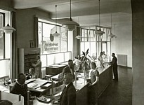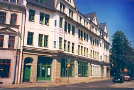

**_Fotos:_** _Wohn- und Geschäftshaus Osterbergstraße 24/26 (2010)_

_\- links ein Blick in die Schalterhalle der Sparkasse um 1938 (SLUB / Fotothek)_

Die Promnitztalstraße wurde Ende der 1990er Jahre in der Nähe des Hubertusplatzes angelegt und entstand zur Erschließung eines kleinen Wohngebietes. Benannt ist sie nach der Gemeinde Promnitztal, die heute zur Stadt Radeburg gehört.

Die heutige Rehefelder Straße, einst Triebe genannt und für den Viehauftrieb der Pieschener Bauern genutzt, erhielt nach ihrem Ausbau Ende des 19. Jahrhunderts 1889 den Namen Wasastraße. Mit dieser Namensgebung sollte das schwedische Königshaus, insbesondere die aus dieser Familie stammende sächsische Königin Carola geehrt werden. Um Verwechslungen mit einer gleichnamigen Straße in Strehlen zu verhindern, erfolgte im Zusammenhang mit der Eingemeindung Pieschens 1897 die Umbenennung in Rehefelder Straße. Der kleine Ort im Osterzgebirge in der Nähe von Altenberg ist Standort eines Jagdschlosses der Wettiner und bot sich wegen seinem Bezug zur Jagd als Namensgeber der Straße an. Neben Wohnhäusern entstand hier 1910 die katholische [St.-Josephs-Kirche](../../../nordwest/pieschen/st_-josefs-kirche/).

Wie bei vielen Pieschener Straßen prägen auch die Rehefelder Straße zahlreiche zwischen 1880 und 1900 entstandene Mehrfamilienhäuser in geschlossener Bebauung. Im Eckhaus zur Mohnstraße (Nr. 19) befand sich früher das Restaurant "Rehefelder Hof" _(Foto)_, in der Nr. 20 die bis in die Nachkriegszeit bestehende Gaststätte "Zur Glocke". Beide Gebäude werden bis heute gastronomisch bzw. als Pension genutzt. Eine weitere Gastwirtschaft gab es mit der "Wachtschänke" unmittelbar neben der St.-Josefs-Kirche (Nr. 57).

Jüngeren Datums ist der 1925 nach Plänen von Hans Richter im Bauhausstil entworfene Wohnblock Nr. 35-37c. Hier lebte in der Nr. 37c bis 1945 der Maler und Grafiker Franz Gaudeck (1889-1946). Unweit davon wohnte in der Nr. 39 Karl Enderlein (1872-1954). Enderlein, gelernter Lithograph, hatte nach seinem Studium an der Kunstakademie an mehreren Ausstellungen teilgenommen und arbeitete vor allem als Kinderbuchillustrator. Hauptberuflich war er Lehrer an der Kunstgewerbeschule. In der Nummer Nr. 39b befand sich viele Jahre eine Filiale der Städtischen Volksbücherei.

Außerdem gibt es auf der Rehefelder Straße zwei Kindertagesstätten. Eine befindet sich seit 1998 im Obergeschoss des 1997/98 entstandenen Einkaufszentrums Rehefelder Straße 7 und wird vom Verein Outlaw betrieben. 2020 wurde diese ins Finale des "Deutschen Kitapreises" als eine der zehn besten Deutschlands gewählt. Ein weiterer Kindergarten existiert mit der Kita "Bim Bam Bino" auf der Rehefelder Straße 56. Der Neubau entstand bereits zu DDR-Zeiten als Typenbau und wurde am 1. Januar 1985 eröffnet. Seit Mitte der 1950er Jahre gab es auch auf dem Grundstück Nr. 13/15 einen Kindergarten, der jedoch Mitte der 1990er Jahre abgerissen wurde.

Kleingartenverein "Am Anton-Günther-Park" (Nr. 63):  Der Kleingartenverein wurde von Pieschener Arbeitern im September 1912 gegründet und erhielt zunächst den Namen "Alpenrose". Zuvor hatten diese das Areal von ortsansässigen Bauern gepachtet. Drei Jahre später begann der Bau der "Almhütte" als Vereinsheim, der jedoch erst 1923 vollendet werden konnte. Später schlossen sich auch die Gartenvereine "Rehefeld", "Einigkeit", Klotzsche I und II sowie "Naturfreunde" an. Ab 1938 trug die gesamte Anlage kurzzeitig den Namen "Am Sachsenbad", bevor nach 1945 die Umbenennung in "Am Anton-Günther-Park" erfolgte. Namensgeber war der erzgebirgische Mundartsänger Anton Günther. Bis zum Beginn des Krieges entstanden zahlreiche neue Lauben, außerdem wurde ein einheitliches Wegenetz geschaffen.

Während des Luftangriffs 1945 gab es auch im Bereich der Gartenanlage einige Schäden. In der Nachkriegszeit wurden die Gärten jedoch bald wieder für die Versorgung mit Obst und Gemüse genutzt. Das alte Vereinsheim wurde rekonstruiert und umgebaut 1964 erfolgte die Grundsteinlegung für den Neubau eines Kulturheims, welches am 25. Oktober 1969 eingeweiht werden konnte und heute als öffentliche Gaststätte dient. Zur Anlage gehören derzeit 280 Gärten.

Die Riesaer Straße wurde Ende des 19. Jahrhunderts parallel zum Bahndamm angelegt und führt an zahlreichen Industriebetrieben vorbei. Von 1883 bis 1886 trug sie zunächst den Namen Große Maschinenhausstraße, bevor dann der Name Fabrikstraße eingeführt wurde. Nach der Eingemeindung von Pieschen 1897 erfolgte die Umbenennung nach der Industriestadt Riesa.

Bekanntestes Unternehmen der Riesaer Straße war die hier seit 1900 beheimatete Küchenmöbelfabrik [Eschebach](../../../nordwest/pieschen/eschebach-werke/) (Nr. 7). Nach deren Schließung und Verlagerung der Produktion nach Radeberg 1927 bezogen die Veco Maschinenfabrik, später die Aktiengesellschaft für Cartonagen-Industrie zur Herstellung von Tabakbearbeitungs- und Kartonagen-Maschinen das Areal. 1941 war die Bergmann & Cie Kartonnagenfabrik Nutzer der Gebäude, nach dem Zweiten Weltkrieg der VEB Kartonagenindustrie Dresden (später VEB Polypack). Anfang der 1990er Jahre wurden die zum Teil unter Denkmalschutz stehenden Industriebauten saniert. Später dienten diese zeitweise als Sozialrathaus der Stadt Dresden und sind heute Sitz verschiedener Behörden und Firmen.

Zweites größeres Unternehmen war die Malzfabrik Woldemar Schmidt AG an der Riesaer Straße 5 und der Heidestraße. Während Teile des Betriebes nach 1990 zum Warenhaus Mälzerei umgebaut wurden, entstand an Stelle abgerissener Werksgebäude zwischen 1991 und 1993 der moderne Büro- und Geschäftskomplex Riesaer Straße 5-7. An Stelle der gesprengten alten Malzfabrik errichtete die Frankfurter Firma Calliston GmbH einen Neubau mit einem markanten Büroturm _(Foto)_. Hier sind heute verschiedene Firmen untergebracht; außerdem gibt es mehrere Geschäfte und Gaststätten.

Neben den genannten Gewerbegebäuden gibt es an der Riesaer Straße auch eine Reihe von Wohnhäusern verschiedener Zeitepochen. 1913 entstand an der Einmündung der Zeithainer Straße eine von Theodor Richter entworfene Wohnanlage für den Kleinwohnungs-Bauverein (Nr. 26-30). Wenig später folgten die Wohnhäuser Nr. 54-56 für den Gemeinnützigen Bauverein Dresden. Im Eckhaus zur Barbarastraße (Nr. 58) gab es seit ca. 1900 die Gaststätte "Barbaraschänke" und auf dem Grundstück Nr. 62 befindet sich seit 1928 die Kleingartensparte "Schrebergruß" mit 41 Gärten.

Sachsenverlag (Nr. 32): Die Sachsenverlag Druckerei- und Verlagsgesellschaft mbH wurde 1947 im Komplex des sogenannten "Goehle-Werkes" gegründet, in dem nach dem Zweiten Weltkrieg auch die "Sächsische Zeitung" beheimatet war. Der ausgedehnte Gebäudekomplex erstreckt sich zwischen Großenhainer, Heide- und Riesaer Straße und dient heute als Kulturzentrum "Zentralwerk e.V." und Gründerzentrum. Erstes Buch des neuen Verlags war die von Paul W. Eisold verfasste Dokumentation "Hitler wie er wirklich war" über den Aufstieg und die Verbrechen der Nationalsozialisten. Später konzentrierte man sich vor allem auf heimatkundliche Bücher und Kunstbände, von denen u.a. Fritz Löfflers "Das alte Dresden" bekannt geworden ist. Hinzu kamen belletristische Titel und Kinderbücher. 1962 wurde der Sachsenverlag aufgelöst.

Die heutige Robert-Matzke-Straße war ursprünglich Teil eines Verbindungsweges, welcher von Pieschener Ortskern zum St.-Pauli-Friedhof und weiter in die Dresdner Heide führte und deshalb ab 1886 Haidestraße genannt wurde. 1892 erhielt der westliche Abschnitt dieses Weges bis zur Großenhainer Straße die Benennung Moltkestraße. 1897 wurde der östlich der Bahnlinie gelegene Teil wieder der Heidestraße zugeordnet, die Moltkestraße dafür zwei Jahre später bis zur Leipziger Straße verlängert. Helmuth Graf von Moltke (1800-1891) war Generalfeldmarschall in der preußischen Armee und gilt als einer der bedeutendsten Militärführer des 19. Jahrhunderts. 1871 ernannte ihn die Stadt Dresden zum Ehrenbürger.

Am 1. Juli 1946 wurde die Moltkestraße wegen ihres militärischen Bezugs in Robert-Matzke-Straße umbenannt. Robert Matzke (1884-1943) gehörte seit 1920 der Pieschener Ortsgruppe der KPD und der “Roten Hilfe” an und war nach 1933 im illegalen Widerstand gegen die NS-Herrschaft aktiv. Mehrfach verhaftet und verurteilt, verstarb er 1943 an den Folgen eines Gestapo-Verhörs im Dresdner Polizeigefängnis.

An der Robert-Matzke-Straße haben sich, wie auch in Altpieschen, noch Reste des früheren Dorfkerns erhalten. Am 1803 errichteten Haus Nr. 34 _(Foto oben links)_ erinnert ein offener Laubengang zur Hofseite mit Weinspalier an den früheren Weinbau im Ort. Weitere Wohn- und Geschäftshäuser entstanden in den 1890er Jahren am Leisniger Platz und zwischen Dorfkern und Leipziger Straße. In den Erdgeschosszonen dieser Mietshäuser waren oft kleinere Lokale und Geschäfte untergebracht, so im Eckhaus zum Leisniger Platz (Nr. 1 - Gasthaus zum Bahnhof), im gegenüberliegenden Haus Nr. 2 (bis 1970 Bäckerei & Konditorei Martin), Nr. 7 (Osang's Badeanstalt), Nr. 38 (Restaurant Pieschner Hof - _Foto links_), Nr. 39 (Speisewirtschaft Große Emma) und als Abschluss der Straße an der Einmündung in die Leipziger Straße das Restaurant "Zum Echo" (Nr. 56).

1925 errichtete eine Baugesellschaft zwischen Moltke- und Wurzener Straße eine Wohnsiedlung in Anlehnung an den Bauhausstil, wobei der Architekt Hans Richter für die Pläne verantwortlich zeichnete. Jüngster Bau ist das 2002 eröffnete DRK-Altenpflegeheim an der Ecke zur Rehefelder Straße (Nr. 18 - _Foto rechts_). Zuvor diente die Fläche als Schulgarten der 26. und 27. POS. Letztere entstand 1889/91 als [27\. Bezirksschule](../../../nordwest/pieschen/) an der damaligen Moltkestraße 14 und wird heute von der freien Gemeinschaftsschule Pieschen genutzt.

Die Rückertstraße entstand um 1900 im Nordteil der Pieschener Flur, als hier eine kleine Arbeitersiedlung errichtet wurde. Ihren Namen erhielt sie 1901 nach dem spätromantischen Dichter Friedrich Rückert (1788-1866). Rückert verfasste vor allem lyrische Werke, die als “Hauspoesie” seinerzeit sehr beliebt waren.

Die noch erhaltenen Wohnhäuser wurden in den letzten Jahren saniert. Bemerkenswert sind die zwischen 1913 und 1920 entstandenen “Palmié-Häuser” des Dresdner Spar- und Bauvereins zwischen Rückert-, Maxim-Gorki- und Hans-Sachs-Straße _(Foto rechts)_. Architekt der Wohnanlage (Nr. 22-30) war Heinrich Koch.

Die schmale Schiffsstraße verlief einst zwischen Leipziger und Mohnstraße in der Nähe des alten Dorfkerns. Ihren Namen verdankte sie den hier ansässigen Elbschiffern. Von 1886 bis 1897 wurde sie Elbgasse genannt. Bereits kurz nach 1900 begann der Abriss der ersten Gebäude, da diese nicht mehr den Anforderungen genügten. Weitere Häuser folgten 1930. 1994/95 wurde die Fläche mit dem neuen Pieschener Stadtteilzentrum “Elbcenter” bebaut und die Benennung zum 31. August 1996 aufgehoben.

Die Seumestraße in der Nähe des Trachenberger Platzes wurde nach 1890 angelegt, als hier eine kleine Wohnsiedlung entstand. Die Straßen der nach einheitlicher Konzeption errichteten Anlage erhielten ihre Namen 1899 nach bekannten deutschen Dichtern: Heinrich von Kleist, Hans Sachs, Friedrich Rückert und Johann Gottfried Seume. Seume lebte von 1763 bis 1810 und wurde vor allem durch seinen “Spaziergang nach Syrakus” bekannt. Die Doppelmietshäuser Nr. 26 bis 32 und Nr. 29 bis 33 stehen unter Demkmalschutz.

Die heutige Torgauer Straße trug ursprünglich ab 1877 den Namen Hafenstraße, da sie am 1856-59 angelegten Pieschener Elbhafen endete. Erst nach der Eingemeindung Pieschens erfolgte 1897 die Umbenennung in Torgauer Straße nach der Stadt Torgau an der Elbe.

Hier befand sich einst auch der alte Pieschener Dorfgasthof (Nr. 38), der Ende des 19. Jahrhunderts Schauplatz für Konzerte, Bälle und politische Versammlungen war. Ein weiteres Lokal gab es auf der Torgauer Straße 31 (Ecke Osterbergstraße) und wurde um 1900 "Zum Grenadier", später bis in die Zeit nach dem Zweiten Weltkrieg Torgauer Hof genannt. Danach befand sich hier bis zur Schließung 1991 eine Postdienststelle. Zuvor war die Pieschener Post zwischen 1902 und 1932 im unter Denkmalschutz stehenden Wohnhaus Torgauer Straße 25 untergebracht (Postamt Dresden N 22). Nr. 58 war ab 1914 Sitz der Hirsch-Drogerie von Gustav Kliemt. Nach 1990 nutzte der Drogeriemarkt Schlecker die Räume.

Torgauer Schlößchen (Nr. 13): In dem zweigeschossigen Wohnhaus ist bereits 1888 eine Gastwirtschaft erwähnt, die damals den Namen "Welt-Restaurant-Casino", später auch nur "Zum Casino" trug. Neue Besitzer änderten den Namen nach der Jahrhundertwende in das profanere "Torgauer Schlösschen". Mit seinem kleinen Vorgarten gehörte das "Torgauer Schlösschen" zu den zahlreichen kleinen Bier- und Speiselokalen der dicht besiedelten Vorstadt _(Foto rechts)_.

Gasthof Pieschen (Nr. 38): Die Gaststätte entstand 1883 auf der damaligen Hafenstraße (heute Torgauer Straße) und besaß neben Gast- und Vereinsräumen im hinteren Teil einen großen Ballsaal. Besitzer war zunächst der Gastwirt Heinrich Schäfer, danach August Leipert. Obwohl sich das Lokal anfangs großer Beliebtheit bei den Pieschenern erfreute, wurde das Ballhaus Pieschen bereits 1898 wieder geschlossen. Grund war die Entstehung weiterer Vergnügungsstätten in der Umgebung, insbesondere die Eröffnung des [“Ballhauses Watzke”](../../../nordwest/mickten/ballhaus_watzke/) in Mickten. Danach dienten die Erdgeschossräume noch bis in die frühen 1920er Jahre als Schankwirtschaft.

1925 übernahm die 1894 gegründete Maschinenfabrik Richard Krautwald die Räume und nutzte diese für ihre Produktion. Das traditionsreiche Unternehmen stellte im früheren Ballsaal u. a. Verpackungsmaschinen für Papier und Kartonagen sowie für die Herstellung von Papptellern für den Imbißverkauf her. 1972 wurde der Betrieb verstaatlicht und als VEB Sondermaschinenbau KARTOPLAST weitergeführt. Erst 1990 erhielten die Alteigentümer ihre Firma zurück und übergaben diese 2004 an eine neue Geschäftsführung. Zwei Jahre später musste der Betrieb jedoch Insolvenz anmelden. Danach stand das Gebäude leer. 2011/12 nutzte es eine Pieschener Kulturinitiative als Ausstellungs- und Veranstaltungsort. Wenig später erfolgte gemeinsam mit dem benachbarten Haus Torgauer Straße 40 der Umbau des Hauptgebäudes zu Wohnungen. Der frühere Ballsaal wurde 2012 zugunsten einer kleinen Reihenhausanlage abgerissen.

Der Trachauer Heideweg ist bereits um 1900 als namenloser Weg in den Stadtplänen verzeichnet und verband den Trachauer Dorfkern mit der Dresdner Heide. Inoffiziell wurde er von den Anwohnern Haideweg genannt. 1904 erhielt der auf Trachauer und Pieschener Flur gelegene westliche Abschnitt bis zur Großenhainer Straße den Namen Boxdorfer Straße. Für den unbebauten Teil, der größtenteils durch eine Kleingartenanlage führt, entstand nach dem Ersten Weltkrieg die Bezeichnung Trachauer Heideweg.

Der Trachenberger Platz sowie die angrenzende Trachenberger Straße wurden im letzten Drittel des 19. Jahrhunderts auf zuvor gartenbaulich genutztem Gelände angelegt. Bis zur Jahrhundertwende entstanden hier mehrgeschossige Wohn- und Geschäftshäuser. Ab 1891 verkehrte die Straßenbahn über den Trachenberger Platz zum nahegelegenen Betriebshof Trachenberge, in dem heute auch das Dresdner [Straßenbahnmuseum](../../../nordwest/trachenberge/strassenbahnmuseum/) sein Domizil hat. Offiziell wurde die Namensgebung jedoch erst im Dezember 1925 eingeführt.

Zwischen 1890 und 1895 wurde das Areal zwischen Trachenberger Platz und Marienhofstraße (heute Maxim-Gorki-Straße) mit einer kleinen Arbeiterwohnsiedlung bebaut, wobei die neu angelegten Straßen Namen deutscher Dichter erhielten. 1906 eröffnete in einem dieser Gebäude die Barbara-Apotheke, an deren ersten Besitzer Looß noch ein Jugendstilfenster erinnert. Obwohl das Gebiet rund um den Trachenberger Platz zur Pieschener Flur gehört, wird es heute oft zu Trachenberge gerechnet.

In den 1920er Jahren wurde in unmittelbarer Nähe des Trachenberger Platzes ein Sportplatz mit Casino angelegt, welcher vom Fußballverein “Sportfreunde 01” genutzt wurde. Der Verein war 1933 durch Zusammenschluss der Vereine “DSV Brandenburg”, “Ring-Greiling” und “Rasensport” entstanden und existierte bis 1945. Nach dessen Auflösung wurde der Platz zunächst für ein Umsiedlerlager genutzt und Anfang der 1950er Jahre in eine Grünanlage mit Kinderspielplatz umgewandelt. Im ehemaligen Casino befand sich noch bis 1992 eine Imbissgaststätte. Mitte der 1990er Jahre war hier der Bau eines nie realisierten Stadtteilzentrums geplant. Heute steht auf dem Grundstück ein Supermarkt.

1965 entstand im Umfeld des Trachenberger Platzes (Nr. 2) in einem eingeschossigen Flachbau eine Kindertagesstätte. Bis 1990 wurde diese als Betriebskindergarten des VEB Purotex mit Hauptsitz auf der Heidestraße genutzt. Bauliche Mängel führten zur Entscheidung, das Haus im Frühjahr 2017 abzureißen und durch einen Neubau zu ersetzen. Für ca. 3,3 Millionen Euro entstand die moderne zweigeschossige Kinderkrippe "Haus der Kinder" mit 60 Plätzen. Die Eröffnung erfolgte am 8. August 2019.

Ebenso wie der angrenzende Trachenberger Platz wurde auch die Trachenberger Straße Mitte der 1870er Jahre angelegt und mit mehrgeschossigen Wohnhäusern bebaut. Ab 1889 wurde sie zunächst Steinstaße genannt, drei Jahre später jedoch in Trachenberger Straße umbenannt. 1892 entstand hier der Straßenbahnhof Trachenberge, zunächst als Depot der am 11. Oktober 1891 eröffneten Pferdebahn zum St.-Pauli-Friedhof. Die mehrfach erweiterte und modernisierte Anlage dient bis heute ihrem Zweck und ist zugleich Verwaltungssitz der Dresdner Verkehrsbetriebe und Domizil des Straßenbahnmuseums.

Restaurant Zur Mälze (Nr. 8): Das Lokal wurde bereits vor dem Ersten Weltkrieg im Erdgeschoss des Doppelhauses Trachenberger Straße 8/10 eingerichtet und existierte, unter verschiedenen Inhabern, bis Anfang der 1960er Jahre. Heute werden die Räume zu Wohnzwecken genutzt. Das Gebäude steht unter Denkmalschutz. Eine weitere Gaststätte gab es im nahen Haus Nr. 14, 1912 "Schankwirtschaft von Voigt" genannt. Im Eckhaus zum Trachenberger Platz (Nr. 20) befand sich vor dem Zweiten Weltkrieg das "Pieschner Kaufhaus".

Titania-Lichtspiele (Nr. 15): Das Kino im Hintergebäude der Trachenberger Straße 15 entstand kurz vor dem Ersten Weltkrieg als Kinematographisches Theater und ist im Adressbuch von 1914 unter dem Namen “Weltspiegel” verzeichnet. Zu diesem Zeitpunkt befand es sich im Besitz des Radebeulers Bernhard Schindhelm. Das kleine Kino besaß 270 Plätze und wurde um 1930 in “Titania-Lichtspiele”, im Volksmund liebevoll als “Titti” bezeichnet, umbenannt. 1958 endete der Kinobetrieb. Die Räume dienten danach als Kfz-Werkstatt. Im Nachbarhaus entstand nach 1990 die originelle Gaststätte “Agatha´s Bistro Who dun it?”, deren Ausstattung von Romanen der englischen Kriminalschriftstellerin Agatha Christie inspiriert war.

Kaufhaus Steinhart (Nr. 23): Das Kaufhaus im Eckgebäude zur Großenhainer Straße am Trachenberger Platz wurde kurz vor dem Ersten Weltkrieg vom jüdischen Kaufmann und Handelsvertreter Walter Steinhart und seinem Geschäftspartner Emil Kahlenberg als Spezialgeschäft für Haus- und Küchengeräte gegründet. 1913 heiratete Walter Steinhart seine Frau Rosa und führte mit ihr das Geschäft bis zur zwangsweisen Enteignung in der Nazizeit. Außerdem befand sich im Gebäude zeitweise eine Verkaufsstelle der Drema AG (Dresdner Molkerei). 1940 musste das Ehepaar in das "Judenhaus" Bautzner Straße 20 umziehen. Am 23./24. November 1942 wurden beide zunächst in das ["Judenlager Hellerberge"](../../../nord/), am 2. März 1943 schließlich nach Auschwitz deportiert und dort unmittelbar nach ihrer Ankunft ermordet. In Erinnerung an dieses Schicksal wurden am 26. November 2012 vor dem Gebäude zwei Stolpersteine verlegt. 2015 erhielt eine neu angelegte Straße in der Nähe des Konkordienplatzes den Namen [Rosa-Steinhart-Straße](../../../neustadt/leipziger_vorstadt/strassen_leipziger_vorstadt/).

Straßenbahnhof Trachenberge: Der heutige Betriebshof der Dresdner Verkehrsbetriebe entstand 1890/91 als Pferdebahnhof Pieschen für die Deutsche Strassenbahn-Gesellschaft, nach der Farbe ihrer Wagen im Volksmund als "die Rote" bezeichnet. Die damals errichtete Halle A bot Platz für 30 Fahrzeuge und bis zu 190 Pferde und ist heute Sitz des [Straßenbahnmuseums](../../../nordwest/trachenberge/strassenbahnmuseum/). Mit Umstellung der Dresdner Straßenbahn auf elektrischen Antrieb wurde sie 1900 umgebaut und erweitert. Ab 1914 waren hier auch die erste Kraftomnibusse untergestellt.

Nach dem Ersten Weltkrieg wurde eine weitere Halle (Halle D) durch das Elbtal-Eisenwerk Clemens Steuer gebaut. Zwischen 1924 und 1927 erfolgten Erweiterungen, so dass der Betriebshof nun Platz für 110 Trieb- und 67 Beiwagen bot. 1981 erfolgte die Inbetriebnahme einer neuen Betriebswerkstatt zur Reparatur von Straßenbahnwagen. In diesem Zusammenhang erfolgte der Bau einer 940 Meter langen Abstellhalle. Nach 1990 wurde Trachenberge zum Hauptstandort der Dresdner Verkehrsbetriebe mit Sitz der Verwaltung und der Dispatcherzentrale sowie der Hauptwerkstatt des Unternehmens.

Trachenberger Hof (Nr. 51): Auch im nördlichen Abschnitt der Trachenberger Straße gab es früher verschiedene Geschäfte und kleine Lokale. So befand sich im Eckhaus zur Kleiststraße (Nr. 33) früher die Schankwirtschaft "Zum Straßenbahnhof". Das unter Denkmalschutz stehende Eckhaus zur Seumestraße (Nr. 51) beherbergte seit 1900 bis nach 1990 die Gaststätte "Trachenberger Hof". Später zog hier ein griechisches Restaurant ein.

Die Volkersdorfer Straße entstand Anfang des 20. Jahrhunderts am Nordrand des St.-Markus-Friedhofs und wurde am 19. Dezember 1907 nach dem heutigen Radeburger Ortsteil Volkersdorf benannt. Anfangs blieb sie jedoch unbebaut. Erst zwischen 1929 u 1931 ließ hier der Dresdner Spar- und Bauverein eine größere Wohnanlage errichten _(Foto)_. Ein Großteil dieser Gebäude (Nr. 12-27) wurde von Paul Beck entworfen. Die etwas später vollendeten Häuser an der östlichen Seite der Hellerauer Straße stammen von Willimartin Romberger.

Ab 1930 wohnte der aus Trachau stammende Arbeiter Albert Hensel mit seiner Ehefrau auf der Volkersdorfer Straße 3. Hensel schloss sich 1934 der antifaschistischen Widerstandsgruppe um Karl Stein, Fritz und Eva Schulze und Herbert Bochow an. Am 6. Februar 1941 wurde er verhaftet und gemeinsam mit seinen Mitstreitern am 5. Juni 1942 in Berlin-Plötzensee hingerichtet. Seit 2015 erinnert ein Stolperstein vor dem Haus an ihn.

Die Waldstraße wurde 1899 angelegt und erhielt 1902 ihren Namen, da sie damals noch entlang des Heidewalds führte. Ursprünglich war eine durchgehende Straßenführung von der Hans-Sachs- bis zur Hubertusstraße geplant, die jedoch nicht zustande kam. Zwischen 1912 und 1914 wurde hier nach Plänen von Heinrich Koch eine kleine Wohnanlage des Dresdner Spar- und Bauvereins gebaut (Nr. 1-7).

Die Wurzener Straße wurde bereits 1866 als Nordstraße angelegt und nach der Eingemeindung Pieschens 1898 nach der Kleinstadt Wurzen bei Leipzig benannt. In diesem damals noch weitgehend unbebautem Gebiet lagen neben Kleingärten auch die Sportplätze des Pieschener Arbeiterturnvereins. Außerdem gab es im Abschmitt zwischen Leisniger und Rehefelder Straße einige Wohnhäuser. In einem dieser Häuser (Nr. 12) wohnte ab 1927 der kommunistische Arbeiterfunktionär und Dresdner Stadtrat Arno Lade. Lade wurde 1944 wegen seiner Mitarbeit in einer Widerstandsgruppe verhaftet und starb im Polizeigefängnis. An ihn erinnert die in der Nähe gelegene Arno-Lade-Straße.

Mit dem Bau des Schulhauses der [XI. Bürgerschule](../../../nordwest/pieschen/) 1901/02 (Wurzener Straße 5) erfolgte eine Verlängerung der Wurzener Straße bis zur Leisniger Straße. 1928 entstand nach Entwürfen Hans Richters an der Wurzener Straße eine moderne Wohnsiedlung im Bauhausstil (Nr. 13-17). Im gleichen Jahr wurde das [Sachsenbad](../../../nordwest/pieschen/strassen_pieschen/sachsenbad/) eröffnet, 1929 auf dem Nachbargrundstück das Gebäude der Städtischen Bibliothek. Weitere Wohnblocks folgten bis 1939 im Bereich Wurzener / Dahlener Straße. Die frühere Bürgerschule Wurzener Straße 5 diente später viele Jahre als Poliklinik. Zu den jüngeren Bauten der Straße gehört die Kita "Pfiffikus" auf dem Grundstück Nr. 19. Sie entstand ursprünglich 1970 als Kombination von Kinderkrippe und Kindergarten und wurde 2009/11 durch einen modernen Neubau ersetzt. Zwischen 1926 und 1946 war die Wurzener Straße Teil einer über Bürgerstraße, Mohnstraße und Altpieschen führenden Gleisschleife der Straßenbahn.

**_Fotos:_** _Hans-Richter-Wohnsiedlung an der Wurzener Straße (links) und die jetzt als_

_Ärztehaus genutzte ehemalige Bürgerschule (rechts)_

Sportplatz: Nach dem Ersten Weltkrieg legten Pieschener Arbeitersportler an der Wurzener Straße einen Turn- und Spielplatz an, auf dem bis 1933 Fußballspiele, Leichtathletik-Wettkämpfe sowie Massenturnübungen stattfanden. Hauptnutzer des Sportplatzes mit ca. 2000 Zuschauerplätzen war der Pieschener Arbeitersportverein 01. Nach 1945 hieß die Sportstätte nach einem kommunistischen Arbeiterfunktionär "Rudi-Pinkert-Stadion" und war Betriebssportplatz des Transformatoren- und Röntgenwerkes. Nach 1990 erfolgten einige Modernisierungen. Heute finden hier die Heimspiele der Frauen-Fußballmannschaft des FFC Fortuna Dresden-Rähnitz statt.

Die Zeithainer Straße wurde 1910 zur Erschließung des Gebietes zwischen Riesaer, Heide- und Großenhainer Straße als Planstraße J angelegt. Am 8. April 1913 erhielt sie ihren Namen nach dem Ort Zeithain bei Riesa. In den 1960er Jahren wurde sie bis zur Eschebachstraße verlängert. Die ersten Häuser an der Zeithainer Straße entstanden um 1913 für den Kleinwohnungs-Bauverein Dresden (Nr. 11).

[Pieschen auf OpenStreetMap](https://www.openstreetmap.org/search?query=Dresden+Pieschen)

* * *

 \[ [Home](../../../index.html)\] \[ [Nord](../../../nord/)\] \[ [Nordwest](../../../nordwest/)\] \[ [Neustadt](../../../neustadt/)\] \[ [Nordost](../../../nordost/)\] \[ [West](../../../west/)\] \[ [Zentrum](../../../zentrum/)\] \[ [Südwest](../../../sudwest/)\] \[ [Süd](../../../sud/)\] \[ [Südost](../../../sudost/)\] \[ [Ost](../../../ost/)\] \[ [Register](../../../Register/register.html)\] \[ [Kontakt](../../../Kontakt/kontakt.html)\] \[ [Impressum](../../../impressum/)\]
