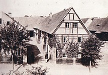
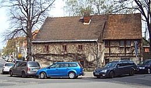
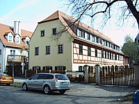
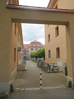
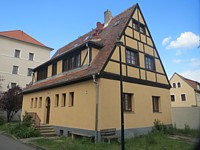
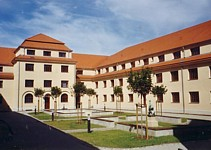
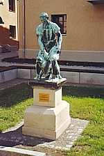

Die Anlage des ab 1882 bis 1906 Lindenplatz genannten Dorfplatzes geht auf das frühere Bauerndorf Pieschen zurück. Hier befanden sich die Wohnhäuser und Stallungen der Pieschener Bauern und Häusler. Mehrfach fielen die Gebäude kriegerischen Auseinandersetzungen oder Dorfbränden zum Opfer, wurden jedoch in der Regel schnell wiederaufgebaut. In der Mitte des Platzes stand noch bis 1897 das Spritzenhaus der Ortsfeuerwehr, der alle Männer des Dorfes angehörten. 1839 ließ der Lehrer Christian Gottlieb Mohn aus Anlass des 300. Jubiläums der Reformation auf dem Dorfplatz zwei Linden pflanzen, die noch bis 1896 den 1882 so benannten „Lindenplatz“ zierten. In den umliegenden Gebäuden entstanden in der Mitte des 19. Jahrhunderts kleine Weinstuben und Gartenlokale, welche den Ort zum Ausflugsziel der Dresdner Bevölkerung machte. Bekannt war das 1899 eröffnete "Lindenschlößchen" im Erdgeschoss von Nr. 17. Im Haus Nr. 3 betrieb Friedrich Franze zeitweise eine Weinhandlung. Am 20. Juli 1906 wurde der Platz Altpieschen benannt.

Die Gehöfte an der Westseite des Dorfplatzes wurden um die Jahrhundertwende zugunsten neuer Mietshäuser abgerissen. Dennoch sind hier und an der Robert-Matzke-Straße noch einige alte Bauernhäuser sowie ein historischer Brunnentrog erhalten geblieben. Unter Denkmalschutz stehen unter anderem die Güter Altpieschen Nr. 2 von 1710 sowie Nr. 4 mit einem Schlussstein von 1806. 2005 konnte die Platzanlage begrünt und neu gestaltet werden.

Zwischen 1926 und 1946 verkehrte eine Straßenbahnlinie durch den Ortskern. Die Am 11. Mai 1926 eingeführte Linie 14 führte, vom Georgplatz kommend, über die Fritz-Reuter- und Harkortstraße zur Bürgerstraße, durchquerte dann den alten Dorfkern und die Braunschweiger Straße und bog über die Wurzener Straße in Richtung Straßenbahnhof Mickten ab und fuhr dann über die Mohnstraße ab. Diese große Schleife wurde am 2. November 1946 wieder stillgelegt und die Gleise zur Gewinnung von Gleismaterial wieder abgebaut.

**_Fotos:_** _Dorfkern Altpieschen - links Altpieschen Nr 2, rechts Altpieschen Nr. 4_

Städtisches Obdachlosenasyl:

Auf dem Grundstück Nr. 9 (heute Altpieschen 5-15), welches früher zum sogenannten “Bischofsgut” gehörte, richtete die Stadt Dresden 1912 ein Asyl für Obdachlose ein. Die aus mehreren Gebäuden bestehende Wohnanlage galt zum Zeitpunkt ihrer Erbauung als eine der modernsten in Deutschland und besaß Räume für 59 obdachlose Familien sowie für 110 alleinstehende Männer. Die Planung oblag dem Dresdner Stadtbaurat Hans Erlwein. Die Wohnungen bestanden aus zwei Zimmern und waren jeweils mit einem Herd ausgestattet. Waschbecken und Toiletten befanden sich im Treppenhaus. Außerdem gab es im Innenhof einen als Treffpunkt für Kinder gedachten “Spielpavillon” sowie ein Brausebad und ein Kinderschwimmbad im Keller.

Da die Wohnanlage schon bald ausgelastet war, machten sich bereits 1915 Erweiterungen erforderlich, die nach Erlweins Tod das Dresdner Architektenbüro Hirschmann übernahm. Leider brannte der Spielpavillon in den 1920er Jahren ab und wurde nicht wieder aufgebaut. Dennoch wurde das Obdachlosenasyl ab 1926 verstärkt zur Unterbringung kinderreicher Familien genutzt, um zumindest die größte Not der Betroffenen zu lindern. Im Eingangsgebäude (Altpieschen 5b) existierte zeitweise die Gaststätte “Altpieschener Destille”, deren Räume bis Ende 2012 von der Arbeiterwohlfahrt genutzt wurden _(Foto links)_. Zuvor diente das kleine Gebäude zu DDR-Zeiten als Kindergarten und beherbergt heute eine Pension. Eines der früheren Wohnhäuser wurde ab 1955 als Mütterberatungsstelle und Kinderkrippe genutzt.

Der zu den wichtigen Zeugnissen der Sozialfürsorge in Dresden gehörende Gebäudekomplex wurde 2003/05 saniert und beherbergt heute Mietwohnungen unterschiedlicher Größe. Im Innenhof fand zeitweise eine Plastik Aufstellung, die einen Fleischer mit einem Schwein zeigt und aus dem ebenfalls von Erlwein entworfenen Dresdner Schlachthof stammt.

**_Fotos:_** _Wohnanlage Altpieschen (“Erlweinhof”) mit Plastik im Innenhof_

__

* * *

 \[ [Home](../../../../index.html)\] \[ [Nord](../../../../nord/)\] \[ [Nordwest](../../../../nordwest/)\] \[ [Neustadt](../../../../neustadt/)\] \[ [Nordost](../../../../nordost/)\] \[ [West](../../../../west/)\] \[ [Zentrum](../../../../zentrum/)\] \[ [Südwest](../../../../sudwest/)\] \[ [Süd](../../../../sud/)\] \[ [Südost](../../../../sudost/)\] \[ [Ost](../../../../ost/)\] \[ [Register](../../../../Register/register.html)\] \[ [Kontakt](../../../../Kontakt/kontakt.html)\] \[ [Impressum](../../../../impressum/)\]
