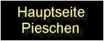
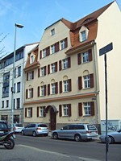
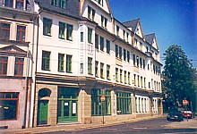
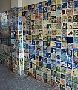

* * *

* * *

Die Bürgerstraße, ursprünglich Feld- bzw. Flurweg genannt, trug ab 1877 auf Pieschener Flur den Namen Schulstraße. Grund für diese Namensgebung war, dass hier seit 1805 das Pieschener [Schulhaus](../../../../nordwest/pieschen/) (Bürgerstraße 76) stand. Nachdem das alte Gebäude nicht mehr der gewachsenen Schülerzahl genügte, erfolgte 1861 auf dem heutigen Grundstück Bürgerstraße 68 ein Neubau. Heute wird dieser vom Kinder- und Jugendhaus "Emmers" genutzt.

1886 erhielt zunächst der Abschnitt zwischen Oschatzer Straße und Moritzburger Platz seinen heutigen Namen im Zusammenhang mit der geplanten Bebauung in diesem Bereich. Anlass war die ein Jahr zuvor erstmals gewährte Verleihung des Bürgerrechts an die Bewohner der Gemeinde Pieschen. 1888 konnte das erste Mietshaus bezogen werden. Weitere Gebäude entstanden bis zum Ende des 19. Jahrhunderts in geschlossener Bauweise. Markanteste Bauwerke sind die 1888 geweihte neogotische [Markuskirche](../../../../nordwest/pieschen/markuskirche/) und das 1891 fertiggestellte Pieschener Rathaus. Mit der Eingemeindung Pieschens wurde der Straßenname Bürgerstraße 1897 auch auf die Schulstraße übertragen und beide Abschnitte zusammengefasst.

Während die oberen Etagen der Häuser in der Regel Wohnzwecken vorbehalten waren, gab es in den Erdgeschossräumen Geschäfte und kleine Gewerbebetriebe, darunter die Gaststätte “Bürgerhof” (Nr. 29), Kubaschs Badeanstalt (Nr. 33) und den ersten Pieschener Ratskeller (Nr. 77). Mit Fertigstellung des neuen Rathauses wurde diese Gaststätte in neue Räumlichkeiten verlegt. Auch das Eckhaus zur
[Oschatzer Straße](../../../../nordwest/pieschen/strassen_pieschen/oschatzer_strasse/) wurde einst gastronomisch genutzt. Ab 1897 befand sich in den Räumen des früheren Postamtes (Nr. 36) die Gaststätte “Zur Post”. Architektonisch bemerkenswert ist auch ein 1912 nach Plänen von Stadtbaurat Erlwein errichtetes Wohnhaus (Nr. 72) mit mehreren Kleinwohnungen _(Foto)_.

Ein weiteres bekanntes Lokal entstand nach 1990 auf der Bürgerstraße 14. Das mehrfach ausgezeichnete Restaurant “ars vivendi” (seit 2006 “Petit Frank”) gilt als eines der besten Feinschmeckerlokale in Dresden. Im Haus Nr. 38/40 hatte seit 1908 die traditionsreiche Spielwarenhandlung „Puppen-Langner“ ihren Sitz, bis zur Schließung 2014 ältestes Spielzeuggeschäft Dresdens. Wichtige Kulturstätten des Stadtteils sind die Kreative Werkstatt im Hof der Bürgerstraße 50 sowie das Kinder- und Jugendhaus „Emmers“ im alten Schulhaus (Nr. 68).

**_Fotos:_** _Polizeirevier Pieschen an der Bürgerstraße / Ecke Osterbergstraße - Spielplatz im Galvanohof_

Einzelne Gebäude:

Bürgerhof (Nr. 29): In diesem Gebäude befand sich seit ca. 1900 das Restaurant "Zum Bürgerhof" sowie das "Bürgerbad", ein Wannenbad für die Anwohner der Vorstadt. Inhaber des Lokals war um 1910 Wilhelm Korb, ab 1914 August Richard Schubert. Heute befindet sich hier ein portugiesisches Restaurant.

Restaurant "Zur Post" (Nr. 36): Ursprünglich befand sich in diesem Gebäude seit ca. 1880 das erste Pieschener Postamt. Nachdem dieses 1892 in das neu erbaute Rathaus verlegt worden war, vermietete man die Räume an einen Gastwirt, der hier "Jahn´s Gaststätten", später "Restaurant zur Post" genannt, einrichtete. Neben den Gasträumen und einem Vereinszimmer gehörte auch eine Stehbierhalle zu diesem Lokal. Nach der Wende nutzte viele Jahre der Frankreichladen "Savoir vivre" die Räume. Am 8. April 2016 eröffnete hier das Bistro "&Rausch", eine Kombination von Bistro, Café und Bar.

Puppen-Langner (Nr. 40): Das traditionsreiche Dresdner Spielwarengeschäft wurde am 1. Oktober 1894 von Hedwig Langner als Puppen-Klinik gegründet und widmete sich vor allem der Reparatur und Pflege defekter Puppen. Zunächst nutzte man Räume gegenüber der Markuskirche (Nr. 55), bevor das Unternehmen 1908 zur Bürgerstraße 40 umzog. Tochter Johanna begann sich nun verstärkt dem Verkauf von Spielzeug zuzuwenden, während Hedwig Langner auch weiterhin ihre Puppenklinik betrieb. Trotz Kriegszerstörungen und der wirtschaftlichen Probleme der Nachkriegszeit blieb der Laden auch nach 1945 in Familienbesitz und wurde ab 1950 von Johannas Sohn Rudolf Winkler und seiner Frau Christa fortgeführt. 1985 übernahm Hansjochen Langner die Geschäftsführung. 1989 und Anfang der 1990er Jahre gab es
umfassende Umbauarbeiten im Geschäft, welches bis zur Schließung Ende 2014 älteste Dresdner Spielzeughandlung blieb.

Galvanohof: Der Gebäudekomplex an der Bürgerstraße 50 beherbergte ursprünglich die
Geschäftsräume des “Consumvereins für Pieschen und Umgegend”. Später nutzte die Konsumgenossenschaft Dresden, nach deren Zwangsauflösung bis 1945 die
“Gemeinschaftswerk Versorgungsring G.m.b.H.” die Räume. Nach dem Zweiten Weltkrieg befand sich hier der Sitz des VEB Galvano Dresden, einer Fabrik zur Herstellung
galvanischer Erzeugnisse. Neben dem Pieschener Betriebsteil besaß die Firma ein weiteres Werk auf dem Areal der früheren [Schokoladenfabrik Petzold & Aulhorn](../../../../sud/plauen/strassen_plauen/petzold___aulhorn/) in Plauen. 1993
schloss die Firma.

Die verfallenden Gebäude wurden daraufhin vom 1994 gegründeten Verein “Kreative Werkstatt Dresden” e. V. übernommen. Zunächst richtete man hier einige Räume für
Künstler ein, in denen Kurse in Malerei, Bildhauerei und plastischem Gestalten angeboten wurden. Ab 1999 konnten die
Bauten schrittweise saniert und für eine dauerhafte kulturelle Nutzung umgebaut werden. Heute befinden sich im
Galvanohof Werkstätten für verschiedene künstlerische Betätigungen, eine Galerie sowie Kursräume und Büros. Seit
1996 finden regelmäßige Ausstellungen regionaler und überregionaler Künstler statt. Berkenswert ist die aus 1500 Keramikfliesen bestehende Wandgestaltung am Durchganz zum Hof _(Foto)_
. Schöpfer waren zwischen 2006 und 2009 Kinder und Jugendliche aus dem Stadtteil.

Firma Ostner (O.D.-Werk Willy Ostner):

Das Unternehmen wurde 1921 von Willy Ostner (1889-1959) und seinem Bruder als Kraftfahrzeughandlung gegründet und hatte seinen Sitz zunächst auf der Strehlener Straße 21.
1923 übernahm er eine kleine Fahrrad- und Armaturenfabrik im Hintergebäude der Leipziger Straße 154 in Pieschen. Drei Jahre später erwarb er das GrundstückBürgerstraße 56 und
begann dort 1927 mit der Herstellung von Motorrädern. Unter dem Markennamen „O. D.“ wurden hier bis 1936 verschiedene Modelle gefertigt. 1932 nahm der Betrieb zusätzlich die
Produktion von Nutzfahrzeugen auf. Beliebt waren vor allem die O.D.-Lieferdreiräder für Händler und Kleingewerbetreibende. Außerdem entstanden vierrädrige Lieferwagen mit
Zweitaktmotor, später auch mit leistungsstärkeren Motoren der Ford-Werke. Der wirtschaftliche Erfolg ermöglichte ihm 1935 die Übernahme der Elite-Diamant-Werke  in Brand-Erbisdorf und 1938 den
Erwerb eines größeren Betriebsgeländes. Hier widmete sich Ostner fortan ausschließlich dem Nutzfahrzeugbau. Nach
Kriegsende siedelte er nach Bayern über und baute dort eine neue Fahrzeugfabrik auf. 1955 wurde  diese von den
Faun-Werken übernommen und bis 1958 fortgeführt. Am Pieschener Standort an der Bürgerstraße erinnert heute ein Wandbild an das Unternehmen.

* * *

 \[ [Home](../../../../index.html)\] \[ [Nord](../../../../nord/)\] \[ [Nordwest](../../../../nordwest/)\] \[ [Neustadt](../../../../neustadt/)\] \[ [Nordost](../../../../nordost/)\] \[ [West](../../../../west/)\] \[ [Zentrum](../../../../zentrum/)\] \[ [Südwest](../../../../sudwest/)\] \[ [Süd](../../../../sud/)\] \[ [Südost](../../../../sudost/)\] \[ [Ost](../../../../ost/)\] \[ [Register](../../../../Register/register.html)\] \[ [Kontakt](../../../../Kontakt/kontakt.html)\] \[ [Impressum](../../../../impressum/)\]
