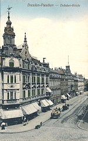
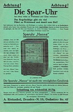
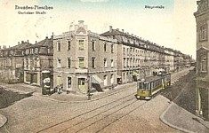
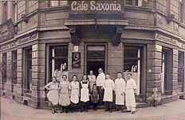
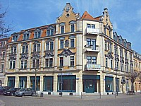
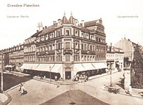
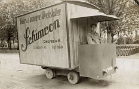

* * *

_Kaufhaus Fanger_

_(Nr. 15)_

_Werbeprospekt für die Sparuhr "Hansa" der Firma Rietzschel_

_(Oschatzer Straße 47)_

* * *

Die Oschatzer Straße bildete einst die Pieschener Ostgrenze zur benachbarten Neudorfer Flur und wurde deshalb ab 1877 Oststraße genannt. Zunächst gab es hier lediglich einige Gärtnereien, bevor um 1886 die Bebauung mit Wohn- und Geschäftshäusern begann. 1897 erhielt die Oststraße ihren heutigen Namen nach der Stadt Oschatz bei Leipzig.

Neben der Bürgerstraße entwickelte sich die Oschatzer Straße zum Geschäftszentrum Pieschens mit zahlreichen Läden unterschiedlichsten Sortiments. Außerdem gab es hier mehrere Gaststätten und Cafés. So befand sich im Haus Nr. 5 bereits um 1910 eine Kaffeestube, in der Nr. 12 die Schankwirtschaft zum Silberhammer (später "Oschatzer Hof"). Heute werden die früheren Gasträume vom Dresdner Nähkabinett genutzt. In der Hintergebäude Nr. 21 betrieb um 1900 Arthur Georg Schinke eine Likörfabrik, im Vorderhaus eine Wein- und Spirituosenhandlung. Auch die Gebäude Nr. 51 und Nr. 55 (Leisniger Hof) dienten einst gastronomischen Zwecken.

Einzelne Gebäude:

Café Saxonia (Nr. 13): Das Café entstand Ende des 19. Jahrhunderts im Erdgeschoss des Eckhauses zur Konkordienstraße und befand sich zunächst im Besitz von Paul Herrnsdorf. Nach dem Ersten Weltkrieg übernahm Hermann Kaut das Café und ließ es umbauen und mit Billardtisch und elektrischem Klavier ausstatten, um die Attraktivität weiter zu erhöhen. Nach einem erneuten Eigentümerwechsel 1934 übernahm die Familie Hänsel das Lokal und führte es als Bäckerei weiter. 1958 wurde diese von Rudolf Maaß übernommen. Seit 2016 gehört auch das traditionsreiche [Café Maaß](../../../../ost/gruna/strassen_gruna/) an der Zwinglistraße zum Unternehmen.

Kaufhaus Fanger (Nr. 15): Größtes Handelshaus der Oschatzer Straße war das um 1898 von der jüdischen Kaufmannsfamilie Benjamin und Fritze Fanger errichtete Gebäude Oschatzer Straße 15 / Konkordienstraße 44 _(Foto)_. Anfangs als Galanterie- und Lederwaren- sowie Küchengerätehandlung betrieben, entwickelte es sich später zum Vollsortiment-Kaufhaus. Später firmierte es unter dem Namen "HAWA - Haus der vielen Waren" und blieb bis 1938 unter jüdischer Geschäftsleitung. Neben dem Kaufhaus gab es im Erdgeschoss zeitweise eine Filile der bekannten Dresdner Süßwarenhandlung Richard Selbmann. Im Zuge der zwangsweisen Arisierung übernahm 1938 Gustav Caspar das Warenhaus.

1941 musste Fangers Tochter Selma Lotte mit ihrem Mann Moritz Auerbach in das "Judenhaus" Bautzner Straße 20 umziehen und Zwangsarbeit in den Goehle-Werken leisten. 1942 deportierte man das Paar zunächst in das [Judenlager Hellerberge](../../../../nord/) und wenig später nach Auschwitz, wo beide ums Leben kamen. Fritze Fanger starb 1943 in Theresienstadt. Nach 1945 wurde das Gebäude bis 1990 als Konsum-Warenhaus genutzt. Danach befand sich hier die Filiale eines Schlecker-Drogeriemarktes. 2015 übernahm ein türkischer Lebensmittelmarkt die Räume.

Nr. 16/18: Auch an der gegenüberliegenden Straßenecke zur Konkordienstraße gab es früher ein Kaufhaus. Um 1900 betrieb hier Ida Hultsch ein Putzwaren- und Stohhutgeschäft. In den 1920er Jahren übernahm der Kaufmann Ludwig Bach die Räume und vereinigte diese mit den Ladenräumen des Nachbarhauses Konkordienstraße 42. Neuer Nutzer war bis Mitte der 1930er Jahre das Modehaus Kornblum & Michaelis. Danach befand sich hier das Modekaufhaus Schuppan. Zur Förderung der Kundenbindung gab Inhaber Martin Schuppan ab 1940 die in mehreren Ausgaben erschienene Kinderzeitung "Dideldum" heraus. Auch dieses Geschäft wurde nach dem Zweiten Weltkrieg verstaatlicht und diente bis 1990 als HO-Bekleidungsgeschäft für Damen und Herren. Seit Oktober 2006 hat in den Räumen eine Filiale der Allgemeinen Ortskrankenkasse (AOK PLUS) ihren Sitz.

Markus-Drogerie: (Nr. 24): Im Erdgeschoss dieses Gebäudes befand sich ab 1905 die Markus-Drogerie von Fritz Meyer. Hier arbeitete zu dieser Zeit Richard Heinrich Langner als Marktgehilfe und Drogist, der das Geschäft 1913 übernahm. 1892 hatte Langner Hedwig Jindra geheiratet, Gründerin des bekannten Dresdner Spielwarengeschäfts "Puppen-Langner" auf der [Bürgerstraße](../../../../nordwest/pieschen/strassen_pieschen/burgerstrasse/). Beim Luftangriff 1945 wurden die Häuser Oschatzer Straße 22 und 24 zerstört. 2016 entstand auf dem Grundstück ein neues Mehrfamilienhaus.

Zur Hopfenblüte (Nr. 26): Das 1898 eröffnete Lokal "Zur Hopfenblüte" befand sich viele Jahre im Besitz von Robert Kaden, später von dessen Witwe Clara. In den 1930er Jahren übernahm Robert Bär die Schankwirtschaft und benannte diese in "Pieschener Bärenschänke" um. Sie blieb auch nach dem Zweiten Weltkrieg erhalten. 1976 bezog das Café Baltimore die Räume, die heute von einer deutsch-kurdischen Begegnungsstätte genutzt werden.

Nr. 34: Im Erdgeschoss dieses Hauses befand sich von Ende des 19. Jahrhunderts bis 1989 eine Fleischerei. Inhaber war zunächst der Fleischermeister Ernst Schluckwerder, später Emil Nacke. 1933 übernahm Max Alfred Hofmann das Geschäft. 1990 zog hier die Bierbar "Graf Zeppelin" ein, später das "Camel's Pub". In den oberen Etagen befand sich zeitweise eine kleine Pension. Nach einem erneuten Umbau öffnete in den Räumen Anfang Juni 2016 das "JESS Pub" mit einem kleinen Biergarten im Hof.

Nr. 40/42: Auf diesem Grundstück entstand 2005/06 eine im Mai 2006 eröffnete Integrations-Kindertagesstätte. Die Kita "Leuchtturm" bietet 24 Krippen- und 73 Kindergartenplätze.

Nr. 47: Exemplarisch für die vielseitige Nutzung der Wohn- und Geschäftshäuser der Vorstadt Pieschen steht die Oschatzer Straße 47. Wie in vielen Gebäuden der Vorstadt gab es auch hier neben Wohnungen kleine Gewerbebetriebe, die teilweise direkt aus den Wohnräumen heraus geleitet wurden. Um 1910 ist ein Wagenverleih erwähnt, während die Erdgeschossräume eine Bäckerei beherbergten. 1930 warb der Unternehmer A. Rietzschel für seine Sparuhren "Hansa". Dabei handelte es sich um Tischuhren und Wecker, die durch den Einwurf von Münzen bestimmte Funktionen ermöglichten wurden und so den Sparwillen der Bevölkerung fördern sollten. Auch die Maler- und Lackierer-Werkstätten von William Schimron hatten im Haus ihre Geschäftsräume. Das Foto zeigt den Transporter des Malerbetriebs Mitte der 1930er Jahre.

Kirche der Herrnhuter Brüdergemeine:

Die Glaubensgemeinschaft der Herrnhuter Brüder entstand im 18. Jahrhundert und wurde von Nikolaus Graf von Zinzendorf, einem am Hofe August des Starken tätigen Justizrat, gegründet. Sitz der weltweit aktiven evangelischen Gemeinschaft ist bis heute die Stadt Herrnhut in der Nähe von Bautzen. Im April 1904 bildete sich auch in Dresden eine Gemeinde, die bis 1945 einige Räume der [Taubstummenanstalt](../../../../sud/plauen/strassen_plauen/chemnitzer_strasse/) in der Nähe des Hauptbahnhofes nutzte. Zuvor hatte man sich im "Kaiser-Wilhelm-Saal" des Hauptbahnhofs und im Wartesaal des Neustädter Bahnhofs getroffen.

Nach 1945 fanden die Gottesdienste zunächst in einem Haus auf der Ostra-Allee, später im Gebäude der evangelisch-reformierten Kirche an der Brühlschen Terrasse statt. Erst 1978 konnte die Herrnhuter Brüdergemeine eine kleine Kirche im Hof des Grundstücks Oschatzer Straße 41 erwerben, welche zuvor der evangelisch-methodistischen Kirche als Gemeindezentrum diente. Bis heute treffen sich hier die ca. 300 Gemeindemitglieder zu Gottesdiensten und anderen kirchlichen Veranstaltungen. Gemäß den Glaubensregeln der Brüdergemeine ist der Saal in schmucklosem Weiß gehalten und bietet ca. 50 Plätze.

* * *

 \[ [Home](../../../../index.html)\] \[ [Nord](../../../../nord/)\] \[ [Nordwest](../../../../nordwest/)\] \[ [Neustadt](../../../../neustadt/)\] \[ [Nordost](../../../../nordost/)\] \[ [West](../../../../west/)\] \[ [Zentrum](../../../../zentrum/)\] \[ [Südwest](../../../../sudwest/)\] \[ [Süd](../../../../sud/)\] \[ [Südost](../../../../sudost/)\] \[ [Ost](../../../../ost/)\] \[ [Register](../../../../Register/register.html)\] \[ [Kontakt](../../../../Kontakt/kontakt.html)\] \[ [Impressum](../../../../impressum/)\]
