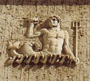
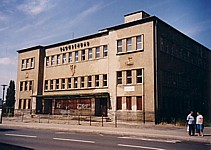
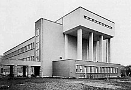
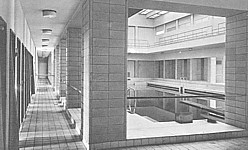

* * *

* * *

Das moderne Hallenbad an der Wurzener Straße 18 wurde 1927/28 als Volksbad Pieschen von Stadtbaurat Paul Wolf errichtet und sollte Kernstück eines hier geplanten Sportkomplexes sein. Zuvor hatten bereits Pieschener Turnvereine auf dem Gelände einen Sportplatz angelegt. Neben einem 320 Quadratmeter großen Schwimmbecken mit 25-Meter-Bahn erhielt das neue Bad auch Wannen- und Brausebäder, Massage- und Vortragsräume sowie ein Restaurant. Ziel war eine Verbesserung der Lebensbedingungen in dem dichtbesiedelten Arbeitervorort, in dem nur wenige Wohnungen mit Badezimmern ausgestattet waren.

Die Architektur des Gebäudes orientierte sich im Geist des "Neuen Bauens" an der kurz zuvor begonnenen Wohnsiedlung Hans Richters zwischen Wurzener und Rehefelder Straße. Die Fassaden sind weitgehend schmucklos und mit einheitlichen Fensterfronten gestaltet. Als plastischer Schmuck weisen Reliefs mit Nixe und Neptun und dem Dresdner Stadtwappen (von Gustav Ludwig Bach) auf die Nutzung des Städtischen Bades hin _(Foto links oben)_. Trotz baulicher Mängel war das Sachsenbad noch bis 1994 in Betrieb. Eine vorgesehene Sanierung scheiterte bislang an den hohen Kosten. Künftig wird auch eine kulturelle oder gewerbliche Nutzung des denkmalgeschützten Gebäudes erwogen. Allerdings kamen 2005 alternative Pläne auf, das denkmlageschützte Haus zugunsten eines modernen Schwimmbadkomplexes abzureißen.

**_Fotos:_** _Das Sachsenbad um 1930_

Am 1. September 1930 wurde im Komplex des Sachsenbades die “Bibliothek Nordwest” als Zweigstelle der
Städtischen Bibliotheken gegründet. Die Einrichtung war fünfte hauptamtlich geleitete Filiale in Dresden und widmete sich
als erste der speziellen Förderung von Kindern und Jugendlichen. Dafür wurde 1935 ein Kinderlesezimmer mit über 200
Büchern eingerichtet. Zu DDR-Zeiten diente sie als Ausbildungsbibliothek für junge Bibliothekare. Nach 1990 wurde die Bibliothek im Sachsenbad geschlossen und in ein Nebengebäude des Pieschener Rathauses verlegt.

Zu den Kuriositäten der Nachkriegszeit gehört die zeitweise Nutzung des Sachsenbades als Dresdner Postscheckamt.
Nach Zerstörung der Hauptpost in der Innenstadt wurde das Postscheckamt am 1. September 1945 in dem unzerstörten Gebäude untergebracht und bestand hier bis zur Schließung 1947.
