* * *

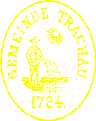

**Gemeindesiegel von Trachau**

* * *

* * *

_Siegelmarke der Gemeinde_

* * *

**Schulen in Trachau:**

[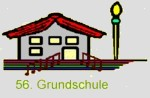](http://56gs-dresden.de)

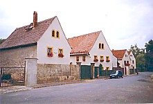Das von slawischen Siedlern gegründete Trachau wurde 1242 erstmals als Trachennowe erwähnt. Der aus dem mittelhochdeutschen abgeleitete Name bedeutet “Ort bei den Drachenbergen” und weist auf die Lage im hügligen Gelände hin. Zwischen altem Dorfkern und den Hängen im Norden der Flur bestand einst ein Höhenunterschied von 12 Metern, der infolge der starken Bebauung heute jedoch kaum noch wahrnehmbar ist. Der Ort bestand ursprünglich aus dem Bauerndorf und einem Vorwerk, welches dem Meißner Hochstift gehörte und ab 1541 dem Dresdner Religionsamt unterstellt war.

Ab 1607 wurden dessen Fluren an Bauern abgegeben, die neben der Amtsgemeinde die sogenannte Ratsgemeinde bildeten. Noch bis ins 19. Jahrhundert bestand diese Teilung des Ortes. Die Trachauer Bewohner bauten schon frühzeitig Wein an, der 1446 durch Augustinermönche am Trachenberg eingeführt wurde. Die Weinbergsgrundstücke lagen meist an der heutigen [Schützenhofstraße](../../nordwest/trachau/strassen_trachau/schutzenhofstrasse/) und hießen u. a. Roter Ochse, Weiße Kuh und Ampachischer Berg. 1661 wurde mit kurfürstlicher Erlaubnis auch an der Neuländer Straße mit der Anpflanzung von Rebstöcken begonnen. Erst die Reblaus brachte im 19. Jahrhundert den Weinbau um Trachau zum Erliegen, an den heute noch einige alte Weinbergsmauern erinnern.

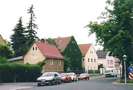Das Straßenangerdorf Alttrachau lag an einem früheren Elbarm, dessen Reste später zwei Dorfteiche bildeten. Bis heute erinnern in [Alttrachau](../../nordwest/trachau/strassen_trachau/alttrachau/) noch einige Zwei- und Dreiseithöfe an die dörfliche Vergangenheit des Ortes. Bemerkenswert sind die zum Teil erhaltenen Weinspaliere und -keller in den Gehöften. Ältestes erhaltenes Gebäude in Trachau ist das Haus Henricistraße 4 von 1642. Als eines der wenigen Alttrachauer Häuser überstand es die Dorfbrände von 1766, 1795 und 1816, die jeweils große Teile des Dorfes einäscherten. Interessant ist auch das “Schlösschen” Rietzstraße 14, welches einst Herrenhaus einer Ziegelei war. Als einziges Gebäude blieb es 1845 vom schweren Elbehochwasser verschont und wurde seitdem “Wasserschloss” genannt. An einigen Trachauer Häusern erinnern bis heute Hochwassermarken an diese Flut, so im Hof Alttrachau Nr. 17 _(Foto links)_. Auch beim Elbehochwasser im August 2002 standen große Teile des Stadtteils unter Wasser. Ein Wassereinbruch in die Trachauer Siedlung konnte nur mit Mühe verhindert werden.

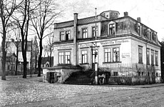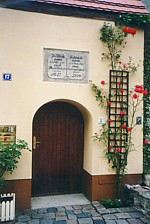Bereits ab 1614 begann Trachau über seinen alten Kern hinauszuwachsen, als ein Einwohner des Ortes das erste Haus an der heutigen [Leipziger Straße](../../neustadt/leipziger_vorstadt/leipziger_strasse/) errichtete. Bis 1675 entstanden weitere Wohnhäuser der im Ort ansässigen Winzer, denen bald einige Handwerker folgten. Für die Entwicklung dieser Siedlung war die Eröffnung der neuen Poststraße nach Meißen im Jahr 1787 von Vorteil, die auch zur Gründung des Gasthofes “Goldenes Lamm” führte. Zweite beliebte Trachauer Gaststätte wurde nach 1876 die “Waldvilla” an der Leipziger Straße 300 _(Foto links - SLUB/Fotothek)_. Um 1880 wurde die Trachauer Flur von der angewachsenen großstädtisch-geschlossenen Bebauung erreicht. Nun entstanden rund um das “Goldene Lamm” mehrstöckige Mietshäuser, die Trachau zur Vorstadt machten. Am 1. Januar 1903 wurde der Ort nach Dresden eingemeindet. Zuvor hatte sich der Gemeinderat lange Zeit geweigert, Verhandlungen mit der Stadt Dresden aufzunehmen. Lediglich die Einbeziehung der Nachbarorte, die Trachau zu einer “Exklave” im Stadtgebiet gemacht hätten, führten schließlich zum Einlenken der Gemeinderäte.

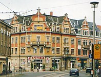

**_Foto:_** _Leipziger Straße am “Goldenen Lamm” mit Elisabeth-Apotheke_

Seit 1899 besaß Trachau Straßenbahnanschluß durch die schmalspurige [“Lößnitzbahn”](../../nordwest/mickten/lossnitzbahn/), die 1927 auf Stadtspur umgebaut wurde. Da der Ort auf einen Haltepunkt an der 1839 erbauten Eisenbahnstrecke zunächst verzichtet hatte, siedelten sich hier nur wenige Industriebetriebe an. Die Bahnlinie, die die Flur der Gemeinde in zwei Teile zerschnitt, erhielt erst 1902 nach langjährigen Diskussionen im Gemeinderat einen Halt in Trachau. Parallel zum Bahndamm ließen sich nun entlang der neu angelegten [Industriestraße](../../nordwest/trachau/strassen_trachau/) einige kleinere Unternehmen nieder.

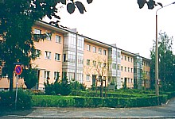Auf den verbliebenen Freiflächen, für die bereits vor der Eingemeindung ein Bebauungsplan entworfen worden war, entstanden vor und nach dem Ersten Weltkrieg zwei Schulen und die [Apostelkirche](../../nordwest/trachau/apostelkirche/). Ende der 1920er Jahre begann die Bebauung mit Reihenhäusern durch mehrere Baugesellschaften. Städtebaulich interessant sind die Anlagen an der Schützenhofstraße, die wegen ihrer Flachdächer als “Klein-Marokko” bezeichnet wurden sowie die von Hans Richter entworfene [Trachauer Siedlung](../../nordwest/trachau/trachauer_siedlung/) an der Kopernikusstraße _(Foto)_. Das 1928 in deren Nachbarschaft eingeweihte [Güntzheim](../../nordwest/trachau/guntzheim/) wird heute als Krankenhaus Dresden-Neustadt genutzt.

Bis zur Gegenwart blieb Trachau vorrangig Wohnvorort Dresdens mit relativ wenig Industrie. Nach 1990 wurden viele der vorhandenen Gebäude saniert, darunter auch die 1996 von einer Wohnungsgenossenschaft erworbenen Häuser der Trachauer Siedlung. Einige Neubauten entstanden u. a. an der Tichatschekstraße und der Schützenhofstraße. Umstritten war ein geplantes Wohngebiet auf den sogenannten “Hufewiesen”, einer der letzten verbliebenen Trachauer Grünflächen an der Gaußstraße. Eine Bürgerinitiative setzte mit Erfolg durch, dass dieses Areal als "grüne Lunge" des Stadtteils weitgehend erhalten bleibt.

Schulen in Trachau:

Dorfschule: Bis ins 19. Jahrhundert besuchten die Kinder aus Trachau, ebenso wie die der Nachbargemeinden, die Kaditzer Kirchschule, die bereits 1539 erwähnt wurde. Um den beschwerlichen Schulweg zu verkürzen, war seit 1613 ein “Kinderlehrer” im Nachbarort Pieschen tätig, der auch die jüngeren Trachauer Schulkinder unterrichtete. Erst 1872 beschloss der Gemeinderat die Gründung einer eigenen Schule. Das zunächst nur einstöckig ausgeführte Gebäude entstand nach Plänen des Baumeisters Schmidt. Das notwendige Grundstück hatte die Gemeinde zuvor für 750 Taler von Johann Gottfried Findeisen und Johann Gottlieb Klotzsche erworben. Die feierliche Einweihung erfolgte am 16. September 1873. Bereits kurze Zeit später mussten Ausweichquartiere für die stark gewachsene Schülerzahl eingerichtet werden. 1893/94 wurde das alte Schulhaus aufgestockt. Nach Eröffnung der neuen Schule diente das Gebäude noch zeitweise als Kindergarten und Verwaltung des Gaswerkes. Später wurde es als Wohnhaus genutzt, steht jedoch seit einigen Jahren leer (Alttrachau Nr. 52).

40\. Bezirksschule: Als die bisherige Dorfschule zu klein geworden war entstand ab 1898 auf einem Grundstück an der Böttgerstraße 11 ein neues Schulhaus. Das Areal war zuvor von drei Trachauer Gutsbesitzern erworben worden. Die feierliche Grundsteinlegung fand am 1. April 1898 aus Anlass des Geburtstages Otto von Bismarcks statt. Am 15. März 1899 wurde der nach Plänen des Dresden Architekten Gustav Hänichen errichtete Neubau eingeweiht. Zu diesem gehörte eine geräumige Turnhalle und ein Glockenturm auf dem Schulhof, da der Platz auf dem Nachbargrundstück für einen Kirchenbau vorgesehen war. Mit der Eingemeindung Trachaus wurde die Trachauer Schule ins Dresdner Schulnetz eingegliedert. 1903 entstand im Gebäude zusätzlich die XVI. Bürgerschule.

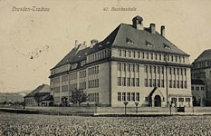1911 wurde an der Cottbuser Straße 34 ein zweites Schulgebäude durch Hans Erlwein erbaut _(Foto rechts)_. 1929 erhielt dieses noch einen Anbau nach Plänen des Dresdner Stadtbaurates Paul Wolf. Die zunächst gemeinsam verwalteten Schulen teilte man nach dem Ersten Weltkrieg auf, so dass sich ab 1920 auf dem Grundstück die 40. Volksschule (Cottbuser Straße 34) und die 56. Volksschule (Böttgerstraße 11) befanden. Während des Zweiten Weltkrieg wurden die Gebäude zeitweise als Behelfslazarett genutzt.

Unmittelbar nach Kriegsende wurde an den beiden weitgehend unzerstörten Schulen der Unterricht wieder aufgenommen. Zur Umsetzung des politischen Ziels, künftig auch Jugendlichen aus Arbeiter- und Bauernfamilien einen Hochschulabschluss zu ermöglichen, gründete sich am 1. Oktober 1949 in Dresden die "Arbeiter- und Bauernfakultät" (ABF) als siebente Fakultät der Technischen Hochschule. Aus Mangel an geeigneten Räumlichkeiten nutzte man das Schulgebäude Cottbuser Straße und begann Ende Oktober mit dem Vorlesungsbetrieb für anfangs 380 Studenten. Ein Großteil von ihnen konnte in Wohnheimen ganz in der Nähe untergebracht werden. Bis 1954 dauerte dieser provisorische Hochschulbetrieb, danach zog die ABF in das wieder hergestellte Gebäude des früheren [Pädagogischen Instituts](../../sudost/strehlen/) in Strehlen.

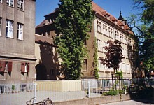Zu DDR-Zeiten dienten beide Schulhäuser als Polytechnische Oberschulen. Bis 1990 befand sich im Gebäude an der Cottbuser Straße die 40. Polytechnische Oberschule “Edmund Fink”, 1975 benannt nach dem Eisenbahner und KPD-Funktionär Edmund Fink (1891-1952). Fink war während der NS-Diktatur im Widerstand tätig und wohnte viele Jahre auf der Aachener Straße 1, wo bis 1998 auch eine von den Schülern gestiftete Gedenktafel an ihn erinnerte. Das von Erlwein erbaute Schulgebäude an der Cottbuser Straße nutzte die 56. POS "Georg Wolff". Am 1. Juni 1978 war der Bildungseinrichtung dieser Name anlässlich des 72. Geburtstages des ehemaligen Spanienkämpfers und "Aktivisten der ersten Stunde" verliehen worden. Wolff (1906-1948) liegt auf dem Heidefriedhof begraben und war bis 1993 auch Namensgeber der heutigen Dorothea-Erxleben-Straße.

1991 wurden beide Bezeichnungen aufgehoben und die Schulen als Grund- bzw. Mittelschulen fortgeführt. 2001 schloss die 40. Mittelschule. Die beiden Schulhäuser wurden danach von der 56. Grund- und Mittelschule genutzt. Eine grundlegende Sanierung begann 2013. Während der ältere Bau Hans Erlweins denkmalgerecht saniert wurde, brach man den Anbau von 1929 zugunsten eines modernen Erweiterungsgebäudes mit integrierter Turnhalle, Fachkabinetten und Speisesaal ab. Im August 2015 konnte die 56. Oberschule “Am Trachenberg” wieder in ihr Domizil zurückkehren.

144\. Grundschule: Der moderne Neubau an der Micktner Straße 10 entstand 2013/14 an Stelle einer ehemaligen Kindertagesstätte und wurde am 10. Oktober 2014 eingeweiht. Die vom Architektenteam Heinle, Wischer und Partner entworfene Schule war erster neu gebildeter Schulstandort in Dresden nach 1990. Das in Modulbauweise errichtete Gebäude bietet Platz für ca. 300 Kinder und besitzt zusätzlich eine Einfeldturnhalle.

Postwesen in Trachau:

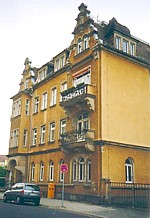Die erste Postagentur in Trachau wurde am 16. Januar 1892 eröffnet und befand sich im Wohn- und Geschäftshaus Leipziger Straße 3 (heute 153). Leiter war der Trachauer
Zigarrenfabrikant Friedrich Otto Jedicke, der die benachbarte Villa (Nr. 151) bewohnte. Zwei Jahre später erhielt der Ort auch eine eigene Telegraphenanstalt und wurde wenig
später an das Telefonnetz angeschlossen.

Im Jahr 1900 verlegte die Postverwaltung die inzwischen zum Postamt erhobene Dienststelle zur Übigauer Straße 4 (heute Bunsenstraße - _Foto)_
. Mit Eröffnung einer Postagentur im neuerrichteten Elbcenter an der Leipziger Straße sowie einer weiteren Agentur in einem
Schreibwarenladen wurde das Trachauer Postamt im April 2000 geschlossen. Seit 2011 befindet sich die Trachauer Poststelle in einem Tabakwarengeschäft auf der Großenhainer Straße 182.

Trachauer Windmühle:

Die Trachauer Windmühle wurde 1848/49 durch den früheren Boxdorfer Windmüller Karl Friedrich Trentzsch
unmittelbar am Bahndamm der Dresden - Leipziger Eisenbahn errichtet. Zuvor mussten die Trachauer Bauern ihr Korn
mühsam nach Boxdorf zur dortigen Mühle transportieren. Nach Erteilung der Konzession entstanden Mühle und
Wohngebäude, die Trentzsch jedoch bereits 1853 weiter veräußerte. Am 16. Januar 1878 wurde die Mühle bei einem
Brand zerstört und nicht wieder aufgebaut. Erhalten blieb zunächst das Wohnhaus im Grundstück Alttrachau 60, welches jedoch
in den 1970er Jahren  dem Abbruch verfiel. An den Mühlenbesitzer Trentzsch, der noch zwei weitere Mühlen in Pieschen besaß, erinnert seit 1935 der Trentzschweg.

Gaswerk Trachau:

Das Werk entstand um 1900 für die damals noch selbständige Gemeinde und nahm am 1. Dezember 1900 seinen Betrieb auf. Vorrangig sollte es die Straßenbeleuchtung des Ortes absichern, lieferte jedoch auch Stadtgas für die ortsansässige Industrie und für die Haushalte. Als Verwaltungsgebäude nutzte man die frühere Schule des Ortes. Das Werk besaß ein Gasometer mit 1000 m³ Fassungsvermögen, drei Öfen sowie die notwendigen technischen Anlagen und Lagerräume. Ab 1902 wurden auch einige Häuser in den Nachbarorten Kaditz und Oberlößnitz mit versorgt. Nach Trachaus Eingemeindung übernahm die Stadt Dresden das Werk an der Industriestraße 19 und ließ es 1908 erweitern. 1922 wurde die Gasproduktion eingestellt. An Stelle des 1930 abgerissenen Gaswerkes steht heute ein Supermarkt.

Wasserwerk Trachau:

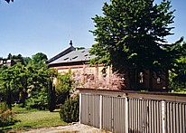Bereits 1895 erwog die damals noch selbständige Gemeinde Trachau den Bau eines eigenen Wasserwerkes sowie die Anlage eines Kanalnetzes im Ort. 1897/99 konnte zunächst mit der Anlage von Abwasserschleusen begonnen werden. Im Herbst 1899 erfolgte die Grundsteinlegung für das gemeindeeigene Wasserwerk auf der heutigen Aachener Straße. Zum Werk gehörten ein Brunnen- und Maschinenhaus sowie ein Hochbehälter zur Drucksicherung in der Nähe der Gaststätte “Glasewalds Ruhe” _(Foto rechts: Karl Quarck - SLUB/Fotothek)_. Am 3. August 1900 wurde das neue Werk im Beisein des Amtshauptmannes von Craushaar feierlich eingeweiht.

Obwohl schon bald die meisten Häuser des Ortes sowie einige Gebäude im benachbarten Neukaditz angeschlossen werden konnten, erwies sich das Wasserwerk nach der Eingemeindung als unwirtschaftlich. Hinzu kamen hygienische Bedenken der Dresdner Behörden. Im Sommer 1909 wurde der Betrieb schließlich eingestellt. Die Gebäude auf dem Grundstück Aachener Straße 31 sind jedoch noch erhalten _(Foto links)_.

 \[ [Home](../../index.html)\] \[ [Nord](../../nord/)\] \[ [Nordwest](../../nordwest/)\] \[ [Neustadt](../../neustadt/)\] \[ [Nordost](../../nordost/)\] \[ [West](../../west/)\] \[ [Zentrum](../../zentrum/)\] \[ [Südwest](../../sudwest/)\] \[ [Süd](../../sud/)\] \[ [Südost](../../sudost/)\] \[ [Ost](../../ost/)\] \[ [Register](../../Register/register.html)\] \[ [Kontakt](../../Kontakt/kontakt.html)\]
 \[ [Impressum](../../impressum/)\]
