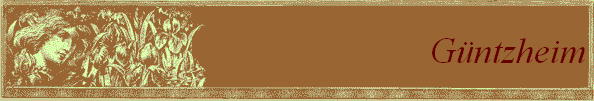
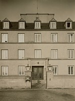
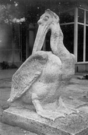
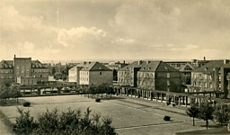
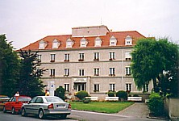
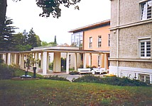
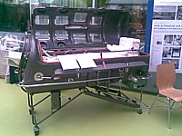

* * *

* * *

* * *

* * *

* * *

* * *

* * *

_Haupteingang des Güntzheimes_

_(Foto Walter Möbius - SLUB/Fotothek)_

_Plastik "Pelikan" von Etha Richter_

_(Foto SLUB/Fotothek)_

Das Güntzheim entstand auf Beschluss des Rates der Stadt Dresden als neues Altersheim am Rande der Stadt. Das nach modernsten Gesichtspunkten von Stadtbaurat Paul Wolf entworfene Heim ersetzte die bisherigen Unterkünfte in der Friedrichstadt, die für Wohnzwecke benötigt wurden. Außerdem konnten mit dem Zusammenlegung der bisherigen Heime der Duckwitzstiftung auf der Friedrichstraße und dem Hohenthalhaus auf der Waltherstraße Kosten gespart und die Betreuung der Bewohner deutlich verbessert werden. Die Finanzierung der neuen Einrichtung erfolgte zum Teil aus Mitteln der Güntz´schen Stiftung, die dem neuen Altersheim auch ihren Namen verlieh _(Foto von 1930)_.

Der aus acht um einen Gartenhof plazierten Gebäuden bestehende Komplex wurde am 7. November 1928 durch Oberbürgermeister Blüher übergeben. Als plastischer Schmuck ziert ein von Prof. Brodauf geschaffener Kopf des Stifters das Hauptgebäude. Einen Brunnen mit Pelikan-Plastik für die Gartenanlage schuf die Bildhauerin Etha Richter. Die einzelnen Häuser, die der Unterbringung der Senioren dienten, waren durch Laubengänge miteinander verbunden und besaßen gemeinsame Unterhaltungs-, Lese- und Spielzimmer. Insgesamt standen 300 Plätze für Frauen, Männer und Ehepaare zur Verfügung. Außerdem gab es eine Großküche, Bade- und Krankenräume sowie Wohnungen für das Personal der Einrichtung. Bis 1937 folgten noch einige Ergänzungen der Anlage, die seinerzeit beispielgebend für moderne Sozialeinrichtungen war.

Gegen Ende des Zweiten Weltkrieges wurden die Bewohner des Güntzheimes wegen der drohenden Bombengefahr evakuiert und kamen in Bad Schandau sowie im Schloss Hermsdorf bei Radeberg unter. Nach Zerstörung der Dresdner Krankenhäuser der Innenstadt diente das Heim zunächst als Seuchen- und Infektionskrankenhaus. Aus dieser Einrichtung entwickelte sich das Städtische Krankenhaus Dresden-Neustadt. Dieses war im Mai 1945 in einem ehemaligen Wehrmachtslazarett auf der Wurzener Straße gegründet worden und bezog Ende 1945 die Gebäude des früheren Güntzheimes.

Als Spezialkrankenhaus für Lungenkrankheiten besaß das Klinikum seit 1947 eine der ersten “eisernen Lungen”, ein Spezial-Beatmungsgerät für Patienten mit Kinderlähmung _(Foto)_. Außerdem wurde hier am 14. Februar 1948 die zweite Dresdner Poliklinik eröffnet. 1949 kam eine Röntgenabteilung, 1956 eine Kinder- und Jugendklinik mit Geburtsstation hinzu. 1960 bezogen die Abteilungen Chirurgie und Gynäkologie neue Räumlichkeiten im Krankenhausareal an der Industriestraße. In jüngster Zeit entstanden einige moderne Funktionsbauten. Heute gehören neben dem Stammhaus auch Außenstellen in Radebeul, Löbtau und am Weißen Hirsch zum Neustädter Krankenhaus.

Im Innenhof des Krankenhauses erinnert eine Bronzebüste an den Stifter Justus Friedrich Güntz (1801-1875). Als Rechtsanwalt und Besitzer der Zeitung “Dresdner Anzeiger” war Güntz zu erheblichem Vermögen gekommen, welches er in Form einer Stiftung für wohltätige Zwecke zur Verfügung stellte. U.a. bezahlte die Güntz- Stiftung den Bau des 1945 zerstörten [Güntzbades](../../../Zentrum/Pirnaische_Vorstadt/Strassen_Pirnaische_Vorstadt/Guntzbad/guntzbad.html) in der Pirnaischen Vorstadt und der heutigen Krankenhausgebäude. Ein weiteres Kunstwerk wurde im Oktober 2018 vor der Klinik aufgestellt. Die Plastik "Stehender Jüngling" von Wilhelm Landgraf hatte ihren ursprünglichen Standort in den Touristengärten an der Prager Straße, wurde dort 1996 gestohlen und 2015 anonym zurückgegeben.

* * *

 \[ [Home](../../../index.html)\] \[ [Nord](../../../nord/)\] \[ [Nordwest](../../../nordwest/)\] \[ [Neustadt](../../../neustadt/)\] \[ [Nordost](../../../nordost/)\] \[ [West](../../../west/)\] \[ [Zentrum](../../../zentrum/)\] \[ [Südwest](../../../sudwest/)\] \[ [Süd](../../../sud/)\] \[ [Südost](../../../sudost/)\] \[ [Ost](../../../ost/)\] \[ [Register](../../../Register/register.html)\] \[ [Kontakt](../../../Kontakt/kontakt.html)\] \[ [Impressum](../../../impressum/)\]
