* * *

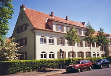Die Aachener Straße wurde 1898 im Zusammenhang mit dem Bau eines eigenen [Wasserwerkes](../../../nordwest/trachau/) der Gemeinde Trachau angelegt. Zunächst wurde sie als Burgsdorffstraße bezeichnet, womit der damalige Amtshauptmann von Dresden-Neustadt Curt Ludwig Franz von Burgsdorff (1849-1922) geehrt werden sollte. Bereits 1902 wechselte die Straße jedoch ihren Namen in Erinnerung an die Stadt Aachen, einstiger Krönungsort der deutschen Kaiser. Der alte Name Burgsdorffstraße wurde daraufhin auf die frühere Hohenzollernstraße übertragen. Bis zum Ersten Weltkrieg entstanden hier nur wenige Gebäude, darunter das 1911 eingeweihte neue [Schulhaus](../../../nordwest/trachau/) der 40. Bezirksschule.

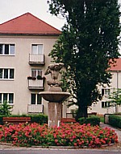Zwischen 1923 und 1926 folgten die Wohnhäuser der „Bodenreformerischen Siedlungsgemeinschaft Groß-Dresden“. 1927 begann der Bauverein “Gartenheim” mit der Errichtung von Reihenhäusern nach Entwürfen des Architekten Paul Beck. 1929 erfolgte die Bebauung der anderen Straßenseite durch die Baugesellschaft GEWOBAG. Die Planungen für diese Gebäude stammen vom renommierten Dresdner Architektenbüro Schilling & Gräbner. Weitere Bauten wurden Mitte der 1930er Jahre am Lichtenbergweg errichtet. Als baukünstlerischer Schmuck entstand 1934 ein heute nicht mehr betriebener, jedoch noch vorhandener Faunbrunnen _(Foto)_. Ihren Abschluss fand die Bebauung der Aachener Straße 1955/57 durch die Neubauten der Eisenbahner-AWG der Deutschen Reichsbahn.

Nr. 1: Am Wohnhaus Nr. 1 errinnerte noch bis 1998 eine Gedenktafel an den viele Jahre dort wohnenden Antifaschisten Edmund Fink (1891-1952). Edmund Fink gehörte der KPD-Bezirksleitung Ostsachsen an und war bis 1933 Betriebsrat der Dresdner Straßenbahn AG. Nach seinem Tod wurde 1963 die heutige Burgsdorffstraße in Edmund-Fink-Straße umbenannt.

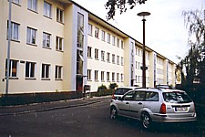Die nach dem Physiker und Astronomen Ernst Abbe (1840-1905) benannte Straße wurde 1932 im Zusammenhang mit dem Bau der [Trachauer Siedlung](../../../nordwest/trachau/trachauer_siedlung/) angelegt. Abbe leitete gemeinsam mit seinem Partner Carl Zeiss das Carl-Zeiss-Werk in Jena und begründete dessen Weltruf als Hersteller optischer Geräte. Die Häuser an der Abbestraße entstanden in zwei Abschnitten: 1932 wurde die lange Wohnzeile (Nr. 14-24) nach den Plänen Hans Richters erbaut, jedoch nicht vollendet _(Foto)_. 1937/38 folgten die Häuser der gegenüberliegenden Straßenseite (Nr. 25-35). Architekt dieser Wohnanlage zwischen Abbe- und Fraunhoferstraße war Willimartin Romberger.

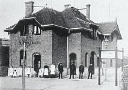Die Straße Am Trachauer Bahnhof entstand 1902 als Zufahrt zum neu eingerichteten Haltepunkt Trachau _(Foto um 1903)_ und erhielt deshalb den Namen Bahnhofstraße. Erst im September 1953 wurde sie in Am Trachauer Bahnhof umbenannt.

Wichtigstes Bauwerk ist der am 1. Mai 1902 für den öffentlichen Verkehr eröffnete Haltepunkt. Mit seiner Einweihung erhielt der Ort endlich den vor allem von den Gewerbetreibenden lang ersehnten direkten Anschluss an die 1839 eröffnete [Bahnstrecke von Dresden nach Leipzig](../../../neustadt/leipziger_vorstadt/dresden_-_leipzig/). In der Folge siedelten sich an der Straße mehrere Unternehmen an, u.a. die 1899 gegründete Turngerätefabrik von Robert
Hermann Fechner und die Mitteldeutsche Kellerei-Maschinenfabrik Ernst Mäurich. Auch der [Tintenfabrikant August Leonhardi](../../../nordost/loschwitz/strassen_loschwitz/grundstrasse/tintenfabrik_leonhardi/) verlegte sein Loschwitzer Werk nach Trachau, wo die Firma noch bis 2012 unter dem Namen „Barock“ verschiedene Büroartikel produzierte. 1999 entstand das moderne Nahversorgungszentrum „Am Trachauer Bahnhof“ sowie ein Büro-, Schulungs- und Handwerker-Center.

Maschinenfabrik Ernst Mäurich: Das Unternehmen wurde 1898 als Mitteldeutsche Kellereimaschinenfabrik Ernst Mäurich gegründet. 1903 ließ der Unternehmer an der damaligen Bahnhofstraße 6b neue Fabrikgebäude und eine Fabrikantenvilla errichten. Hier entwickelte sich die Firma zu einem der bedeutendsten mitteldeutschen Hersteller von Spezialmaschinen für Limonadenhersteller, Molkereien, Brauereien und Keltereien. Produziert wurden Flaschenreinigungsmaschinen, Abfüllapparate und andere Geräte für die Getränkeindustrie.

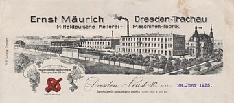

1945 wurde die Fabrik von der sowjetischen Besatzungsmacht demontiert, konnte jedoch mit einem Restbestand zunächst weitergeführt werden. 1972 erfolgte die Verstaatlichung des Betriebes und 1978 dessen Eingliederung als Ratiomittelbau in den VEB Getränkekombinat Dresden. Im Zuge der Reprivatisierung entstand 1990 die
TEN BRINK DRESDEN Maschinen- und Apparatebau GmbH, die sich auf die Verarbeitung von Edelstahl spezialisierte. Seit 2007 wird der Betrieb als 3D Edelstahl Maschinen- und Apparatebau GmbH fortgeführt.

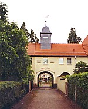 Die Straße An der Dürren Heide erhielt am 8. Juni 1923 ihren Namen nach einer bereits seit dem 16. Jahrhundert nachweisbaren Flurbezeichnung. Gleichzeitig wurden die angrenzenden Straßen in der sogenannten [„Kriegerheimsiedlung“](../../../nordwest/trachau/strassen_trachau/schutzenhofstrasse/) An der Böschung, Rodung und Baumwiesenweg genannt. Ursprünglich hatten die Siedler für den Straßenkomplex die Namen “Heimstättenstraße”, “Siedlerstraße“ und “Damaschkestraße“ vorgeschlagen. Adolf Damaschke (1865–1935) war Gründer des Bundes deutscher Bodenreformer und setzte sich für den Bau genossenschaftlicher Wohnanlagen ein. Letztlich entschied sich der Dresdner Stadtrat jedoch für eine Namensgebung nach Flurnamen der Umgebung.

Die Anne-Frank-Straße befindet sich unmittelbar an der Stadtgrenze zu Radebeul und erhielt ihren Namen nach der durch ihr Tagebuch berühmt gewordenen Jüdin Anne Frank. Anne Frank musste mit ihrer Familie nach dem Einmarsch der Nationalsozialisten in Holland 1940 in einem Versteck untertauchen und verfasste in einem Amsterdamer Hinterhaus ihr Tagebuch, in welchem sie ihre Gedanken und Gefühle niederlegte. Durch Denunziation wurde die Familie 1944 verraten und in das KZ Bergen-Belsen verbracht, wo das Mädchen mit nur 15 Jahren 1945 verstarb.

Ursprünglich befand sich auf dem Areal der 1904 angelegte König-Friedrich-August-Park, von dessen ursprünglicher Gestaltung sich nur wenige Reste erhalten haben. Bereits während des Zweiten Weltkrieges fiel ein Großteil der Bäume dem Holzschlagen zum Opfer. 1950 entstand hier die Kleingartensparte “Am Waldrand”.

Die Benzstraße wurde Mitte der 1930er Jahre im Zusammenhang mit dem weiteren Ausbau der Trachauer Siedlung angelegt und 1935 nach Carl Friedrich Benz (1844-1929) benannt. Benz konstruierte 1878 den ersten Zweitaktmotor und gilt als “Vater des Automobils”.

Die Bolivarstraße wurde 1931 im Zusammenhang mit dem Bau neuer Wohnhäuser an der früheren Gemarkungsgrenze zwischen Trachau und Pieschen angelegt. Ihren Namen erhielt sie am 11. Juli 1931 nach dem südamerikanischen Freiheitskämpfer und Politiker Simon Bolivar y Ponte (1783-1830). Er gilt als einer der wichtigsten Führer der Unabhängigkeitsbewegung gegen die spanische Kolonialherrschaft und wird bis heute in den Ländern der Region als Nationalheld verehrt.

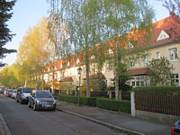Die Wohnhäuser an der Bolivarstraße entstanden ab 1930 für den Allgemeinen Sächsischen Siedlerverband (ASSV), wobei die Entwurfsplanung dem Architekten Paul Müller oblag. Die Grundsteinlegung für die 14 Reihen- und 8 Mehrfamilienhäuser der Siedlung "Zur guten Hoffnung" erfolgte im Herbst 1930. Innerhalb von neun Monaten entstanden hier insgesamt 88 Wohnungen, finanziert aus Eigenmitteln der Siedler, Hypothekengeldern und Darlehen der Stadt Dresden. Alle Wohnungen erhielten separate Eingänge und Kleingärten, welche der Selbstversorgung der Vereinsmitglieder mit Obst und Gemüse dienen sollten. Die 1931 bezogene Siedlung befindet sich heute im Besitz der Gemeinnützigen Wohnungsgenossenschaft “Am alten Weingut Wilder Mann”und steht seit 1994 unter Denkmalschutz. Diese Genossenschaft hatte sich im September 1933 unter dem Druck der Nationalsozialisten aus dem gewerkschaftlich orientierten ASSV gebildet und ist kleinste Wohnungsgenossenschaft Dresdens.

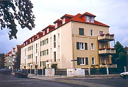Die Böttgerstraße, bis 1904 Germanen- bzw. in ihrem nördlichen Abschnitt nach dem früheren preußischen Kriegsminister Albrecht von Roon (1803-1879) Roonstraße genannt, verdankt ihren Namen dem Erfinder des europäischen Porzellans Johann Friedrich Böttger (1682-1719). Der Alchimist Böttger war als Gefangener August des Starken auf dem Königstein inhaftiert und entwickelte mit Hilfe des Gelehrten Walter von Tzschirnhaus 1708 das erste europäische Porzellan. Markantestes Gebäude an der Böttgerstraße ist das 1899 entstandene neue Trachauer [Schulhaus](../../../nordwest/trachau/). Hinzu kommen die 1929 vom Bauverein Gartenheim errichteten Häuser an der Böttger, Stephan- und Aachener Straße _(Foto)_

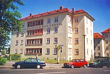Am 1. Januar 1904 erhielt die Ende des 19. Jahrhunderts als Haidestraße angelegte Straße ihren heutigen Namen nach der kleinen Ortschaft Boxdorf bei Moritzburg. Ursprünglich war die Boxdorfer Straße Teil eines alten Verbindungsweges zwischen Pieschen, Trachau und der nahegelegenen “Jungen Heide” und wurde deshalb auch Trachauer Heideweg genannt. Die ersten Gebäude errichteten private Bauherren um 1870. Wenig später beschloss der Gemeinderat die offizielle Benennung in Haidestraße. Neben Wohnungen gab es hier früher auch einige kleinere Geschäfte, u.a. die “Nord-West-Drogerie” und die Fleischerei Hempel. Der auf Pieschener Flur gelegene und bis in die 1920er Jahre unbebaute Abschnitt wurde noch bis 1904 Trachauer Heideweg genannt.

Erst ab 1929/30 folgte nach Plänen Paul Becks das Wohnviertel im Bereich Boxdorfer und Volkersdorfer Straße im Auftrag des Dresdner Spar- und Bauvereins _(Foto)_. 1935/36 kamen die Häuser der Hellerauer Straße 1-21 und 2-18 hinzu. 1940 entstand auf den verbliebenen Freiflächen ein Wohnblock der GEWOBAG. Architekt war hier Willimartin Romberger.

Der Brehmweg in der Trachauer Siedlung erhielt seinen Namen nach dem Pfarrer und Ornithologen Christian Ludwig Brehm (1787-1864) und erinnert gleichzeitig an seinen Sohn Alfred Brehm (1829-1884). Dieser erlangte als Naturforscher große Popularität. Sein bekanntestes Werk ist das bis heute als Standardwerk der Zoologie geltende Buch “Brehms Tierleben”.

Die Buchholzer Straße wurde um 1875 als Privatstraße angelegt, um zwei hier vom Trachauer Baumeister Damm errichtete Villen zu erreichen. Erst 1934 wurde sie in eine öffentliche Straße umgewidmet und erhielt in diesem Zusammenhang ihren Namen nach dem kleinen Ort Buchholz, einem Ortsteil der heute zu Moritzburg gehörenden Gemeinde Friedewald.

Die Bunsenstraße im Süden der Trachauer Flur trug ursprünglich den Namen Übigauer Straße.1904 wurde sie nach dem Chemiker Robert Bunsen (1811-1899) umbenannt. Bunsen entwickelte den nach ihm benannten Bunsenbrenner und gilt als Begründer der Spektralanalyse. 1900 wurde auf der Bunsenstraße 4 das neue Trachauer Postamt eröffnet, welches bis zur Schließung im April 2000 alle postalischen Aufgaben für das Gebiet Trachau übernahm.

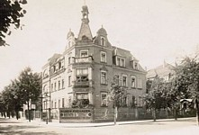Die Burgsdorffstraße wurde 1898 angelegt und zunächst Hohenzollernstraße genannt. 1902 erhielt sie ihren heutigen Namen in Würdigung der Verdienste des Amtshauptmannes von Dresden-Neustadt Curt Ludwig Franz von Burgsdorff (1849-1922). Burgsdorff hatte sich in seiner Funktion stark für die Entwicklung Trachaus engagiert. Zuvor trug der nördliche Teil der heutigen Aachener Straße den Namen Burgsdorffstraße. Im März 1963 wurde die Burgsdorffstraße nach dem antifaschistischen Widerstandskämpfer Edmund Fink (1891–1952) in Edmund-Fink-Straße umbenannt. Die Rückbenennung erfolgte im November 1991.

Als erstes Wohnhaus der Burgsdorffstraße entstand 1896/97 ein zweigeschossiges Mietshaus, welches heute jedoch zum Grundstück Weixdorfer Straße 17 gehört. Bauherr war der Dresdner Kaufmann Albert Rollhäuser. Weitere Wohngebäude folgten bis zum Beginn des Ersten Weltkriegs. In den 1920er Jahren errichtete der Bauverein Gartenheim eine kleine Wohnsiedlung. Im Wohnhaus Burgsdorffstraße 24 lebte bis 1945 der Maler Willy Waldapfel (1883-1965), welcher zwischen 1934 und 1945 Professor an der Kunstakademie war und zugleich dem Stadtrat angehörte.

Die 1929 angelegte and am 3. Dezember 1930 amtlich benannte Carl-Zeiss-Straße verdankt ihren Namen dem Mechaniker Carl Zeiss (1816-1888), der 1846 in Jena eine optische Werkstatt gründete, Keimzelle des weltbekannten Carl-Zeiss- Konzerns zur Herstellung von Spezialglas und optischen Geräten.

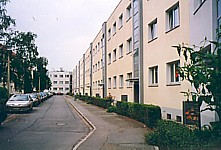1929 begann die Gemeinnützige Wohnungsbau-Aktiengesellschaft GEWOG mit dem Bau der ersten Wohnhäuser der von Hans Waloschek entworfenen [Trachauer Siedlung](../../../nordwest/trachau/trachauer_siedlung/). Bedingt durch die Machtübernahme der Nationalsozialisten, die den von Waloschek und Hans Richter propagierten modernen Architekturstil ablehnten, konnte die Anlage jedoch nicht wie geplant vollendet werden. Erst 1957/58 entstanden im Ostteil der Carl-Zeiss-Straße drei Wohnblocks, die sich jedoch nicht mehr am ursprünglichen Konzept orientierten. Auftraggeber war die Wohnungsbaugenossenschaft der Bezirksbehörde der Volkspolizei. Ein bereits vorbereiteter vierter Wohnblock an der Ecke Doppler-/Schützenhofstraße wurde nicht realisiert. Heute befindet sich auf dem Grundstück ein Garagenkomplex.

Die Cottbuser Straße entstand kurz vor der Jahrhundertwende und erhielt zunächst den Namen Schulstraße, da sich hier ab 1899 das Trachauer Schulhaus befand. 1904 erfolgte die Umbenennung nach der Stadt Cottbus. Früher befanden sich hier verschiedene Geschäfte und Gewerbebetriebe sowie das Restaurant “Schloß Moritzburg”, welches 1945 seine Pforten schloss (Nr. 19). Anschließend bezog ein Kindergarten die Räume. Im Nachbarhaus Nr. 21 wurde 1926 der Dresdner Kammersänger Theo Adam geboren. Auch das Gebäude Cottbuser Straße 31 beherbergte einst eine Gaststätte, welche 1905 als “Goldmanns Restaurant”, später als “Mittelschänke” bekannt war.

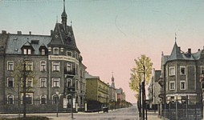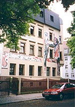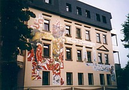

**_Fotos:_** _Eckhaus Nr. 19 “Schloss Moritzburg” um 1920 (links) -_

_Wohnhaus Cottbuser Straße 25 mit moderner Fassadenmalerei (mitte / rechts)_

Die 1898 angelegte Dippelsdorfer Straße verdankt ihren Namen dem kleinen Ort Dippelsdorf in der Nähe von Moritzburg. Bis zu Eingemeindung Trachaus 1904 wurde sie Lindenstraße genannt. Die Straße ist Teil der Gleisschleife der Straßenbahn an der Endstelle Wilder Mann.

Im Wohnhaus Dippelsdorfer Straße 6 lebte ab 1903 für zwei Jahre der Kunstmaler Karl Quarck (1869–1949), dessen Grab sich auf dem [Heidefriedhof](../../../nordost/dresdner_heide/heidefriedhof/) befindet. Quarck war Meisterschüler des Landschaftsmalers Friedrich Preller d. J. und später viele Jahre Vorsitzender des Deutschen Künstlerverbandes Dresden. 1905 verzog er zur heutigen Dorothea-Erxleben-Straße 5. Bemerkenswert ist auch die 1885 erbaute Villa Flora (Nr. 19).

Die Dopplerstraße bildet die Mittelachse der von Hans Richter und Hans Waloschek projektierten [Trachauer Siedlung](../../../nordwest/trachau/trachauer_siedlung/), die zu den wichtigsten Schöpfungen des sozialen Wohnungsbaus der Zwanziger Jahre gehört. Ihren Namen erhielt diese Straße 1929 nach dem österreichischen Physiker Christian Doppler (1803-1853), der auf dem Gebiet der Akustik und Optik forschte und den nach ihm benannten Doppler-Effekt entdeckte.

Ursprünglich waren für diesen Zentralbereich Reihenhäuser vorgesehen. Die ersten Gebäude entstanden bis 1931 nach Plänen von Hans Richter und Hans Waloschek (Nr. 1-5). 1934 entschied man sich für die Komplettierung durch mehrgeschossiger Wohnblocks in traditionellem Stil. 1999 wurde die Dopplerstraße zwischen Halley- und Carl-Zeiss-Straße neu gestaltet und wird seitdem für Wohngebietsfeste genutzt. Als Blickfang fand dort eine sechs Meter hohe, bewegliche Stahlplastik Aufstellung. Die "Doppelhelix" besteht aus zwei gegeneinander verlaufenden Spiralen und lässt sich durch eine leichte Bewegung am Schwungrad in Bewegung setzen.

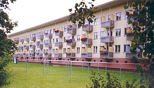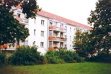

**_Fotos:_** _Die Wohnhäuser an der Dopplerstraße verdeutlichen die beiden Bauabschnitte der Trachauer Siedlung:_

_links eine Wohnzeile nach den Plänen Hans Richters - rechts ein 1934 entstandener Block im traditionellen Stil_

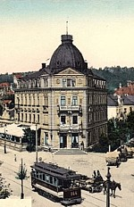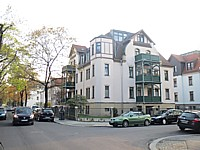Die Dorothea-Erxleben-Straße entstand Ende des 19. Jahrhunderts als Ahornstraße und erhielt 1895 offiziell ihren Namen. Um Verwechslungen mit gleichnamigen Straßen in anderen Stadtteilen zu vermeiden, wurde sie 1904 im Zuge der Eingemeindung Trachaus in Marsdorfer Straße umbenannt. Da es mit der Eingemeindung Klotzsches eine weitere Straße diesen Namens gab, entschied man sich 1953 für die Umbenennung in Georg-Wolff-Straße. Georg Wolff (\* 1906) war Mitglied der KPD, schloss sich im Zweiten Weltkrieg dem Nationalkommitee Freies Deutschland an und gehörte nach 1945 zu den Wegbereitern des sozialistischen Aufbaus in der DDR. Ab 1978 trug auch die Trachauer Schule (56. POS) seinen Namen. 1993 erfolgte die Umbenennung der Georg-Wolff-Straße in Dorothea-Erxleben-Straße. Diesen Namen erhielt sie nach der Ärztin Dorothea Christiane Erxleben (1715-1762), die 1754 als erste Frau in Deutschland den Doktortitel erwarb.

Das Eckhaus zur Großenhainer Straße (Nr. 1a) befand sich seit ca. 1910 viele Jahre die Gaststätte "Wettinschlößchen" _(Foto links)_. Heute werden die Räume als Filiale der Ostsächsischen Sparkasse genutzt. Im Haus Nr. 5 wohnte ab 1905 bis zu seinem Tod 1949 der Kunstmaler Karl Quarck _(Foto rechts)_. Er war Meisterschüler des Landschaftsmalers Friedrich Preller d. J. und viele Jahre Vorsitzender des Deutschen Künstlerverbandes Dresden. Quarck schuf vor allem zahlreiche Zeichnungen und Gemälde mit Darstellungen der Sächsischen und Böhmischen Schweiz. Ein Großteil seiner Werke befindet sich im Museum von Usti nad Labem.

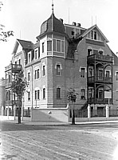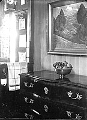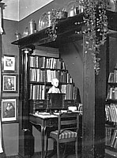

**_Fotos:_** _Das Wohnhaus von Karl Quarck (Nr. 5) und Aufnahmen der Wohnung des Künstlers_

Das Nachbarhaus Nr. 7, Villa Adelheid genannt, befand sich ab 1898 im Besitz des Fotografen Ernst Sonntag, der hier Wohnung und Atelier unterhielt. 1906 ließ er auf dem Grundstück ein weiteres Gebäude errichten, welches heute die Adresse Virchowstraße 32 hat. Ein Jahr später richtete er in dem von ihm erworbenen Haus Wilder-Mann-Straße 63 seine ["Vereinigten Fachschulen für Photographie"](../../../nordwest/trachau/strassen_trachau/wilder-mann-strasse/) ein.

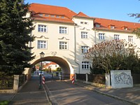Die nach 1900 angelegte Duckwitzstraße erhielt ihren Namen 1911 nach dem Dresdner Bankier Heinrich Eduard Duckwitz (1797–1858), der im 19. Jahrhundert einen großen Teil seines Vermögens in einer Stiftung „zur Begründung und Unterhaltung einer Versorgungsanstalt für alte oder hilfsbedürftige Bürger“ anlegte. Die bis zum Zweiten Weltkrieg bestehende Duckwitzstiftung war u.a. Eigentümer des als Altersheim genutzten Gebäudes [Friedrichstraße 34/36](../../../zentrum/friedrichstadt/strassen_friedrichstadt/friedrichstrasse/).

Zwischen 1929 und 1931 entstanden an der Duckwitzstraße nach Entwürfen des Architekten Paul Müller Reihenhäuser sowie der markante Kopfbau mit Durchfahrt zur Großenhainer Straße. Die Gebäude befanden sich zunächst im Besitz des Siedlervereins “Zur guten Hoffnung”, seit dessen Auflösung 1933 gehören sie zur kleinsten Dresdner Wohnungsgenossenschaft “Am Alten Weingut Wilder Mann”.

Die Eulerstraße wurde Ende der 1920er Jahre im Zusammenhang mit dem Bau neuer Siedlungshäuser angelegt. Ihren Namen erhielt sie im April nach dem Schweizer Mathematiker Leonhard Euler (1707-1783), der sich mit Algebra, Physik und Astronomie befasste. Die Gebäude entstanden zwischen 1929 und 1931 nach Entwürfen von Hans Waloschek.

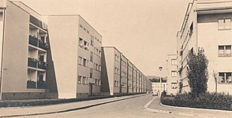Namenspatron dieser Straße im Westteil der Trachauer Siedlung war der bedeutende Physiker Joseph von Fraunhofer (1787-1826), der die nach ihm benannten “Fraunhoferschen Linien” entdeckte, die das Absorpionsverhalten von Sonnenstrahlen beschreiben. Zudem konstruierte er Fernrohre für mehrere Sternwarten, erfand eine Linsenschleifmaschine und das Heliometer und verbesserte zahlreiche optische Instrumente. Ihren Namen erhielt die Fraunhoferstraße am 20. Dezember 1929.

Die Wohnzeile Nr. 1-33 wurden zwischen 1929 und 1931 nach Plänen von Hans Waloschek errichtet, Nr. 2 stammt von Hans Richter. Nach dem Machtantritt der Nationalsozialisten änderten diese den Bebauungsplan und ließen die folgenden Gebäude auf der gegenüberliegenden Straßenseite (Nr. 4-38) zwischen 1934 und 1938 in Abweichung von Waloscheks Konzept in traditionellen Bauformen errichten.

Die Galileistraße entstand im Zusammenhang mit dem Bau der Trachauer Siedlung als Seitenstraße der Neuländer Straße und wurde in der Folgezeit mit Siedlungshäusern bebaut. Die Namensgebung erfolgte im April 1929, in Anlehnung an die Straßennamen der Trachauer Siedlung, nach einem berühmten Wissenschaftler. Galileo Galilei (1564-1642) entdeckte Fall- und Pendelgesetz und setzte sich für die Durchsetzung des Kopernikanischen Weltbildes ein, was ihm Verfolgung durch die Inquisition einbrachte. Ursprünglich sollte sie durchgängig bis zum Morseweg ausgebaut werden, was jedoch nicht umgesetzt wurde.

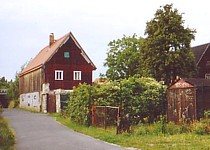Die Gaußstraße war ursprünglich ein alter Verbindungsweg des Dorfes Trachau nach
Norden und hieß ab 1880 Nordstraße. Zuvor wurde sie wegen ihrer Beschaffenheit im Volksmund Sandweg genannt. 1904 erhielt sie nach dem deutschen Mathematiker Karl Friedrich Gauß (1777-1855) den Namen Gaußstraße. Gauß gilt bis heute als einer der berühmtesten Mathematiker überhaupt und entdeckte zahlreiche neue mathematische Gesetze.

Ursprünglich nutzten verschiedene Gärtnereien die Flächen an der Gaußstraße, die bis heute ihr ländliches Bild weitgehend bewahren konnte. Im Haus Nr. 1 an der Ecke zur Straße Alttrachau befand sich vor dem Ersten Weltkrieg eine Schankwirtschaft, nach ihrer Inhaberin "Beuhnes Restaurant" genannt. Das zu den ältesten erhaltenen Gebäuden des Ortes gehörende Haus Nr. 4 _(Foto)_ entstand um 1650 abseits des Dorfkerns am “Dorffrieden”. Unweit der Industriestraße überspannt eine Brücke der Bahnstrecke Dresden - Leipzig die Straße.

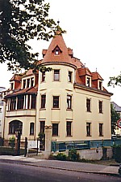
Die 1896 angelegte Geblerstraße erhielt ihren Namen nach dem Trachauer Unternehmer Johann Heinrich Moritz Gebler (1817-1879). Gebler besaß in Dresden eine Seifensiederei und gehörte zwischen 1859 und 1861 dem Stadtrat an. 1875 zog er nach Trachau und ließ sich hier ein Wohnhaus (Nr. 20) sowie die bis 1897 von seinem Sohn Moritz betriebene Ausflugsgaststätte [“Waldvilla”](../../../neustadt/leipziger_vorstadt/leipziger_strasse/) an der Leipziger Straße errichten. Der Gastwirt Felix Hermann Moritz Gebler wohnte im Haus Nr. 14 (Luisens Heim). Die Familiengrabstätte der Geblers befindet sich auf dem Inneren Neustädter Friedhof.

Zu dieser Familie gehörte auch der sächsische Offizier Heinrich Alwin Gebler, der 1895 die Dresdner Sand- und Kieswerke A. Gebler gründete und Besitzer der Villa Geblerstraße 20 war. Das 1874 entstandene Gebäude wurde früher auch als “Villa Sedan” bzw. “Villa Hedwig” bezeichnet und ist heute Domizil eines der ältesten noch bestehenden Dresdner Kindergärten. Die am 1. Juni 1926 eröffnete Einrichtung bot ursprünglich Platz für bis zu 100 Kinder aus den Stadtteilen Kaditz und Trachau. Heute trägt sie den Namen „Trachauer Spatzennest“.

Zu den Traditionsunternehmen Trachaus gehörte lange Zeit der Zierfisch-Zuchtbetrieb Härtel auf der Geblerstraße 6. Seit 1993 befindet sich auf dem Grundstück das Hotel „Dresden-Domizil“.

Die Gustav-Richter-Straße wurde Anfang der 1930er Jahre angelegt und am 27. September 1935 nach dem deutschen Flugzeugkonstrukteur Hugo Junkers (1859-1935) zunächst Junkersstraße genannt. Junkers gehörte zu den Wegbereitern des modernen Flugzeugbaus und war Inhaber der Junkers-Flugzeug- und Motorenwerke in Dessau. Am 15. Februar 1963 erhielt die Straße ihren heutigen Namen. Gustav Richter (1890-1942) war in Trachenberge und Pieschen als Mitglied der KPD im Widerstand gegen das Naziregime aktiv und wurde im Oktober 1942 in Berlin-Plötzensee hingerichtet.

Während im Westteil der [Trachauer Siedlung](../../../nordwest/trachau/trachauer_siedlung/) die Pläne der Architekten Hans Richter und Hans Waloschek weitgehend umgesetzt werden konnten, wurde der Ostteil erst nach 1933 errichtet. In bewusstem Bruch mit den an den Bauhausstil angelehnten Entwürfen Richters entstanden die Gebäude hier in traditionellen Bauformen. Die Planung oblag den Architekten Ernst Ufer und Kurt Müller. 1935 konnte der Wohnblock unmittelbar an der Straße vollendet werden, die Häuser zwischen Gustav-Richter- und Trobischstraße folgten 1937/38.

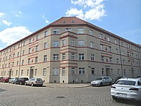Die Guts-Muths-Straße im alten Dorfkern Trachaus verdankt ihren Namen dem Pädagogen Johann Christoph Friedrich GutsMuths (1759-1839). GutsMuths war als Lehrer für Geografie, Französisch und Turnen am Philanthropinum in Halle tätig und engagierte sich vor allem auf dem Gebiet der Körpererziehung. Mit seinen Schriften “Gymnastik für die Jugend” und “Spiele zur Übung und Erholung des Körpers und Geistes” gehört er zu den Wegbereitern der Sportbewegung. Benannt wurde die Straße 1904. Zwischen 1926 und 1930 entstand für die Baugenossenschaft für Handwerk, Handel und Gewerbe zwischen Guts-Muths-Straße, Tichatscheckstraße und Alttrachau eine Wohnsiedlung _(Foto)_.

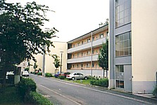Die Halleystraße in der [Trachauer Siedlung](../../../nordwest/trachau/trachauer_siedlung/) erhielt ihren Namen im Oktober 1930 nach dem englischen Astronomen Edmund Halley (1656-1742). Halley berechnete als erster die Umlaufbahn von Planeten. Nach ihm ist der 1758 von Johann Georg Palitzsch wiederentdeckte Halleysche Komet benannt.

Die an der Südseite der Halleystraße befindlichen Wohngebäude (Nr. 1-7, 9-13 und 15-19) wurden 1930/31 für die Wohnungsgenossenschaft GEWOBAG errichtet, wobei die Entwürfe von Hans Richter stammen. Charakteristisch sind die Laubengänge zur Straße, die durch kammartige Treppenhäuser unterbrochen werden _(Foto)_. Für die Häuser der gegenüberliegenden Straßenseite (Nr. 6-10), entstanden zwischen 1934 und 1936, zeichneten Ernst Ufer und Kurt Müller verantwortlich.

Die Henricistraße am Rande des Trachauer Dorfkerns trug ursprünglich den Namen Dorffrieden und hieß ab 1896 Schulgasse, da sie ihren Ausgangspunkt am 1873 eingerichteten ersten Trachauer Schulhaus (Alttrachau 52) hatte. Der seit dem 29. Juni 1900 gültige heutige Name erinnert an den früheren Kaditzer Pfarrer Karl Bernhard Henrici (1837-1924). Henrici besuchte die Fürstenschule in Grimma, war später als Geistlicher in Waldheim und Zwickau tätig und übernahm 1876 die Pfarrstelle in Kaditz. Zugleich war er viele Jahre Lokalschulinspektor für Trachau und Mitglied im örtlichen Schulvorstand.

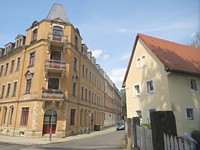Entstanden ist die Straße 1614, als der Trachauer Martin Schumann vom sächsischen Kurfürsten Johann Georg I. die Genehmigung zum Bau eines kleinen Hauses auf einem hier gelegenen Stück Acker bekam. Das Flurstück lag an der heutigen Abzweigung der Henrici- von der Leipziger Straße und wurde "Dorffrieden" genannt. Bis heute befindet sich hier das älteste erhaltene Haus Trachaus (Henricistraße 4), welches bereits 1642 entstand und bis 1887 noch mit Stroh gedeckt war.

Ende des 19. Jahrhunderts begann auch hier die großstädtische Bebauung. Als erstes Gebäude errichtete die am 10. März 1898 im Handelsregister eingetragene "Sächsische Baugesellschaft G.m.b.H." das mehrgeschossige Mietshaus Nr. 16. Wenig später verschwanden fast alle um 1860 entstandenen kleinen Bauernhöfe und Häusleranwesen. Ersetzt wurden diese zwischen 1902 und 1907 durch die Wohnhäuser Nr. 12-18, die teilweise Jugendstilornamentik aufweisen. Jüngster Neubau ist das erst nach 1990 erbaute Wohnhaus Henricistraße Nr. 13.

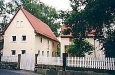

**_Foto:_** _Das älteste Trachauer Haus Henricistraße 4_

Die Hildesheimer Straße wurde kurz nach 1900 als Straße XI angelegt und 1904 nach der niedersächsischen Stadt Hildesheim benannt. Ursprünglich sollte sie Leipziger Straße und Dorfplatz Alttrachau verbinden, was jedoch nicht zustande kam. Als erstes Gebäude entstand hier 1902 das Wohnhaus Hildesheimer Straße 66, in dessen Erdgeschoss 1905 die Gaststätte “Zum Bahnhof Trachau” eröffnet wurde. Mehrfach wechselten die Besitzer, bevor das Lokal Anfang der 1930 Jahre schloss. 1935 übernahm die Kant-Apotheke die ehemaligen Gasträume.

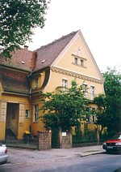1899 wurde parallel zum Bahndamm eine neue Straße angelegt, die den Namen Industriestraße erhielt. Gemäß dem Bebauungsplan der Gemeinde waren die Flächen zur Ansiedlung von Gewerbebetrieben vorgesehen. Allerdings ließen sich zunächst nur an der linken Straßenseite einige Unternehmen nieder, so die Fabrik für hölzerne Riemenscheiben Karthaus & Co. (Nr. 17), die Metalldruckwarenfabrik Hermann Neider, die Lackfabrik Otto Baer, die Loschwitzer [Tintenfabrik Leonhardi](../../../nordost/loschwitz/strassen_loschwitz/grundstrasse/tintenfabrik_leonhardi/) und die [Waffel- und Zuckerwarenfabrik Max Gerhardt](../../../nordwest/trachau/strassen_trachau/wilder-mann-strasse/) (Nr. 63). 1900 nahm an der Industriestraße 19 das [Trachauer Gaswerk](../../../nordwest/trachau/) seinen Betrieb auf.

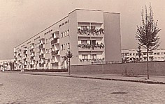Die gegenüberliegenden Flächen wurden noch bis Ende der 1920er Jahre landwirtschaftlich genutzt. Erst 1927 erwarb diese Freiflächen die Stadt Dresden, um hier das Städtische [Güntzheim](../../../nordwest/trachau/guntzheim/) als Alters- und Pflegeheim zu errichten. Seit 1945 dienen die Gebäude als Krankenhaus Dresden-Neustadt. Weitere Häuser entstanden zwischen 1929 und 1936 für die gemeinnützigen Baugesellschaften GEWOBAG und GEWOG und werden heute von der Wohnungsgenossenschaft Trachau-Nord vermietet _(Foto rechts)_. Auf dem Grundstück Nr. 6 entstand 1973 ein Kindergarten, der seit seiner Sanierung 2007 die kombinierte Kindertagesstätte "Sausewind" beherbergt. Eine weitere Kindertagesstätte, das Integrative Kinderhaus "Albert Schweitzer" befindet sich in der Villa Industriestraße 33 _(Foto oben links)_. Bis 1945 hatte hier die Firma Ernst Schrader KG ihren Sitz. Hergestellt wurden Bremsbeläge und sogenannte Stopfbüchsen, ein im Maschinenbau eingesetztes Dichtungsmaterial.

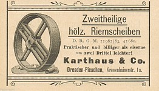Firma Julius Karthaus & Co: Das Unternehmen wurde 1898 von Julius Karthaus in Pieschen als „Fabrikation hölzerner Riemenscheiben“ gegründet und hatte seinen Sitz zunächst auf der Großenhainer Straße 1a. Bereits ein Jahr später erwarb der Firmengründer ein Grundstück am Bahndamm der Leipzig - Dresdner Eisenbahn und ließ hier auf der Industriestraße 17 neue Fabrikations- und Verwaltungsgebäude errichten und die für die Produktion notwendigen Holzverarbeitungsmaschinen aufstellen. Die Firma Karthaus existierte bis Ende der 1930er Jahre. Danach übernahm der Antriebsketten-Hersteller „Ketten-Kittner“, offiziell "Carl Kittner - Fabrik für Antriebsketten und Kettenräder" das Areal. Seit 1990 nutzt das „Sächsische Umschulungs- und Fortbildungswerk Dresden“ (SUFW) die Gebäude.

Die Jubiläumstraße wurde 1896 in Erinnerung an das in diesem Jahr gefeierte 25-jährige Jubiläum der Gründung des Deutschen Reichs benannt und führt von der Leipziger Straße zu den sogenannten Hufewiesen. 1943 wechselte die Schreibweise in die heute übliche "Jubiläumsstraße". Das Grundstück Jubiläumsstraße 5 wurde vor dem Zweiten Weltkrieg von der 1910 gegründeten Accumulatoren-Fabrik Oscar Müller (AFOM) genutzt.

Die frühere Hedwigstraße im Norden der Trachauer Flur wurde 1896 angelegt und zunächst nach der Gattin des Trachauer Gemeindeältesten Alwin Gebler benannt. Gebler war nach seiner Entlassung aus dem 3. Königlich-sächsischen Infanterie-Regiment Nr. 102 Besitzer der "Dresdner Sand- und Kieswerke AG". Die noch erhaltene Villa des Ehepaares (Geblerstraße 20) wird heute als Kindergarten genutzt. Um Verwechslungen mit einer gleichnamigen Straße der Leipziger Vorstadt zu vermeiden, erhielt die Trachauer Hedwigstraße nach der Eingemeindung des Ortes am 1. Januar 1904 den Namen Kleestraße. Die Namensgebung erinnert an den Pädagogen und Sprachwissenschaftler Julius Ludwig Klee (1807-1867), der viele Jahre Rektor der Dresdner Kreuzschule war und als Philologe am Deutschen Wörterbuch der Gebrüder Grimm mitarbeitete. Die Wohnhäuser Kleestraße 2, 4 und 6 entstanden ab 1929 für die Wohnungsbaugenossenschaft GEWOG nach Plänen von Hans Waloschek und gehören zur [Trachauer Siedlung](../../../nordwest/trachau/trachauer_siedlung/).

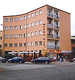Die Kopernikusstraße verdankt ihren Namen dem polnischen Astronomen Nikolaus Kopernikus (1473-1543), der als erster die These des sonnenzentrierten Planetensystems aufstellte und damit das Weltbild seiner Zeit revolutionierte. Erstmals benannt wurde sie im Dezember 1904.

Bereits Mitte der 1920er Jahre hatte eine Siedlungsgemeinschaft erfolglos versucht, die Flächen zwischen Kopernikusstraße und Schützenhofstraße für den Bau von Wohnhäusern zu erwerben. Zunächst konnte jedoch ab 1925 lediglich die sogenannte “Damaschke-Siedlung” des Heimstättenvereins zwischen Böttger- und Stephanstraße errichtet werden.

Erst ab 1928/29 entstand nach Überarbeitung des bestehenden Bebauungsplanes für Trachau ein ausgedehntes Neubauviertel durch die gemeinnützigen Wohnungsbaugesellschaften GEWOBAG und GEWOG. Die Entwürfe stammten von Hans Richter und Hans Waloschek und sorgten durch ihre am Bauhaus orientierten Formen für Aufsehen _(Foto)_. Die Gebäude erhielten meist Flachdächer und wurden bei erschwinglichen Mietpreisen mit Erkern, Wintergärten, Bädern, Fernheizung und Gemeinschaftseinrichtungen ausgestattet. Die [Trachauer Siedlung](../../../nordwest/trachau/trachauer_siedlung/) gehört zu den wichtigsten Beispielen des sozialen Wohnungsbaus in Dresden und steht wegen ihrer architektonischen Bedeutung seit 1985 unter Denkmalschutz.

Nr. 74: Zu den markanten Gebäuden der Trachauer Siedlung gehört das Eckhaus zur Industriestraße (Nr. 74), welches von Beginn an als Wohn- und Geschäftshaus konzipiert war. Hier gab es ab 1930 das Café & Konditorei Richter. Später wurden die Räume als Lindendrogerie genutzt. Heute gibt es hier mit dem "Mokka Eck" wieder ein Café.

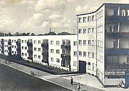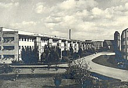

**_Fotos:_** _Die Trachauer Siedlung an der Industrie- und Kopernikusstraße kurz nach ihrer Fertigstellung um 1930_

Die Krantzstraße wurde 1935 angelegt und erhielt im Juni dieses Jahres den Namen des Musikwissenschaftlers und Professors für Musik Georg Eugen Krantz (1844-1898). Krantz war ab 1890 Direktor des Dresdner Konservatoriums und schrieb selbst verschiedene Streichquartette, Klavierstücke und Lieder. Die Wohnhäuser an der Krantzstraße 36/38 wurden Ende der 1930 Jahre durch den Gemeinnützigen Bauverein Dresden errichtet. Weitere Häuser folgten 1956/57.

Die Kronenstraße verbindet Aachener und Wahnsdorfer Straße und entstand 1899. Ihren Namen erhielt sie nach einer gleichnamigen Straße in Berlin, die Gründe dafür sind unklar. Die Wohnhäuser zwischen Aachener und Böttgerstraße entstanden ab 1927 nach Plänen von Paul Beck für den Gemeinnützigen Bauverein Gartenheim.

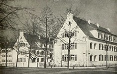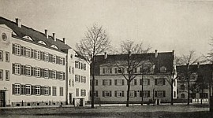

**_Fotos:_** _Siedlung des Gemeinnützigen Bauvereins Gartenheim zwischen Aachener und Böttgerstraße_

Der Lichtenbergweg wurde im März 1935 nach dem deutschen Physiker Georg Christoph Lichtenberg (1742-1799) benannt. Lichtenberg ist jedoch vor allem als Kunstkritiker, Satiriker und Verfasser zeitkritischer Aphorismen bekannt. Die Gebäude entstanden zwischen 1934 und 1936 nach Entwürfen von Ernst Ufer für die Baugenossenschaft GEWOBAG.

Die Maria-Kirch-Straße entstand 2017 auf dem Gelände einer ehemaligen Gärtnerei an der Neuländer Straße im Zuge des Baus einer Einfamilienhaussiedlung. Benannt wurde sie nach der Astronomin Maria Margaretha Kirch (1670-1720), die 1702 als erste Frau einen Kometen entdeckte. Trotz dieser Leistung wurde ihr auf Grund ihres Geschlechts eine Stelle an der Akademie der Wissenschaften Berlin verwehrt.

Die Micktner Straße geht auf einen alten Kommunikationsweg zwischen den Dörfern Trachau und Mickten zurück. In den 1880er Jahren wurde dieser Weg zur Straße ausgebaut und im Anschluss Micktner Straße benannt. Markantestes Gebäude ist der 2014 eingeweihte Neubau der [144\. Grundschule](../../../nordwest/trachau/).

An der Micktner Straße 10 entstand bis Sommer 2014 der Neubau der 144. Grundschule, des ersten neuen Grundschul-Standorts nach der Wende in Dresden. Am 10. Oktober 2014 wurde die neue Schule eingeweiht.\[2\] Früher standen an der Stelle eine Kindertagesstätte und Lagerhallen.

Der Morseweg, am Rande der sogenannten “Kriegerheimsiedlung” gelegen, erhielt seinen Namen 1932 in Erinnerung an den amerikanischen Erfinder Samuel Finley Morse (1791-1872), der 1837 den Morseapparat und das zugehörige Morsealphabeth zur Nachrichtenübermittlung erfand.

Der Name Neuländer Straße geht auf das Jahr 1661 zurück, als Trachauer Bauern die kurfürstliche Erlaubnis erhielten, hier zur Gewinnung neuer Ackerflächen den Wald zu roden. Das auch für den Weinbau genutzte Flurstück wurde als “die Neuländer” bezeichnet. Dieser Name ging 1905 auf die aus einem Forstweg hervorgegangene Straße über.

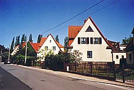Nach dem Ausbau entstanden hier und an den neu angelegten Seitenstraßen Wohnhäuser _(Foto)_. In einem dieser Häuser (Nr. 33b) besaß bis zum Ende des Zweiten Weltkriegs der Maler und Grafiker Rudolf Nehmer (1912-1983) sein Atelier. Regelmäßig traf er sich hier mit Künstlerfreunden wie Willy Wolff und Hans Jüchser.In der Nachkriegszeit wurde das Atelier als Kommandantur der sowjetischen Besatzer genutzt, wobei zahlreiche Frühwerke Nehmers verloren gingen. Der Künstler verzog deshalb zunächst nach Strehlen (Lenbachstraße 8) und lebte ab 1964 auf der Rostocker Straße 17 in Klotzsche.

Überregional von Bedeutung ist die an der Neuländer Straße 29 ansässige Zweigstelle des Berufsförderungswerkes Bau Sachsen e.V. Die ersten Gebäude entstanden 1936/37 als Lehrbaustelle der sächsischen Bauindustrie. Heute werden sie als Betonzentrum Dresden für Lehrgänge und Seminare im Betonbau genutzt.
2017 folgten auf dem Areal einer ehemaligen Gärtnerei zwischen Neuländer und Galileistraße mehrere Einfamilienhäuser, die die postalische Anschrift Maria-Kirch-Straße erhielten.

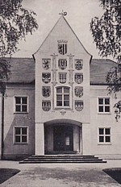Landeskriminalamt: Auf der gegenüberliegenden Straßenseite entstanden 1934/35 Dienstgebäude der Polizei. Zum zunächst als Gendarmerie-Unterkunft bezeichneten Komplex gehörten Mannschaftsunterkünfte, Speisesaal und verschiedenen Schulungsräume. Genutzt wurden diese u.a. als Schule für die Generalsstabsausbildung der Ordnungspolizei, als Polizei-Kraftfahrschule und Abrichteanstalt für Diensthunde.

Nach 1945 bezog zunächst bis 1954 eine Klinik für Unfallgeschädigte und Körperbehinderte das Areal. Ab Februar 1963 hatte hier die Zentrale Lehranstalt des Ministeriums des Inneren der DDR ihren Sitz. Aufgabe war die Ausbildung von Führungskräften für die Volkspolizei-Bereitschaftseinheiten. 1971 erhielt diese Einrichtung den Status einer Offiziershochschule und den Namen “Artur Becker” verliehen. Heute gehören die Gebäude zur Hochschule des Ministeriums des Inneren bzw. zum Landeskriminalamt Sachsen. Auch das sächsische Polizeiverwaltungsamt und weitere polizeiliche Behörden haben hier ihren Sitz.

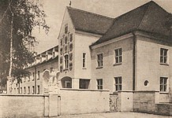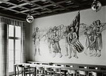

**_Fotos:_** _Mannschaftsgebäude und Speisesaal der Polizeischule um 1935 (Else Seifert - SLUB/Fotothek)_

Die heutige Pettenkoferstraße geht in ihrem Verlauf auf den alten Trachauer Kirchweg nach Kaditz zurück. Erst 1896 wurde dieser Fußweg zur Straße ausgebaut und zunächst Kirchgasse genannt. 1904 erfolgte die Umbenennung nach dem Professor für medizinische Chemie Max von Pettenkofer (1818-1901). Pettenkofer gilt als Begründer der experimentellen Hygiene und war zwischen 1890 und 1899 Präsident der Bayrischen Akademie für Wissenschaften.

Tabakfabrik Jedicke & Sohn (Nr. 10): Das Unternehmen entstand Ende des 19. Jahrhunderts als zweite Trachauer Zigarrenfabrik und wurde um 1900 unter der damaligen Anschrift Leipziger Straße 224 ins Handelsregister eingetragen. Besitzer waren die Brüder Hermann Otto und Robert Richard Jedicke. Unter deren Leitung entwickelte sich die Firma zu einem der zahlreichen Dresdner Hersteller von Zigarren und anderen Tabakwaren und blieb bis in die 1930er Jahre in Familienbesitz. 1936/37 endete die Produktion. Danach zogen hier eine Schneiderei und eine Kartonagenfabrik ein.

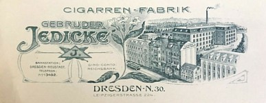

Nach 1945 wurden die Gebäude von einem Verpackungsmittelhersteller genutzt und 1953 bzw. 1957 erweitert. Später befand sich hier das Rechenzentrum der Staatlichen Versicherung der DDR. Nach Rückübertragung des Areals 1998 und Verkauf an einen Investor erfolgte ab 2010 der Umbau zu einer Wohnanlage. Das Konzept beinhaltete mehrere Wohnungen für Personen aller Altersgruppen und den Einsatz ökologischer Bauverfahren vor. 2013 erfolgte der Bezug des Mehrgenerationenhauses.

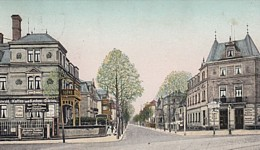Die Platanenstraße entstand 1895 und erhielt ihren Namen, da sie beim Bau mit Platanen bepflanzt wurde. Zeitgleich begann hier der Bau von Villen und Landhäusern. Im Eckhaus zur Großenhainer Straße (Nr. 1) befand sich einst eine Bäckerei und das Café Engelstädter. Bis heute werden die Räume gastronomisch genutzt. Im gleichen Gebäude betrieb Karl Engelstädter eine Bau- und Möbeltischlerei. Zu den jüngeren Gebäude gehört das Wohnhaus Nr. 20, welches 1941 für den Bauverein Kriegerfamilien-Heim mbH errichtet wurde. Das Bild (rechts) zeigt einen Blick in die Platanenstraße um 1900, links der "Kaffee- und Kuchengarten Engelstädter".

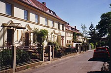Die Rahnstraße wurde Ende der 1920er Jahre an der Nordgrenze der Trachauer Flur angelegt und im Oktober 1927 benannt. Ihren Namen verdankt sie dem Pädagogen und früheren Vorsitzenden der “Literarischen Gesellschaft” Dr. Johannes Rahn (1850-1919), der sich der Förderung von Kunst und Geistesleben in Dresden widmete. Rahn war zugleich Mitbegründer des Allgemeinen Mietbewohnervereins Dresden. 1933 erfolgte die Umbenennung in Stranskystraße. Lorenz Ritter von Stransky-Griffenfeld (1899-1923) war 1923 beim nationalsozialistischen Putschversuch vor der Feldherrnhalle in München erschossen worden und galt als sogenannter "Blutzeuge" der Bewegung". Im Juli 1945 wurde die Namensgebung wieder rückgängig gemacht.

Zu den bemerkenswerten Gebäuden der Rahnstraße gehört das 1892/93 errichtete Wohnhaus Nr. 26 im englischen Landhausstil. Für den Bau verwendete man u. a. Steine, die beim Umbau der Wartburg in Eisenach übrig geblieben waren. Architekten des Gebäudes waren Julius Gäbler und sein Sohn Richard. Weitere Reihenhäuser entstanden in den Jahren nach dem Ersten Weltkrieg.

Die heutige Reichenberger Straße ist Teilabschnitt eines bereits im Mittelalter bestehenden Weges von Altendresden nach Reichenberg, jetzt ein Ortsteil von Moritzburg. Sie ist somit eine der ältesten Straßen der Gegend und wurde bereits 1495 als "Reicheberger steig" genannt. 1526 findet sich der Name "Reichenberger strasse" in alten Karten. 1898 erfolgte die amtliche Namensgebung.

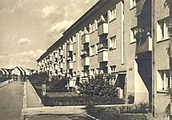Die Richard-Rösch-Straße entstand im Zusammenhang mit dem Bau der Trachauer Siedlung und wurde von 1930 bis 1946 Kirchhoffstraße genannt. Der Physiker Gustav Robert Kirchhoff (1824-1887) begründete gemeinsam mit Robert Bunsen die Spektralanalyse. Die im Bauhausstil gestalteten Wohnhäuser mit Flachdächern wurden 1929 vom Österreicher Hans Waloschek für die GEWOG (Gemeinnützige Wohnungs- und Heimstättengesellschaft für Arbeiter, Angestellte und Beamte) entworfen. Der Architekt selbst bezog eine Wohnung auf der Kirchhoffstraße 2.

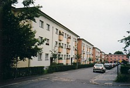Am 1. Juli 1946 erhielt die Kirchhoffstraße nach dem früheren Aufsichtsratsvorsitzenden der GEWOG den Namen Richard-Rösch-Straße. Richard Rösch (1874-1936) war 1922/23 Redakteur der Dresdner Volkszeitung und gehörte viele Jahre als Abgeordneter und Fraktionsvorsitzender der SPD dem Dresdner Stadtrat an. 1933 wurde er in seiner Wohnung Kirchhoffstraße 40 von den Nazis verhaftet und inhaftiert. In der Haft schwer erkrankt, verstarb er 1936 in Cunewalde bei Bautzen.

Im Erdgeschoss des Gebäudes Nr. 22 befand sich bis 1997 eine Verkaufsstelle der Dresdner Konsumgenossenschaft. Danach nutzte bis 2018 das Bürgerzentrum „ELSA“ die Räumlichkeiten, in denen es u.a. eine Bibliothek, Kurs- und Vereinsräume und Räume für Familienfeiern gab. Seit 2019 haben hier eine Kleinbrauerei und eine Physiotherapie ihr Domizil.

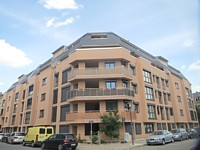Die Rietzstraße am Rande des alten Trachauer Dorfkerns verdankt ihren Namen dem Dirigenten Julius Rietz (1812-1877), der ab 1860 in Dresden als Hofkapellmeister wirkte. 1874 wurde Rietz zum ersten Generalmusikdirektor der Oper ernannt. Bis zur Eingemeindung Trachaus trug sie ab 1885 den Namen Rosenweg, von 1892 bis 1904 Rosenstraße, vermutlich wegen einiger hier beheimateter Rosenzuchtanlagen. Die rsten Gebäude entstanden Ende des 19. Jahrhunderts. In der Nr. 32 gab es vor dem Zweiten Weltkrieg eine Lebensmittelverkaufsstelle des Konsumvereins Vorwärts, im Nachbarhaus Nr. 34 an der Ecke zur Micktener Straße die Gastwirtschaft "Zur alten Post"G. Heute dient das frühere Lokal Wohnzwecken. Das Foto (links) zeigt das nach 1990 entstandene Wohnhaus Rietzstraße 38 an der Ecke zur Roßmäßlerstraße.

Wasserschlösschen (Nr. 14): Neben einigen Bauernhäusern ist auch das “Schlösschen” Rietzstraße 14 interessant _(Foto)_, welches einst Herrenhaus einer Ziegelei war. Ursprünglich gehörten die Flächen zu einem Viertelhufengut, dessen Eigentümer der Trachauer Johann Georg Birkenzöller war. 1802 wurde auf diesem Grundstück ein Ziegelofen sowie Wohn- und Wirtschaftsgebäude für den Ziegeleibetrieb errichtet. Nach Erschöpfung der Lehmvorkommen ließ der Besitzer, ein Kapitän von Witzleben, um 1815 den Betrieb einstellen und den Brennofen sowie die Ziegelscheune abreißen.

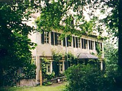Um 1830 wurde das erhaltene Wohngebäude vom neuen Besitzer Carl Heinrich Ferdinand von Petzinger zu einem Landhaus im Biedermeierstil umgebaut. Als einziges Gebäude Trachaus blieb es 1845 vom schweren Elbehochwasser verschont und wurde deshalb fortan auch “Wasserschloss” genannt. Trachauer Bauern sollen während der Flut hier ihr Vieh in Sicherheit gebracht haben. Später wechselten mehrfach die Besitzer, bis 1877 der Dresdner Gastwirt Johann Heinrich Wilhelm Hensel das Schlösschen erwarb. Hensel war Inhaber der Gaststätte "Zum Forsthaus" in der Kleinen Brüdergasse im Stadtzentrum und nutzte das Haus als Privatier bis zu seinem Tod 1905. Das Erdgeschoss hatte er 1901/02 an den Sozialdemokraten Wilhelm Buck (1869-1945) vermietet, der später von 1920 bis 1923 Ministerpräsident des Freistaates Sachsen war.

Nach Hensels Tod blieb das Grundstück zunächst im Besitz der Familie, die die Räume im Haupt- und Seitengebäude vermieteten. 1937/38 wurden einige Nebengebäude abgetragen, um Platz für Neubauten an der Krantzstraße zu machen. Am 25. Juni 1951 vernichtete ein Brand die Mansarden und große Teile des Dachstuhls. Ein Jahr später wurde das Haus leicht verändert wieder aufgebaut. Heute leben zwei bildende Künstler in der Villa und nutzen diese als Wohnung und Atelier. An das Grundstück grenzt eine kleine Parkanlage mit Kinderspielplatz.

Kleingartenverein „Paradies e.V.“: Der Verein wurde 1909 auf dem Grundstück Rietzstraße 14a gegründet und besitzt aktuell 68 Gärten. Außerdem gibt es ein Vereinsheim und eine öffentlicher Gaststätte.

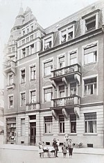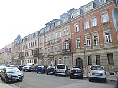Die 1899 angelegte heutige Roßmäßlerstraße wurde auf Beschluss des Trachauer Gemeinderates bis zur Eingemeindung Dammstraße genannt. Grund war, dass in diesem Bereich bei den häufigen Elbefluten regelmäßig Dämme angelegt wurden, um den Ort vor Hochwasser zu schützen. 1845 und auch 1890 hatten diese Dämme jedoch nicht standgehalten, so dass die Königliche Amtshauptmannschaft 1891 verfügte, die bereits zu diesem Zeitpunkt geplante Straße im Notfall per Schutzdamm abzuriegeln. Im Zuge der Eingemeindung Trachaus erhielt die Dammstraße 1904 ihren heutigen Namen nach dem Naturforscher und Forstwissenschaftler Emil Adolph Roßmäßler (1806-1867). Roßmäßler war ab 1830 als Professor an der Tharandter Forstakademie tätig und gehörte 1848/49 der Frankfurter Nationalversammlung an. 2003 wurde die Straße von der Wöhlerstraße bis zur Rietzstraße verlängert.

Die ersten Mietshäuser entstanden hier um 1900, darunter das vom Kaditzer Baumeister Emil Rösler gebaute markante Eckhaus zur Leipziger Straße. Im Erdgeschoss der Häuser Roßmäßlerstraße Nr. 14/16 befand sich bis in die 1960er Jahre ein Polizeirevier. In der Nr. 18 _(Foto)_ gab es bis 1925 das Dresdner Botanische Laboratorium für pharmazeutische Präparate. Jüngeren Datums ist das erst 1992 gegründete kleine Hotel "Windsor" (Nr. 13).

Trachauer Hof (Nr. 9): Gastronomischen Zwecken dient bereits seit vielen Jahrzehnten das Eckhaus zur Wöhlerstraße. Ursprünglich wurde das Lokal "Trachauer Hof" bzw. zeitweise “Zum Trachauer Stiefel” genannt. 2006 zog ein bis 2011 bestehendes philippinisches Nationalitäten-Restaurant ein ("TuroTuro"). Ihm folgten das Restaurant "Akropolis", das Bistro "Menu 9 International" und das im amerikanischen Stil gestaltete "Sam´s Diner".

Am südlichen Ende der Roßmäßlerstraße befand sich noch bis in die jüngste Vergangenheit Kleingärten. Eine dieser Lauben war während der NS-Zeit ein illegaler Treffpunkt Dresdner Widerstandskämpfer um den Sportler Heinz Steyer. 2003 wurde die Gartenanlage durch eine Neubusiedlung ersetzt.

Der Name der Schedlichstraße, einer 1927 benannten kurzen Seitenstraße der Neuländer Straße, erinnert an den Dresdner Rechtsanwalt Dr. Franz Emil Schedlich (1847-1890), der sich Ende des 19. Jahrhunderts für eine Verbesserung der Wohnverhältnisse einsetzte. 1883 gründete er den Allgemeinen Mietbewohnerverein, der an seine Mitglieder Baudarlehen vergab und Vorläufer der späteren Baugenossenschaften wurde.

Die Steinheilstraße in der Trachauer Siedlung erhielt ihren Namen 1935 nach dem Physiker und Mathematiker Carl August von Steinheil (1801-1870). Steinheil besaß in München eine Professur und gründete 1855 die optische Fabrik C. A. Steinheil & Söhne. Hier entwickelte er verschiedene Objektive und gehörte zu den Wegbereitern der modernen Fotografie. Die Wohnhäuser entstanden in den Jahren 1937-38.

Die Stephanstraße wurde 1896 zur Erschließung des Wohnviertels zwischen Böttgerstraße und Wilder-Mann-Straße (damals noch Moritzburger Straße genannt) angelegt und nach dem Generalpostmeister Heinrich von Stephan (1831-1897) benannt. Stephan gilt als Schöpfer des modernen einheitlichen Postwesens in Deutschland. Das Foto rechts zeigt das Wohnhaus Stephanstraße 62, links die Wohnzeile Nr. 54-58.

Im Haus Stephanstraße 38 wohnte bis zu seinem Tod 1973 der Volksschullehrer und Stadtarchivar Alfred Hahn (1888-1973). Hahn war viele Jahre an der 40. Volksschule in Trachau als Lehrer tätig und wirkte nach 1945 als Archivar des Dresdner Stadtarchivs. Außerdem verfasste er zahlreiche heimatkundliche Beiträge für verschiedene Tageszeitungen.

Die Teichstraße, seit 1901 so genannt, erinnert an die früheren Dorfteiche. Diese waren bis zur Trockenlegung letzter Rest eines alten Elbarmes und wurden nach Bau der Kanalisation Ende des 19.Jahrhunderts zugeschüttet. An dieser Straße entstanden um die Jahrhundertwende einige Mietshäuser, die nach 1990 saniert wurden. Bemerkenswert ist das unter Denkmalschutz stehende Wohnhaus Nr. 5, in dessen Treppenhaus sich Malereien der Entstehungszeit erhalten haben. Bis 1993 wohnte hier der Dresdner Maler Theodor Rosenhauer (1901-1996), an den seit 2001 eine Gedenktafel erinnert. Das Haus Teichstraße 7 wurde 1995 vom bekannten deutschen Model Claudia Schiffer erworben und saniert.

Die Tichatscheckstraße existierte ursprünglich nur auf Micktener Flur und führte Ende des 19. Jahrhunderts von der Leipziger Straße bis zur Rietzstraße. 1891 erhielt dieser Abschnitt nach örtlichen Gegebenheiten den Namen Gartenstraße. Da es nach der Eingemeindung Micktens diesen Straßennamen bereits in der Südvorstadt gab, erfolgte 1904 die Umbenennung in Tichatscheckstraße. Die Bezeichnung erinnert an den Opernsänger und Wagner-Interpreten Joseph Aloys Tichatscheck (1807-1886), der 32 Jahre dem Ensemble des Königlichen Hoftheaters angehörte und zu den bekanntesten Tenören seiner Zeit zählt. Tichatscheck wirkte bis zu seinem Bühnenabschied 1872 in über 1.600 Aufführungen mit und liegt auf dem Alten Katholischen Friedhof in der Friedrichstadt begraben.

Nach dem Ersten Weltkrieg wurde die Tichatscheckstraße bis Alttrachau verlängert. 1926-30 errichtete die Baugenossenschaft für Handwerk, Handel und Gewerbe den Wohnkomplex zwischen Tichatscheck-, Guts-Muths-Straße und Alttrachau. im Wohnhaus Nr. 14 wohnte viele Jahre der Micktener Baumeisters Gustav Richard Martin. Das Grundstück Nr. 19 war nach dem Zweiten Weltkrieg Produktionsort von Betonteilen für den verbreiteten DDR-Garagentyp "Dresden". Nach 1990 nutzte bis zum Abriss 2016 ein Getränkemarkt das Areal. 2017 entstanden hier drei Einfamilien- und ein Mehrfamilienhaus.

Der Trentzschweg entstand 1935 als Verbindungsweg zwischen Steinheilstraße und Halleystraße und wurde nach dem früheren Windmüller in Trachau, Karl Friedrich Trentzsch benannt. Trentzsch bewirtschaftete später auch die Gaststätte “Feldschlösschen” an der Leipziger Straße.

Die Trobischstraße in der Trachauer Siedlung erinnert an den Gutsbesitzer Johann Heinrich Trobisch (1843-1918), der zu den engagiertesten Gemeinderatsmitgliedern des Ortes gehörte. Trobisch war Besitzer des “Trobischhofes” in Alttrachau und stellte der Gemeinde das Schulgrundstück an der Böttgerstraße kostenlos zur Verfügung. Die Wohnhäuser der Trobischstraße wurden 1934-36 von Ernst Ufer und Kurt Müller im traditionellen Stil entworfen und besitzen teilweise interessanten baukünstlerischen Schmuck.

**_Fotos:_** _Reliefs mit Märchenmotiven “Rotkäppchen” und “Die Bremer Stadtmusikanten” an der Trobischstraße_

Die Veteranenstraße, eine kurze Sackgasse östlich von der Leipziger Straße abgehend, erhielt 1896 ihren Namen in Erinnerung an die Veteranen des Deutsch-Französischen Kriegs 1870/71. Dabei sollte wohl wie auch bei der benachbarten Jubiläumsstraße Bezug auf die Gründung des Deutschen Reichs genommen werden.

Die Virchowstraße entstand um 1900 im Zusammenhang mit der Erschließung eines neuen Wohnviertels an der Ortsgrenze zu Pieschen. Ihren Namen erhielt sie 1902 nach dem Naturforscher Rudolf Virchow (1821-1902), der zu den Mitbegründern der modernen Anthropologie und Ethnologie gehört. Ursprünglich führte sie von der Dippelsdorfer Straße nur bis zur heutigen Dorothea-Erxleben-Straße, wurde nach dem Ersten Weltkrieg jedoch bis zur Duckwitzstraße verlängert.
Die Wohnhäuser Nr. 27 und 28 gehören zur zwischen 1926 und 1928 entstandenen Siedlung Zur guten Hoffnung und wurden von Paul Müller entworfen.

Die Wahnsdorfer Straße im Norden der Trachauer Flur wurde ab 1897 bis zur Eingemeindung des Ortes Kyffhäuserstraße genannt. Ihren jetzigen Namen erhielt sie 1904 nach dem Radebeuler Ortsteil Wahnsdorf.

Die Weixdorfer Straße entstand kurz vor dem Ersten Weltkrieg und wurde im August 1914 nach dem Ort Weixdorf benannt, der seit 19999 als Ortschaft zu Dresden gehört. Ursprünglich war ein durchgehender Straßenverlauf von der Boxdorfer Straße bis zur Großenhainer Straße vorgesehen, letztlich blieb jedoch ein Stück nur Fußweg, der durch die Kleingartenanlage „Erdenglück e.V.“ führt. Ältestes Gebäude ist das bereits 1896/97 entstandene Mietshaus Nr. 17, welches dem Kaufmann Albert Rollhäuser gehörte und Auftakt zur Bebauung des Viertels um die Burgsdorffstraße war.

Die Ende des 19. Jahrhunderts südlich des Alttrachauer Dorfkerns angelegte Straße trug ab 1899 bis zur Eingemeindung den Namen Gohliser Straße. Grund war ihre Ausrichtung zu den am linken Elbufer gelegenen Dörfern Ober- und Niedergohlis. 1904 wurde sie in Wöhlerstraße umbenannt. Friedrich Wöhler (1800-1864) arbeitete als Professor für organische Chemie und entwickelte 1828 das Verfahren der Harnstoffsynthese. Mit seinen Versuchen gehört er zu den Wegbereitern der Biochemie und wurde für seine Verdienste international geehrt.

[Trachau auf OpenStreetMap](https://www.openstreetmap.org/search?query=Dresden+Trachau)

* * *

 \[ [Home](../../../index.html)\] \[ [Nord](../../../nord/)\] \[ [Nordwest](../../../nordwest/)\] \[ [Neustadt](../../../neustadt/)\] \[ [Nordost](../../../nordost/)\] \[ [West](../../../west/)\] \[ [Zentrum](../../../zentrum/)\] \[ [Südwest](../../../sudwest/)\] \[ [Süd](../../../sud/)\] \[ [Südost](../../../sudost/)\] \[ [Ost](../../../ost/)\] \[ [Register](../../../Register/register.html)\] \[ [Kontakt](../../../Kontakt/kontakt.html)\] \[ [Impressum](../../../impressum/)\]
