* * *

* * *

* * *

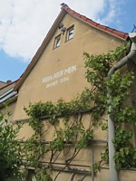

_Kleinstes Haus Alttrachaus (Nr. 3) "Klein aber mein"_

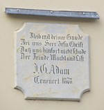

_Schrifttafel_

_Alttrachau 21_

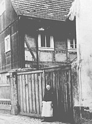

_Alttrachau 29 um 1915_

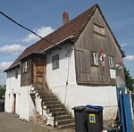

_Alttrachau 43_

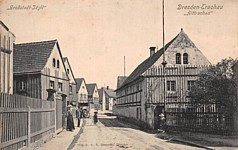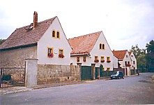Alttrachau ist Kern des ehemaligen Straßenangerdorfes. Um den Platz, an dem sich bis 1904 auch die beiden Dorfteiche, “große” und “kleine Pfütze” genannt, befanden, gruppieren sich die verbliebenen Gehöfte. Die Ostseite wurde um 1900 mit städtischen Mietshäusern bebaut. Bis zur Eingemeindung hieß der Platz mit der anschließenden Verbindungsstraße zur Eisenbahnunterführung Dorfplatz (heute Nr. 1-21) bzw. Hauptstraße (heute Nr. 23-58). Am 10. November 1883 wurde hier aus Anlass des 400. Geburtstages Martin Luthers in der Nähe des einstigen "Trachauer Ratskellers" eine noch heute vorhandene Luthereiche gepflanzt. 1920 folgte in einer kleinen Grünanlage ein Kriegerdenkmal für die Opfer des Ersten Weltkrieges, welches nach 1945 der Bilderstürmerei zum Opfer fiel und durch einen Kinderspielplatz ersetzt wurde. Zwischen 1926 und 1930 entstand der Wohnkomplex Alttrachau - Tichatschekstraße - Guts-Muths-Straße durch die Baugenossenschaft für Handwerk, Handel und Gewerbe. In unmittelbarer Nachbarschaft wurde 1993 eine weitere Wohnanlage errichtet.

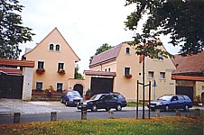Zu den historischen Gebäuden im alten Dorfkern gehören die unter Denkmalschutz
stehenden Gehöfte Nr. 7 und 41. Im Haus Nr. 7 lebte der frühere Trachauer Gemeindevorstand Carl Traugott Frantze. Eine Sandsteintafel am Giebel erinnert an den Dorfbrand vom 4. November 1866, der acht Bauernhöfe mit ihren Scheunen zerstörte. Ursache des Feuers war Brandstiftung. Der Täter, ein aus dem Ort stammender Gutsbesitzer, wurde ein Jahr später zu 20 Jahren Zuchthaus verurteilt. Bemerkenswert sind auch die Güter Nr. 17 mit einigen Hochwassermarken, Nr. 29 mit Laubengang sowie Nr. 13/15 mit einer alten Grenzsäule von 1799. Das kleinste Haus (Alttrachau 3) war einst Wohnung des Gemeindehirten und trägt am Giebel die Inschrift “Klein aber mein”.

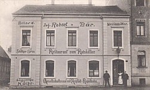Ratskeller Trachau: Das Gebäude Alttrachau 14 war einst Teil eines Bauerngehöftes, welches jedoch am 23. März 1888 mit Ausnahme des Wohnhauses bei einem Feuer zerstört wurde. Daraufhin beantragten dessen Besitzer, der Schuhmacher August Hirschhoff und seine Ehefrau Amalie Auguste, eine Schankgenehmigung und eröffneten am 28. August 1890 im Erdgeschoss eine Gastwirtschaft. Die Räume in der oberen Etage wurden vom Gemeinderat als Versammlungslokal genutzt, weshalb das Lokal den Namen “Trachauer Ratskeller” erhielt. Mit Bau des neuen Gemeindeamtes auf der [Wilder-Mann-Straße](../../../../nordwest/trachau/strassen_trachau/wilder-mann-strasse/) verlor das Haus seine Funktion, existierte jedoch bis 2010 unter wechselnden Besitzern als Gaststätte. Heute dient das Gebäude als Wohnhaus.

Nr. 27: Das heute nicht mehr vorhandene Anwesen befand sich, ebenso wie das Nachbargut Nr. 29, zu Beginn des 20. Jahrhunderts im Besitz von Johann Gottlieb Klotzsche, dessen Sohn Gottlieb Friedrich Max Klotzsche Inhaber eines Bauunternehmens an der Boxdorfer Straße 23 war. In den 1920er Jahren gehörte das Haus dem Handelsgärtner Hermann Schneider. Wegen seines schlechten Bauzustandes wurde das Gebäude Ende der 1970er Jahre abgerissen.

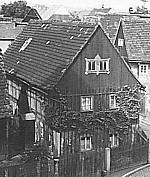Nr. 28: Auf diesem Grundstück befand sich einst das Geburtshaus des Antifaschisten Albert Hensel, der hier am 20. März 1895 zur Welt kam. Hensel schloss sich in den Zwanziger Jahren der KPD an und gehörte nach 1933 zur Widerstandsgruppe um Karl Stein, Fritz Schulze und Herbert Bochow. 1941 wurde er von der Gestapo verhaftet und am 5. Juni 1942 hingerichtet. An ihn erinnert die Albert-Hensel-Straße in Trachenberge. Hensels Geburtsthaus wurde in den 1970er Jahren abgerissen. Heute befindet sich hier die vom Verein „Hufewiesen Trachau“ betreute Gemeinschaftsanlage „Hensels Garten“.

**_Foto:_** _Alttrachau Nr. 28 um 1956 (Quelle: Stadtwiki Dresden / Archiv Brendler)_

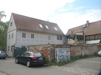Nr. 29: Das Gebäude an der Einmündung der Gaußstraße ist letzter Rest eines kleinen Zweiseitenhofes, zu dem bis zum Abbruch um 1950 früher noch eine Scheune gehörte. Um 1900 befand sich das Gut im Besitz der Familie Klotzsche. Nach dem Ersten Weltkrieg erwarb der Handelsgärtner Hermann Schneider das Anwesen, welches nach seinem Tod weiterhin von seiner Witwe bewohnt wurde. Die Erben vermieteten ab 1943 das Gebäude. Das wegen seines Laubengangs bemerkenswerte Fachwerkhaus steht als Kulturdenkmal auf der Denkmalliste, ist jedoch stark sanierungsbedürftig. 2019 begann die Sanierung.

Trobischhof: Das Gut Alttrachau Nr. 41 wird auch als Trobischhof bezeichnet, da es seit 1870 im Besitz dieser Familie war. Johann Heinrich Trobisch (1843-1913) war zeitweise Gemeindevorstand des Dorfes und stiftete den Bauplatz der [Apostelkirche](../../../../nordwest/trachau/apostelkirche/). Die vom einstigen Dreiseithof noch erhaltenen beiden Gebäude stammen von 1806 und 1886 und besitzen noch eine alte Weinlaube, eine Erinnerung an den früheren Weinbau in der Gegend. Nach erfolgter Sanierung wurde hier 1995 eine historische Gaststätte mit Pension eröffnet.

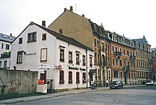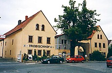

**_Fotos:_** _Alttrachauer Gaststätten - links der “Ratskeller”, rechts der Trobischhof_

* * *

 \[ [Home](../../../../index.html)\] \[ [Nord](../../../../nord/)\] \[ [Nordwest](../../../../nordwest/)\] \[ [Neustadt](../../../../neustadt/)\] \[ [Nordost](../../../../nordost/)\] \[ [West](../../../../west/)\] \[ [Zentrum](../../../../zentrum/)\] \[ [Südwest](../../../../sudwest/)\] \[ [Süd](../../../../sud/)\] \[ [Südost](../../../../sudost/)\] \[ [Ost](../../../../ost/)\] \[ [Register](../../../../Register/register.html)\] \[ [Kontakt](../../../../Kontakt/kontakt.html)\] \[ [Impressum](../../../../impressum/)\]
