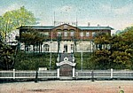
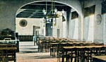
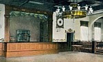
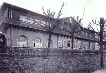
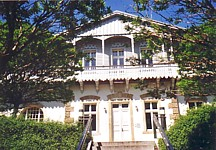
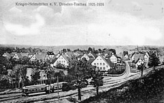
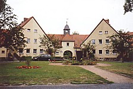
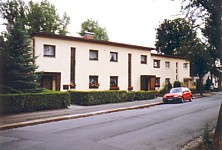

* * *

_Innenräume des Schützenhofs_

* * *

Die Schützenhofstraße führt entlang ehemaliger Weinberggrundstücke am Nordrand der Trachauer Flur. Ihren Namen verdankt sie dem früheren Schützenhof der Dresdner Privilegierten Scheibenschützengesellschaft. Der Verein, der nach 1830 sein bisheriges Übungsgelände in der Innenstadt verloren hatte, erwarb 1874 ein ehemaliges Weingut in Trachau und richtete auf dem Gelände den Schützenhof mit öffentlicher Gaststätte, Schießständen, Waffenkammer und Verwaltungsräumen ein.

Bis nach der Jahrhundertwende entstand ein aus mehreren Häusern bestehender Komplex, der beliebtes Ausflugsziel der Dresdner wurde. In dem im Landhausstil gestalteten Hauptgebäude gab es mehrere Gasträume, einen großen Saal sowie im zugehörigen Gästegarten einen überdachten Sommerballsaal. Die Gebäude wurden nach Auflösung der Scheibenschützengesellschaft 1945 u. a. als Studentenwohnheim genutzt. Heute hat hier die “Sächsische Landeszentrale für politische Bildung” ihren Sitz. Geplant ist der Ausbau des früheren Büchsenmacherhauses zum Buchlager und als Ausgabestelle für Literatur.

Gasthof zum Roten Ochsen: Die Gastwirtschaft entstand im 19. Jahrhundert auf dem Grundstück Schützenhofstraße 2. Bereits im 15. Jahrhundert befanden sich hier Weinberge, die so kuriose Namen wie “Roter Ochse” oder “Weiße Kuh” trugen, was auch die Namensgebung der Schänke erklärte. 1661 erweiterten Trachauer Bauern die Rebflächen auf das Gelände des späteren Schützenhofes. Erst um 1870 kam der Weinbau um Trachau endgültig zum Erliegen.

Villen: Mit Niedergang des Weinbergs gerieten die ehemaligen Rebflächen ins Visier wohlhabender Bürger, die hier um 1900 ihre Villen errichteten. So entstanden innerhalb weniger Jahre zahlreiche landhausartige Gebäude, deren Besitzer ihnen oft die Namen früherer Weinberge oder ihrer Ehefrauen gaben. Dazu gehören u.a. die Häuser Nr. 28 (Geyersberg), 30 (Villa Daheim), 56 (Villa Maria), 66 (Villa Bergschlößchen) und 72 (Giebelberg), die alle um 1900 errichtet wurden.

Kriegerheimsiedlung: Im westlichen Teil der Schützenhofstraße entstand bis Mitte der Zwanziger Jahre die sogenannte “Kriegerheimsiedlung”, welche die neu angelegten Straßen An der Böschung, An der Dürren Heide, Rodung und Baumwiesenweg einbezog. Entgegen den ursprünglichen Absichten der Siedler erhielten die neuen Straßen am 8. Juni 1923 ihre Namen nach örtlichen Flurbezeichnungen. Bereits im 16. Jahrhundert gab es im äußersten Norden der Trachauer Fluren die sogenannte “dürre Heide”, später auch als “Junge Heide” bezeichnet und einst Teil eines geschlossenen Waldgebietes zwischen Bühlau und Moritzburg.

 Erste Initiativen zum Bau einer Siedlung für ehemalige Weltkriegsteilnehmer in Trachau entstanden bereits 1918 mit der Gründung der “Freien Arbeitsgemeinschaft für Kriegersiedlungen - Ortsverband Dresden-Trachau”. Am 17. September 1921 erfolgte schließlich die Grundsteinlegung für diese erste Heimstättensiedlung Dresdens. Die 25 Doppelhäuser wurden vom Architektenbüro Schilling & Gräbner entworfen und als geschlossene Wohnanlage gestaltet _(Foto: Torhaus)_. Bauherr der Siedlung war der Allgemeine Sächsische Siedlerverband, der in den Neubauten vorrangig die Familien von Kriegsversehrten unterbringen wollte. Die feierliche Einweihung fand am 15. August 1926 statt. Im Zentrum der Anlage erinnert ein Gedenkstein an die Entstehungsgeschichte.

Siedlung “Sonnenlehne”: Die Siedlung wurde zwischen 1929 und 1930 für die Mitglieder der Siedlergemeinschaft “Sonnenlehne e.V” des Allgemeinen Sächsischen Siedlerverbandes errichtet. Die Entwürfe für die Reihenhäuser stammen von Hans Waloschek, der die Gebäude nach modernen städtebaulichen Prinzipien staffelte und mit Flachdächern versah. Insgesamt entstanden hier Wohnungen für 58 Familien.

**_Foto:_** _Häuser der Siedlung “Sonnenlehne” an der Schützenhofstraße_

Nr. 115: Hier wohnte bis zu seiner Übersiedlung in den Westen 1961 der Dresdner Arbeiterfunktionär Wilhelm Grothaus (1893-1965). Grothaus gehörte der SPD an und kam 1934 nach Dresden, wo er als Mitglied der Widerstandsgruppe um Georg Schumann 1944 verhaftet wurde. Beim Luftangriff auf Dresden gelang ihm die Flucht aus dem Gefängnis. Nach Kriegsende arbeitete Grothaus als Stadtkämmerer und Leiter des Personalamtes der Stadt, bevor er aus politischen Gründen in die Niedersedlitzer Firma ABUS zwangsversetzt wurde. Am 17. Juni 1953 gehörte er zu den Führern des Volksaufstandes, nach dessen Niederschlagung er zu 15 Jahren Zuchthaus verurteilt wurde. Nach seiner Entlassung verließ Wilhelm Grothaus die DDR und verbrachte seine letzten Lebensjahre in Herten/Westfalen.

* * *

 \[ [Home](../../../../index.html)\] \[ [Nord](../../../../nord/)\] \[ [Nordwest](../../../../nordwest/)\] \[ [Neustadt](../../../../neustadt/)\] \[ [Nordost](../../../../nordost/)\] \[ [West](../../../../west/)\] \[ [Zentrum](../../../../zentrum/)\] \[ [Südwest](../../../../sudwest/)\] \[ [Süd](../../../../sud/)\] \[ [Südost](../../../../sudost/)\] \[ [Ost](../../../../ost/)\] \[ [Register](../../../../Register/register.html)\] \[ [Kontakt](../../../../Kontakt/kontakt.html)\] \[ [Impressum](../../../../impressum/)\]
