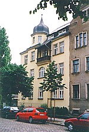
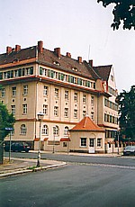
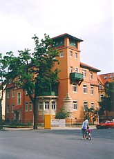
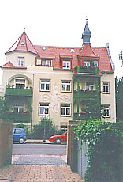

* * *

* * *

* * *

_Wilder-Mann-Straße 6_

_Wilder-Mann-Straße 29_

_(Hörmann-Villa)_

_Wilder-Mann-Straße 34_

_Wilder-Mann-Straße 47_

Die Wilder-Mann-Straße war einst Teil eines Weges, der vom Dorfkern auf die Weideflächen am Trachenberg führte und deshalb “Triebe” genannt wurde. Später wurde der Weg zum Fahrweg nach dem “Wilden Mann” ausgebaut und um 1890 Moritzburger Straße benannt. 1902 erfolgte die Umbenennung in Wilder-Mann-Straße.

 Als erstes Haus an dieser Straße entstand 1899 das Trachauer Gemeindeamt ( _Nr. 5 - Fotos um 1900 und 2010)_, welches zugleich Wohnhaus des Gemeindevorstandes war. Für die Bauausführung wurden der Trachauer Baumeister Carl Frey und der Dresdner Architekt Gustav Hänichen gewonnen. Die abseitige Lage vom Dorfkern war bewusst gewählt worden, um auch in diesem Gebiet die Bautätigkeit zu fördern. Bis zur Fertigstellung des neuen Gemeindeamtes hatte sich der Gemeinderat im “Goldenen Lamm”, im “Trachauer Ratskeller” und im Wohnhaus Alttrachau Nr. 1 getroffen. Nach der Eingemeindung des Ortes 1903 wurde das Gemeindeamt zunächst als Verwaltungsstelle des Stadtbezirks 13, Kassenstelle und Standesamt, später nur noch als Wohngebäude genutzt _(Foto links)_. Unmittelbar gegenüber errichtete der Dresdner Stadtbaurat Hans Erlwein 1912 das Wohnhaus Wilder-Mann-Straße 6/8. Bemerkenswert sind auch zahlreiche Villen an dieser Straße, die teilweise Jugendstilformen zeigen.

Einzelne Gebäude:

Zuckerwaren-Fabrik Max Gerhardt (Nr. 11/13): Das Unternehmen wurde 1896 als Schokoladen- und Zuckerwarenfabrik Max Gerhardt gegründet und hatte seinen Sitz zunächst auf der Hubertusstraße 29. Nach der Jahrhundertwende verlegte Gerhardt seine Produktion in das Hintergebäude Wilder-Mann-Straße 11-13 _(Foto rechts)_. Verkaufsfilialen gab es um 1910 u.a. auf der Leipziger Straße 110 und 210, später auch auf der Torgauer Straße 48 und der Cottbuser Straße 20. Hergestellt wurden verschiedene Süßwaren. Später konzentrierte man sich hauptsächlich auf Dauerbackwaren und Waffeln.

Platzgründe führten 1911 zur Aufgabe der Geschäftsräume und zur Verlagerung des Betriebs zur Kopernikusstraße 51. Neuer Inhaber war in der 1920er Jahren Hugo Meynert, nach dessen Tod seine Witwe Frieda. In den 1930er Jahren befand sich der Sitz der Firma auf der Industriestraße 63. Zu DDR-Zeiten wurde das Unternehmen zunächst als Betrieb mit staatlicher Beteiligung geführt und gehörte nach 1960 zum VEB Waffelfabrik Radebeul, danach zum Kombinat Dauerbackwaren Dresden. 1970 entschloss man sich, die Waffelbäckerei in den Gebäude der ehemaligen [Waffelfabrik Gebrüder Hörmann](../../../../nordwest/mickten/strassen_mickten/waffelfabrik_hormann/) zu konzentrieren. 1974 endete die Produktion an der Industriestraße und damit auch die Geschichte der Firma Max Gerhardt.

Nach dem Auszug der Zuckerwaren-Fabrik Max Gerhardt wurden die Räumlichkeiten auf der Wilder-Mann-Straße 11/13 zunächst ab 1913 von der Dresdner Werkzeugmaschinen-Fabrik Carl Auerbach & Sohn genutzt. 1917 übernahm die [Firma Melitta Bentz](../../../../nordwest/trachau/strassen_trachau/wilder-mann-strasse/melitta/) das Gebäude. Die Inhaberin hatte 1910 den Kaffeefilter erfunden, den sie ab 1914 in Trachau industriell herstellen ließ. Nach dem Einstieg ihres Sohnes Willy ändete sich der Firmenname in den Zwanziger Jahren in Filtrierpapier- und Kartonnagenfabrik Bentz & Sohn. 1929 verlegte das Unternehmen seinen Firmensitz nach Minden in Westfalen. Das Gebäude war später viele Jahre Schulhort der 56. Oberschule.

**_Fotos:_** _Wohnhäuser an der Wilder-Mann-Straße - links das von Erlwein entworfene Wohnhaus Nr. 6/8,_

_die Bilder in der Mitte und rechts zeigen typische Villen des Stadtviertels_

Nr. 18: Das zu den jüngeren Gebäuden der Straße gehörende Doppelhaus Nr. 18/18b an der Kreuzung mit der Cottbuser Straße wurde 1927-28 für den Dresdner Spar- und Bauverein errichtet.

Villa “Alpenstern” (Nr. 29): Die Villa der Ecke zur Kronenstraße entstand kurz vor dem Ersten Weltkrieg für den Unternehmer Max Ludwig Hörmann. Hörmann war Mitbegründer der Keks-, Waffel- und Schokoladenfabrik [Gebrüder Hörmann AG](../../../../nordwest/mickten/strassen_mickten/waffelfabrik_hormann/), die zu den bedeutendsten Firmen der Branche in Deutschland gehörte. Nach seinem Tod erwarb in den 1920er Jahren der [Sägewerksbesitzer Johann Lelansky](../../../../nordwest/mickten/strassen_mickten/) (Sternstraße 12) das Haus und nutzte es als Wohnung. Ab 1945 befand sich hier zeitweise die sowjetische Ortskommandantur für Trachau und Trachenberge. Später wurde das Gebäude als Möbellager genutzt und 1958 zum Kindergarten umgebaut. Bis 1995 diente die Villa als Kindertagesstätte, welche jedoch dann wegen bestehenden Rückübertragungsansprüchen am Grundstück geschlossen werden musste. Das zuletzt leerstehende Haus wurde 2008 saniert und beherbergt heute Eigentumswohnungen.

Nr. 57: Dieses Grundstück war einst Sitz des Bauhofes des Trachauer Baumeisters Carl Frey, der auf der nahen Platanenstraße wohnte und an zahlreichen Bauvorhaben im Ort beteiligt war. Gemeinsam mit dem Architekten Gustav Hänichen errichtete er u.a das Trachauer Gemeindeamt und das Rathaus Pieschen. Auch die Villen Wilder-Mann-Straße 43 und 45 stammen von ihm.

Vereinigte Fachschulen für Photographie und Malerei Ernst Sonntag (Nr. 63): Das Gebäude an der Ecke zur Schützenhofstraße befand sich ab 1907 im Besitz der Fotografen Ernst Julius Sonntag (1860-1928). Der aus Freiberg stammende Sonntag hatte in Dresden das Fotografenhandwerk erlernt und war danach bei mehreren Unternehmen der Branche tätig, u.a. als Operateur der Firma [Römmler & Jonas](../../../../zentrum/johannstadt/strassen_johannstadt/blasewitzer_strasse/rommler___jonas/). Ab 1884 betrieb er ein eigenes Atelier auf der Alaunstraße 14, welches er 1898 nach Trachau verlegte. Hier erwarb er die "Villa Adelheid" auf der Ahornstraße (heute Dorothea-Erxleben-Straße 7). 1906 ließ er auf seinem Grundstück ein weiteres Gebäude errichten (Virchowstraße 32).

Ein Jahr später richtete er in dem ebenfalls von ihm erworbenen Haus Wilder-Mann-Straße 63 seine "Vereinigten Fachschulen für Photographie und Malerei" ein. Bereits um 1890 hatte Sonntag diese Einrichtung gegründet, die sich als Werkstatt und Fachschule für alle Bereiche der Fotografie und der Malerei verstand. Leiter waren ab 1. Oktober 1910 der Fotograf J. Müller und der akademische Maler G. Matthes, die den Betrieb unter der Firmierung "Müller & Matthes, Vereinigte Fachschule für Photographie und Malerei" weitergeführten. Bereits im Folgejahr übernahm jedoch Ernst Sonntag wieder seine Fachschule.

Sonntag war jedoch auch selbst als Fotograf tätig und arbeitete zeitweise mit Hermann Krone zusammen. U.a. fertigte er künstlerische Fotos, mit denen er an verschiedenen Ausstellungen und Wettbewerben teilnahm. Zeitweise fungierte er als Preisrichter und produzierte Bildserien und Leporellos mit Dresden-Motiven. Ab 1907 war er Vorsitzender der "Sachverständigen-Kammer für Werke der bildenden Künste" und ab Anfang 1908 Mitglied des Sächsischen Photographen-Bundes.

* * *

 \[ [Home](../../../../index.html)\] \[ [Nord](../../../../nord/)\] \[ [Nordwest](../../../../nordwest/)\] \[ [Neustadt](../../../../neustadt/)\] \[ [Nordost](../../../../nordost/)\] \[ [West](../../../../west/)\] \[ [Zentrum](../../../../zentrum/)\] \[ [Südwest](../../../../sudwest/)\] \[ [Süd](../../../../sud/)\] \[ [Südost](../../../../sudost/)\] \[ [Ost](../../../../ost/)\] \[ [Register](../../../../Register/register.html)\] \[ [Kontakt](../../../../Kontakt/kontakt.html)\] \[ [Impressum](../../../../impressum/)\]
