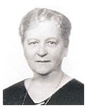
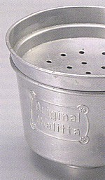
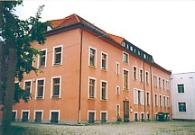

* * *

* * *

**Melitta Bentz**

**(1873-1950)**

* * *

Die Geschichte der Firma “Melitta” begann im Jahr 1908, als die Dresdner Hausfrau Melitta
Bentz  aus einem alten Messingtopf den ersten Kaffeefilter herstellte. Nach Durchlöchern des Bodens und dem Einlegen von Löschpapier gelang es ihr, den Kaffee so zu filtern, das der
störende Kaffeesatz nicht mehr in die Tassen gelangen konnte. Nach einigen Experimenten mit verschiedenen Papiersorten ließ Melitta Bentz am 15. Dezember 1908 ihr Unternehmen
ins Handelsregister eintragen und die Erfindung beim Reichspatentamt anmelden.

Obwohl das Familienunternehmen, welches sie gemeinsam mit ihrem Mann zunächst in ihrer
Wohnung auf der Marschallstraße 31 betrieb, nur über wenig Startkapital verfügte, gelang es schon bald, den neuartigen Filter in größeren Stückzahlen herzustellen und zu verkaufen _(Foto)_
. Zunächst wurden die Kaffeefilter in Handarbeit gefertigt, später als Auftragsarbeit in verschiedenen Handwerksbetrieben. Da die Wohnräume für das Unternehmen schnell zu
klein wurden, pachtete man 1914 eine ehemalige Schlosserei im Hinterhaus der Wilder-Mann-Straße 15 und richtete hier neue Produktionsräume ein. Nach dem Ersten
Weltkrieg zog die Firma auf das Nachbargrundstück (Nr. 11-13) um, wo mehr Platz zur Verfügung stand.

Zunächst wurden die Filter aus Aluminium, später auch aus Porzellan und Steingut hergestellt. Mitte der Zwanziger Jahre
waren bereits auf über 100.000 Kaffeefilter verkauft worden. Da das bisherige Areal in Trachau nicht erweitert werden
konnte, verlegten Hugo und Melitta Bentz ihr Unternehmen 1929 nach Minden in Westfalen, wo der Familienbetrieb bis
heute seinen Sitz hat. Neben der 1937 in ihrer heutigen Form entwickelten Filtertüte werden von der Firmengruppe
auch andere Haushaltsartikel wie Frischhaltefolien und Staubsaugerbeutel gefertigt. Außerdem ist das Unternehmen seit
1966 im Kaffeeverkauf tätig und besitzt die Markenrechte für Toppits, Swirl und Granini-Fruchtsäfte. Weltweit gehören derzeit ca. 3.200 Angestellte zur Melitta Unternehmensgruppe Bentz KG.

**_Foto:_** _Das frühere Stammhaus von “Melitta” auf der Wilder-Mann-Straße_

* * *

 \[ [Home](../../../../../index.html)\] \[ [Nord](../../../../../nord/)\] \[ [Nordwest](../../../../../nordwest/)\] \[ [Neustadt](../../../../../neustadt/)\]
 \[ [Nordost](../../../../../nordost/)\] \[ [West](../../../../../west/)\] \[ [Zentrum](../../../../../zentrum/)\] \[ [Südwest](../../../../../sudwest/)\]
 \[ [Süd](../../../../../sud/)\] \[ [Südost](../../../../../sudost/)\] \[ [Ost](../../../../../ost/)\] \[ [Register](../../../../../Register/register.html)\] \[ [Kontakt](../../../../../Kontakt/kontakt.html)\] \[ [Impressum](../../../../../impressum/)\]
