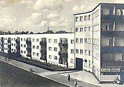
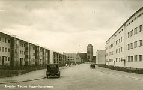
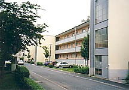
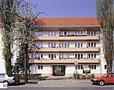
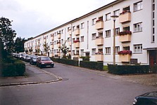

* * *

* * *

* * *

* * *

* * *

* * *

Erste Planungen zum Bau einer genossenschaftlichen Wohnsiedlung auf Trachauer Flur kamen bereits kurz nach dem Ersten Weltkrieg auf. 1921 versuchte der Allgemeine Sächsische Siedlerverband (ASSV) Flächen an der Aachener und Schützenhofstraße zu erwerben, um hier Wohnungen für Kriegsheimkehrer zu errichten. Da die Stadt Dresden den Antrag jedoch ablehnte, musste man auf das Gelände an der dürren Heide ausweichen, wo schließlich die sogenannte [Kriegerheimsiedlung](../../../nordwest/trachau/strassen_trachau/schutzenhofstrasse/) gebaut werden konnte. 1923 entstand eine weitere Wohnanlage des “Heimstättenvereins Damaschke-Siedlung” zwischen Böttger- und Stephanstraße.

1925 ließ das städtische Hochbauamt unter Leitung von Stadtbaudirektor Max Arlt eigene Pläne für dieses Areal erarbeiten. Vorgesehen war eine kleinteilige Bebauung zu beiden Seiten einer grünen Mittelachse. Später wurde in dieses Projekt noch das städtische [Güntzheim](../../../nordwest/trachau/guntzheim/) eingefügt, mit dessen Realisierung bereits 1927 begonnen wurde.

Im folgenden Jahr begannen auch die ersten Arbeiten in der eigentlichen Wohnsiedlung. Bauträger für das Wohnviertel waren die “Gemeinnützige Wohnungs- und Heimstättengesellschaft für Arbeiter, Angestellte und Beamte” (GEWOG) mit ihrem Geschäftsführer Richard Rösch, die “Gemeinnützige Wohnungsbau - Aktiengesellschaft Dresden” (GEWOBAG), die “Bauhütte Dresden” sowie der “Allgemeine Sächsische Siedlerverband - Siedlergemeinschaft Sonnenlehne e.V.” (ASSV). Als Architekten konnten Hans Waloschek und Hans Richter gewonnen werden, die die Gebäude in modernen sachlichen Formen in Anlehnung an den Bauhaus-Stil entwarfen. Hinzu kam das renommierte Dresdner Büro Schilling & Gräbner, welches die Bauten an der Aachener Straße gestaltete. Das obere Bild zeigt die Wohnblöcke an der Kopernikusstraße um 1930.

1929 wurde an der [Schützenhofstraße](../../../nordwest/trachau/strassen_trachau/schutzenhofstrasse/) der Grundstein für die ersten Häuser gelegt. Dabei handelte es sich um Einfamilien- Doppelhäuser in einheitlicher Gestaltung. Wegen der flachen Dächer der von Hans Waloschek entworfenen Gebäude wurden diese im Volksmund später auch als “Klein-Marokko” bezeichnet. Mehrgeschossige Wohnzeilen entstanden u.a. an der Richard-Rösch-Straße, Fraunhofer-, Carl-Zeiss- und Industriestraße. In diesem Bereich ist das ursprüngliche Konzept der Siedlung am besten zu erkennen. Architektonisch interessant sind auch die beiden Laubenganghäuser an der Halleystraße _(Foto rechts)_. Leider konnten die Arbeiten wegen der schlechten wirtschaftlichen Situation um 1930/31 nicht fertiggestellt werden. Auch der von Hans Richter entworfene Wohnblock Abbestraße blieb letztlich unvollendet.

 Mit Machtübernahme der Nationalsozialisten wurden alle Arbeiten sofort gestoppt. Erst 1934/35 konnten nach Überarbeitung der Bauunterlagen durch Ernst Ufer weitere Häuser errichtet werden. In bewusster Abkehr von Richters und Waloscheks modernen Entwürfen erhielten die neuen Häuser traditionelle Steildächer und plastischen Schmuck über den Hauseingängen. Dabei orientierte man sich an dem durch die Architekten Schilling & Gräbner entworfenen Wohnblock Aachener Straße _(Foto links)_. Um Kosten zu sparen, wurden die neuen Gebäude nicht mehr mit Fernheizung, sondern wieder mit Öfen ausgestattet. Neben Ernst Ufer waren auch Kurt
Müller und Willimartin Romberger an den Planungen beteiligt. Bis zum Beginn des Zweiten Weltkrieges entstand so der östliche Bereich der Trachauer Siedlung zwischen Doppler- und Aachener Straße, der Komplex am Lichtenbergweg sowie die Wohnhäuser nördlich der Halleystraße.

Von den schweren Luftangriffen auf Dresden blieb die Trachauer Siedlung weitgehend verschont. Lediglich die Häuser Industriestraße 58 und 60 wurden beschädigt, konnten jedoch schon bald wieder aufgebaut werden. Als eine der letzten Baumaßnahmen folgten 1957 drei Wohnblöcke an der Carl-Zeiss-Straße für die Arbeiterwohnungsbau-Genossenschaft des Ministeriums des Inneren. Bereits 1948 waren die übrigen Wohnungen der Trachauer Siedlung an die Kommunale Wohnungsverwaltung der Stadt Dresden übertragen worden.

Bedingt durch die DDR-Baupolitik, die vorrangig Plattenbauten auf neu erschlossenen Flächen förderte, fehlten bis 1989 die Mittel zur Erhaltung der vorhandenen Gebäude. Dadurch verschlechterte sich der Bauzustand der Trachauer Siedlung immer mehr. Trotzdem wurde die Gesamtanlage als wichtiges Zeugnis des sozialen Wohnungsbaus 1985 unter Denkmalschutz gestellt.

Durch die veränderten Rahmenbedingungen nach 1989 entschloss man sich zur Gründung einer Wohnungsgenossenschaft, die am 5. März 1994 erfolgte. Nach Verhandlungen mit der Wohnbau NordWest GmbH übernahm die Wohnungsgenossenschaft Trachau-Nord e. G. 1996 die Trachauer Siedlung mit ca. 1.770 Wohnungen und ließ die Gebäude in den folgenden Jahren umfassend sanieren. Dabei konnte zum Großteil der ursprüngliche äußere Zustand wiederhergestellt werden. Das Bild rechts zeigt einen Blick in die Richard-Rösch-Straße.

* * *

 \[ [Home](../../../index.html)\] \[ [Nord](../../../nord/)\] \[ [Nordwest](../../../nordwest/)\] \[ [Neustadt](../../../neustadt/)\] \[ [Nordost](../../../nordost/)\] \[ [West](../../../west/)\] \[ [Zentrum](../../../zentrum/)\] \[ [Südwest](../../../sudwest/)\] \[ [Süd](../../../sud/)\] \[ [Südost](../../../sudost/)\] \[ [Ost](../../../ost/)\] \[ [Register](../../../Register/register.html)\] \[ [Kontakt](../../../Kontakt/kontakt.html)\] \[ [Impressum](../../../impressum/)\]
