* * *

**Gemeindesiegel von Trachenberge**

**Sonntagsspaziergang rund um Trachenberge**

**Stadtteilführungen jeden zweiten Sonntag im Monat**

**Tour I: ungerade Monate**

**Tour II: gerade Monate**

**Treffpunkt: 10.30 Uhr am  “Café Genuss” Trachenberger Str. 72**

**Preis: 7,00 Euro**

**(inkl. Getränk und Gebäck)**

**Anmeldung:**

**Tel. 0351/8748273**

**Trachenberger Geschichten-Café**

**Vortragsreihe zur Geschichte Trachenberges**

**Termine unter:** [**www.pressebuero-naumann.de**](http://www.pressebuero-naumann.de)

* * *

**Vereine in**

**Trachau/Trachenberge:**

[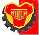](http://www.motor-trachenberge.de)

[**Homepage der   SG Motor Trachenberge**](http://www.motor-trachenberge.de)

* * *

**Schulen in Trachenberge:**

* * *

**Privater Kindergarten in Trachenberge:**

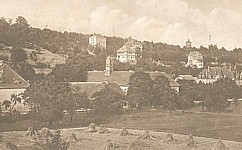Die Fluren des heutigen Stadtteils Trachenberge waren ursprünglich im Besitz
des Landesherren und fast völlig mit Wald bedeckt. Lediglich an den Hängen der Hellerberge wurde schon seit dem 15. Jh. Wein angebaut. Erstmals erwähnt sind diese Weinberge im Abrechnungsbuch des Amtes Dresden aus
dem Jahr 1446. Besitzer waren meist kurfürstliche Beamte, Adlige und wohlhabende Dresdner Bürger. Hinzu kam ein größeres Flurstück westlich der Großenhainer Straße, welches dem Neustädter Augustinerkloster
gehörte. Die als “Brüchigt” bezeichneten Flächen zu Füßen der Trachenberge konnten als Reste früherer Elbarme wegen ihres sumpfigen Untergrundes kaum genutzt werden.

Um 1600 begann die zunehmende Rodung der bewaldeten Hänge zugunsten weiterer Rebflächen, die bis 1670 weitgehend abgeschlossen war. Neben dem [Hellergut](../../nord/hellerau/hellerschanke/) entstanden die “Baumwiese” auf Boxdorfer Flur sowie das Strobelsche Weingut als Mittelpunkt größerer Gutswirtschaften. An zwei Weingüter erinnern noch heute die Namen Wilder Mann und [Hechtviertel](../../neustadt/leipziger_vorstadt/hechtviertel/). Auch der Straßenname [Neuländer Straße](../../nordwest/trachau/strassen_trachau/) hält bis heute die Erinnerung an diese Zeit
wach. Erhalten blieb auch das [“Weinbergschlösschen”](../../nordwest/trachenberge/strassen_trachenberge/döbelner_strasse/) an der Döbelner Straße 24, welches ursprünglich zum
Wertherschen Weinberg gehörte und im 19. Jahrhundert zu einem schlossähnlichen Herrenhaus umgebaut wurde.

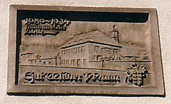Eines der ältesten Gebäuden in Trachenberge war das Weingut [Wilder Mann](../../nordwest/trachenberge/wilder_mann/) an der Döbelner Straße **_(Foto:_** _Gedenktafel am Haus Nr. 110)_. 1680 wurde dieses Gut erstmals erwähnt und bildete zwischen 1722 und 1897 einen selbstständigen Gutsbezirk. Zu dessen Fluren gehörte auch ein früher
Jeßnitz genannter Weinberg in der Nähe des St.-Pauli-Friedhofes, der um 1930 mit Wohnhäusern bebaut wurde. Weitere Weinberge, so der Taubesche Berg an der Kändlerstraße und der Friesensche Weinberg östlich
der Drachenschlucht, wurden nach 1756 parzelliert und an Pieschener Häusler zur Nutzung abgegeben. Wenige Jahre zuvor hatte es hier im Juni
1753 noch ein großes Manöver der sächsischen Armee gegeben, an welchem u. a. Prinz Xaver mit seinem Stab teilnahm. Während des Siebenjährigen Krieges campierten österreichische Soldaten in den Weinbergen und richteten
dabei schwere Verwüstungen an.

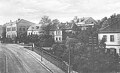
Die stärkere Besiedlung der Trachenberge begann erst um 1800. In den zu dieser Zeit durch Verkäufe und Erbteilungen bereits stark zersplitterten Weinbergen siedelten sich zunehmend landarme Bauern, Häusler,
Gärtner und besitzlose Landarbeiter an. Diese gründeten schon bald kleine Gemeinschaften, um bestimmte Aufgaben wie den Erhalt der Weinbergsterrassen und den Brunnen- und Wegebau gemeinsam erledigen
zu können. Am 26. November 1812 wurden die verstreuten Anwesen durch eine “Instruktion für den Richter in den Trachenbergen” zu einer Amtskommune  zusammengeschlossen, die 1839 den Status einer Landgemeinde erhielt.

Mitte des 19. Jahrhunderts entstanden an der Döbelner und der [Großenhainer Straße](../../neustadt/leipziger_vorstadt/grossenhainer_strasse/) neue Villenviertel, die
Trachenberge zeitweise zu einer beliebten Sommerfrische machten. Die Bevölkerung wuchs, begünstigt durch die Industrialisierung in den Nachbarorten, deutlich an. Dieses führte nach 1890 zum Rückgang und schließlich zur
gänzlichen Einstellung des Weinanbaus an den Hängen der Trachenberge.

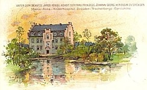Gegen Ende des 19. Jahrhunderts begann die Stadt Dresden an dieser
Stelle einige [Sozialeinrichtungen](../../nordwest/trachenberge/trachenberge_-_sozialeinrichtu/) anzulegen _(Bild rechts: Maria-Anna- Kinderhospital)_
. Als vorteilhaft wurden die ruhige Lage und die günstigen klimatischen Verhältnisse angesehen. Außerdem siedelten sich auf den Freiflächen zwischen dem Ort und dem Pieschener Ortskern mehrere
Gärtnereien an. Am 1. Juli 1897 wurde Trachenberge gemeinsam mit dem Wilden Mann und den [Hellerbergen](../../nord/) nach Dresden eingemeindet wurde.
Bereits seit 1876 besaß der Ort eine eigene Schule und ab 1915 mit der [Weinbergskirche](../../nordwest/trachenberge/weinbergskirche/) auch eine eigene Kirchgemeinde. In den 20er und 30er Jahren und ab 1974 entstanden nördlich der
Großenhainer Straße weitere Wohnviertel. Große Teile des Areals des früheren Weinbergs “Wilder Mann” nimmt seit 1923 eine gleichnamige [Kleingartensparte](../../nordwest/trachenberge/wilder_mann/) ein.

Wichtigstes gewerbliches Unternehmen war seit 1891 der Straßenbahnhof Trachenberge, in dem auch die ersten Fahrzeuge der Straßenbahn gebaut wurden. Am 17. Juli 1891 begann der Bau des Depots, welches zunächst als
Domizil für 30 Pferdebahnwagen und ca. 190 Zugpferde diente. Nachdem am 31. Juli 1900 die letzte Pferdebahn
eingerückt war, fanden hier die elektrischen Bahnen Unterkunft. Mehrfach erfolgten Erweiterungen und Umbauten des Areals. Der bis heute genutzte Betriebshof an der Trachenberger Straße ist zugleich Sitz des Dresdner [Straßenbahnmuseums](../../nordwest/trachenberge/strassenbahnmuseum/) _(Foto)_. Außerdem unterhalten die DVB hier ihre zentrale Leitstelle und die gesamte Verwaltung.

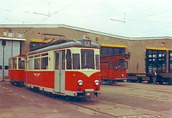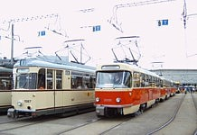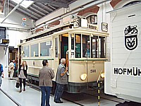

**_Fotos:_** _Straßenbahnhof Trachenberge mit Straßenbahnmuseum_

Gemeindeamt:

Sitz des Trachenberger Gemeindeamtes war bis zur Eingemeindung des Ortes das Haus Hermannstraße 50 (Döbelner Straße 4). welches heute nicht mehr existiert. Unweit davon befand sich das 1888 errichtete Spritzenhaus der örtlichen Feuerwehr. Der im Stil der Erbauungszeit gestaltete historisierende Bau ist eines der wenigen noch erhaltenen Spritzenhäuser in Dresden und steht unter Denkmalschutz. Heute wird es als Wohnung genutzt.

Schulen in Trachenberge:

Alte Schule: Das erste Schulhaus errichtete die Gemeinde Trachenberge 1876 an der Döbelner Straße Nr. 8/10. Die Finanzierung unterstützte der im sogenannten “Weinbergschlösschen” an der Döbelner Straße 24 lebende wohlhabende Pensionär Friedrich Hermann Müller, welcher seinem Heimatort 3.100 Taler für den Grundstückskauf und den Bau des Gebäudes zur Verfügung stellte. Die Grundsteinlegung für diese Schule erfolgte am 27. September 1875. 2004 wurde sie zugunsten des Erweiterungsbaus (Haus D) und einer Sporthalle des Beruflichen Schulzentrums für Gesundheit und Sozialwesen "Karl August Lingner" abgerissen. Teile des Altbaus sind in das neue Gebäude integriert. Hier befinden sich u.a. eine Lehrküche, Räume für die Bewegungserziehung und für Textilarbeit.

147\. Grundschule: Die Gebäude auf dem Grundstück Döbelner Straße 4 enstanden zwischen 2015 und 2017. Einbezogen wurde eine bereits bestehende Turnhalle. Die Eröffnung der neuen Schule erfolgte zu Beginn des Schuljahres 2017/18.

28\. Grundschule: 1882/83 entstand an der Döbelner Straße ein weiteres Schulgebäude, bevor im Jahr 1900 der auf Pieschener Flur durch die Stadt Dresden errichtete Neubau an der Marienhofstraße (Maxim-Gorki-Straße) 39 bezogen werden konnte. 1919 wurde diese als 28. Volksschule in das Städtische Schulnetz eingegliedert. Zu DDR-Zeiten trug diese Schule den Namen 28. POS “Otto Buchwitz”. Am 1. September 1981 wurde auf dem neu gestalteten Schulhof eine von Lothar Breitkopf gestaltete Büste des SPD-Politikers enthüllt.

Im Zuge der Umgestaltung des Schulsystens nach 1989 wurde die 28. POS im Jahr 1991 zur 28. Grundschule. Nach deren Schließung im Jahr 2000 fand hier das im März 2007 eingeweihte Berufsschulzentrum für Gesundheit und Sozialwesen “Karl August Lingner” sein Domizil. Hier werden u.a. Arzthelferinnen, Zahntechniker und Pflegekräfte ausgebildet. Im Zusammenhang mit dem Einzug dieser Bildungseinrichtung erfolgte eine umfassende Sanierung des Schulgebäudes, welches an der Rückseite um einen modernen Neubau ergänzt wurde. Dieser war erster Schulneubau nach 1990 in Dresden.

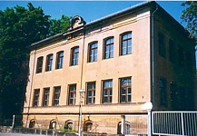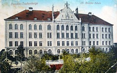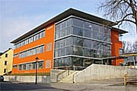

**_Fotos: Trachenberger Schulen_** _\- links das alte Schulgebäude auf der Döbelner Straße 8,_

_in der Mitte die frühere 28. Grundschule auf der Maxim-Gorki-Straße 39, rechts der Schulneubau von 2005_

Postwesen in Trachenberge:

Die erste Postagentur des Ortes entstand 1883 in einem Wohnhaus auf der damaligen Hermannstraße (heute Döbelner
Straße 21). Im Zusammenhang mit dem wenige Wochen später durchgeführten Sächsischen Bundesschießen im Schützenhof  richtete man auch ein Telegraphenamt ein. Nach der Eingemeindung Trachenberges wurde dieses Postamt
als Dresden N 23 bezeichnet und existierte bis 1900.

Im Anschluss verlegte man das Postamt in die Erdgeschossräume des Doppelhauses Marienhofstraße 87. 1914 erfolgte
ein erneuter Umzug zur verkehrsgünstigeren Großenhainer Straße 149. Dieses Gebäude war kurz zuvor von einer
privaten Baugesellschaft im Auftrag der Reichspost errichtet worden und steht heute unter Denkmalschutz. Auch das
Nachbargrundstück wurde seit 1929 für postalische Zwecke genutzt. 1999 wurde dieses Postamt geschlossen und durch eine Filiale in einem nahegelegenen Schreibwarenladen ersetzt.

Kleingartenverein “Frischer Wind”:

Die Gartensparte wurde 1947 auf einem gerodeten Waldstück der Jungen Heide angelegt und sollte vorrangig der besseren Versorgung der Bevölkerung in den
schweren Nachkriegsjahren dienen. Erst später erhielten die Gärten Strom- und Wasseranschluss, ein Spartenheim und eine Kegelbahn. Nach 1990 mussten einige Gärten dem Ausbau
der Autobahnauffahrt weichen. Als Ersatz konnten benachbarte Flächen an der Kalkreuther Straße erworben werden.
Seit 1994 befindet sich das gesamte Grundstück im Besitz der Spartenmitglieder, um einer künftigen Bebauung des Areals an der Autobahn vorzubeugen.

## [Trachenberger Straßen](../../nordwest/trachenberge/strassen_trachenberge/)

[_Weiterführende Literatur und Quellen:_](../../impressum/quellenverzeichnis/)

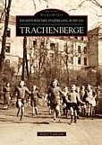**Buchtipp: Jürgen Naumann “Ein historischer Spaziergang rund um Trachenberge”, Sutton Verlag Erfurt (ISBN 978-3-86680-947-5)**

Der Bildband zeigt zahlreiche historische Aufnahmen des Stadtteils und seiner Umgebung aus dem 19. und 20. Jahrhundert und wurde von Jürgen Naumann
verfasst. Texte mit historischen Hintergründen ergänzen die Bilder. Interessierte können das Buch für 18,95 Euro im Buchhandel erwerben.

 \[ [Home](../../index.html)\] \[ [Nord](../../nord/)\] \[ [Nordwest](../../nordwest/)\] \[ [Neustadt](../../neustadt/)\] \[ [Nordost](../../nordost/)\] \[ [West](../../west/)\] \[ [Zentrum](../../zentrum/)\] \[ [Südwest](../../sudwest/)\] \[ [Süd](../../sud/)\]
 \[ [Südost](../../sudost/)\] \[ [Ost](../../ost/)\] \[ [Register](../../Register/register.html)\] \[ [Kontakt](../../Kontakt/kontakt.html)\] \[ [Impressum](../../impressum/)\]
