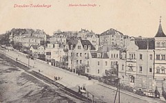
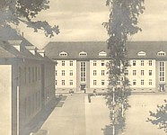
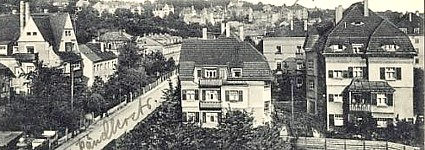
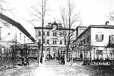
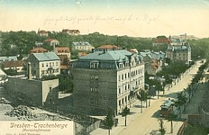
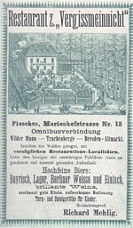
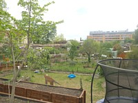
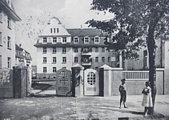
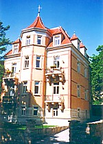
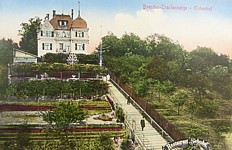

* * *

Die Albert-Hensel-Straße entstand Ende des 19. Jahrhundert im Zusammenhang mit dem Bau neuer Wohnhäuser. Ihren ursprünglichen Namen Maria-Anna-Straße erhielt sie nach dem 1896 gegründeten [Maria-Anna-Kinderhospital](../../../nordwest/trachenberge/trachenberge_-_sozialeinrichtu/), welches heute zum Komplex des Rehabilitationszentrums des Berufsförderungswerkes gehört. Namenspatronin dieser Einrichtung war die Prinzessin Maria Anna (1843-1884), die die Schirmherrschaft über den Verein „Kinderheilstätte für Neu- und Antonstadt Dresden“ übernommen hatte. Markantestes Gebäude ist die 1958 errichtete [Weinbergskirche](../../../nordwest/trachenberge/weinbergskirche/).

Am 8. Februar 1956 wurde die Maria-Anna-Straße nach dem kommunistischen Widerstandskämpfer Albert Hensel (1895-1942) umbenannt. Hensel, geboren in Alttrachau, schloss sich in den 1920er Jahren der kommunistischen Partei an und gehörte seit 1934 zum Führungskreis der Widerstandsgruppe um Fritz Schulze, Karl Stein und Herbert Bochow. 1941 wurde Albert Hensel verhaftet, wenig später zum Tode verurteilt und am 5. Juni 1942 in Berlin-Plötzensee hingerichtet.

Die Hellerhofstraße erhielt ihren Namen in den 1920er Jahren nach dem 1894 gegründeten und auch als “Eselhof” bezeichneten [Hellerhof](../../../nordwest/trachenberge/trachenberge_-_sozialeinrichtu/). Ab 1933 wurde das Gelände als Kaserne und Übungslager von der Waffen-SS genutzt und in diesem Zusammenhang erweitert. So entstand 1933 die Pionierkaserne Wilder Mann (Nr. 35) mit Unterkunfts- und Wirtschaftsgebäuden _(Foto)_. Ab 1937 hatte hier ein SS-Pioniersturmbann sein Domizil, nach Kriegsbeginn weitere Ausbildungs- und Ersatzeinheiten der Waffen-SS und die SRD-Führerschule. In unmittelbarer Nähe entstand 1941 ein Gefangenenlager für sowjetische Zwangsarbeiter, die in den kriegswichtigen Göhle-Werken an der Großenhainer Straße arbeiten mussten. Heute befinden sich auf dem Grundstück verschiedene Gewerbebetriebe. Außerdem haben auf der Hellerhofstraße das Berufsbildungswerk Sachsen (Nr. 21) und das Berufsförderungswerk Dresden (Nr. 35) ihren Sitz.

Die Kalkreuther Straße entstand Anfang der 1970er Jahre im Zusammenhang mit einem Neubaugebiet an der Autobahn-Anschlussstelle Wilder Mann. Teilweise entspricht sie in ihrem Verlauf dem früheren Diebsteig bzw. Diebweg. Ihren Namen bekam sie im Oktober 1972 nach dem kleinen Ort Kalkreuth, heute ein Ortsteil von Ebersbach bei Großenhain. Bereits vor Anlage der Straße gab es in diesem Gebiet seit 1947 den Kleingartenverein "Frischer Wind e.V.".

Die Kändlerstraße geht auf einen ehemaligen Weinbergsweg in den Taubischen Bergen zurück. Ursprünglich war dieser Zugang zu einem an der "Trachenschlucht" gelegenen Weinberg. Zwischen 1756 und 1777 wurde das Gelände aufgeteilt und an Kleinbauern und Häusler aus Pieschen verkauft. Mit zunehmender Bebauung erfolgte um 1897 der Ausbau zur Straße und die Benennung in Kändlerstraße. Mit der Namensgebung wird an den Trachenberger Rittergutsbesitzer Bernhard Adolf Kändler erinnert, der 1871 das Gut Wilder Mann erwarb und 1880 verstarb. Kändler ließ auch den ersten Bebauungsplan für die Gemeinde erstellen und setzte durch, dass hier ausschließlich Villen und Wohnhäuser entstehen durften.

**_Foto:_** _Blick in die Kändlerstraße in den 1930er Jahren_

Die Lauterbacher Straße entstand Anfang der 1930er Jahre als Verlängerung der Hellerhofstraße bis zur Radeburger Straße. Im September 1934 wurde sie nach dem Ort Lauterbach, heute ein Ortsteil von Ebersbach bei Großenhain gehört.

Die frühere Marienhofstraße verdankte ihren Namen dem 1873 hier gegründeten [Marienhof](../../../nordwest/trachenberge/trachenberge_-_sozialeinrichtu/), einer Besserungsanstalt für Jugendliche, die später als städtisches Kinderheim diente _(Foto)_. 1886 wurde sie offiziell so benannt. Nachdem das Heim 1949 den Namen des russischen Schriftstellers Maxim Gorki erhalten hatte, wurde auch die Straße in Maxim-Gorki-Straße umbenannt.

Das Straßenbild der Maxim-Gorki-Straße prägen bis heute vorrangig Wohnhäuser der Gründerzeit vom Ende des 19. Jahrhunderts. Hier befanden sich auch verschiedene Geschäfte und Gaststätten. In den Räumen einer ehemaligen Fleischerei an der Einmündung zur Trachenberger Straße (Nr. 34) entstand nach 1990 das Imbisslokal "Suppentöppl". Seit 2015 werden die Räume vom Bistro "Lunch & more" genutzt. Viele Jahre war in diesem Haus auch die zahnärztliche Abteilung der Poliklinik Mickten untergebracht.

Eine weitere Gaststätte gab es im Eckhaus Nr. 36 (“Zur fröhlichen Wiederkehr”). Das Gebäude stürzte am 18. Juli 2012 ein und wurde daraufhin abgerissen. Im Haus Marienhofstraße 76 bestand um 1900 das Arbeiterlokal “Zum Vergißmeinnicht”, welches als Kundgebungsort und politischer Treffpunkt bekannt war.

Unweit davon existierte zwischen 1900 und 1914 das Trachenberger Postamt im Erdgeschoss des Doppelhauses Nr. 85/87. Weitere Lokale befanden sich mit dem "Marienschlößchen" in der Nr. 52 und in der Nr. 65 ("Zur alten Eiche"). Auch das Haus Marienhofstraße 85 wurde vor 1945 gastronomisch genutzt. Benannt war dieses nach dem nahen Kinderhospital als "Maria-Anna-Hof".

Zu den Bewohnern der Marienhofstraße gehörte ab 1915 die Familie des bekannten Leichtathleten und späteren "Wunderläufers" Rudolf Harbig (Nr. 28). Weitere Flächen werden von der 1902 gegründeten Kleingartensparte "Mariengärten e. V." eingenommen. Das Gebäude der früheren [28\. Bezirksschule](../../../nordwest/trachenberge/) wird heute als Berufliches Schulzentrum für Gesundheit und Sozialwesen "Karl August Lingner" genutzt.

Kleingartenverein "Mariengärten" (Nr. 35): Die Gartenanlage entstand 1902 auf dem Gelände einer früheren Tongrube und gehört zu den ältesten Kleingartenanlagen in Dresden. Gründer waren die beiden Radebeuler Fabrikbesitzer Max und Richard Böhme, die das Areal mit der Bestimmung verpachteten, es dauerhaft als Gartenland zu nutzen. 1980 konnte der Verein seine Anlage um das Gelände eines Abrissgrundstücks des Otto-Buchwitz-Werkes an der Weinböhlaer Straße erweitern. Zum Kleingartenverein gehören heute 100 Gärten sowie eine öffentlich zugängliche Vereinsgaststätte.

Nr. 58/60: Die kleine Wohnanlage, zu der auch die Gebäude Rückertstraße 22-30, Waldstraße 1-7b und Hans-Sachs- Straße 33/35 gehören, entstand zwischen 1913 und 1920 für den Dresdner Spar- und Bauverein. Architekt der für ihre Zeit modernen Siedlung war Heinrich Koch. Alle Wohnungen erhielten moderne sanitäre Anlagen und Balkone, womit an sozial- und lebensreformerische Grundsätze angeknüpft wurde. Hinzu kamen Gemeinschaftsräume, ein Waschhaustrakt und Grün- und Spielflächen in den Innenhöfen. Nach einem der Förderer des Spar- und Bauvereins, dem Kommerzienrat Palmié, werden die Wohnhäuser auch als “Palmié-Häuser” bezeichnet.

Die erst nach 1990 angelegte Meinholdstraße auf dem Heller erhielt ihren Namen am 20. April 1995 nach dem Dresdner Druckereibesitzer Carl Christian Meinhold (1740-1827). Meinhold erwarb 1783 die Dresdner Hofdruckerei und baute sie zu einem der bedeutendsten Dresdner Verlage aus. Noch bis 1945 führte die Familie das Unternehmen unter dem Namen [C. C. Meinhold & Söhne](../../../Zentrum/Pirnaische_Vorstadt/Strassen_Pirnaische_Vorstadt/Zinzendorfstrasse/Meinhold_Sohne/meinhold_sohne.html) fort. Heute hat auf der Meinholdstraße die Druckerei des Dresdner Druck- und Verlagshauses ihren Sitz, in der u.a. die “Sächsische Zeitung” und die “Dresdner Morgenpost” gedruckt werden. Der moderne Komplex entstand 1996/97 und war zum Zeitpunkt seiner Fertigstellung eine der modernsten Druckereien Europas. Außerdem befinden sich hier Verwaltung und Briefverteilzentrum des privaten Postdienstleisters PostModern.

Die seit 1896 amtlich benannte Weinbergstraße erinnert an den bis Ende des 19. Jahrhunderts bedeutenden Weinbau in Trachenberge. Ursprünglich lagen hier die Friesenberge, die dem Freiherrn Carol von Friesen gehörten, der 1686 in Dresden verstarb. 1853 errichtete der Dresdner Kaufmann Emil Weithaas hier sein Landhaus "Marienhof", aus dem 1873 die gleichnamige Einrichtung der Kinder- und Jugendfürsorge hervorging. 1896 entstanden mit dem Maria-Anna-Kinderhospital und dem Sächsischen Krüppelheim wichtige Sozialeinrichtungen für Behinderte, die heute zu einem [Rehabilitationszentrum](../../../nordwest/trachenberge/trachenberge_-_sozialeinrichtu/) zusammengefasst sind (Weinbergstraße 52-54). Hinzu kamen eine Reihe von Villen und Landhäusern. 1974 wurde zwischen Weinbergstraße und Großenhainer Straße ein Neubaugebiet errichtet. Am westlichen Ende der Straße befindet sich die Kleingartenanlage "Wilder Mann" mit dem Restaurant "Weinbergbaude" (Nr. 83).

Nr. 24: Die Villa entstand 1917/18 für den Fabrikanten Julius Heyde, der als Teilhaber der Gesellschaft für Optik und Feinmechanik mit Sitz auf der Kleiststraße zu Wohlstand gekommen war. Nach Ende des Zweiten Weltkriegs verließ Heyde Dresden, sein Unternehmen ging im VEB Feinmeß auf. Zwischen November 1945 und Juli 1946 unterhielt die damalige sowjetische Besatzungsmacht im Haus ein “Postamt” zur Kontrolle aller von und nach Dresden gehenden Sendungen. Die Zensurstelle wurde später zur Bautzner Straße verlegt und bestand noch bis 1950. 1952 übernahm die Binnenhandelsschule das Gebäude sowie die Nachbargrundstücke. Nach deren Auflösung befand sich ab 1995 bis 2011 eine Ausbildungsstätte der Berufsakademie Sachsen in der Villa. 2016 begann die Sanierung und die Errichtung einer Wohnanlage im hinteren Teil des Grundstücks.

Nr. 38: Die Ende des 19. Jahrhunderts in den Weinbergen errichtete Gebäude beherbergte einst das beliebte Ausflugslokal “Eichenhof”, von dessen Terrasse sich ein schöner Fernblick über das Elbtal bot _(Foto)_. 1906 warb Besitzer Ernst Linke als "Schönster Aussichtspunkt - Grosser schattiger Eichenpark. - Elegante Veranden und Terrassen. - Kinderbelustigungen.". Nach dem Ersten Weltkrieg wurde die Gaststätte geschlossen und es zog Schröter's Heilpädagogisches Institut ein. Heute dient das Haus Wohnzwecken.

Nr. 40e: In diesem Haus wohnte bis 1945 die deutsch-jüdische Familie Kühnert. Edith Kühnert und ihre zweijährige Tochter Barbara erhielten am 12. Februar 1945 den Deportationsbefehl, konnten jedoch nach dem Luftangriff auf Dresden fliehen. Wenige Tage später nahmen sich beide in der Nähe von Bad Liebenwerda das Leben. An das tragische Schicksal erinnern seit 2013 zwei Stolpersteine vor dem Gebäude.

Nr. 76: Die um 1910 vom Architekten Heinze als eigenes Wohnhaus errichtete Villa Nr. 76 gehört zu den interessantesten Gebäuden an der Weinbergstraße. Das im Landhausstil gestaltete Gebäude weist an der Fassade verschiedene neogotische Elemente und Plastiken auf, welche Szenen der biblischen Geschichte darstellen.

[Trachenberge auf OpenStreetMap](https://www.openstreetmap.org/search?query=Dresden+Trachenberge)

* * *

 \[ [Home](../../../index.html)\] \[ [Nord](../../../nord/)\] \[ [Nordwest](../../../nordwest/)\] \[ [Neustadt](../../../neustadt/)\] \[ [Nordost](../../../nordost/)\] \[ [West](../../../west/)\] \[ [Zentrum](../../../zentrum/)\] \[ [Südwest](../../../sudwest/)\] \[ [Süd](../../../sud/)\] \[ [Südost](../../../sudost/)\] \[ [Ost](../../../ost/)\] \[ [Register](../../../Register/register.html)\] \[ [Kontakt](../../../Kontakt/kontakt.html)\] \[ [Impressum](../../../impressum/)\]
