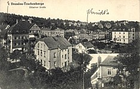
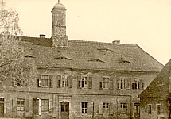
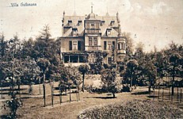
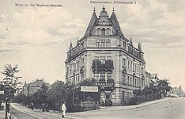
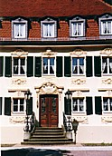
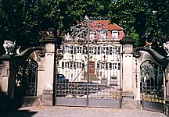
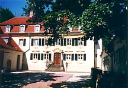
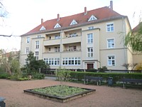

* * *

* * *

Die Döbelner Straße geht auf einen alten Verbindungsweg am Fuße der Weinberge zurück, der nach seinem Ausbau zur Straße ab 1885 zunächst Hermannstraße genannt wurde. Namensgeber war der im Ort lebende Rentier Friedrich Hermann Müller (1819-1898), welcher ab 1863 Besitzer eines Weinbergschlösschens an dieser Straße war (Nr. 24). Müller unterstützte seinen Heimatort mit verschiedenen Stiftungen, u.a. zur Finanzierung des Schulhauses und für die Ausstattung der Pieschener Markuskirche. Nach der Eingemeindung Trachenberges wurde die Hermannstraße 1897 nach der Kleinstadt Döbeln bei Leipzig in Döbelner Straße umbenannt. 1904 folgte der verbleibende Restabschnitt auf Trachauer Flur.

Die unterhalb der früheren Weinberge verlaufende Straße bildet die eigentliche Hauptstraße der bis 1897 selbständigen Gemeinde Trachenberge. Ursprünglich lagen hier einige seit dem 16. Jahrhundert entstandene Weingüter. Hier befand sich auch das Gemeindeamt mit dem Spritzenhaus (Nr. 9). Im Haus Döbelner Straße 8 wurde 1876 die erste [Schule](../../../../nordwest/trachenberge/) in Trachenberge eröffnet. Auf den Grundstücken Nr. 108-116 stand bis zum Abriss 1934 das frühere Gut [Wilder Mann](../../../../nordwest/trachenberge/wilder_mann/), welches dem Stadtviertel seinen Namen gab. Aus diesem ging auch das gleichnamige Gasthaus an der Döbelner Straße 130 hervor, das nach 1945 als Fernsehstudio genutzt wurde. Heute erinnert noch eine Gedenktafel am Wohnhaus Döbelner Straße 110 an den einstigen Standort. Das Grundstück Nr. 12 diente vor dem Ersten Weltkrieg als "Luftbad Demnitz".

Die Grundstücke an der heutigen Döbelner Straße befanden sich um 1680 im Besitz sächsischer Adliger. Neben den Weinbergen des “Wilden Manns” lagen die Taubischen Berge, daran anschließend die Friesenberge sowie die nach dem kurfürstlichen Oberstallmeister Graf Nikolaus von Maxen (+ 1712) benannten Max\`schen Berge. Später betrieben bevorzugt Pieschener und Trachauer Bauern den Weinanbau. Heute sind diese Weingüter allesamt aus dem Stadtbild verschwunden. Lediglich einige alte Weinbergsmauern sowie das zu den wenigen erhaltenen bäuerlichen Anwesen gehörende Wohnhaus Döbelner Straße 32 erinnern noch an diese Zeit.

Mitte des 19. Jahrhunderts begann der Ausbau der Straße mit Villen und Landhäusern, denen später gründerzeitliche Wohnhäuser in offener Bebauung folgten. Weitere Baulücken wurden nach dem Ersten Weltkrieg geschlossen. Architektonisch und städtebaulich bedeutend sind u.a. die unter Denkmalschutz stehenden Gebäude Döbelner Straße 54 (Villa Guthmann - _Foto links_), Nr. 74 (Villa Maria um 1900), Nr. 76 (Villa um 1900), Nr. 94, 96, 98 und 104 (1896-1900), das im sogenannten "Reformstil" um 1910 gebaute Wohnhaus Nr. 100 und das mit Art-déco-Elementen verzierte Doppelhaus Nr. 102 (um 1920).

Einzelne Gebäude:

Germaniahof (Nr. 1): Die Gaststätte wurde 1900 im kurz zuvor erbauten Mehrfamilienhaus an der Ecke zur Marienhofstraße eröffnet und befand sich zunächst im Besitz von Wilhelm Wohlrab, ab 1910 von Traugott Morkisch bzw. dessen Witwe Wilhelmine Bertha. Das repräsentative Gebäude mit Ziergiebeln und baukünstlerischem Schmuck steht unter Denkmalschutz. Die ehemaligen Gasträume dienen heute als Wohnung. Weitere kleinere Lokale gab es mit Sparmanns Restaurant "Helgoländer Gehölz" (Nr. 13) und dem "Duckwitz-Hof" an der Ecke zur Duckwitzstraße (Nr. 69). Letzteres ist im Jahr 1910 unter Leitung des Gastwirts Bruno Köhler als "City of New York" im Adressbuch verzeichnet. Gastronomischen Zwecken dient bereits seit Ende des 19. Jahrhunderts der Anbau des Wohnhauses Döbelner Straße 88 mit dem kleinen Lokal "Zur Klause".

Nr. 23: Der ungewöhnliche moderne Neubau entstand 2009/10 als privates Wohnhaus des Architekten Philipp Stamborski. Das Gebäude besitzt eine dunkelgrau-schwarze Fassade mit nur einem großen Fenster zur Straße. Die Rückseite zum Garten ist hingegen fast voll verglast und wurde mit einer auf Wunsch zu öffnenden Terrasse versehen. Für seine Gestaltung wurde dem Bauherrn 2011 der “Häuser-Award” des Architekturmagazins “Häuser” verliehen.

Spieglersches Haus (Nr. 24): Bemerkenswert ist die Villa Döbelner Straße 24, nach einem früheren Besitzer auch “Spieglersches Haus” genannt. Ursprünglich gehörte dieses Grundstück im 17. Jahrhundert zum sogenannten “Wertherschen Weinberg” des kursächsischen Kammer- und Bergrates Wolf von Werthern. Später besaß Graf Nikolaus von Maxen einen größeren Weinberg in diesem Gebiet und ließ sich hier zwischen 1738 und 1743 ein Weingut erbauen. Grundmauern und Keller des heutigen Weinbergschlösschen reichen bis in diese Zeit zurück. Auch das barocke Kavalier- bzw. Gästehaus (Döbelner Straße 22a) geht wohl auf diese Zeit zurück. Bereits 1722 hatte der Förster August Hecht weitere Flächen des Max´schen Weinberg erworben und verkaufte dessen östlichen Teil 1746 an den kurfürstlich-sächsischen Proviantverwalter Christian Friedrich Gärtner, der so auch in den Besitz des Weinbergschlösschens kam. Dieser ließ das vorhandene Gebäude zu einem zweistöckigen Herrenhaus erweitern. Hauptsächlich nutzte Gärtner es als Sommersitz. In den unteren Räumen befand sich die Weinpresse und die Kelterei.

Nach mehrfachem Besitzerwechsel erwarb 1831 der Ornithologe Prof. Dr. Friedrich August Ludwig Thienemann (1793-1858) das Anwesen. Thienemann war zeitweise als Inspektor am Dresdner Naturalienkabinett angestellte und erwarb sich vor allem als Fachmann für Vogeleier hohes Ansehen. Seine Erben verkauften das Haus 1863 an den wohlhabenden Rentier Friedrich Hermann Müller, über dessen Tochter die Villa in den Besitz des königlich-sächsischen Hofrates Dr. med. Gotthold Opitz überging. 1895 ließ Opitz das bislang von ihm nur als Sommerwohnsitz genutzte Landhaus umbauen und um zwei Seitengebäude erweitern. In diesem Zusammenhang entstanden auch die noch heute erhaltene Neo-Rokoko-Fassade sowie das prunkvolle Hoftor, wodurch das schlichte Landhaus ein schlossartiges Aussehen erhielt. Seitlich des Herrenhauses schließen sich einige Nebengebäude an: Links Pferdestall und Remise, rechts das Gärtner- und ein Taubenhaus, beide im Stil der Neorenaissance gestaltet. Auf Opitz´ Tochter Maria Spiegler geht der umgangssprachliche Name “Spieglersches Haus” für das frühere Weingut zurück.

**_Fotos:_** _Das frühere Weinbergschlösschen Döbelner Straße 24_

Im Garten befindet sich ein steinerner Brüstungsbogen der 1907 abgerissenen alten Augustusbrücke, welches als Geschenk König Friedrich August III. nach Trachenberge kam. Unweit davon steht eine über 250 Jahre, unter Naturschutz stehende alte Stieleiche. Außerdem gibt es auf dem parkartigen Grundstück einen kleinen Grottenbrunnen und einen romantischen Laubengang. Nach 1990 wurden Haus und Garten von Nachkommen der Familie Spiegler denkmalgerecht saniert und beherbergen mehrere Wohnungen.

Nr. 54: Die architektonisch bemerkenswerte Villa Villa Guthmann entstand 1855 und ist eines der frühesten Beispiele der deutschen Neorenaissance in Dresden. Gegliedert ist das Haus durch verschiedene Schweifgiebel, Erker, Veranda und einem von einer von Glockenhaube bekröntem Treppenturm. Während der Nazizeit befand sich hier die Bauleitung der Waffen-SS und der Polizei.

Nr. 77/79: Das Doppelhaus an der Einmündung der Duckwitzstraße _(Foto)_ bildet den Abschluss der zwischen 1926 und 1929 entstandenen Siedlung "Zur guten Hoffnung". Die Gebäude zwischen Großenhainer Straße (Nr. 162/164) und Döbelner Straße entstanden nach Plänen von Paul Müller und umfassen auch die Reihenhäuser [Bolivarstraße](../../../../nordwest/trachau/strassen_trachau/) 4-54 und an der Duckwitzstraße.

Nr. 126: Die um 1880 entstandene Villa steht exemplarisch für das Baugeschehen in Trachenberge in dieser Zeit. Der zweigeschossige Putzbau mit Satteldach, Erker und Zwerchhaus ist von einer noch weitgehend im Ursprungszustand erhaltenen Gartenanlage umgeben und steht als Baudenkmal unter Schutz.

* * *

 \[ [Home](../../../../index.html)\] \[ [Nord](../../../../nord/)\] \[ [Nordwest](../../../../nordwest/)\] \[ [Neustadt](../../../../neustadt/)\] \[ [Nordost](../../../../nordost/)\] \[ [West](../../../../west/)\] \[ [Zentrum](../../../../zentrum/)\] \[ [Südwest](../../../../sudwest/)\] \[ [Süd](../../../../sud/)\] \[ [Südost](../../../../sudost/)\] \[ [Ost](../../../../ost/)\] \[ [Register](../../../../Register/register.html)\] \[ [Kontakt](../../../../Kontakt/kontakt.html)\] \[ [Impressum](../../../../impressum/)\]
