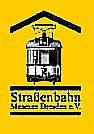
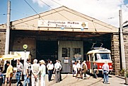
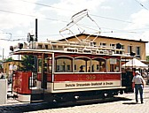
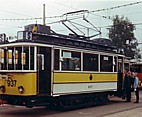
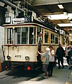
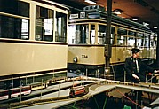
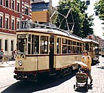
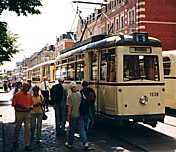

* * *

* * *

**Straßenbahnmuseum Dresden e.V.**

**Trachenberger Str. 38**

**01129 Dresden**

****

* * *

Nachdem die historischen Fahrzeuge der Dresdner Straßenbahn zunächst in den
Straßenbahnhöfen Mickten und Coswig untergebracht waren, sind sie seit 1996 in einer Halle des Betriebshofes Trachenberge zu sehen. Betreut werden sie vom
Verein Straßenbahnmuseum Dresden e.V. Neben mehreren Oldtimer-Trieb- und Beiwagen befinden sich auch einige Arbeitswagen sowie zahlreiche sonstige Sachzeugen aus der Dresdner Straßenbahngeschichte wie Fahrkarten-
Entwerter, Haltestellenschilder und eine alte Wartehalle im Besitz des Museums. Die Ausstellung ist regelmäßig geöffnet. Außerdem sind die meisten historischen
Straßenbahnen zu besonderen Anlässen bei Sonderfahrten zu erleben. Auch eine Vermietung für Firmenfeiern o.ä. ist möglich.

Museumsfahrzeuge des Straßenbahnmuseums (Auswahl):

Triebwagen Nr. 309 und Beiwagen Nr. 87: Die beiden Straßenbahnwagen sind die ältesten noch betriebsfähigen Fahrzeuge der Dresdner Straßenbahn. Beide
wurden 1902 bzw. 1911 in Eigenregie gebaut und waren, nach mehreren Umbauten, noch bis 1965 im Liniendienst im Einsatz. 1968 wurden sie für Filmaufnahmen wieder in den Originalzustand versetzt und sind heute
Hauptanziehungspunkt des Museums.

Union-Triebwagen Nr. 937 und Beiwagen Nr. 307: Der Triebwagen Nr. 937 wurde 1927 von der Städtischen Straßenbahn auf der Grundlage eines Union-Fahrgestells
gebaut und war noch bis 1972 in Betrieb. Bevorzugt war er auf der Bergstrecke nach Bühlau eingesetzt. Gemeinsam mit dem 1912 gebauten Beiwagen Nr. 307, einem der
ersten fahrgestelllosen großen Beiwagen der Dresdner Straßenbahn, wurde er 1972 als Museumsfahrzeug in den Zustand der Zwanziger Jahre versetzt und gehört heute zum Bestand des Straßenbahnmuseums.

MAN-Triebwagen Nr. 1644 und Beiwagen Nr. 1135: Die ersten Fahrzeuge der Firma MAN wurden 1909 von der
Dresdner Straßenbahn AG erworben. Die elektrische Ausstattung der Fahrzeuge stammte von Siemens, z. T. auch von der AEG bzw. aus dem Niedersedlitzer Sachsenwerk. In den Zwanziger Jahren entstanden weitere verbesserte
Triebwagen dieser Baureihe in den Waggonfabriken Bautzen, Görlitz und Niesky. Gemeinsam mit dem 1918 in Dresden gebauten Beiwagen Nr. 1135 dokumentiert der MAN-Triebwagen 1644 heute über 60 Jahre Dresdner
Straßenbahngeschichte. Farbgebung und Ausstattung der Museumsfahrzeuge orientieren sich am Zustand von 1955.

MAN-Einrichtungswagen Nr. 734 und Beiwagen Nr. 1029: Auch diese beiden Fahrzeuge gehen auf das bewährte Konzept der MAN-Wagen zurück. Beide Wagen waren bereits seit den Zwanziger Jahren im Einsatz und wurden 1966
komplett überholt und modernisiert. In diesem Zusammenhang wurden die Straßenbahnen zu Einrichtungswagen mit Türen an nur einer Seite umgebaut, was
jedoch den Nachteil hatte, nur auf Strecken mit Gleisschleife eingesetzt werden zu können. Ein weiterer modernisierter Triebwagen (Nr. 765) dieser Baureihe mit
Türen auf beiden Seiten gehört ebenfalls zum Bestand des Museums.

Großer Hecht (Triebwagen Nr. 1716 und Beiwagen Nr. 1314): Die ersten Triebwagen dieser wohl bekanntesten Baureihe der Dresdner Straßenbahn
kamen 1930 nach Dresden. Entwickelt wurden die modernen Fahrzeuge von Prof. Alfred Bockemühl, der zwischen 1945 und 1949 auch zum Vorstand der Dresdner Verkehrsgesellschaft AG gehörte. Die Trieb- und
Beiwagen entstanden in Ganzstahlbauweise und boten sowohl für Fahrgäste als auch Bedienungspersonal deutlich verbesserten Komfort. Bis zur Außerdienststellung der “Großen Hechte” 1971/72 gehörten die Bahnen
zum typischen Bild der Dresdner Straßenbahn, vor allem auf den stark frequentierten Linien. Heute befindet sich ein kompletter Wagenzug im Straßenbahnmuseum, ein weiterer im Verkehrsmuseum.

Kleiner Hecht (Triebwagen Nr. 1820 und Beiwagen Nr. 1219): Ab 1934 wurde in Ergänzung zum “Großen Hecht”
eine kleinerne Variante gebaut, die vor allem auf weniger stark genutzten Strecken zum Einsatz kam. Gemeinsam mit
den als Ergänzung entwickelten Schwebeachsbeiwagen waren auch diese Bahnen noch bis zum Beginn der 70er Jahre im Einsatz. Ein erhaltener Zug ist heute im Straßenbahnmuseum zu sehen.

LOWA-Triebwagen ET 54 (Nr. 1538) und Beiwagen EB 54 (Nr. 1361/1362): Nach dem Zweiten Weltkrieg beschloss die DDR-Führung den Bau von Einheitsstraßenbahnwagen, die ohne größere Anpassungen in verschiedenen
Städten eingesetzt werden konnten. Gebaut wurden diese ab 1951 im VEB Waggonbau Werdau. Zum 750. Stadtjubiläum 1956 konnten die Dresdner Verkehrsbetriebe mehrere Fahrzeuge dieser Baureihe erwerben, die
schrittweise die älteren Vorkriegsmodelle ablösen sollten. Ein Trieb- und zwei Beiwagen blieben bis heute im Straßenbahnmuseum erhalten und werden auch zu Sonderfahrten eingesetzt.

Gotha-Triebwagen ET 57 (Nr. 1587) und Beiwagen EB 57 (Nr. 1413): Die Gotha-Wagen ähneln im äußeren Erscheinungsbild den Vorgängermodellen der Firma LOWA und wurden ab 1957 gebaut. In Dresden wurden sowohl
Einrichtungs- als auch Zweirichtungswagen dieser Serie eingesetzt, letztere u.a. bis zur Betriebseinstellung 1991 auf der
Strecke nach Cossebaude. Zum Bestand des Straßenbahnmuseums gehören je zwei komplette Wagenzüge beider Varianten.

Großraumtriebwagen Nr. 1734 und Beiwagen Nr. 2015:
Die letzten in der DDR hergestellten Straßenbahnen, erstmals mit modernen Falttüren versehen, wurden ab 1962 in Gotha gebaut und kamen auch in Dresden zum Einsatz. Auf Weisung der Staatsführung mussten die Fahrzeuge
jedoch ab 1966 nach Berlin abgegeben werden. 1995/96 kehrte ein Wagenzug nach Dresden zurück und befindet sich heute im Besitz des Straßenbahnmuseums.

**_Foto:_** _Großraumtriebwagen und Tatra-Triebwagen T4D Nr. 2000_

Tatra-Triebwagen T4D (Nr. 2000): Der Triebwagen Nr. 2000 des tschechischen Herstellers Tatra kam 1967 als
Prototyp nach Dresden. Nachdem die Tests erfolgreich verlaufen waren, erwarben die Dresdner Verkehrsbetriebe bis
1984 insgesamt 572 Trieb- und 249 Beiwagen. Diese waren noch bis Mai 2010 auf vielen Linien im Einsatz, wurden jedoch zunehmend durch die modernen Stadtbahnwagen ersetzt. Seit 1997 ist der erste in Dresden eingesetzte
Tatrawagen, der viele Jahre als Fahrschulwagen diente, Museumsfahrzeug des Straßenbahnmuseums.

Video: Besuch im Straßenbahnmuseum Trachenberge

* * *

 \[ [Nord](../../../nord/)\] \[ [Nordwest](../../../nordwest/)\] \[ [Neustadt](../../../neustadt/)\] \[ [Nordost](../../../nordost/)\]
 \[ [West](../../../west/)\] \[ [Zentrum](../../../zentrum/)\] \[ [Südwest](../../../sudwest/)\] \[ [Süd](../../../sud/)\] \[ [Südost](../../../sudost/)\] \[ [Ost](../../../ost/)\] \[ [Register](../../../Register/register.html)\] \[ [Kontakt](../../../Kontakt/kontakt.html)\] \[ [Impressum](../../../impressum/)\]
