* * *

* * *

* * *

* * *

* * *

[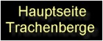](../../../nordwest/trachenberge/)

* * *

[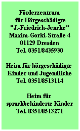](http://www.johannf.de/)

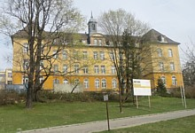Nach Einstellung des Weinbaus an den Hängen der Hellerberge, bedingt durch
zunehmende Besiedlung und das Auftreten der Reblaus, entstanden im letzten Drittel des 19. Jahrhunderts in Trachenberge eine Reihe sozialer Einrichtungen. Gründer waren dabei sowohl die Stadt Dresden als auch private Initiativen. Die hier in ruhiger und grüner Stadtrandlage angebotenen Betreuungsmöglichkeiten für Kinder und Behinderte galten für die damalige Zeit als beispielhaft. Heute setzen u.a. ein berufliches Rehabilitationszentrum sowie das Förderzentrum für Hörgeschädigte “Johann Friedrich Jencke” diese Tradition fort.

Marienhof:

Der Name Marienhof geht auf ein Mitte des 19. Jahrhunderts errichtetes Landhaus in der Nähe der Radeburger Straße zurück. 1853 hatte der Dresdner Kaufmann Emil Weithaas vom Hofbuchdrucker und Verleger Meinhold einen Teil des “Hechtschen Weinbergs” erworben und dort ein villenartiges Gebäude errichten lassen, welches nach seiner Frau den Namen Marienhof erhielt (Weinbergstraße 1).

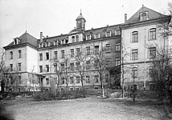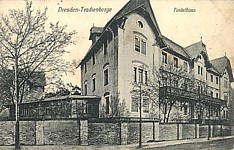1873 wurde auf diesem Gelände eine Besserungsanstalt für Jugendliche gegründet. Besitzer war die Stadt Dresden, die hier bis zu 125 schwer erziehbare Kinder unterbrachte. Im gleichen Jahr wurde auch das städtische Waisenhaus, die sogenannte "Kinderpflegeanstalt", nach Trachenberge verlegt. Dieses war bereits 1685 am Jüdenteich in der Nähe der Bürgerwiese gegründet worden, wo noch heute der Name Waisenhausstraße an diese Einrichtung erinnert. Von 1827 bis 1869 befand sich das Waisenhaus in der Louisenstraße in der Neustadt. Dieses Heim sollte vorrangig Kinder aufnehmen, deren Eltern die Betreuung nicht selbst übernehmen konnten oder wollten. Drittes Heim war das Dresdner “Findelhaus” für ausgesetzte Kleinkinder im Säuglingsalter _(Foto rechts)_.

Gemeinsam mit dem Marienhof wurden die Einrichtungen 1911 zu den “Städtischen Kinderanstalten im Marienhof” vereinigt. Ab 1928 “Stadtkinderheime” genannt, erhielt die Einrichtung 1949 nach dem russischen Schriftsteller Maxim Gorki den Namen Maxim-Gorki-Heim. Zeitweise wurden auch Kinder aus Vietnam und Korea, die wegen der dortigen Kriegsereignisse flüchten mussten, betreut. Seit 1959 werden die Gebäude als Gehörlosen- und Sprachheilschule genutzt (Förderzentrum für Hörgeschädigte "Johann Friedrich Jencke").

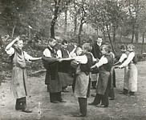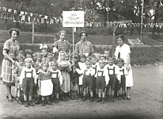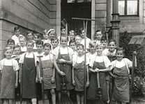

**_Fotos:_** _Alltagsleben im Marienhof um 1925 (SLUB/Fotothek)_

Hellerhof:

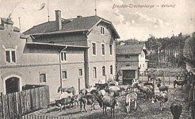Der Hellerhof entstand 1894 am oberen Ende der Drachenschlucht auf Anregung des Arztes Dr. Klemm. Auf dem Gelände der Gutswirtschaft wurden um die Jahrhundertwende über 50 Esel gehalten, deren Milch Verdauungsstörungen bei Säuglingen heilen sollte. Im Volksmund hieß das Anwesen deshalb auch Eselhof. Finanziert wurde das Unternehmen durch den Verkauf der zur Zucht nicht benötigten männlichen Tiere sowie durch den Milchverkauf. Die von einer gemeinnützigen Genossenschaft zur Bekämpfung der Säuglingssterblichkeit bewirtschaftete Einrichtung musste 1915 wegen des Ersten Weltkrieges geschlossen werden.

Nach Machtantritt der Nazis wurde der Hellerhof von der SS als Kaserne missbraucht, die hier 1934 einige Führer der konkurrierenden SA nach dem “Röhm-Putsch” erschoss. Zu DDR-Jahren gab es hier einen Kraftfahrzeug-Stützpunkt der Gesellschaft für Sport und Technik (GST). Heute befindet sich auf dem Gelände ein Bauunternehmen.

Maria-Anna-Kinderhospital:

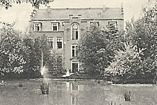Die Einrichtung geht auf eine 1876 vom Verein “Kinderheilstätte für Neu- und Antonstadt Dresden” gegründete Klinik zurück, welche sich vorrangig mit der medizinischen Versorgung von Kindern aus den ärmeren Schichten befasste. Ursprünglich befand diese sich auf der Königsbrücker Straße 44, wurde später jedoch zur [Hechtstraße](../../../neustadt/leipziger_vorstadt/strassen_leipziger_vorstadt/hechtstrasse/) verlegt. 1891 erwarb der Verein ein Grundstück an der Weinbergstraße in Trachenberge und legte dort 1895 den Grundstein für das Maria-Anna-Kinderhospital. Das im Pavillonstil gestaltete Krankenhaus _(Fotos um 1916)_ bot Platz für 64 Kinder und bestand aus einem Verwaltungsgebäude, einer Liegehalle für Freiluftkuren, einem Pavillon für Diphtherie- und Scharlachkranke sowie einem Totenhaus und den notwendigen Versorgungseinrichtungen. Die offizielle Einweihung erfolgte am 6. Oktober 1896.

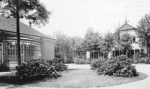Da sich das Gelände relativ abseits, dafür aber in ruhiger und klimatisch günstiger Lage befand, fanden hier vor allem chronisch kranke Patienten Aufnahme, während Akutfälle in der [Kinderklinik](../../../sud/plauen/strassen_plauen/chemnitzer_strasse/) auf der Chemnitzer Straße versorgt wurden. 1920 übernahm die Stadt das Hospital an der Weinbergstraße 52 und nutzte es noch bis 1931. 1922 entstanden zwei beheizbare Liegehallen, welche nach einem Umbau 1929 auch in den Wintermonaten genutzt werden konnten. Nach der Schließung des Hospitals am 21. Juni 1931 standen die Räume zunächst leer. Ab 1933 wurden diese von der NSDAP als Unterkunft des SS-Sonderkommandos “Sachsen” genutzt. Nach 1945 kamen die Gebäude zum benachbarten Heim für Körperbehinderte.

Sächsisches Krüppelheim (Schule für Körperbehinderte):

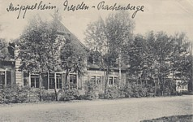Das Heim an der Weinbergstraße 54 entstand 1896 auf Anregung des unter Schirmherrschaft der sächsischen Königin Carola stehenden Vereins “Krüppelhilfe”. Mit dem Krüppelheim wurde eine anerkannte Erziehungs- und Ausbildungsstätte für körperbehinderte Kinder und Jugendliche aus ganz Sachsen geschaffen. 1899 erfolgte wegen der großen Nachfrage eine erste Erweiterung. Das Krüppelheim wurde in den 1930er Jahren mit dem benachbarten Maria-Anna-Kinderhospital vereinigt und 1939 in Sächsisches Heim für Körperbehinderte umbenannt.

In der Nachkriegszeit entstand aus diesem ein Betreuungszentrum für körperbehinderte junge Erwachsene, welches ab 1962 offiziell den Namen Rehabilitationszentrum für Berufsbildung Dresden trug und 1991 vom Berufsbildungswerk Sachsen übernommen wurde. Das heutige Berufsschulzentrum für Technik und Wirtschaft mit Status einer Förderschule bereitet Behinderte auf eine künftige berufliche Tätigkeit vor. 2008 entstand ein modernes Erweiterungsgebäude, welches die nicht mehr den Anforderungen genügende Schule aus dem Jahr 1974 ersetzt. Zum Areal gehört auch ein auf dem Grundstück stehender denkmalgeschützter Wasserturm und das heute als Seminargebäude des Berufsförderungswerkes Dresden genutzte einstige Offizierscasino der Hellerkaserne.

Johann-Friedrich-Jencke-Schule:

Die Geschichte der Dresdner Gehörlosenbildung begann im Jahr 1832, als der Lehrer Johann Friedrich Jencke auf der Freiberger Straße 25 die erste [Taubstummenanstalt](../../../sud/plauen/strassen_plauen/chemnitzer_strasse/) gründete. Bereits 1837 konnte die Einrichtung in einen Neubau auf der Chemnitzer Straße verlegt werden. Erstmals konnten Hörgeschädigte hier neben einer Schul- auch eine Berufsausbildung erhalten. Zwei Jahre später kam ein Asyl für alleinstehende taubstumme Mädchen hinzu, 1872 folgte ein Kindergarten für Gehörlose, damals eine Novität in Deutschland. Mehrfach umstrukturiert, bestand die Einrichtung bis zur Zerstörung der Gebäude am 13. Februar 1945.

Bereits im Oktober 1945 konnte, zunächst in den Räumen des früheren Freimaurerinstitutes auf der Eisenacher Straße (heute Kreuzschule), der Schulbetrieb wieder aufgenommen werden. Um dem Platzmangel zu begegnen, entstanden 1947 Außenstellen in Röthenbach und Schellerhau im Erzgebirge. 1959 wurde die Schule nach Trachenberge verlegt, wo bereits ein Internat existierte. In den 1970er Jahren errichtete man moderne Schulneubauten für die Betreuung der Behinderten. Nach Sanierungsarbeiten an den Gebäuden Anfang der 1990er Jahre gab es erneut organisatorische Veränderungen. Schule, Heim und Kindergarten wurden organisatorisch voneinander getrennt. 1994 erhielt die Einrichtung nach ihrem Gründer den Namen “Johann-Friedrich-Jencke-Schule” verliehen. Seit 1999 vereint sie als Förderzentrum für Hörgeschädigte die schulische Betreuung von Schwerhörigen und Gehörlosen in Dresden. Außerdem gibt es eine bilinguale Integrations-Kindertagesstätte, in der hörende und hörgeschädigte Kinder gemeinsam betreut werden.

* * *

 \[ [Home](../../../index.html)\] \[ [Nord](../../../nord/)\] \[ [Nordwest](../../../nordwest/)\] \[ [Neustadt](../../../neustadt/)\] \[ [Nordost](../../../nordost/)\] \[ [West](../../../west/)\] \[ [Zentrum](../../../zentrum/)\] \[ [Südwest](../../../sudwest/)\] \[ [Süd](../../../sud/)\] \[ [Südost](../../../sudost/)\] \[ [Ost](../../../ost/)\] \[ [Register](../../../Register/register.html)\] \[ [Kontakt](../../../Kontakt/kontakt.html)\] \[ [Impressum](../../../impressum/)\]
