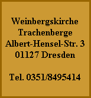
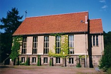
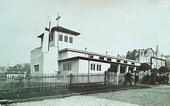
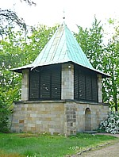
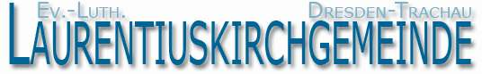

* * *

Die erst im 19. Jahrhundert entstandene Gemeinde Trachenberge gehörte kirchlich ursprünglich zu Kaditz und war ab 1884 nach Pieschen gepfarrt. Nachdem dort 1888 die neugotische [Markuskirche](../../../nordwest/pieschen/markuskirche/) eingeweiht worden war, besuchten auch die Gläubigen aus Trachenberge dieses Gotteshaus. Allerdings entschlossen sich diese bereits 1891 für die Nutzung einer Schulturnhalle auf der Döbelner Straße 8 als Notkirche. Ab 1903 stand für diesen provisorischen Betsaal ein eigener Pfarrer zur Verfügung, um die stark angewachsene Bevölkerung vor Ort betreuen zu können.

1915 löste sich Trachenberge von der Pieschener Markuskirche und bildete eine eigene Kirchgemeinde, die in Anlehnung an die Tradition des Ortes den Namen Weinbergskirchgemeinde erhielt. Die zunächst in verschiedenen Ausweichquartieren untergebrachte Gemeinde errichtete 1929/30 an der heutigen Albert-Hensel-Straße 3 die kleine Weinbergkirche _(Bild)_. Das schlichte Gebäude entstand zunächst als “Notkirche” in Fachwerkbauweise, da ein fester repräsentativer Neubau vorerst nicht finanzierbar war. Hinzu kam ein hölzerner Glockenstuhl für drei 1928 erworbenen Glocken, welche ursprünglich in Bochum für die Dresdner Gartenbauausstellung angefertigt worden waren.

Am 23. Oktober 1946 wurde diese Kirche bei einem Brand zerstört und konnte bis 1958 nur unter großen Mühen wiederaufgebaut werden. Architekt des Neubaus war Günter Schöneberg. Der freistehende Glockenturm _(Foto)_ wurde zwischen 1947 und 1950 aus Quadern verschiedener zerstörter Dresdner Kirchen errichtet und stellt so ein besonderes Mahnmal für Zerstörung und Wiederaufbau der Stadt dar. Hier läuten bis heute die aus dem Vorgängerbau geretteten Glocken. 1967 erhielt die Weinbergskirche eine Orgel der Firma Jehmlich mit 22 Registern und 1.650 Pfeifen. In den 1970er Jahren war sie ein Zentrum der “offenen Jugendarbeit” und Ort für zahlreiche kulturelle Veranstaltungen. Zeitweise probte hier auch die bekannte DDR-Rockband “Lift”. 2003 wurde auf dem Dach der Kirche die mit 72 m² größte Solaranlage Dresdens eingeweiht. Seit 2006 gehört die Weinbergskirche zur Laurentiuskirchgemeinde, die mehrere Kirchen im Dresdner Nordwesten umfasst.

Zur Ausstattung der Kirche gehören neben einem noch aus dem ersten Bau stammenden Kruzifix ein Altar und ein Taufstein aus Rochlitzer Travertin, geschaffen von Helmut Schleider. An der Ostfassade ist eine Sonnenuhr mit biblischen Symbolen des Weinbaus zu sehen. Diese wurde vom Astronomie-Professor Hans-Ullrich Sandig entworfen und gestiftet.

* * *

 \[ [Home](../../../index.html)\] \[ [Nord](../../../nord/)\] \[ [Nordwest](../../../nordwest/)\] \[ [Neustadt](../../../neustadt/)\] \[ [Nordost](../../../nordost/)\] \[ [West](../../../west/)\] \[ [Zentrum](../../../zentrum/)\] \[ [Südwest](../../../sudwest/)\] \[ [Süd](../../../sud/)\] \[ [Südost](../../../sudost/)\] \[ [Ost](../../../ost/)\] \[ [Register](../../../Register/register.html)\] \[ [Kontakt](../../../Kontakt/kontakt.html)\] \[ [Impressum](../../../impressum/)\]
