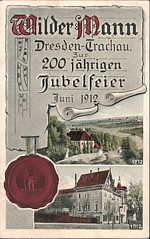
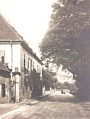
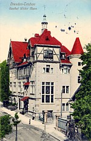
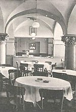
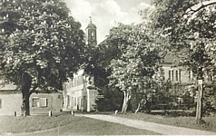
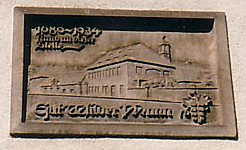
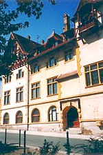
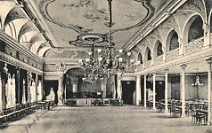
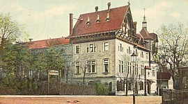
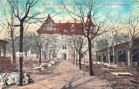

* * *

**Jubiläumspostkarte von 1912**

**Altes Weingut**

**Gasthaus-Neubau um 1900**

**Gaststube**

Das Weingut Wilder Mann entstand um 1680 an den Hängen der Hellerberge und verdankt seinen Namen vermutlich einem so benannten Weinberg. Der Sage nach soll das Areal nach Ende des Dreißigjährigen Krieges vom Kurfürsten an einen Einsiedler verschenkt worden sein, nachdem dieser dem Landesherren bei einem Raubüberfall das Leben gerettet hatte. An das Ereignis erinnerte seit 1710 ein Wirtshauszeichen über dem Eingang des Gaststättengebäudes.

Erster nachgewiesener Besitzer war der Dresdner Bürgermeister Philipp Strobel (1643-1702). Sein Schwiegersohn Lüder Hildebrand war Generaladjutant August des Starken. Ihm gelang es, das Gut erheblich zu vergrößern und am 18. Juni 1722 zu einem schriftsässigen Vorwerk erklären zu lassen. Das Freigut unterstand damit unmittelbar dem Landesherren, besaß die Ober- und Erbgerichtsbarkeit und bildete bis zur Eingemeindung Trachenberges 1897 einen eigenen Gutsbezirk. Nach Hildebrands Tod wechselten in kurzer Folge die Besitzer, unter denen bemerkenswert viele Frauen waren: Henriette von Benckendorff, Frau Obrist-Leutnantin von Leipziger, Frau Bergrätin Starke und Johanna Rosine von Zittwitz.

Bereits um 1690 existierte am Wilden Mann ein einfacher Bierschank mit dem bereits erwähnten Wirtshauszeichen über der Tür. 1773 wurde der Schankbetrieb von der Gutswirtschaft getrennt und in einen Neubau am Anstieg der Großenhainer Straße verlegt. Das Weingut selbst bestand bis 1883 an der Döbelner Straße. Nach dem von der Reblaus erzwungenen Ende des Weinbaus diente es noch bis 1934 als Wohnhaus und wurde dann wegen Baufälligkeit abgerissen. Auch die zuletzt leer stehenden Nebengebäude und Begrenzungsmauern fielen dem Abbruch zum Opfer, nachdem eine geplante gewerbliche Nutzung an behördlichen Auflagen und dem schlechten Bauzustand gescheitert war. Heute erinnert eine Gedenktafel am Nachfolgebau Döbelner Straße 110 an dieses Gut _(Foto rechts)_.

Die Gaststätte an der Döbelner Straße 130 hingegen blieb auch nach Einstellung des Gutsbetriebes bestehen. Gegen Ende des 19. Jahrhunderts wurden die Gebäude umgebaut und 1892/93 um einen Saal mit Gartenterrasse erweitert. Fortan firmierte das Lokal, ab 1893 unter dem Besitzer Gustav Emil Weber, ab 1898 von Gustav Opitz als "Concert- u. Ball-Etablissement Wilder Mann". Die Besitzer machten den “Wilden Mann” zu einem beliebten Ausflugsziel am nordwestlichen Stadtrand. Seit 1881 fuhr die Straßenbahn bis unmittelbar vor das Haus. Das bis heute erhaltenen Gaststättengebäude war während des Zweiten Weltkriegs Reserve-Lazarett, nach 1945 zeitweise Kreisparteischule der SED und ab 1969 viele Jahre lang Fernsehstudio des Senders Dresden. Nach Auszug des MDR 1999 stand der Bau einige Jahre leer und wurde 2007 zum Wohn- und Bürohaus umgebaut. An Stelle abgerissener Nebengebäude aus DDR-Zeiten entstand ein Supermarkt.

**_Fotos:_** _Der ehemalige Gasthof Wilder Mann auf einer historischen Postkarte_

Kleingartenverein “Wilder Mann”:

Die Kleingartenanlage wurde 1923 auf dem Areal des früheren Weingutes Wilder Mann angelegt und nutzte die bereits vorhandenen Terrassen oberhalb der heutigen Weinbergstraße. Auch ein ehemaliges Winzerhäuschen wurde in die Gestaltung einbezogen und vor diesem ein Festplatz für öffentliche Veranstaltungen angelegt. 1926 begann die Erweiterung der Sparte auf die Fläche unterhalb des Mittelweges, so das die Gesamtzahl der Parzellen auf ca. 100 anstieg. 1938 mussten 38 Gärten der Kleingartenanlage dem Bau einer Kaserne weichen. Diesem Bau fielen auch der Festplatz und das Winzerhaus zum Opfer. Heute gehören 60 Gärten zur Anlage. Außerdem gibt es hier die zugleich als Vereinsheim genutzte öffentliche Gaststätte “Weinbergbaude Kleiner Luisenhof”.

* * *

 \[ [Home](../../../index.html)\] \[ [Nord](../../../nord/)\] \[ [Nordwest](../../../nordwest/)\] \[ [Neustadt](../../../neustadt/)\] \[ [Nordost](../../../nordost/)\] \[ [West](../../../west/)\] \[ [Zentrum](../../../zentrum/)\] \[ [Südwest](../../../sudwest/)\] \[ [Süd](../../../sud/)\] \[ [Südost](../../../sudost/)\] \[ [Ost](../../../ost/)\] \[ [Register](../../../Register/register.html)\] \[ [Kontakt](../../../Kontakt/kontakt.html)\] \[ [Impressum](../../../impressum/)\]
