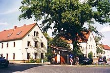
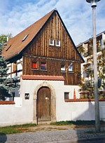
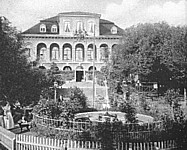
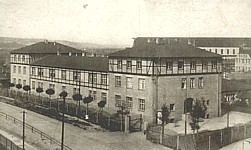
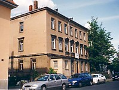
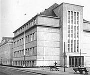
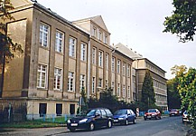
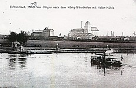
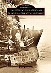

* * *

**Gemeindesiegel von Übigau**

**Sonntagsspaziergang zwischen**

**Mickten und Übigau**

**Stadtteilführungen jeden letzten Sonntag im Monat**

**Treffpunkt: 10.30 Uhr an der “Lindenschänke”**

**(Dauer ca. 120 Min.)**

**Preis: 7,00 EURO**

**(inkl. Kaffee & Brez´n)**

**Tel. 0351/859 95 77**

**Übigauer Geschichten**

**Vortragsreihe zur Geschichte Übigaus und seiner Umgebung**

**Termine unter:** [**www.pressebuero-naumann.de**](http://www.pressebuero-naumann.de)

* * *

**Übigauer Stadtteilseiten:**

Die Fluren des heutigen Stadtteils Übigau waren bereits in der Bronzezeit besiedelt und gehören zu den ältesten nachgewiesenen Siedlungen im oberen Elbtal. Bei mehreren Ausgrabungen wurden seit dem 19. Jahrhundert verschiedene Gräberfelder freigelegt, auf denen man Keramikscherben und andere Siedlungsfunde entdeckte. 1994 wurde bei einer größeren archäologischen Untersuchung an der Werftstraße ein Gräberfeld aus der Zeit um 1400 v. Chr. gefunden.

Der Ort Übigau entstand als slawisches Sackgassendorf auf einer hochwasserfreien Erhebung am Elbufer und wurde 1324 erstmals als Vbegowe urkundlich erwähnt. Der Name ist vermutlich vom altsorbischen ubeg = Flucht abgeleitet, da die Bewohner bei Hochwasser nach hier flüchten konnten. Im Mittelalter gehörte das Dorf mit sechs Gehöften und einer Fischfangstelle in der Elbe dem Domstift Meißen, welches die Einkünfte aus seinem Besitz der Stiftsbaumeisterei überließ. Bis 1559 unterstand der Ort dem Amt Stolpen, danach dem kurfürstlichen Amt Dresden, welches 1732 durch Tausch auch die Grundherrschaft erwarb. An der Flurgrenze verlief einst der wichtige Bischofsweg von Meißen nach Stolpen, der bei Übigau die Elbe durchquerte. Die Anwesen Rethelstraße 17 und 19 wurden deshalb auch als “Bischofsgüter” bezeichnet. Im 16. Jahrhundert kamen Teile der Flur des wüst gewordenen Dörfchens [Bortzschen](../../nordwest/ubigau/bortzschen/) zu Übigau. Neben Landwirtschaft und Elbfischerei betrieben die Einwohner einst auch umfangreichen Weinbau in der nahen Lößnitz. Sogar die kurfürstliche Kellerei bezog gelegentlich Wein von Übigauer Bauern.

Wegen seiner romantischen Lage im Elbbogen wurde Übigau 1725 vom kurfürstlichen Minister Graf Jakob Heinrich von Flemming zum Standort eines [Lustschlosses](../../nordwest/ubigau/schloss_ubigau/) gewählt, _(Foto)_ welches viele Jahre im kurfürstlichen Besitz blieb und als “Gegenstück” zum Schloss Pillnitz Schauplatz für verschiedene Festlichkeiten war. 1831 wurde dieses Schloss vom Amtszimmermeister Paul Siemen erworben und 1836 in ein Verwaltungsgebäude einer Maschinenfabrik umgewandelt. In den angeschlossenen Räumlichkeiten entstanden 1837 Teile des ersten sächsischen Elbdampfers und 1839 die erste deutsche Lokomotive “Saxonia” nach Plänen von Andreas Schubert. Diese Maschinenbauanstalt war Ausgangspunkt der Industrialisierung in Übigau. Nachfolger dieser Firma wurde 1877 die [Übigauer Schiffswerft](../../nordwest/ubigau/schloss_ubigau/schiffswerft_ubigau/), an die noch ein alter Kran als technisches Denkmal am Elbufer erinnert. Unweit davon befand sich einst die Anlegestelle der “Weißen Flotte” sowie der 1930 eingestellten Übigauer Fähre, deren Geschichte bis ins Jahr 1698 zurückreichte.

In den Folgejahren entwickelten sich Übigau und seine Nachbargemeinden zu Arbeiterwohnvororten Dresdens. Bedeutendstes Unternehmen war die Elektrotechnikfirma [Koch & Sterzel](../../nordwest/ubigau/strassen_ubigau/koch___sterzel/), die unter dem Namen VEB Transformatoren- und Röntgenwerk bis 1990 größter Arbeitgeber der Stadt war. Am 1. Januar 1903 kam Übigau gemeinsam mit seinen Nachbarorten Kaditz und Mickten als Stadtteil zu Dresden. 1913 erhielt der Orterstmals Straßenbahnanschluss, wobei die alte Strecke ursprünglich über die Böcklinstraße bis zur Endstelle an der Sternstraße führte. Erst 1928 wurden die Gleise über die neue Flutrinnenbrücke verlegt. 1967 entstand schließlich die bis zum Hochwasser 2002 genutzte Gleisschleife an der Washingtonstraße. Heute verbinden Buslinien den Stadtteil mit seinen Nachbarorten.

Infolge der späteren gewerblichen Nutzung sind vom ehemaligen Dorfkern nur noch Reste erhalten. Einige historische Gebäude stehen noch in Altübigau, an der Rethel- und der Kaditzer Straße. Ein Teil des Dorfkerns mit vier Gütern fiel am 2. März 1945 einem Luftangriff zum Opfer. In der Nähe entstanden 1964/65 neue Wohnblocks an der Mengs-, 1979/80 auch an der Rethel- und Werftstraße. An den verbliebenen Gehöften erinnern Schlusssteine von 1720 (Altübigau Nr. 8) und 1693 (Rethelstraße 28) an die dörfliche Vergangenheit Übigaus. 1994 wurde an der Carrierastraße mit dem Bau des neuen Stadtteilzentrums “Elbarkaden” begonnen.

Von Bedeutung war Übigau viele Jahrzehnte auch als Garnisonsstandort. An der Elbe entstand im 19. Jahrhundert eine Pionierkaserne, die seit 1879 nur noch als Wohnhaus genutzt und 1989 abgerissen wurde _(Foto rechts)_. 1870/71 befand sich auf Übigauer Flur ein Kriegsgefangenenlager für französische Soldaten. In den notdürftig zusammengezimmerten Baracken am Elbufer waren zeitweise ca. 16.000 Soldaten und Offiziere untergebracht. Für die Verpflegung sorgten die Bauern der umliegenden Dörfer. An die 116 im Lager an Kriegsverletzungen oder Krankheiten verstorbenen Franzosen erinnert ein Denkmal auf dem [Kaditzer Friedhof](../../nordwest/kaditz/emmauskirche/).

Kurz vor dem Ersten Weltkrieg errichtete man in unmittelbarer Nachbarschaft des [Kaditzer Flugplatzes](../../nordwest/kaditz/flugplatz_kaditz/) an der Washingtonstraße eine [Luftschifferkaserne](../../nordwest/ubigau/strassen_ubigau/washingtonstrasse/). Die später Hindenburgkaserne genannte Einrichtung wurde zunächst vom Telegraphen-Bataillon Nr. 7, danach bis 1945 von Nachrichteneinheiten der Reichswehr bzw. der Wehrmacht belegt. Die Gebäude dienten dann zwischen 1945 und 1991 der Sowjetarmee und standen dann leer. 1997 begann eine schrittweise Umgestaltung des Areals, auf dem u. a. eine neue Dresdner Feuerwache entstand. Da sich für die verbliebenen Kasernenbauten kein Investor fand, wurden diese 2002 von der Denkmalliste gestrichen und 2004 zum Großteil abgerissen.

Postwesen in Übigau:

Die postalische Versorgung des Dorfes oblag ursprünglich der Königlich-Sächsischen Postanstalt Stadt Neudorf, die ihren Sitz in der Nähe der Leipziger Straße hatte. Auch nach Übernahme der Posthoheit durch die Reichspost 1868 änderte sich daran zunächst noch nichts. Allerdings wuchs mit zunehmender Industrialisierung in den Orten Mickten und Übigau der Wunsch nach einer eigenen Postdienststelle.

Am 1. Mai 1896 eröffnete deshalb im Haus des Kaufmanns Hermann Hugo Schäfer, Dorfstraße 2 eine gemeinsame Postagentur für Übigau und Mickten. Nach der Eingemeindung als Dresden N 31 bezeichnet, wurde sie 1907 auf die Rethelstraße 13 und 1915 zur Kaditzer Straße 30 _(Foto)_ verlegt. Im Zuge der Neugliederung der Postbezirke schloss dieses Postamt am 30. September 1991. Seit 2012 werden die Dienstleistungen von einer Postagentur auf der Carrierastraße 7 übernommen.

Schulen in Übigau:

 Übigau bildete ursprünglich mit Kaditz und Mickten einen gemeinsamen Schulbezirk. Erst 1896 erbaute die damals noch selbständige Gemeinde ein eigenes Schulhaus an der Thäterstraße 9. Am 30. Juli erfolgte der erste Spatenstich, am 15. August des gleichen Jahres die Grundsteinlegung. Bereits im Folgejahr die wurde vom Baumeister Gustav Richard Martin ausgeführte neue Schule am 20. April 1897 durch den Königlichen Bezirksschulrat Fink und Oberschulinspektor Schreckenbach eingeweiht. Die Kosten in Höhe von ca. 80.000 Mark wurden von der Gemeinde getragen. Zwei Jahre später folgte noch ein kleiner Anbau und eine am 2. September 1899 eingeweihte Turnhalle _(Foto um 1926)_. Diese Schule, nach der Eingemeindung Übigaus als 42. Volksschule ins Dresdner Schulnetz eingegliedert, wurde 1928 deutlich erweitert und erhielt dabei ihr heutiges Aussehen _(Foto rechts)_. Der am 17. Oktober 1928 eingeweihte Neubau war seinerzeit einer der modernsten in Sachsen und zugleich erster Schulneubau in Dresden nach dem Ersten Weltkrieg.

Während des Zweiten Weltkrieges diente das Gebäude ab Juli 1944 zeitweise als Lazarett der Wehrmacht, später auch als Flüchtlingsunterkunft. Am 2. März 1945 beschädigten Bomben das Schulgebäude und zerstörten die bereits im Februar schwer getroffene Turnhalle völlig. Nach notdürftiger Reparatur konnte im Oktober der Schulbetrieb wieder aufgenommen werden. Erst 1973 entstand ein Ersatzbau für die zerstörte Turnhalle.

Als eine der ersten Schulen in Dresden führte die Übigauer Schule 1955 den erweiterten Russischunterricht für interessierte Mädchen und Jungen ein. 1970 erhielt sie nach einem 1944 von den Nationalsozialisten hingerichteten Dresdner Antifaschisten den Namen 42. POS “Herbert Blochwitz”. In diesem Zusammenhang wurde ein Gedenkstein auf dem Schulhof aufgestellt. 1986 erfolgten umfassende Rekonstruktions- und Sanierungsarbeiten im Schulhaus. Seit 1992 wurde sie als 42. Grundschule genutzt und trotz heftiger Elternproteste im August 2000 auf Beschluss des Stadtrates geschlossen. Die verbliebenen ca. 90 Schüler kamen daraufhin in die 41. Grundschule an der Hauptmannstraße in Mickten. Das Gebäude stand im Anschluss einige Jahre leer, diente während der Hochwasserkatastrophe 2002 als Zwischenlager für Sachspenden und wurde 2011/12 für Wohnzwecke umgebaut.

Elbfähre:

Die Geschichte der Übigauer Elbfähre reicht bis ins Jahr 1698 zurück. Die zunächst vermutlich nur bei Bedarf verkehrende Kahnfähre wurde Mitte des 18. Jahrhunderts in ein gewerbliches Unternehmen umgewandelt und befand sich damals im Besitz der Schlossherrschaft. Nutzer waren vor allem die Besucher der im Schloß befindlichen Gastwirtschaft. 1783 wurde die Fährgerechtigkeit an einen Übigauer Grundstücksbesitzer weiter verkauft. Im 19. Jahrhundert teilten sich vier Einwohner die Einnahmen, bevor der von Andreas Schubert gegründete Aktien- und Maschinenbau-Verein die Fähre erwarb. 1866 ging sie schließlich in den Besitz der Gemeinde über und wurde an wechselnde Betreiber verpachtet. Wirtschaftliche Gründe führten 1930 zur Einstellung des Betriebes. Das Foto zeigt die frühere Fähre auf ihrer Fahrt in Richtung [Ostragehege](../../zentrum/friedrichstadt/ostragehege/), im Hintergrund die Hafenmühle.

[_Weiterführende Literatur und Quellen_](../../impressum/quellenverzeichnis/)

**Buchtipp: Jürgen Naumann “Ein historischer Spaziergang zwischen Alt-Mickten und Übigau”, Sutton Verlag Erfurt (ISBN 978-3-86680-703-7)**

Der Bildband zeigt zahlreiche historische Aufnahmen der beiden Stadtteile aus
dem 19. und 20. Jahrhundert und wurde von Jürgen Naumann verfasst. Texte mit historischen Hintergründen ergänzen die Bilder. Interessierte können das Buch für 17,90 Euro im Buchhandel erwerben.

 \[ [Home](../../index.html)\] \[ [Nord](../../nord/)\] \[ [Nordwest](../../nordwest/)\] \[ [Neustadt](../../neustadt/)\] \[ [Nordost](../../nordost/)\] \[ [West](../../west/)\] \[ [Zentrum](../../zentrum/)\] \[ [Südwest](../../sudwest/)\] \[ [Süd](../../sud/)\]
 \[ [Südost](../../sudost/)\] \[ [Ost](../../ost/)\] \[ [Register](../../Register/register.html)\] \[ [Kontakt](../../Kontakt/kontakt.html)\] \[ [Impressum](../../impressum/)\]
