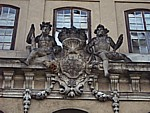
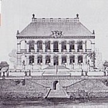
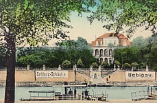

* * *

* * *

* * *

* * *

* * *

* * *

**Wappenkartusche an der Gartenseite**

* * *

Schloss Übigau wurde 1724-26 durch Johann Friedrich Eosander (von Göthe) als
Lustschloss für den sächsischen Kabinettsminister Jakob Heinrich Reichsgraf von Flemming errichtet. Der Barockbau entstand auf vier ehemaligen bäuerlichen
Weinbergsgrundstücken unmittelbar am Elbufer und sollte mit seiner Gondelanlegestelle “Gegenstück” des Wasserschlosses Pillnitz sein. Zudem bildete er
den optischen Abschluss einer Allee, die vom Residenzschloss zum Ostragehege führte und heute noch in Fragmenten erhalten ist.

Das wesentlich kleinere Übigauer Schlösschen besteht aus einem zweigeschossigen
Hauptgebäude mit neun Fensterachsen und offener Bogenhalle, über der eine Figurengruppe mit dem sächsisch-polnischen Wappen angebracht ist. Ursprünglich plante Eosander noch zwei Seitenflügel, die jedoch nicht
realisiert wurden. Vom Schloss führt auf der Elbseite eine Freitreppe in einen kleinen französischen Park und bis ans
Elbufer. Einst gehörten zu diesem Park zwei Torhäuser, vier Pavillons, eine Orangerie und verschiedene Wasserspiele, die
jedoch der späteren industriellen Nutzung des Geländes zum Opfer fielen. Von den einst zahlreich vorhandenen Figurengruppen und Schmuckvasen sind heute nur noch wenige erhalten geblieben.

1726 kam Schloss Übigau noch vor einer vollständigen Vollendung in den Besitz der
Wettiner und war gelegentlich Schauplatz für prunkvolle Hoffeste. So feierte am 28. August 1727 Kaiserin Elisabeth, Gemahlin Karl VI., ihren Geburtstag in Übigau. Ein Jahr
später war Preußenkönig Friedrich I. zu Besuch. Zwischen 1733 und 1736 besaß Graf Alexander Joseph von Sulkowski, neben Brühl einer der engsten Vertrauten des
Kurfürsten Friedrich August II., das Schloss, welches er als Anerkennung für seine langjährigen Dienste geschenkt bekommen hatte. Später nutzten vor allem die Söhne des
Kurfürsten das Lustschlösschen als Jagdaufenthalt. 1753 fand in Übigau ein großes militärisches Lustlager mit Truppenparade und verschiedenen Manöverübungen statt. Ende
des 18. Jahrhunderts verloren jedoch die Wettiner das Interesse an ihrem Besitz, so dass das Schloss meist ungenutzt leer stand. Der letzte Besuch eines Mitglieds des Hofes ist für 1770 verbürgt. Stattdessen
richteten die Hofgärtner 1783 eine kleine von den Bewohnern der umliegenden Orte gern besuchte Schankwirtschaft ein.
1813 plünderten napoleonische Soldaten das Anwesen und zerstörten den größten Teil der Inneneinrichtung.

1831 erwarb der Dresdner Ratszimmermeister Paul Siemen im Rahmen einer Versteigerung das verfallende Schloss und baute es um. Im früheren Park
entstanden die Produktionsstätten der Übigauer Maschinenbauanstalt, die 1836 als “Dresdner Actien-Maschinenbau-Verein” gegründet wurde. 1837 wurde hier
nach Plänen von Andreas Schubert das erste sächsische Personendampfschiff “Königin Maria” vollendet und zwei Jahre später die erste deutsche Lokomotive “Saxonia”gebaut. Das Schloss selbst beherbergte neben Büros und
Konstruktionsräumen im Obergeschoss auch die Wohnung Schuberts. Aufgrund der verkehrstechnisch ungünstigen Lage und der fehlenden Schienenanbindung
konzentrierte sich die Firma später auf den Bau von Dampfschiffen und -kesseln, ging jedoch 1845 ein. Nachdem
zwischenzeitlich eine Dampfmühle, eine Essig-, eine Branntwein- und eine Papierfabrik bestanden, erwarb 1877 die Elbeschiffahrtsgesellschaft “Kette” das Gelände und nutzte es als [Schiffswerft](../../../nordwest/ubigau/schloss_ubigau/schiffswerft_ubigau/), woran ein noch erhaltener Drehkran von
1898 am Elbufer erinnert. Das Unternehmen war um 1910 größte Binnenwerft Europas mit über 1200 Mitarbeitern. Schloss Übigau selbst diente ab 1854 als Wohnhaus der Familie von Oppen, nach dem Ersten Weltkrieg als
Verwaltungsgebäude der Werft. Zwischen 1886 und 1916 existierte hier die Gaststätte “Schloßschänke Übigau”.

Die Übigauer Werft bestand bis 1930 und wurde dann in Folge der Weltwirtschaftskrise stillgelegt. Das zum Abbruch vorgesehene Schloss pachtete
daraufhin die KPD und nutzte es bis 1933 als Vereinsheim des “Zentralvereins für Arbeitersport Dresden 1885 e. V.” Nach Besetzung und Enteignung durch die neuen
nationalsozialistischen Machthaber diente es zeitweise als Wohnhaus der Werftbesitzerfamilie Birke, die zu besonderen Anlässen im Park Bälle und ähnliche
Veranstaltungen durchführte. 1945 zog die Verwaltung des VEB Dampfkesselbau Dresden-Übigau in das Schloss. Bis 1990 nutzte das Unternehmen das historische
Gebäude. Nachdem 1993 der Verkauf an einen Investor scheiterte, der im Schloss Künstlerateliers einrichten wollte, steht Schloss Übigau heute leer. Seit einigen Jahren befindet es sich in Privatbesitz. Im
Garten wurde 2008 eine kleine Sommerwirtschaft eröffnet. Eine Sanierung des historischen Gebäudes ist geplant.

Video: Eröffnung der Sommerwirtschaft Schloss Übigau am 8. Mai 2008

* * *

 \[ [Home](../../../index.html)\] \[ [Nord](../../../nord/)\] \[ [Nordwest](../../../nordwest/)\] \[ [Neustadt](../../../neustadt/)\] \[ [Nordost](../../../nordost/)\] \[ [West](../../../west/)\] \[ [Zentrum](../../../zentrum/)\] \[ [Südwest](../../../sudwest/)\] \[ [Süd](../../../sud/)\] \[ [Südost](../../../sudost/)\] \[ [Ost](../../../ost/)\] \[ [Register](../../../Register/register.html)\] \[ [Kontakt](../../../Kontakt/kontakt.html)\] \[ [Impressum](../../../impressum/)\]
