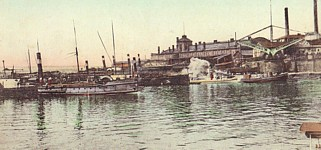
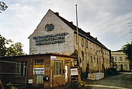
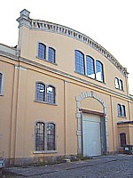
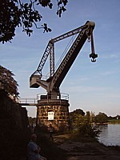

* * *

* * *

**Das erste Elbedampfschiff**

**"Königin Maria"**

**vor dem Übigauer Schloss 1836**

Die Übigauer Schiffswerft entstand 1873 auf dem Gelände der ehemaligen Maschinenbauanstalt Schuberts und befand sich zunächst im Besitz der Dresdner Frachtschiffahrts-Gesellschaft, die hier hölzerne Kähne baute. Im Januar 1878 erwarb die von Ewald Bellingrath gegründete Dresdner Schifffahrtsgesellschaft “Kette” das Areal mit der bestehenden Schiffsbauerei und spezialisierte sich auf den Bau von Binnenschiffen und Dampfkesselanlagen. 1885 entstand dafür nach Plänen des Ingenieurs Otto Intze ein elf Meter hohe Maschinenbauhalle mit ca. 60 Metern Länge. Das im gleichen Jahr erworbene [Schloss](../../../../nordwest/ubigau/schloss_ubigau/) diente als Verwaltung des Betriebes.

Bereits 1863 war in Dresden-Neustadt eine weitere Werft gegründet worden, die sich im Besitz der Familie Schlick befand und 1899 in eine Aktiengesellschaft umgewandelt wurde. Da in Übigau mehr Platz für den Bau der größer gewordenen Schiffe war, siedelte diese Firma nach Übigau um und vereinigte sich 1905 mit dem bestehenden Unternehmen zur Dresdner Maschinenfabrik und Schiffswerft Übigau AG. In diesem Zusammenhang entstanden zahlreiche neue Gebäude und Hallen sowie eine moderne Slipanlage. So wurde 1885/86 die große Maschinenbauhalle, 1895 die Kesselschmiede und 1902 ein neues Kessel- und Maschinenhaus errichtet.

**_Foto:_** _Die Übigauer Werft um die Jahrhundertwende,_

_ganz rechts der bis heute noch erhaltene historische Drehkran_

In Übigau wurden neben Rad- und Schraubenschleppern, Frachtkähnen und sonstigen Schiffen auch Kesselanlagen und verschiedene Bagger hergestellt. Auch die technischen Einrichtungen der meisten Elbdampfer stammen aus Übigau und wurden in Laubegast in die dort gebauten Schiffskörper eingesetzt. Bis 1910 wuchs das Unternehmen auf ca. 1.200 Beschäftigte. 1921 arbeiteten bereits 1.500 Arbeiter und Angestellte im Betrieb, der zu diesem Zeitpunkt größte Binnenschiffswerft Europas war. 1924 erwarb die Waggon- und Maschinenbau AG Görlitz die Übigauer Werft. In Folge der Weltwirtschaftskrise geriet das Unternehmen jedoch in wirtschaftliche Schwierigkeiten und wurde 1930 stillgelegt.

 Zu den für die damalige Zeit ungewöhnlichen Neuerungen gehörte die in Übigau praktizierte enge Zusammenarbeit zwischen der Werft und der Technischen Hochschule. Auf Anregung des TH-Professors Hubert Engels, Inhaber des Lehrstuhls für Wasserbau, richtete man 1892 auf dem Werftareal eine “Anstalt zur Prüfung von Schiffswiderständen und hydrometrischen Instrumenten” ein. Hier konnten in einer Versuchsanlage mit einem eigens errichteten Wasserbecken technische Neuerungen im Schiffs- und Wasserbau praktisch erprobt werden _(Foto)_. Generaldirektor Ewald Bellingrath ermöglichte zudem TH-Professor Gustav Zeuner, seinen Turbinenpropeller mit Kontraktor praktisch auszuführen und in einem Versuchsschiff testen zu lassen. Die wissenschaftlich-technische Zusammenarbeit der Werft endete erst mit deren Schließung 1930.

1935 entschlossen sich drei ehemalige Ingenieure zur Übernahme eines Teils der Werft und gründeten die “Übigau-AG Schiffswerft, Maschinen- und Kesselfabrik”, welche bis zum Ende des Zweiten Weltkriegs hier Motoren, Bagger und Schiffe herstellte. Zugleich richteten die Gebrüder Birke auf dem verbliebenen Restgrundstück eine Fabrik zum Bau von Dampfkesseln ein, so dass nun zwei Nachfolgebetriebe existierten. Während des Zweiten Weltkrieges wurden hier u.a. U-Boot-Teile für Hitlers Marine hergestellt.

Zwei Luftangriffe am 16. Januar und 2. März 1945 richteten große Schäden im Betriebsgelände an. Beide kriegswichtige Unternehmen fielen 1946/47 unter die Enteignungsverfügungen und wurde zum VEB Schiffswerft bzw. zum VEB Dampfkesselbau Dresden-Übigau. Hergestellt wurden u.a. Frachtschiffe für die sowjetische Binnenschifffahrt, Motorgüterschiffe, Schwimmkräne und Pontons. Auch der erste in der DDR gebaute Eisbrecher entstand in Übigau. 1958 wurde die Werft geschlossen und nach Laubegast bzw. Boitzenburg verlegt. Fortan nutzten der [VEB TuR](../../../../nordwest/ubigau/strassen_ubigau/koch___sterzel/) (Transformatoren- und Röntgenwerk) sowie der weiter bestehende VEB Dampfkesselbau die Flächen. Bis 1989 befand sich im Übigauer Schloss die Verwaltung des Betriebes. Das Bild rechts zeigt den Eingang zum Betriebsgelände mit einer bis heute erhaltenen Leuchtwerbung.

Die Firma wurde 1990 privatisiert und von der TTU aus Ulm übernommen. In Folge wurden hier in Einzelfertigung komplette Kesselanlagen sowie Zubehörteile für den Schiffsbau produziert und an verschiedene Unternehmen im In- und Ausland geliefert. 1998 musste die Firma jedoch unter Zwangsverwaltung gestellt werden und ging 2001 in Insolvenz. Heute haben auf dem früheren Werftgelände die HSI Turbinenstahlbau Dresden-Übigau GmbH und mehrere Kleinbetriebe ihren Sitz. Am Elbufer erinnert ein alter Drehkran von 1891 an die Geschichte der Übigauer Werft.

Der historische Drehkran _(Foto)_ wurde von den Eisenwerken Hamburg errichtet und geht auf das System des britischen Maschinenbauers William Fairbairn zurück. Der auf einem Sandsteinsockel stehende Kran diente der Umsetzung schwerer Großteile und wurde zunächst von Hand, ab 1904 von einem Elektromotor mit Hilfe einer Kette angetrieben. Mit dem 14 Meter langen Lastenausleger konnten Lasten bis zu 30 Tonnen gehoben werden. Hauptsächlich wurde er zum Einbau der schweren Dampfkessel und Schiffsmaschinen genutzt. Die Gesamthöhe des Krans beträgt ca. 18 Meter. Obwohl der Kran wegen fehlendem Antrieb heute nicht mehr funktionstüchtig ist, steht er als bedeutendes Zeugnis der Industriegeschichte seit 1982 unter Denkmalschutz und wurde 2005 vom Sächsischen Umschulungs- und Fortbildungswerk restauriert.

* * *

 \[ [Home](../../../../index.html)\] \[ [Nord](../../../../nord/)\] \[ [Nordwest](../../../../nordwest/)\] \[ [Neustadt](../../../../neustadt/)\] \[ [Nordost](../../../../nordost/)\] \[ [West](../../../../west/)\] \[ [Zentrum](../../../../zentrum/)\] \[ [Südwest](../../../../sudwest/)\] \[ [Süd](../../../../sud/)\] \[ [Südost](../../../../sudost/)\] \[ [Ost](../../../../ost/)\] \[ [Register](../../../../Register/register.html)\] \[ [Kontakt](../../../../Kontakt/kontakt.html)\] \[ [Impressum](../../../../impressum/)\]
