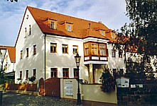
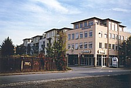
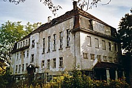
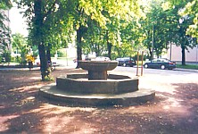
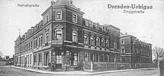
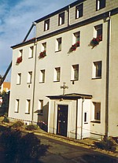
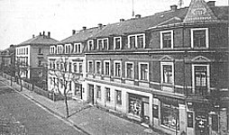

* * *

Der alte Dorfkern des Ortes hieß bis zur Eingemeindung 1903 “die Tränke”, da hier das Vieh zum Elbufer getrieben wurde.
Angelegt wurde der Ort auf einer acht Meter über der Elbe gelegenen hochwasserfreien Erhebung. Zusätzlich entstand eine
noch heute erhaltene, aus mehreren Abschnitten bestehende 620 Meter lange Ufermauer. Diese geht in ihren Grundzügen bis ins 14. Jahrhundert zurück und steht seit 2001 unter Denkmalschutz.

Von den ehemals sechs Gehöften Altübigaus sind seit dem Luftangriff vom 2. März 1945 nur noch zwei erhalten geblieben.
Am Haus Altübigau Nr. 8  ist noch ein Schlussstein von 1720 zu sehen. Die auf dem Platz stehende Flatterulme wurde 1999
zum Naturdenkmal erklärt. In unmittelbarer Nachbarschaft erinnert eine Gedenksäule an das Elbehochwasser vom August 2002.

**_Fotos:_** _Dorfkern Altübigau mit Hochwassersäule._

Die Carrierastraße wurde 1997 im Zusammenhang mit dem Neubau des Stadtteilzentrums “Elbarkaden” angelegt. Ihren
Namen erhielt sie nach der italienischen Kunstmalerin Rosalba Carriera (1675-1757). Nach Eröffnung des Wohn- und Geschäftskomplexes befindet sich hier heute das eigentliche Zentrum Übigaus _(Foto)_.

Die Klingerstraße erinnert an den Maler und Bildhauer Max Klinger (1857-1920),
einen der wichtigsten Vertreter des kritischen Realismus in Deutschland. Bis 1945 hieß sie nach einem bekannten sächsischen Kampfflieger Immelmannstraße. Max
Immelmann wurde 1890 in Dresden geboren und besuchte hier die Kadettenanstalt und die Technische Hochschule. Während des Ersten Weltkrieges wurde er als “Adler von Lille” zum Volkshelden. 1916 kam Immelmann bei einem Flugunfall ums
Leben.

Im Zusammenhang mit dem Bau des [Kaditzer Luftschiffhafens](../../../nordwest/kaditz/flugplatz_kaditz/) wurde 1913 eine
Kaserne errichtet, die bis zum Ende des Ersten Weltkrieges vom Luftschiffer-Bataillon Nr. 2 genutzt wurde. Später waren
hier Nachrichtentruppen der Reichswehr und der Wehrmacht, nach 1945 Einheiten der sowjetischen Armee untergebracht. Nach mehrjährigem Leerstand wurden große Teile der Anlage 2005 abgerissen _(Foto)_
. Die verbliebenen Gebäiude sollen künftig zu einer Seniorenwohnanlage umgebaut werden. Die frühere Maschinenhalle wird vom Deutschen Roten Kreuz genutzt.

Die Marie-Curie-Straße im Übigauer Gewerbegebiet an der Scharfenberger Straße Straße erhielt ihren Namen 1995 nach der polnisch-französischen Chemikerin und Physikerin Marie Sklodowska-Curie (1867-1934). Marie Curie
gilt als eine der Begründerinnen der Radiochemie und entdeckte gemeinsam mit ihrem Mann Pierre das Element Polonium. Für ihre Forschungen erhielt sie 1911 den Nobelpreis.

Von 1899 bis zur Eingemeindung Übigaus 1903 wurde diese Straße nach dem
damals regierenden sächsischen König Albertstraße genannt. Da es diesen Namen jedoch in Dresden mehrfach gab, machte sich eine Umbenennung erforderlich. Ihren
heutigen Namen erhielt sie nach dem Maler und Kunsthistoriker Anton Raphael Mengs (1728-1779), der u.a. das Altargemälde der Hofkirche schuf. Ab 1745 war
er Hofmaler der sächsischen Kurfürsten und lebte ab 1760 in Spanien. Mengs gilt als Begründer des Klassizismus in der Malerei.

Die ersten Wohngebäude _(Foto)_ entstanden Ende des 19. Jahrhunderts als
Arbeiterwohnhäuser der Micktener und Übigauer Industrie. Oft befanden sich in den Erdgeschosszonen kleine Geschäfte und Gaststätten, u.a das frühere “Hansa-Café” im Eckhaus zur Kaditzer Straße und das Hotel “Fliegerheim” auf der
Mengsstraße 4. 1914 befand sich dieses im Besitz der Familie Rentzsch. Im Zusammenhang mit dem Schulbau an der Thäterstraße wurde ein kleiner Vorplatz mit Brunnen angelegt, welcher früher als Albertplatz, heute als Mengsplatz
bezeichnet wird. Neue Wohnhäuser folgten 1964/65 in Ergänzung der vorhandenen Bebauung für die Beschäftigten des Transformatoren- und Röntgenwerkes.

**_Foto:_** _Brunnenanlage am Mengsplatz_

__

Die Rauchstraße bildete früher die Ortsgrenze zwischen Mickten und Übigau und hieß deshalb bis 1903 Grenzstraße. Ihr
jetziger Name erinnert an den bekannten Bildhauer des Klassizismus Christian Daniel Rauch (1777-1857, der vor allem in Berlin tätig war und 1857 in Dresden verstarb.

Die Rethelstraße bildet neben Altübigau den alten Kern des Dorfes Übigau. Früher wurde die Straße “Triebe” genannt, da
hier der Weg des Viehs auf die Weiden entlangführte. Bis 1899 hieß sie Dorf-, danach Hauptstraße. Alfred Rethel (1816-1859) war ein wichtiger Vertreter der Historienmalerei des 19. Jahrhunderts und schuf u.a. die Fresken des
Aachener Rathauses. In den Wintermonaten hielt sich Rethel meist in Dresden auf, wo auch einige seiner Werke entstanden. 1904 erhielten die Hauptstraße in Übigau sowie die anschließende Bergstraße in Mickten seinen Namen.

**_Foto:_** _Blick in die Rethelstraße um 1920_

1945 wurden auch hier einige Gebäude zerstört bzw. beschädigt. Zu den Neubauten der Nachkriegszeit gehörte neben
Wohnhäusern das 1954 eröffnete Kulturhaus “Völkerfreundschaft” der Übigauer Werft. Mit deren Schließung wurde die Einrichtung dem Transformatoren- und Röntgenwerk übergeben und noch bis 1990 für verschiedene Veranstaltungen
genutzt. Am erhaltenen Gehöft Rethelstraße 28 erinnert zwei Steintafeln von 1692 und 1695 an die Vergangenheit des
Dorfes. Die Anwesen Rethelstraße Nr. 17 und 19 waren früher als “Bischofsgüter” bekannt. Die ehemalige Pionierkaserne am Elbufer, seit 1879 nur noch als Wohnhaus genutzt, wurde 1989 abgerissen.

Die Rethelstraße bildete einst das Geschäftszentrum Übigaus mit zahlreichen Läden und den
beiden Gasthöfen “Zur Kette” (Nr. 20 - 1945 zerstört) und “Gasthof Übigau” (Nr. 43). Das zeitweise auch als “Günthers Gasthof” bezeichnete Lokal besaß einen Ballsaal sowie einen
Biergarten am Elbufer und war kultureller Mittelpunkt des Ortes. Während des Zweiten Weltkrieges diente der Gasthof als Notquartier und wurde am 2. März 1945 zerstört. 1956
entstand an seiner Stelle durch Ausbau der Ruine die Kreuzkapelle Übigau als Gemeindehaus der Übigauer Christen _(Rethelstraße 43 - Foto)_. Anlass für die Namensgebung war ein über dem
Haupteingang angebrachtes Kreuz, welches sich ursprünglich auf dem Kaditzer Schulhaus befand. Nach deutlichem Rückgang der Zahl der Gemeindemitglieder wurde die Kreuzkapelle
1999 entwidmet und aufgegeben. Ihre Ausstattung befindet sich heute im [Micktener Gemeindehaus](../../../nordwest/mickten/kapelle_mickten/).

Die Schwindstraße wurde 1900 als Gartenstraße angelegt und 1903 nach dem romantischen Maler und Zeichner Moritz von
Schwind (1804-1871) benannt. Schwind schuf zahlreiche Zeichnungen und Gemälde mit Motiven aus der Märchen- und Sagenwelt. Auf ihn geht auch die Figur des Weihnachtsmannes mit weißem Bart, Rute und Geschenkesack zurück.

Die Tauberthstraße wurde 1996 im neuen Gewerbegebiet Übigau angelegt. Otto Volkmar Tauberth (1816-1871) war als Eisenbahn-Maschinenbauingenieur einer der engsten Mitarbeiter Andreas Schuberts und wirkte an der Übigauer
Maschinenbauanstalt. Tauberth wurde später Maschinenmeister der ersten deutschen Fernbahn und war zeitweise auch Vorsitzender des Dresdner Gewerbevereins.

Die Thäterstraße erhielt ihren Namen 1904 nach dem früheren Zeichenlehrer an der Dresdner Kunstakademie Julius Thäter
(1804-1870), der seine letzten Lebensjahre in München verbrachte. Zuvor hieß die Straße Schulstraße, da sich hier seit 1897 das Übigauer [Schulhaus](../../../nordwest/ubigau/) befand.

Die Werftstraße verdankt ihren Namen der 1877 hier gegründeten Übigauer [Schiffswerft](../../../nordwest/ubigau/schloss_ubigau/schiffswerft_ubigau/). Das Werftgelände nahm einen Teil des ehemaligen Schlossparks in
Anspruch und wurde zuletzt vom Dampfkesselbau Übigau und einigen kleineren Handwerksbetrieben genutzt. Vor der Eingemeindung wurde die Straße Schloßstraße (1899-1903) bzw. Eosanderstraße (nach dem Erbauer des
Übigauer Schlosses) genannt.  Johann Friedrich Eosander von Göthe (1670-1729) war ab 1699 Hofarchitekt Friedrich I. von Preußen und am Bau des Berliner Stadtschlosses sowie von Schloss Charlottenburg beteiligt. Seine
letzten Lebensjahre verbrachte er, im Dienste des sächsischen Kurfürsts stehend, in Dresden.

Das Straßenbild der 1946 umbenannten Werftstraße prägen heute vor allem gewerbliche Einrichtungen, aber auch einige
Wohn- und Geschäftshäuser. 1945 richteten die Bomben auch hier an mehreren Gebäudern große Schäden an. Im Wohnhaus Werftstraße 6 befand sich viele Jahre ein gemeinsam vom VEB Dampfkesselbau und dem Transformatoren- und
Röntgenwerk betriebener Kindergarten. Zuvor diente das Gebäude bis um 1950 als Gastwirtschaft.

Die Zinggstraße hieß vor der Eingemeindung bis 1903 Briesnitzer Straße. Ihren heutigen Namen erhielt sie 1903 nach dem
romantischen Maler Adrian Zingg (1734-1816), der von 1766 bis zu seinem Tod Zeichenlehrer an der Kunstakademie war. Gemeinsam mit seinem Künstlerfreund Anton Graff gilt Zingg als künstlerischer “Entdecker” der Sächsischen Schweiz.

Am Ende der Zinggstraße gab es bis um 1940 eine Dampferanlegestelle der Weißen Flotte. Unweit davon verband einst
eine Fähre den Stadtteil mit dem Ostragehege, welche jedoch durch den Bau der Flügelwegbrücke überflüssig wurde. An
Stelle der früheren Orangerie des Schlosses entstand 1835 eine bis 1879 genutzte Pionierkaserne der sächsischen Armee. Nach deren Verlegung in die Albertstadt wurde das 1989 abgerissene Gebäude als Wohnhaus genutzt.

[Übigau auf OpenStreetMap](https://www.openstreetmap.org/search?query=Dresden+%C3%9Cbigau)

* * *

 \[ [Home](../../../index.html)\] \[ [Nord](../../../nord/)\] \[ [Nordwest](../../../nordwest/)\] \[ [Neustadt](../../../neustadt/)\] \[ [Nordost](../../../nordost/)\] \[ [West](../../../west/)\] \[ [Zentrum](../../../zentrum/)\] \[ [Südwest](../../../sudwest/)\] \[ [Süd](../../../sud/)\] \[ [Südost](../../../sudost/)\] \[ [Ost](../../../ost/)\] \[ [Register](../../../Register/register.html)\] \[ [Kontakt](../../../Kontakt/kontakt.html)\] \[ [Impressum](../../../impressum/)\]
